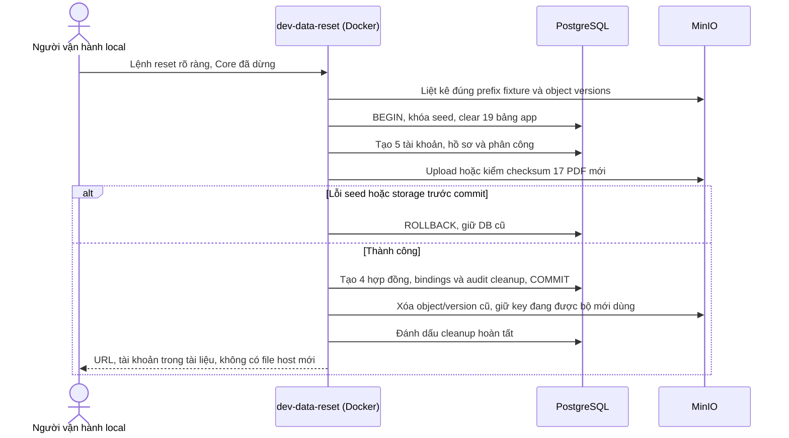
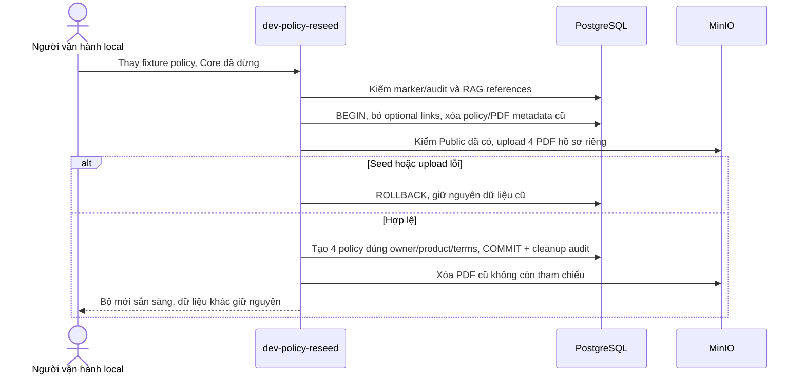

# Life Insurance AI Assistant — Hướng dẫn chạy dự án

Hướng dẫn dùng chung cho thành viên clone repo. Chạy các lệnh tại thư mục gốc có `compose.yaml`. Ví dụ dùng PowerShell trên Windows; cổng bên dưới là mặc định.

Cập nhật 05/11/2026: **FE/BE chỉ chạy bằng Docker Compose**, cùng PostgreSQL/pgvector, Nginx, DbGate và MinIO private. Đã có tài khoản/hồ sơ Staff, Customers, Policy Lookup/PDF, Products/PDF và Inbox chat hai đầu I01–I06 với consent/Accept/realtime/handoff notifications. Ticket read/Accept/UI và notification/realtime TK01–TK05 đã có; Customer Home/Products/Policies/PDF/chat shell đã có; nguồn tạo/xác nhận Ticket I07 và Copilot/Agent còn phần triển khai/nghiệm thu riêng. Xem [checklist](ui/implementation-status.md) và [Staff plans](ui/staff/plans/README.md).

Mục lục: [1. Chuẩn bị](#prerequisites) · [2. Cấu hình](#environment) · [3. Chạy Docker](#full-docker) · [3.5. MinIO](#35-storage-minio-local) · [4. Cập nhật source](#source-updates) · [5. Tool admin](#admin-tool) · [6. Cổng/URL](#ports) · [7. Tài khoản mẫu](#dev-accounts) · [8. Dữ liệu](#database) · [9. Kiểm tra/dừng](#commands) · [10. Xử lý lỗi](#troubleshooting) · [11. Cấu trúc](#project-layout).

<a id="prerequisites"></a>
## 1. Chuẩn bị sau khi clone

| Phần mềm | Khi nào cần |
| --- | --- |
| Git | Clone/cập nhật source của team |
| Docker Desktop, Linux containers và Compose v2 | Chạy toàn bộ ứng dụng |
| Node.js 24.18.0, npm 11.16.0 | Tool admin, kiểm tra source và helper npm tùy chọn |

Website chỉ cần Docker Desktop; không cần cài PostgreSQL, Go, Node/npm trên host để chạy stack. Lần build đầu cần Internet để tải image/source/dependency và lâu hơn do build Web/Core/MinIO. Các lần sau dùng cache.

~~~powershell
cd LifeInsuranceAIAssistant
docker --version
docker compose version
~~~

Nếu dùng tool hoặc kiểm tra source, cài Node/npm theo `.node-version` và `package.json`, rồi chạy `npm ci` tại root. Repo dùng npm workspaces và một `package-lock.json`; không tạo lockfile riêng trong từng app. Các helper `storage:*` chỉ dùng thư viện Node có sẵn, không cần `npm ci`.

<a id="environment"></a>
## 2. Cấu hình Docker local

Tạo `.env` tại root repo từ `.env.example` trước khi dùng Compose. Đây là đầu mối cấu hình Docker, Core, Web và storage; lệnh sau giữ file đã tồn tại:

~~~powershell
if (-not (Test-Path .env)) {
  Copy-Item .env.example .env
}
~~~

Linux/macOS dùng `cp -n .env.example .env`. `start-local.ps1` và các helper npm tự copy mẫu nếu chưa có `.env`, không ghi đè file đã tồn tại, rồi thông báo đường dẫn. Compose đọc `.env` root và ánh xạ từng biến vào đúng service qua `environment`/build args; không nạp toàn bộ secret vào mọi container. Không cần env từng app. Web gọi Core cùng origin qua `/api/v1`.

| Biến trong .env root | Mặc định | Ý nghĩa |
| --- | --- | --- |
| GATEWAY_PORT | 8080 | Website và Business API |
| SWAGGER_PORT | 8081 | Swagger và Try it out |
| DATABASE_UI_PORT | 5050 | DbGate |
| POSTGRES_PORT | 5432 | PostgreSQL loopback cho tool local |
| MINIO_API_PORT | 9000 | MinIO S3 API |
| MINIO_CONSOLE_PORT | 9001 | MinIO Console |
| CORE_ENABLE_API_DOCS | true | Bật/tắt Swagger; tắt docs không làm gateway unhealthy |
| CORE_CORS_ORIGINS | Trống | Tự suy ra origin gateway/Swagger theo cổng; có thể đặt danh sách exact origin |
| NEXT_PUBLIC_CORE_API_URL | /api/v1 | URL API công khai, được đưa vào Web lúc build |
| NEXT_PUBLIC_DATABASE_UI_URL | Trống | Tự suy ra URL DbGate theo DATABASE_UI_PORT, hoặc đặt URL công khai |
| MINIO_REGION | ap-southeast-1 | Region tương thích S3, thống nhất Singapore; MinIO vẫn lưu dữ liệu trên máy local |
| MINIO_BUCKET | life-insurance-documents | Bucket private được init tạo |
| MINIO_BROWSER_REDIRECT_URL | Trống | Tự suy ra URL console, hoặc đặt URL browser truy cập được |
| MINIO_CORS_ORIGINS | Trống | Tự suy ra origin website theo GATEWAY_PORT |
| MINIO_PUBLIC_ENDPOINT | Trống | Core suy ra `http://localhost:<MINIO_API_PORT>` để ký link browser truy cập được; khác endpoint nội bộ `http://minio:9000` |
| STORAGE_URL_TTL_SECONDS | 900 | TTL signed PDF URL; Core hiện kiểm khoảng 60–3600 giây |

`.env.example` chứa bộ credential synthetic local cố định được phép chia sẻ cho team; xem [tài khoản DB/MinIO local](#local-infrastructure-accounts). Máy mới copy mẫu sẽ dùng ngay các giá trị này. Trong `.env` riêng vẫn có thể đặt credential khác hoặc để trống để sinh một lần.

Để trống thì prepare sinh một lần; nếu đã có credential volume thì giữ giá trị cũ. Nếu đặt giá trị thì prepare dùng nó để khởi tạo volume mới hoặc kiểm khớp volume cũ. DB password dài 16–128 ký tự, không newline/khoảng trắng đầu cuối; MinIO access key 3–20 chữ/số/`_`/`-`, secret 8–128 ký tự, không newline. Mỗi cặp MinIO phải điền đủ hai trường hoặc để trống cả hai. Đặt giá trị chứa `$`, `#` hoặc khoảng trắng trong nháy đơn của `.env`.

Credential DB chỉ truyền vào job prepare; credential MinIO chỉ truyền vào storage-prepare. Job kiểm tra toàn bộ giá trị trước khi ghi; nếu `.env` khác credential đã có thì dừng và báo tên cấu hình xung đột, không log giá trị, không tự đổi password hoặc reset dữ liệu. Runtime vẫn chỉ mount volume credential của đúng role; Web không nhận secret. Tool admin lấy DB credential qua bộ nhớ/stdin; không tạo `core.env` hoặc file password Core trên host.

Sửa `.env` rồi chạy `docker compose up -d --build --wait` để áp dụng. `NEXT_PUBLIC_*` là cấu hình công khai được đóng vào Web lúc build, tuyệt đối không đặt password/key vào đó. Không đổi tên bucket trên dữ liệu đã có nếu chưa thiết kế chuyển object/metadata. Đổi password trong `.env` không phải thao tác rotate DB/MinIO; cần quy trình rotate riêng. Không xóa volumes để giải quyết xung đột credential.

File riêng tư của tool nằm ngoài repo: Windows tại `%LOCALAPPDATA%/LifeInsuranceAIAssistant`, macOS tại `~/Library/Application Support/LifeInsuranceAIAssistant`, Linux tại `$XDG_STATE_HOME/LifeInsuranceAIAssistant` (mặc định `~/.local/state/LifeInsuranceAIAssistant`). Các mục dưới dùng đường dẫn Windows; helper in đường dẫn thực tế trên máy. Chạy stack không tạo `.local` trong repo.

Ví dụ Windows: `C:\Users\<tên-user>\AppData\Local\LifeInsuranceAIAssistant`. Đây là thư mục riêng của từng người chạy, không nằm trong thư mục clone repo. Docker chỉ giữ credential/data trong named volumes; các file dưới đây chỉ xuất hiện khi chạy đúng lệnh tool:

| Đường dẫn con trong thư mục dữ liệu người dùng | Lệnh tạo/lấy file | Mục đích |
| --- | --- | --- |
| `operator/operator-initial.txt` | `npm run admin:setup` hoặc `npm run admin`, khi chưa có operator | Username/password ban đầu để đăng nhập tool 4100 |
| `operator/operator.json` | Cùng bước tạo operator | Hash xác thực; giữ file này, không dùng hash để đăng nhập |
| `storage/console.json` | `npm run storage:credentials` | Xuất username/password MinIO hiện có để đăng nhập console |

Lệnh tạo/lấy tài khoản in đường dẫn tuyệt đối, không in mật khẩu. Nếu file `.txt` operator đã bị xóa sau khi lưu password, chạy lại setup không reset operator hoặc khôi phục password đã quên. Bản xuất MinIO có thể tạo lại từ credential volumes.

Không chia sẻ env thật, credential volumes hoặc file riêng tư qua Git/chat/log. Ngoại lệ công khai chỉ dành cho 5 tài khoản synthetic tại mục 7 và bộ DB/MinIO synthetic local cố định bên dưới; không áp dụng cho credential ngẫu nhiên đang dùng trên máy, operator hoặc cloud.

`docker compose config` có thể hiện secret đã nội suy từ `.env`; dùng `docker compose config --quiet` để kiểm cú pháp khi không cần xem giá trị. File `.env` thật bị Git/Docker build ignore; chỉ chia sẻ `.env.example`.

<a id="local-infrastructure-accounts"></a>
### 2.1. Tài khoản DB và MinIO local dùng chung

Các giá trị sau dành cho **máy mới có volumes mới**, khi copy `.env.example` không sửa credential. Chỉ dùng cho dữ liệu synthetic local; không dùng trên cloud hoặc hồ sơ thật.

PostgreSQL từ host: `127.0.0.1:5432`, database `life_insurance`; trong Docker dùng `postgres:5432`. Đổi cổng host qua `POSTGRES_PORT` trong `.env`.

| Username DB | Password mẫu local | Biến .env | Mục đích |
| --- | --- | --- | --- |
| `db_viewer` | `LocalDbViewer-2026!` | `DB_VIEWER_PASSWORD` | Xem dữ liệu bằng DbGate/DBeaver/psql; chỉ đọc |
| `core_runtime` | `LocalDbCore-2026!` | `DB_CORE_PASSWORD` | Runtime Core, không DDL/superuser/rag |
| `admin_runtime` | `LocalDbAdmin-2026!` | `DB_ADMIN_PASSWORD` | Tool quản trị tài khoản local |
| `app_migrator` | `LocalDbMigrate-2026!` | `DB_MIGRATION_PASSWORD` | Migration/schema |
| `local_owner` | `LocalDbOwner-2026!` | `DB_BOOTSTRAP_PASSWORD` | Bootstrap local; không dùng cho ứng dụng hoặc xem DB thường ngày |
| `rag_indexer` | `LocalDbRagIndexer-2026!` | `DB_RAG_INDEXER_PASSWORD` | Indexer RAG offline của Agent: chỉ SELECT/INSERT/DELETE `rag`, không cấp cho runtime |
| `rag_retriever` | `LocalDbRagRetriever-2026!` | `DB_RAG_RETRIEVER_PASSWORD` | Retrieval runtime của Agent: chỉ đọc `rag`, không truy cập `business` |

Mở [DbGate](http://127.0.0.1:5050) để xem DB ngay, không cần nhập password vì service đã tự cấu hình `db_viewer`. Nếu dùng công cụ khác, dùng host/port/database và `db_viewer` trong bảng; không cấp quyền ghi để chỉ xem dữ liệu.

| Tài khoản/access key MinIO | Secret/password mẫu local | Mục đích |
| --- | --- | --- |
| `local-storage-admin` | `LocalMinioAdmin-2026!` | Đăng nhập [MinIO Console](http://localhost:9001) |
| `local-reader` | `LocalMinioReader-2026!` | Chỉ đọc object, không quản trị |
| `local-writer` | `LocalMinioWriter-2026!` | Job chuẩn bị file: đọc/ghi, không xóa/quản trị |

S3 endpoint từ host: `http://localhost:9000`; trong Docker: `http://minio:9000`, region `ap-southeast-1`, bucket `life-insurance-documents`, path-style. Các access key của reader/writer dành cho chương trình, không phải tài khoản quản trị console.

Hai role `rag_*` được thêm sau bản đầu: máy đã có dữ liệu cần thêm hai biến `DB_RAG_*` vào `.env` riêng rồi chạy lại `docker compose up -d --build --wait`; prepare tạo credential mới chỉ cho hai role này, không đổi role cũ. Nếu để trống, password được sinh ngẫu nhiên trong volume và Agent không biết giá trị.

**Máy đã có dữ liệu:** giữ `.env` và volumes hiện tại, không copy đè credential mẫu. Bảng này không tự đổi mật khẩu cũ. Nếu trước đây dùng password ngẫu nhiên, tra các biến `DB_*_PASSWORD` trong `.env` riêng; nếu biến trống, giá trị vẫn nằm trong credential volume tương ứng. Với MinIO, chạy `npm run storage:credentials` để lấy đúng tài khoản hiện dùng vào file riêng ngoài repo. Không chia sẻ các giá trị hiện dùng đó hoặc xóa volumes để chuyển sang mẫu.

<a id="full-docker"></a>
## 3. Chạy toàn bộ ứng dụng bằng Docker

### 3.1. Khởi động lần đầu

Bản source có cấu hình hiện tại cho phép thành viên mới clone về, copy `.env.example` thành `.env`, rồi chạy Compose để khởi tạo toàn bộ stack và 5 tài khoản mẫu. Không cần lấy credential hoặc dữ liệu từ máy thành viên khác. Cần Docker Desktop đang chạy, Internet cho lần build đầu và các cổng cấu hình còn trống.

Bật Docker Desktop. Trên PowerShell, dùng lệnh khởi động có thông báo sau khi dựng xong:

~~~powershell
.\scripts\start-local.ps1
~~~

Script lâu dài này chạy full Docker, chờ thành công rồi in URL website/Swagger/DbGate/MinIO, đường dẫn tuyệt đối và trạng thái có/chưa có của file tài khoản ngoài repo, cùng lệnh tạo/lấy tài khoản. Nó không tự tạo operator, không tự xuất secret và không in password. Script chỉ cần Docker/PowerShell; các lệnh tool lấy tài khoản vẫn cần Node/npm. Lần mở lại không cần build: `.\scripts\start-local.ps1 -NoBuild`.

Nếu dùng lệnh Compose trực tiếp:

~~~powershell
docker compose up -d --build --wait
~~~

Compose trực tiếp chỉ in trạng thái container, không có thông báo đường dẫn host ở cuối. Nếu có Node/npm, `npm run local:up` cũng dựng full Docker và in thông báo URL/đường dẫn tương tự.

Compose ưu tiên biến môi trường terminal hơn giá trị cùng tên trong `.env`. Nếu cổng/credential không như dự kiến, kiểm biến đã export thay vì copy đè `.env`. Cơ chế nội suy và chờ health/job theo [Docker environment interpolation](https://docs.docker.com/compose/how-tos/environment-variables/variable-interpolation/) và [startup order](https://docs.docker.com/compose/how-tos/startup-order/). Chỉ dùng `docker compose config --quiet` khi không cần in cấu hình có thể chứa secret.

Không cần `npm ci` để chạy stack. MinIO được dựng cùng các service khác, không cần chạy thêm `storage:up`. Core chờ cả seed DB và storage-init hoàn tất thành công; `--wait` chờ các service sẵn sàng.

Mở [Customer login](http://localhost:8080/login), [Staff login](http://localhost:8080/staff/login), [Swagger](http://localhost:8081), [DbGate](http://127.0.0.1:5050) hoặc [MinIO Console](http://localhost:9001). Tool admin chạy riêng theo mục 5.

### 3.2. Các bước tự động

- Database: prepare credential → PostgreSQL healthy → bootstrap role/schema → migration + storage-init → seed 2 Staff/3 Customer, sản phẩm/hợp đồng/PDF → Core/DbGate sẵn sàng.
- Storage: storage-prepare credential → MinIO healthy → storage-init tạo private bucket và user/policy đọc/ghi.
- Web/gateway có healthcheck riêng. Mọi cổng publish chỉ bind loopback.

Mỗi máy có DB, storage và credential riêng. Khởi động lại giữ dữ liệu, mật khẩu, hồ sơ và phân công đã sửa; không cần tài khoản/credential từ máy thành viên khác.

Đã kiểm tra 31/10 với `.env.example`, database/storage volumes mới: toàn bộ stack healthy, website/API sẵn sàng, đúng 5 tài khoản mẫu, MinIO region `ap-southeast-1` và signed URL hoạt động. Kiểm tra dùng image đã build, không thay dữ liệu của stack hiện có; container/network/volumes kiểm thử được dọn sau khi xong. Tool admin và bản xuất tài khoản console là các bước tùy chọn riêng ở mục 5 và 3.5, không cần để đăng nhập website.

### 3.3. Trạng thái container bình thường

| Service | Trạng thái |
| --- | --- |
| postgres, core, web, gateway, database-ui, minio | Running, healthy |
| prepare, bootstrap, migrate, seed-dev | Exited (0) sau khi hoàn thành |
| storage-prepare, storage-init | Exited (0) sau khi hoàn thành |

Các job dừng với mã 0 là thành công, có thể giữ nguyên trong Docker Desktop. Job có thể chạy lại để chuẩn bị stack; object và credential hiện có được giữ.

### 3.4. Kiểm tra và dừng

~~~powershell
docker compose ps --all
docker compose logs --tail 100 core gateway
docker compose down
~~~

`down` giữ named volumes. Không thêm `-v` để dừng thông thường vì sẽ xóa dữ liệu/credential của stack.

### 3.5. Storage MinIO local

API S3 là `http://localhost:9000`, console tại [localhost:9001](http://localhost:9001). Bucket `life-insurance-documents` private, được tạo tự động. Credential root, reader, writer nằm trong ba volumes riêng; reader chỉ GetObject, writer đọc/ghi/multipart trong bucket, không xóa hoặc quản trị. Core đã mount credential reader để HEAD/ký URL xem/tải PDF; seed-dev dùng writer. Web không nhận credential, Agent chưa triển khai.

Nếu cần đăng nhập console, chạy trên máy vừa dựng:

~~~powershell
npm run storage:credentials
~~~

Mở `%LOCALAPPDATA%/LifeInsuranceAIAssistant/storage/console.json`, lấy `username` và `password` để đăng nhập. Helper in đường dẫn thực tế, không in credential. Lệnh chỉ xuất lại tài khoản đã sinh, không đổi mật khẩu. Mất file JSON thì xuất lại từ credential volume.

Tài khoản MinIO riêng với Staff/Customer/operator. Máy mới dùng mẫu cố định ở mục 2.1 thì có thể đăng nhập console trực tiếp, không cần xuất file. Mỗi máy có volumes/dữ liệu độc lập, không tự đồng bộ bucket/PDF. Nếu `.env` đã dùng credential khác, lấy đúng giá trị từ file riêng hoặc lệnh xuất. Console chỉ truy cập từ máy chạy Docker.

Các helper tùy chọn:

~~~powershell
npm run storage:up
npm run storage:check
~~~

`storage:up` chỉ dựng storage khi không cần bật stack còn lại. `storage:check` kiểm health/console login, init rerun, upload/read synthetic, private anonymous access, quyền đọc/ghi, signed URL/Range/CORS và chữ ký sai; restart riêng MinIO để xác minh persistence. Object kiểm tra được dọn sau khi thành công.

Image local build Community **AGPL-3.0** từ source [MinIO](https://github.com/minio/minio/tree/9e49d5e7a648f00e26f2246f4dc28e6b07f8c84a) release `RELEASE.2025-10-15T17-29-55Z`, commit `9e49d5e7a648f00e26f2246f4dc28e6b07f8c84a`, và [mc](https://github.com/minio/mc/tree/7394ce0dd2a80935aded936b09fa12cbb3cb8096) release `RELEASE.2025-08-13T08-35-41Z`, commit `7394ce0dd2a80935aded936b09fa12cbb3cb8096`. Dockerfile pin source checksum/base digest, license kèm image. Chỉ dùng local; chưa tạo AWS S3/cloud.

Endpoint nội bộ Docker là `http://minio:9000`, region `ap-southeast-1` (Singapore), path-style. MinIO vẫn lưu dữ liệu trên máy, region chỉ là cấu hình tương thích S3; khi triển khai AWS mới chọn tài nguyên thực tại Singapore. Core hiện ký URL bằng endpoint browser truy cập được (`http://localhost:9000` theo cổng cấu hình/MINIO_PUBLIC_ENDPOINT), cùng region, sau khi kiểm session/quyền/document/version. Policy dùng exact applied version, Products dùng PUBLIC current version. Đã nối SDK/access API, viewer Staff và seed PDF synthetic. CORS không thay kiểm quyền; URL đã cấp có thể còn dùng tới hết TTL dù phiên/quyền thay đổi.

<a id="source-updates"></a>
## 4. Cập nhật source khi dùng Docker

Sau khi sửa source hoặc nhận code mới:

~~~powershell
docker compose up -d --build --wait
~~~

Compose dùng cache để build lại phần thay đổi, giữ dữ liệu/credential trong volumes. Chỉ khởi động lại khi source/image chưa đổi: `docker compose up -d --wait`. Image hiện tại không có hot reload. Nếu gateway báo 502 sau khi thay Web/Core, chạy `docker compose restart gateway` để resolve lại upstream.

<a id="admin-tool"></a>
## 5. Tool quản trị local

### 5.1. Bật tool

Tool quản trị vẫn là entrypoint local riêng, không nằm trong public Core/gateway. Nó dùng cùng PostgreSQL Docker, chỉ phục vụ tại `127.0.0.1:4100`; chưa hỗ trợ RDS.

~~~powershell
npm ci
npm run admin
~~~

Script chuẩn bị DB/seed và build tool, không khởi động FE/BE trên host. Mở [127.0.0.1:4100](http://127.0.0.1:4100). Chỉ chuẩn bị operator mà chưa bật server: `npm run admin:setup`. Giữ terminal; Ctrl+C dừng tool.

### 5.2. Tài khoản operator

Mỗi máy tạo operator riêng khi chạy tool lần đầu, không cần file từ người khác:

| File ngoài repo trên Windows | Nội dung |
| --- | --- |
| `%LOCALAPPDATA%/LifeInsuranceAIAssistant/operator/operator-initial.txt` | Username `local-operator` và mật khẩu ban đầu để đăng nhập |
| `%LOCALAPPDATA%/LifeInsuranceAIAssistant/operator/operator.json` | Username và hash bcrypt dùng xác thực |

Mở file `.txt` trên chính máy để lấy mật khẩu; không đưa file/nội dung vào Git/chat/log. Có thể xóa `.txt` sau khi lưu mật khẩu an toàn; giữ `.json`. Hash không dùng để xem lại mật khẩu đã quên. Chỉ clone repo hoặc chạy Compose không tạo operator; cần chạy `admin`/`admin:setup`.

Chạy lại giữ operator hiện có. Khi nâng từ bản cũ, helper sao chép hai file operator từ `.local/dev` sang thư mục mới nếu chưa có operator ở đích; không ghi đè đích hoặc xóa bản cũ. Các file `.local` cũ khác không được dùng để chạy FE/BE và không tự bị xóa.

Operator riêng với 5 tài khoản Staff/Customer. Phiên tool có hạn 30 phút; restart tool cần đăng nhập lại.

### 5.3. Thao tác quản trị

1. Cấp tài khoản Staff/Customer bằng email/tên synthetic; mật khẩu nhập hoặc tự sinh. Mã STF-/CUS- cấp tự động.
2. Mật khẩu tạo/reset chỉ hiển thị tại dialog lần đó, cần lưu ngay; không xem lại được sau khi đóng.
3. Phân công Customer cho Staff active hoặc gỡ phân công. Staff cũ mất quyền ở request tiếp theo sau commit; giữ lịch sử.
4. Khóa/mở khóa/reset kiểm đúng đối tượng. Reset/khóa thu hồi phiên; mở khóa không làm phiên cũ dùng lại. Reset không tự mở khóa tài khoản.
5. Audit xem actor/action/target/outcome/time, lọc và phân trang.

Tool không xóa user hoặc đổi role. Lỗi 409 cần đọc lại dữ liệu rồi xác nhận nếu cần; không gửi lại vô hạn khi timeout. Account provisioning, assignment và audit được ghi atomic trong Core.

<a id="ports"></a>
## 6. Cổng và URL

| Thành phần | Cổng truy cập mặc định |
| --- | --- |
| Website/Business API | http://localhost:8080 |
| Swagger | http://localhost:8081 |
| PostgreSQL | 127.0.0.1:5432, không phải HTTP |
| DbGate | http://127.0.0.1:5050 |
| MinIO S3 API / Console | http://localhost:9000 / http://localhost:9001 |
| Tool admin riêng | http://127.0.0.1:4100 khi chạy tool |

Web/Core chỉ mở cổng nội bộ 3000/4000, không publish lên host. Browser → Nginx → Web hoặc Core; `/api/*` chuyển tới Core. Các job khởi tạo không mở cổng.

| Đường dẫn | Mục đích |
| --- | --- |
| `/login`, `/staff/login` qua 8080 | Customer/Staff login |
| `/customer`, `/staff/customers` qua 8080 | Customer profile / Staff Customers |
| `/account` qua 8080 | Tài khoản và đổi mật khẩu |
| `/staff/inbox`, `/staff/policies`, `/staff/tickets` | Inbox chat, Policy Lookup/PDF, Ticket read/Accept/notification đã nối Core; Ticket chưa có producer tạo nghiệp vụ |
| `/api/v1/realtime` qua 8080 | WebSocket invalidation account/profile/assignment |
| `/api/v1/health/live`, `/api/v1/health/ready` qua 8080 | Core liveness / DB readiness |
| `/connection` qua 8080 | Kiểm tra kết nối FE–BE |
| `/gateway-health` qua 8080 | Gateway health |
| `/api/v1/docs`, `/api/v1/docs-json` qua 8081 | Swagger UI / OpenAPI JSON |

Swagger 8081 tự chuyển tới UI; assets, OpenAPI và Try it out cùng đi tới Core Docker, không phục vụ frontend/admin. Swagger cũ qua 8080/api/v1/docs vẫn dùng được. Đổi cổng bằng `.env` root rồi chạy lại Compose; allowlist Core tự theo cổng gateway/Swagger.

Try it out login cần `X-Auth-Request: 1`, email/password mục 7 và đúng endpoint Staff/Customer. Browser giữ cookie phiên; request ghi sau login cần `X-CSRF-Token` lấy từ login hoặc me. Dùng thống nhất localhost/127.0.0.1 trong một luồng đăng nhập. Không wildcard CORS hoặc bỏ CSRF để xử lý lỗi.

<a id="dev-accounts"></a>
## 7. Tài khoản đã seed sẵn

### 7.1. Năm tài khoản đăng nhập mẫu

**Mật khẩu ban đầu chung: `DevLocal-2026!`**.

| Vai trò / tên hiển thị | Email | Mã | Phân công ban đầu |
| --- | --- | --- | --- |
| Staff — Nguyễn Hoàng Minh | minh.staff@dev.example.invalid | STF-000001 | Phụ trách Lê Minh Anh |
| Staff — Trần Ngọc Hà | ha.staff@dev.example.invalid | STF-000002 | Phụ trách Phạm Ngọc Linh |
| Customer — Lê Minh Anh | anh.customer@dev.example.invalid | CUS-000001 | Nguyễn Hoàng Minh |
| Customer — Phạm Ngọc Linh | linh.customer@dev.example.invalid | CUS-000002 | Trần Ngọc Hà |
| Customer — Vũ Thu Trang | trang.customer@dev.example.invalid | CUS-000003 | Chưa có Staff |

Đây là bộ danh tính cố định cho mọi thành viên từ cùng phiên bản repo; tên, ngày sinh, địa chỉ và dữ liệu hợp đồng đều được viết mới, không phải người/hồ sơ thật. Email dùng miền `.invalid`, phone dùng mã quốc gia giả `+999` để không liên hệ nhầm người thật. Hồ sơ mới có ngày sinh/địa chỉ cho Customer và phòng ban cho Staff. UUID runtime tự cấp trong mỗi DB; không cần giống nhau giữa các máy.

Chỉ đăng nhập bằng email, không dùng mã. Customer vào `/login`, Staff vào `/staff/login`; MVP dùng tài khoản được cấp sẵn và không tự đăng ký công khai theo quyết định 07/11/2026. Chỉ đúng 5 fixture synthetic này được phép công khai credential cho dev local; không dùng hồ sơ/hợp đồng thật đã che tên.

### 7.2. Khi nào seed chạy?

Full Docker tự seed sau migration, trước khi Core/DbGate sẵn sàng. Seed dùng chung tạo 5 tài khoản trên cùng sản phẩm, hợp đồng và PDF synthetic ở mục 7.4; dữ liệu kiểm thử riêng trước đó của từng máy được giữ nguyên. Chạy lại giữ password, trạng thái khóa, hồ sơ và phân công đã sửa; không xóa tài khoản đã có.

Nếu cần chạy riêng hoặc xem kết quả:

~~~powershell
docker compose run --rm --build seed-dev
docker compose logs seed-dev
~~~

Helper tùy chọn `npm run bootstrap:dev` cũng chạy seed trong Docker. Password mẫu không còn khớp thì dùng password hiện tại hoặc reset bằng tool; không xóa DB để khắc phục.

### 7.3. Đăng nhập và đổi mật khẩu

Customer tới `/customer`, Staff tới `/staff/customers`; `/staff` redirect về Customers. Deep link giữ `next` hợp lệ. Không OTP/kích hoạt hoặc ép đổi password lần đầu. Staff menu có Personal information và Sign out; Security có Change password. Customer dùng Account.

Password mới khác cũ, tối thiểu 6 ký tự/tối đa 72 byte UTF-8. Đổi thành công tắt lời nhắc, thu hồi mọi phiên cũ và cấp phiên mới cho thiết bị hiện tại. Phiên website có hạn tuyệt đối 8 giờ.

Customer chỉ xem hồ sơ mình; Staff chỉ xem khách được phân công. Customers search theo tên/mã/email/phone trên toàn tập assignment trước phân trang, 10/trang; URL giữ search/page, lỗi tải có Try again. Policy trong hồ sơ khách đã nối list/detail, PDF chính và tài liệu kèm theo.

Staff có Products và Policy Lookup riêng trong Tools. Tickets hiển thị danh sách rồi mở chi tiết riêng; dropdown status hỗ trợ resolve/close/reopen đúng workflow Core. Notifications ở toolbar chung, popup không nằm trong cột cuộn. Search Products/Customers/Policy Lookup dùng Enter; xóa nội dung rồi Enter để bỏ từ khóa, không có nút Search/Clear. Products tự mở PDF đầu tiên và bộ chọn khi nhiều tài liệu; phiên bản mới chuyển chủ động. Inbox tìm tên/mã khách bằng debounce/Enter, All/Requests/Active không counts. Pending chỉ metadata; Customer đồng ý chia sẻ và Staff Accept mới mở toàn bộ lịch sử Customer-facing của cuộc đó. Direct hợp lệ là luồng riêng; phân công không cho Staff đọc chat AI riêng. Không nút Refresh Inbox/chat hoặc “Message saved.”; ACK/realtime cập nhật đúng vùng, Retry khi lỗi. Handoff/Accept không tạo Ticket.

### 7.4. Sản phẩm, hợp đồng và PDF mô phỏng

Bootstrap chung tạo **7 sản phẩm, 4 hợp đồng, 17 tài liệu và 17 phiên bản PDF**: 13 tài liệu Public và bốn hồ sơ riêng từ `data/synthetic/manulife-demo-v1/policies.json`. Không nhân bản một hợp đồng để đủ số trang. `seed-dev` chờ migration và storage-init, dùng DB admin_runtime và storage-writer từ volumes; Core vẫn chỉ nhận storage-reader. Không sinh file trên host.

| Khách mẫu | Bộ hợp đồng mới | Số lượng |
| --- | --- | --- |
| Lê Minh Anh — anh.customer@dev.example.invalid | BH-2024-01001 (bảo vệ con, Hành Trình Hạnh Phúc); BH-2026-01002 (bảo vệ bản thân, Xanh Phú Quý) | 2 |
| Phạm Ngọc Linh — linh.customer@dev.example.invalid | BH-2026-02001 (bản thân, Xanh Tương Lai); BH-2026-02002 (con, Xanh Ước Mơ UL049) | 2 |
| Vũ Thu Trang — trang.customer@dev.example.invalid | Không tạo hợp đồng | 0 |

Catalog gồm bốn sản phẩm chính (Xanh Phú Quý, Xanh Tương Lai, Xanh Ước Mơ, Hành Trình Hạnh Phúc – Gia Tăng Bảo Vệ) và ba bổ trợ (Dự Phòng Xanh, Hộ Vệ Xanh, Lá Chắn Xanh). Một nhóm thư mục là một sản phẩm; 13 tài liệu không phải 13 sản phẩm. Hai bản điều khoản UL049/ULP50 thuộc hai lựa chọn của Xanh Ước Mơ và được giữ riêng.

Mỗi hồ sơ chọn đúng một sản phẩm chính và đúng bản điều khoản bằng checksum, có người được bảo hiểm/người thụ hưởng, mục đích tham gia, thời hạn và phí riêng. Snapshot `2026-11-01`, đều ACTIVE. Đây là dữ liệu giả lập, không phải báo giá hoặc xác nhận phát hành thương mại.

| Hợp đồng | Người được bảo hiểm | Phí mỗi kỳ / định kỳ | Phí quy năm | STBH chính | Kỳ tiếp theo |
| --- | --- | --- | --- | --- | --- |
| BH-2024-01001 | Lê Quang Bình | 6.000.000 / nửa năm | 12.000.000 | 750.000.000 | 2027-01-01 |
| BH-2026-01002 | Lê Minh Anh | 24.000.000 / năm | 24.000.000 | 1.000.000.000 | 2027-07-01 |
| BH-2026-02001 | Phạm Ngọc Linh | 1.500.000 / tháng | 18.000.000 | 800.000.000 | 2026-12-01 |
| BH-2026-02002 | Phạm Gia Bảo | 2.250.000 / quý | 9.000.000 | 500.000.000 | 2027-01-01 |

Đơn vị tiền: VND. STBH không phải khoản chi trả đã được phê duyệt. Giá trị tài khoản, hoàn lại, nợ và số tiền giải quyết quyền lợi chưa có nguồn xác nhận được giữ `null`. Kiểm phân trang trên >10 hợp đồng dùng fixture cô lập của các suite API/browser; không trộn vào bootstrap chung.

Bốn hồ sơ khai báo không tham gia bổ trợ (`schemaVersion=1`, `riders=[]`, `ridersComplete=true`); không dùng DEMO-TITAN hoặc tự gắn ba bổ trợ trong catalog. Mỗi hợp đồng có một PDF chính `portfolio-v2.1` và một bản điều khoản của đúng sản phẩm `public-text-v2`; không tự tạo phụ lục. Tên tài liệu gồm bên mua, sản phẩm và số hợp đồng. Không seed chat/Ticket hoặc thêm Customer ngoài năm tài khoản chuẩn. `contract.json`/15 đáp án cũ là fixture tham chiếu riêng, không phải nguồn runtime.

PDF chính tiếng Việt có font nhúng, sáu phần: giấy chứng nhận/thông tin, các bên, thời hạn/phí, phạm vi quyền lợi, lịch thu giả lập và danh mục tài liệu/xác nhận. Các PDF Public dựng lại toàn bộ nội dung Markdown, giữ mốc trang nguồn; riêng điều khoản Hành Trình Hạnh Phúc có 25 mốc. Bảng HTML gộp ô được chuyển thành dòng giá trị có nhãn cột. Phân trang bản dựng khác PDF nguồn, ghi rõ không phải PDF gốc/chưa duyệt nghiệp vụ. `data/private` không được seed. Metadata/checksum ở PostgreSQL, PDF trong bucket private theo MINIO_BUCKET, prefix `dev-fixtures/synthetic-manulife-v1/dev/` trên MinIO volume. Không commit PDF, tạo `.local` hoặc xuất credential/PDF ra host.

Chạy lại chỉ thêm bản ghi còn thiếu, giữ password/khóa/hồ sơ/phân công và các trường hợp đồng/snapshot đã sửa; không bật lại version bị vô hiệu hóa hoặc đổi currentVersion đã chỉnh. File còn nguyên được kiểm SHA-256, không upload đè. File fixture thiếu được phục hồi bằng đúng nội dung ổn định. Nếu trùng mã/ID với dữ liệu không thuộc bootstrap hoặc object/version đã khác checksum thì seed báo lỗi, không chiếm hay ghi đè. DB rollback khi seed thất bại; object đã upload ở prefix riêng được giữ để lần chạy lại tiếp tục, không xóa bucket/volumes.

Dữ liệu đã có được giữ nguyên khi chạy lại bootstrap. Số lượng trong bảng mô tả bộ seed dùng chung, không phải tổng dữ liệu của mọi môi trường. Kết quả tra cứu thực tế phụ thuộc dữ liệu và phân công hiện hành; kiểm thử tự động dùng fixture cô lập để không phụ thuộc dữ liệu của thành viên.

Kiểm chứng seed: `npm run test:policy-seed` chạy fixture riêng với DB rollback, kiểm tính ổn định PDF, chạy lại, giữ chỉnh sửa, lỗi storage/retry và xung đột. `docker compose run --rm --no-deps dev-seed-tests` kiểm thêm full reset trong transaction luôn rollback; chạy tuần tự khi Core đã dừng để không cạnh tranh dữ liệu. Test không khởi động Core/Web trên host.

### 7.5. Xóa toàn bộ dữ liệu ứng dụng local và seed lại

Chỉ dùng khi chủ môi trường chủ động muốn bỏ **toàn bộ** dữ liệu ứng dụng: tài khoản, hồ sơ/mật khẩu đã đổi, phân công, hợp đồng/tài liệu, chat/tin nhắn, Ticket, notification, session, rate limit, audit cũ và chunks RAG. Không phải bước cho thành viên mới hoặc cách xử lý lỗi đăng nhập. Bootstrap bình thường không gọi thao tác này; bộ cũ có email khác sẽ báo xung đột, không tự đổi tài khoản đang dùng.

Schema, migration metadata, DB roles, `.env`, credential DB/MinIO và Docker volumes được giữ. Lệnh riêng cần quyền DB owner và xóa object; các credential này chỉ mount vào service `dev-data-reset` thuộc profile `maintenance`, không thêm quyền cho Core hoặc seed thường.

```powershell
docker compose build seed-dev
docker compose stop core
try {
    docker compose run --rm --no-deps dev-data-reset
    if ($LASTEXITCODE -ne 0) { throw 'Dev data reset failed; inspect the short error before retrying.' }
} finally {
    docker compose up -d --no-deps core
}
```

DB clear và seed mới cùng một transaction: lỗi trước commit phục hồi dữ liệu DB cũ. PDF mới được upload/kiểm SHA-256 trước commit; file đã upload có thể được tái sử dụng khi retry. Sau commit mới xóa các object/version fixture cũ trong phạm vi cho phép; không xóa bucket hoặc credential. DB lưu hàng đợi cleanup trong audit của bộ mới; nếu xóa storage thất bại, chạy lại đúng lệnh trên sẽ hoàn tất cleanup đang chờ, không reset DB lần nữa. Khi cleanup đã hoàn tất, gọi lại lệnh là một lần reset mới.

Sau thành công mở `http://localhost:8080`, đăng nhập lại bằng năm email và mật khẩu ban đầu ở mục 7.1. Không tạo file credential/PDF trên host hoặc file riêng ngoài repo; dữ liệu runtime nằm trong volumes. Inbox/Tickets ban đầu trống để bắt đầu kiểm thử sạch.



**Test case GS-SEED-01 — Bộ chung và chạy lại:** trên DB mới, chạy Compose; đăng nhập từng email ở mục 7.1, kiểm tên/phân công, 2/2/0 hợp đồng. Mỗi khách có hai sản phẩm/người được bảo hiểm phân biệt được, PDF và bảng phí khớp mục 7.4. Chạy `seed-dev` lần nữa: không thêm bản ghi hoặc reset chỉnh sửa.

**Test case GS-SEED-02 — Reset:** trên môi trường test, tạo dữ liệu thử/đổi hồ sơ và đăng nhập; chạy lệnh mục 7.5. Kỳ vọng năm tài khoản chuẩn, bảy sản phẩm, bốn hợp đồng/17 version; chat/Ticket/notification trống, phiên cũ không dùng được, mật khẩu về mẫu. PDF đã loại khỏi bộ mới hết truy cập; object có cùng checksum được tái sử dụng nếu vẫn thuộc bộ mới.

**Test case GS-SEED-03 — Rollback/retry:** dùng suite `dev-seed-tests` để inject lỗi upload và rollback reset; không inject lỗi trên dữ liệu đang dùng. Kỳ vọng DB cũ phục hồi nguyên trạng, không thay schema/migrations/credential. Retry cleanup sau commit chỉ xóa đúng prefix/object không còn được DB tham chiếu.

### 7.6. Thay bộ hợp đồng mẫu nhân bản cũ

Môi trường từng seed 12 bản sao cho một khách cần chạy maintenance một lần; không phải migration schema và không tự xóa dữ liệu khi Compose up. Môi trường mới nhận bốn hồ sơ chuẩn ngay từ bootstrap.

```powershell
docker compose build seed-dev
docker compose stop core
try {
    docker compose run --rm --no-deps dev-policy-reseed
    if ($LASTEXITCODE -ne 0) { throw 'Policy fixture replacement failed; inspect the short error before retrying.' }
} finally {
    docker compose up -d --no-deps core
}
```

Chỉ policy có marker/audit sở hữu của bộ dev cũ và PDF Private gắn với chúng được xóa. Giữ tài khoản, password, hồ sơ/phân công, 7 sản phẩm/13 tài liệu Public, chat, tin nhắn, Ticket và chứng cứ cũ. Liên kết tùy chọn từ chat/Ticket tới policy bị loại được bỏ và tăng controlVersion/version; không âm thầm chuyển cuộc trao đổi cũ sang sản phẩm mới. Có RAG references thì dừng để review reindex, không tự sửa Agent.

Xóa metadata cũ/tạo bốn hồ sơ mới cùng transaction; lỗi seed/upload rollback DB. Sau commit mới xóa file không còn được tham chiếu. Audit lưu cleanup chờ để retry an toàn như mục 7.5; sau khi hoàn tất, chạy lại chỉ kiểm/giữ bộ mới, không reset tài khoản. Không tạo file host hoặc đổi credentials/volumes.



**Test case GS-SEED-04 — Hồ sơ khác biệt:** đăng nhập Staff Minh, mở từng hợp đồng của Minh Anh. Kiểm BH-2024-01001 là Hành Trình Hạnh Phúc cho con Lê Quang Bình, phí nửa năm 6 triệu; BH-2026-01002 là Xanh Phú Quý cho bản thân, phí năm 24 triệu. Kiểm PDF chính có đúng sản phẩm/người/số hợp đồng và tổng phí; mỗi danh mục policy chỉ có một bản điều khoản của đúng sản phẩm, không có DEMO-TITAN/ULP50 gắn nhầm.

**Test case GS-SEED-05 — Bảo toàn dữ liệu khi thay fixture:** trong harness, tạo một chat/Ticket tham chiếu policy cũ, lưu nguyên nội dung/chứng cứ và hồ sơ/password của actor. Chạy policy-only replacement. Kỳ vọng policy/PDF cũ bị loại, optional links null và version tăng; nội dung, chứng cứ, actor/profile/password không đổi. Chạy lại không thêm hồ sơ trùng. Suite `dev-seed-tests` kiểm ca này bằng transaction rollback.

<a id="database"></a>
## 8. Dữ liệu và migration

DbGate tự kết nối role chỉ đọc tại [127.0.0.1:5050](http://127.0.0.1:5050). Có 19 bảng ứng dụng trong business/rag; `_prisma_migrations` là metadata, viewer không đọc/sửa. Nhiều bảng nghiệp vụ chưa có seed; trống là bình thường. Không mở cổng PostgreSQL 5432 bằng browser; quản trị tài khoản dùng tool.

| Nơi lưu | Nội dung |
| --- | --- |
| life-insurance-local-postgres-data | DB, tài khoản, hồ sơ, phân công, audit/session |
| life-insurance-local-credential-bootstrap/migration/core/admin/viewer | Credential DB tách role |
| life-insurance-local-minio-data | Object MinIO |
| life-insurance-local-credential-storage-root/reader/writer | Credential storage tách quyền |
| life-insurance-local-database-ui-data | Cấu hình DbGate |
| Thư mục dữ liệu người dùng ngoài repo, `operator/` | Credential operator |
| Thư mục dữ liệu người dùng ngoài repo, `storage/console.json` | Bản xuất credential console, có thể xuất lại |

Down/up và thay container giữ volumes. Mất credential volume khi DB/storage đã có dữ liệu thì cần khôi phục bản gốc; prepare từ chối tự sinh bộ mới. Không coi volumes hoặc `.local` cũ là cache để xóa.

Source model tại [schema.prisma](../apps/core/prisma/schema.prisma), migration tại [prisma/migrations](../apps/core/prisma/migrations). `InsurancePolicy`/`PolicyStatus`/`insurance_policies` được rename bằng migration `202610300001_rename_insurance_policies`, giữ dữ liệu và ba migration trước. Staff policy APIs và Customer owner list/detail/catalog/view/download APIs đã có; UI hai role dùng API đúng scope riêng. Bảng tồn tại không đồng nghĩa có đầy đủ API, nhất là SupportTicket. ConversationStatus hiện AI_ACTIVE/PENDING_HANDOFF/STAFF_ACTIVE; TicketStatus giữ CLOSED riêng. Migration Inbox/handoff/outbox áp bằng Compose như các migration khác, không reset DB.

Người sửa backend có thể chạy `npm run db:validate --workspace @life-insurance/core` và `npm run db:generate --workspace @life-insurance/core`. Generate không sửa DB. Thay schema cần migration mới và giữ CHECK/partial indexes; không sửa migration đã apply hoặc dùng db push/migrate reset trên DB cần giữ.

<a id="commands"></a>
## 9. Kiểm tra và dừng dự án

Tool/test source cần Node/npm và `npm ci`; FE/BE vẫn chạy bằng Docker:

~~~powershell
npm run local:check
npm run check:connection
npm run storage:check
npm run lint
npm run typecheck
npm run build
npm run build:admin --workspace @life-insurance/core
~~~

`check:connection` tự lấy cổng gateway đang publish từ Compose, theo cấu hình `.env`. `CHECK_WEB_ORIGIN`/`CHECK_CORE_URL` chỉ dùng khi chủ động kiểm origin/endpoint khác. Test DB dùng fixtures synthetic riêng, rollback/dọn sau test:

~~~powershell
npm run test:accounts
npm run test:auth
npm run test:customers
npm run test:policies
npm run test:admin
npm run test:http --workspace @life-insurance/core
~~~

Các helper DB tự chuẩn bị service cần thiết; không chạy với NODE_ENV=production. Test admin cần cổng 4101 trống. HTTP/realtime có thể kiểm sau build Core bằng `node --test apps/core/test/realtime.test.cjs apps/core/test/http-foundation.test.cjs`, không cần DB thật. Browser mock và gateway E2E có giới hạn riêng ở checklist UI, không thay kiểm quyền Core/DB/MinIO.

### 9.1. Kiểm thử browser Staff và E2E hệ thống thật

Sau `docker compose up -d --build --wait` và `npm ci`, cài browser kiểm thử một lần nếu máy chưa có:

~~~powershell
node node_modules/@playwright/test/cli.js install chromium firefox webkit
node apps/web/scripts/test-staff.mjs --workers=2
~~~

Lệnh thứ hai chạy Account/session/Customers/Policies/Inbox regression và `staff-foundation.integration.spec.mjs` trên Chromium, Firefox, WebKit. Mặc định đủ ba browser; có thể đặt `BROWSER_TEST_BROWSERS=chromium` trong môi trường lệnh nếu chỉ cần vòng kiểm ngắn. Web/Core vẫn là build Docker qua gateway `http://localhost:8080`, không khởi động server host.

Phân biệt bằng chứng: các file regression cũ dùng API/WS mock để kiểm UI; `staff-foundation.integration.spec.mjs` dùng gateway/Core/PostgreSQL/MinIO thật, tài khoản/mật khẩu/session riêng chỉ trong memory và fixture UUID qua service test Docker. Ca mạng cố ý abort request, expiry dịch đồng hồ browser rồi trả lại giờ thật trước xin grant mới; không gọi đó là outage/clock drift của server. Kiểm PDF qua byte/checksum/Range, không chứng nhận giao diện toolbar/zoom của PDF viewer native.

Harness có quyền dọn chỉ trong service `product-document-tests`, không thêm quyền ghi/xóa object cho Core runtime. Mỗi ca đóng context và dọn đúng user/profile/assignment/policy/document/chat/Ticket/session/audit/object của runId trong finally; bootstrap và dữ liệu đang dùng được giữ nguyên. Runner tổng hợp một JSON tạm trong thư mục dữ liệu tạm của hệ điều hành, tự xóa cả thư mục do nó tạo khi xong; không tạo report/credential/PDF trong repo, screenshot/video/trace tắt. Kết quả báo trong terminal; tài liệu phase giữ test case và trạng thái triển khai.

Product API có test Docker với PostgreSQL/MinIO thật, sau khi stack đã healthy:

~~~powershell
docker compose --profile tests build core-tests
docker compose --profile tests run --rm --no-deps core-tests node --test test/products.test.cjs
docker compose --profile tests run --rm --no-deps product-document-tests
~~~

`product-document-tests` chỉ chạy khi gọi tường minh trong profile tests, không thêm vào startup app. Harness dùng PDF synthetic trong memory và prefix object riêng theo UUID, tự xóa đúng fixtures sau test. Reader/writer và root cleanup mount readonly chỉ trong service test riêng; Core runtime giữ reader-only. Root cleanup cần vì writer không có DeleteObject, không sửa IAM/credential đang dùng. Không tạo file secret/fixture trên host, không xóa bucket/volumes/dữ liệu người dùng. Command gateway sau cập nhật runtime và kết quả ở [P01](ui/staff/plans/products/01-catalog-read-api.md), [P02](ui/staff/plans/products/02-document-access.md).

### 9.1. Browser tests qua Web Docker

Sau khi ứng dụng đã healthy và source Web mới đã rebuild theo mục 4, chuẩn bị test runner trên host:

~~~powershell
npm ci
npx playwright install chromium
npm run test:browser:account
npm run test:browser:customers
npm run test:browser:policies
npm run test:browser --workspace apps/web -- staff-products.spec.mjs staff-inbox.spec.mjs conversation-send.spec.mjs conversation-realtime.spec.mjs
~~~

Đây là browser regression dùng API/WebSocket/PDF mock cho các suite trên, không chứng minh quyền Core hoặc Agent thật. Host chỉ chạy test runner, không mở Web/Core server. Base URL mặc định `http://localhost:8080`; nếu đổi GATEWAY_PORT, đặt `BROWSER_TEST_BASE_URL` theo URL gateway trước khi chạy. Ví dụ PowerShell: `$env:BROWSER_TEST_BASE_URL = 'http://localhost:8090'`.

Các bài E2E thật dùng gateway/Core/PostgreSQL/MinIO đang chạy và fixture synthetic tự dọn. Build image test khớp source trước khi gọi các suite integration:

~~~powershell
docker compose --profile tests build core-tests
npm run test:browser --workspace apps/web -- staff-inbox.integration.spec.mjs conversation-flow.integration.spec.mjs conversation-realtime.integration.spec.mjs product-flow.integration.spec.mjs
~~~

Integration suites hiện dùng default origin/port của stack local trong fixture; chạy với cổng mặc định của `.env.example`. Chỉ đổi BROWSER_TEST_BASE_URL không bảo đảm sửa được Origin/port trong fixture. Không bật E2E trên DB/cloud thật hoặc sửa bootstrap để chuẩn bị test. Không coi các suite đã có là coverage đầy đủ Account/Policy/Agent; bổ sung tests ở phase chức năng tương ứng.

Playwright cấu hình screenshot/video/trace tắt. Kết quả tổng hợp tại `apps/web/test-results/results.json` (Git ignore); đọc kết quả rồi dọn output do lượt test tạo trong `apps/web/test-results`, không xóa volumes hoặc dữ liệu người dùng. PDF kiểm bytes/SHA256/metadata/network, không render thành ảnh.

### 9.2. Dừng và xem trạng thái

- Tool admin: Ctrl+C tại terminal của tool.
- Dừng riêng Web/Core/gateway: `docker compose stop gateway web core`.
- Dừng stack, giữ dữ liệu: `docker compose down` hoặc `npm run local:down`.
- Xem trạng thái: `docker compose ps --all` hoặc `npm run db:status`.

<a id="troubleshooting"></a>
## 10. Xử lý lỗi thường gặp

| Hiện tượng | Cách xử lý |
| --- | --- |
| Docker daemon chưa chạy | Bật Docker Desktop Linux containers, kiểm docker info; helper chỉ dùng context local |
| Port already allocated / EADDRINUSE | Dừng process trùng hoặc đổi cổng trong .env root; tool cần 4100 trống |
| Container Exited (0) | Bình thường với job khởi tạo; xem mục 3.3 |
| Core readiness 503 | Kiểm logs postgres/migrate/core và credential/schema |
| Sửa source nhưng website không đổi | Chạy Compose với --build; truy cập gateway 8080 |
| Gateway 502 sau thay Web/Core | Chờ service healthy, restart gateway để resolve upstream |
| Login 401 | Đúng email/cổng role; password có thể đã đổi, account khóa hoặc phiên hết hạn |
| API 403 | Kiểm Host/Origin/cookie/CSRF; không bỏ kiểm quyền để xử lý |
| API 429 | Đợi giới hạn tạm hết; không gửi lại liên tục |
| Hồ sơ/chat không tự cập nhật | Kiểm WS /api/v1/realtime, cookie/Origin và gateway Upgrade; đã có invalidation chat/scope/notification và REST catch-up, không delivery/read ACK |
| Tool 409 | Đọc lại version/dữ liệu rồi xác nhận lại nếu cần |
| Không vào Swagger | Kiểm gateway/core, SWAGGER_PORT; dùng cổng gateway Swagger |
| Không vào MinIO | Kiểm minio healthy/storage-init Exited (0), MINIO_API_PORT/MINIO_CONSOLE_PORT; xem mục 3.5 |
| Không vào tool admin | npm ci, npm run admin; đọc operator-initial.txt ở thư mục dữ liệu người dùng |
| DB/MinIO có dữ liệu nhưng thiếu credential | Khôi phục credential volumes gốc, không xóa dữ liệu hoặc tạo password mới |

Khi chia sẻ lỗi, dùng request ID, mã HTTP và log ngắn đã kiểm tra; không gửi password/token/cookie, URL ký, connection string có secret hoặc file riêng tư.

<a id="project-layout"></a>
## 11. Cấu trúc và tài liệu kỹ thuật

~~~text
apps/web/       Next.js Customer/Staff UI
apps/core/      NestJS, Prisma, business và admin entrypoint/UI riêng
apps/agent/     Placeholder; chưa triển khai
scripts/        Docker helpers, tool admin và kiểm tra
infra/local/    Nginx và cấu hình/build storage
compose.yaml    Stack Docker local
docs/           Hướng dẫn, thiết kế và đặc tả
~~~

Core chia theo tính năng auth/customers/accounts/admin; model ORM ở Prisma schema, không tạo model TypeScript trùng lặp. Public AppModule tách khỏi AdminModule. Chỉ dùng dữ liệu hoàn toàn synthetic. Core sở hữu danh tính/phân quyền/nghiệp vụ; Agent tương lai gọi Business API, không truy cập trực tiếp business DB.

Đọc thêm: [kiến trúc](architecture.md), [quy tắc cấu hình/dữ liệu](configuration-and-data.md), [UI và checklist](ui/README.md), [hướng tiếp theo](next-steps.md), [đối chiếu nguồn](source-review.md), [đặc tả](specifications), [cấu trúc repo](adr/0001-repository-layout.md). Model/embedding/checkpoint/queue/cloud vẫn cần chốt riêng khi triển khai.

### PDF trong Staff workspace

Customers → chọn khách → chọn hợp đồng để đọc PDF chính và Download PDF. Policy information nằm dưới viewer, mặc định thu gọn, là dữ liệu DB chứ không trích xuất PDF. Supporting documents tách riêng điều khoản/phụ lục; View PDF mở cùng viewer và Back to main policy quay lại hợp đồng chính. Trình duyệt cần hỗ trợ nhúng PDF; có Open PDF in a new tab để đọc riêng. Compose tự tạo bộ hợp đồng/PDF chung ở mục 7.4; fixture cá nhân trước đó được giữ nguyên, không đưa vào seed chung.

Core mount readonly credential storage-reader từ Docker volume, không dùng root/writer. `.env` root có tùy chọn MINIO_PUBLIC_ENDPOINT (mặc định http://localhost:<MINIO_API_PORT>) để browser đọc file, STORAGE_URL_TTL_SECONDS mặc định 900, cho phép 60–3600. Endpoint nội bộ Core dùng http://minio:9000; region/bucket dùng MINIO_REGION/MINIO_BUCKET hiện tại. File .env cũ không cần thêm biến nếu dùng mặc định. Không cần xuất credential ra host hoặc tạo file riêng mới.

Không chia sẻ signed URL; link có thể còn hiệu lực đến hết TTL sau đổi quyền. Lần xin link mới kiểm lại session/Staff assignment và phiên bản áp dụng. Audit ghi ý định cấp xem/tải, không chứa URL ký hoặc nội dung PDF.
