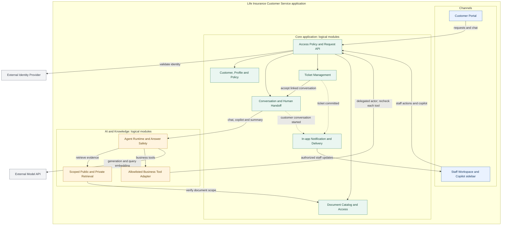

# Kiến trúc Ứng dụng & Trách nhiệm Thành phần (Application Architecture)

> **Tài liệu tổng hợp từ:** `Application Architecture.pdf` và `Component Responsible.pdf`  
> **Hệ thống:** Life Insurance Customer Service Application

---

## 1. Sơ đồ Kiến trúc Tổng thể (Architecture Diagram)

Hệ thống được tổ chức thành 3 phân vùng logic chính bên trong ứng dụng: **Channels (Giao diện)**, **Core Application (Nghiệp vụ lõi)**, và **AI & Knowledge (Trí tuệ nhân tạo & Tri thức)**, cùng với 2 dịch vụ tích hợp bên ngoài (**External Identity Provider** và **External Model API**).

---

## 2. Trách nhiệm của các Thành phần (Component Responsibilities)

### 2.1. Phân hệ Giao diện & Kênh tương tác (Channels)

| Thành phần (Component) | Trách nhiệm (Responsibilities) |
| :--- | :--- |
| **Customer Portal** | Cung cấp giao diện cho Customer để gửi câu hỏi, chat với AI Agent và sử dụng các chức năng được phép theo quyền sở hữu dữ liệu. |
| **Staff Workspace and Copilot Sidebar** | Cung cấp giao diện làm việc cho Staff, bao gồm tra cứu thông tin, quản lý công việc, xem thông báo và sử dụng AI Copilot trong ngữ cảnh hỗ trợ khách hàng. |

---

### 2.2. Phân hệ Nghiệp vụ lõi (Core Application: Logical Modules)

| Thành phần (Component) | Trách nhiệm (Responsibilities) |
| :--- | :--- |
| **Access Policy and Request API** | Tiếp nhận request từ giao diện và AI Tool Adapter; xác thực ngữ cảnh người dùng, kiểm tra quyền truy cập, điều phối yêu cầu nghiệp vụ và cung cấp API được cho phép. |
| **Customer, Profile and Policy** | Quản lý và cung cấp dữ liệu khách hàng, hồ sơ cá nhân, hợp đồng bảo hiểm và thông tin nghiệp vụ liên quan theo quyền truy cập. |
| **Conversation and Human Handoff** | Quản lý hội thoại, duy trì ngữ cảnh chat, kết nối hội thoại với AI Agent và hỗ trợ chuyển giao từ AI sang Staff khi cần. |
| **Ticket Management** | Quản lý Ticket hỗ trợ, bao gồm tạo, lưu trữ, tra cứu và liên kết Ticket với hội thoại tương ứng; chỉ ghi nhận Ticket sau khi đáp ứng các điều kiện nghiệp vụ. |
| **Document Catalog and Access** | Quản lý danh mục và quyền truy cập tài liệu; xác định phạm vi tài liệu được phép sử dụng hoặc cung cấp cho từng người dùng. |
| **In-app Notification and Delivery** | Phát và phân phối thông báo khi có hội thoại mới hoặc Ticket đã được lưu thành công; chỉ hiển thị thông tin cho Staff có quyền nhận thông báo. |

---

### 2.3. Phân hệ Trí tuệ nhân tạo & Tri thức (AI and Knowledge: Logical Modules)

| Thành phần (Component) | Trách nhiệm (Responsibilities) |
| :--- | :--- |
| **Agent Runtime and Answer Safety** | Điều phối hoạt động AI Agent: phân tích yêu cầu, lựa chọn công cụ hoặc nguồn dữ liệu, phối hợp retrieval và business tools, kiểm tra kết quả và tạo câu trả lời dựa trên bằng chứng. |
| **Scoped Public and Private Retrieval** | Tìm kiếm tài liệu bằng RAG trong phạm vi Public hoặc Private phù hợp; áp dụng bộ lọc truy xuất và kiểm tra quyền tài liệu trước khi đưa kết quả vào ngữ cảnh AI. |
| **Allowlisted Business Tool Adapter** | Cung cấp lớp thực thi các business tools trong danh sách cho phép; xác thực đầu vào, chuyển tiếp ngữ cảnh đã được ủy quyền và yêu cầu Core API kiểm tra lại quyền ở mỗi lần gọi. |

---

### 2.4. Dịch vụ Tích hợp bên ngoài (External Services)

| Thành phần (Component) | Trách nhiệm (Responsibilities) |
| :--- | :--- |
| **External Identity Provider** | Cung cấp dịch vụ xác thực danh tính người dùng (đăng nhập, xác minh token). Quyền truy cập tài nguyên nghiệp vụ vẫn do Core kiểm soát hoàn toàn. |
| **External Model API** | Cung cấp mô hình AI bên ngoài (LLM/Embedding) để xử lý ngôn ngữ tự nhiên, tạo câu trả lời, tóm tắt hội thoại và tạo embedding cho truy vấn khi cần. |

---

## 3. Tóm tắt Luồng Tương tác Chính (Interaction Flow)

1. **Ủy quyền & Tiếp nhận yêu cầu:**  
   Customer và Staff tương tác qua Portal / Workspace → gửi request tới `Access Policy and Request API` → kiểm tra danh tính với `External Identity Provider`.
2. **Xử lý hội thoại & AI Copilot:**  
   Module `Conversation and Human Handoff` chuyển giao ngữ cảnh hội thoại sang `Agent Runtime and Answer Safety`.
3. **Truy xuất tri thức (RAG):**  
   Agent gửi truy vấn tới `Scoped Public and Private Retrieval`, thành phần này xác thực phạm vi tài liệu với `Document Catalog and Access` trước khi trả chunks về cho Agent.
4. **Gọi Business Tools:**  
   Khi Agent cần gọi nghiệp vụ, yêu cầu đi qua `Allowlisted Business Tool Adapter` → quay ngược lại `Access Policy and Request API` của Core để kiểm tra quyền và xác thực tham số trước khi thực thi.
5. **Chuyển giao và Tạo Ticket:**  
   Khi có Ticket được commit hoặc có hội thoại mới cần can thiệp, `In-app Notification and Delivery` sẽ phát tín hiệu realtime đến `Staff Workspace`.
