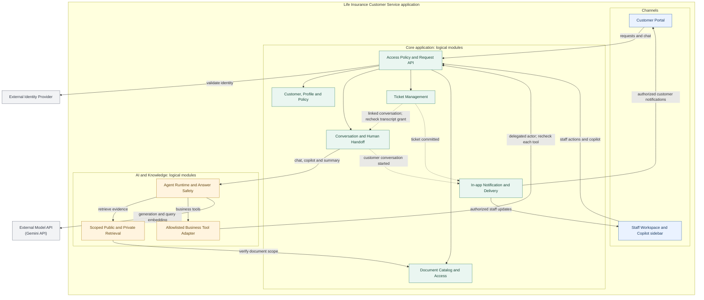

# Kiến trúc Ứng dụng & Trách nhiệm Thành phần (Application Architecture)

> **Đối chiếu 06/11/2026 theo application main 05/11:** Local có Web/Core/Auth/Customers/Policies/Products/Conversations/Realtime/Outbox/Notifications/Tickets, Staff và Customer policy/PDF, Customer Home/Products, chat I01–I06 và Staff Ticket TK01–TK05. Tạo/xác nhận Ticket từ Agent I07 và Copilot chưa có trong baseline này; không nghiệm thu Agent từ API/UI App. Sơ đồ là kiến trúc logic đích; External IdP/cloud còn là định hướng. Xem [tiến độ](../ui/implementation-status.md), [architecture](../architecture.md), [source review](../source-review.md).

> **Hệ thống:** Life Insurance Customer Service Application

> **Đã chốt 30/10/2026 — tra cứu hợp đồng:** Core giữ sản phẩm chính và danh sách bổ trợ tối thiểu theo [thiết kế dữ liệu hợp đồng](Contract_Data_Design.md), tận dụng JSONB hiện có. Người được bảo hiểm, gói, hạn mức và điều khoản tra qua Private RAG theo hợp đồng/tài liệu/phiên bản do Core cấp quyền. Agent không truy cập business DB; không thêm module hoặc bảng trong quyết định này. API và validation chưa triển khai.

---

## 1. Sơ đồ Kiến trúc Tổng thể (Architecture Diagram)

Hệ thống được tổ chức thành 3 phân vùng logic chính bên trong ứng dụng: **Channels (Giao diện)**, **Core Application (Nghiệp vụ lõi)**, và **AI & Knowledge (Trí tuệ nhân tạo & Tri thức)**, cùng với 2 dịch vụ tích hợp bên ngoài (**External Identity Provider** và **External Model API**).

---

## 2. Trách nhiệm của các Thành phần (Component Responsibilities)

### 2.1. Phân hệ Giao diện & Kênh tương tác (Channels)

| Thành phần (Component) | Trách nhiệm (Responsibilities) |
| :--- | :--- |
| **Customer Portal** | Cung cấp giao diện cho Customer để gửi câu hỏi, chat với AI Agent và sử dụng các chức năng được phép theo quyền sở hữu dữ liệu. |
| **Staff Workspace and Copilot Sidebar** | Staff tra cứu, quản lý Ticket, xem thông báo và dùng Copilot nội bộ để tra cứu/giải thích/tóm tắt trong cuộc đủ quyền; MVP không soạn nháp câu trả lời Customer hoặc có Use draft. |

---

### 2.2. Phân hệ Nghiệp vụ lõi (Core Application: Logical Modules)

| Thành phần (Component) | Trách nhiệm (Responsibilities) |
| :--- | :--- |
| **Access Policy and Request API** | Tiếp nhận request từ giao diện và AI Tool Adapter; xác thực ngữ cảnh người dùng, kiểm tra quyền truy cập, điều phối yêu cầu nghiệp vụ và cung cấp API được cho phép. |
| **Customer, Profile and Policy** | Quản lý và cung cấp dữ liệu khách hàng, hồ sơ cá nhân, hợp đồng bảo hiểm và thông tin nghiệp vụ liên quan theo quyền truy cập. |
| **Conversation and Human Handoff** | Quản lý lịch sử/lượt và quyền chat. Cuộc AI chỉ chuyển sau Customer consent và Staff Accept; trước Accept chỉ metadata. Direct là luồng riêng; assignment/Ticket không tự cấp quyền transcript. |
| **Ticket Management** | Quản lý Ticket, trạng thái và liên kết hội thoại. Agent chỉ đề xuất; Core ghi Ticket + outbox sau xác nhận hợp lệ và kiểm quyền/chống trùng. Nhận/đổi trạng thái Ticket không thay quyền đọc chat. |
| **Document Catalog and Access** | Quản lý danh mục và quyền truy cập tài liệu; xác định phạm vi tài liệu được phép sử dụng hoặc cung cấp cho từng người dùng. |
| **In-app Notification and Delivery** | Phát notification theo owner/recipient Customer hoặc Staff qua outbox; Customer có center và chat/SYSTEM theo N01/N02, trạng thái đọc riêng cho notification và message, retention notification 30 ngày chung cho cả Customer và Staff, áp dụng read/unread; không xóa Ticket/Message nguồn. |

---

### 2.3. Phân hệ Trí tuệ nhân tạo & Tri thức (AI and Knowledge: Logical Modules)

| Thành phần (Component) | Trách nhiệm (Responsibilities) |
| :--- | :--- |
| **Agent Runtime and Answer Safety** | Điều phối hoạt động AI Agent: phân tích yêu cầu, lựa chọn công cụ hoặc nguồn dữ liệu, phối hợp retrieval và business tools, kiểm tra kết quả và tạo câu trả lời dựa trên bằng chứng. |
| **Scoped Public and Private Retrieval** | Cung cấp hai tool truy xuất Public/Private, áp dụng scope Core và trả bằng chứng/trạng thái. Code dựng context; LLM trong node Agent tổng hợp câu trả lời của toàn luồng Agentic RAG. Xem [phân biệt thuật ngữ](Agent_Design.md#rag-terminology). |
| **Allowlisted Business Tool Adapter** | Cung cấp lớp thực thi các business tools trong danh sách cho phép; xác thực đầu vào, chuyển tiếp ngữ cảnh đã được ủy quyền và yêu cầu Core API kiểm tra lại quyền ở mỗi lần gọi. |

---

### 2.4. Dịch vụ Tích hợp bên ngoài (External Services)

| Thành phần (Component) | Trách nhiệm (Responsibilities) |
| :--- | :--- |
| **External Identity Provider** | Cung cấp dịch vụ xác thực danh tính người dùng (đăng nhập, xác minh token). Quyền truy cập tài nguyên nghiệp vụ vẫn do Core kiểm soát hoàn toàn. |
| **External Model API** | Gemini API là provider model sinh và embedding của MVP theo quyết định 13/11/2026. Model MVP đã chốt gemini-3.8-flash và gemini-embedding-2, 1536 chiều ngày 13/11/2026. Limits và nghiệm thu tiếp tục theo G4. |

---

## 3. Tóm tắt Luồng Tương tác Chính (Interaction Flow)

1. **Ủy quyền & Tiếp nhận yêu cầu:**  
   Customer và Staff gửi request qua Portal / Workspace → `Access Policy and Request API` kiểm phiên và quyền. Local dùng auth Core hiện có; External Identity Provider là định hướng, chưa tích hợp.
2. **Xử lý hội thoại & AI Copilot:**  
   Module `Conversation and Human Handoff` chuyển giao ngữ cảnh hội thoại sang `Agent Runtime and Answer Safety`.
3. **Truy xuất tri thức (RAG):**  
   Agent gửi truy vấn tới `Scoped Public and Private Retrieval`, thành phần này xác thực phạm vi tài liệu với `Document Catalog and Access` trước khi trả chunks về cho Agent.
4. **Gọi Business Tools:**  
   Khi Agent cần gọi nghiệp vụ, yêu cầu đi qua `Allowlisted Business Tool Adapter` → quay ngược lại `Access Policy and Request API` của Core để kiểm tra quyền và xác thực tham số trước khi thực thi.
5. **Chuyển giao:**
   Customer xác nhận chia sẻ cuộc AI → Core lưu handoff request và phát thông báo → Staff Accept → mở transcript Customer-facing và chat tiếp. Handoff không tạo Ticket.
6. **Tạo Ticket:**
   Agent đề xuất nội dung → Customer xác nhận → Core kiểm quyền/idempotency và commit Ticket + outbox → báo mã và giao thông báo Staff bất đồng bộ. Ticket không tự cấp quyền chat.
7. **Mở chat AI mới sau Staff**
   Customer chọn New AI chat → Core tạo conversation mới qua create/receipt hiện có → Agent dùng thread/context riêng. Cuộc cũ vẫn theo trạng thái và allowedActions hiện hành, dừng trao đổi không tạo Close. UI/create đã có, tích hợp Agent/Core còn P theo [quyết định chuẩn](Agent_Design.md#new-ai-chat-after-staff).
