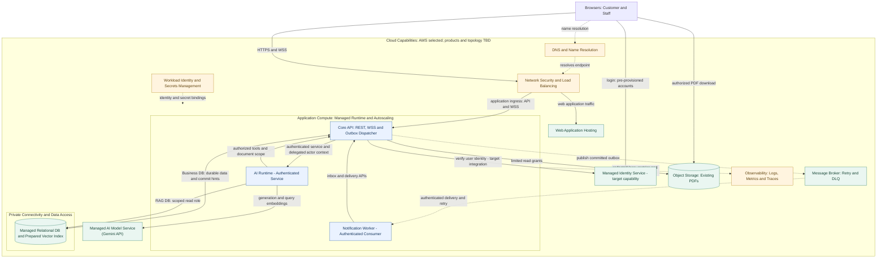

# Kiến trúc Cloud & Trách nhiệm Thành phần (Cloud Architecture)

Sơ đồ cloud đích; sản phẩm dịch vụ và topology cụ thể chưa chốt. Ranh giới nghiệp vụ theo [Application Architecture](Application_Architecture.md), tích hợp Agent theo [Agent Design](Agent_Design.md).

## 1. Sơ đồ Kiến trúc Cloud (Architecture Diagram)

Các khối là capability logic, không mặc định là deployment riêng. Core giữ phân quyền; Agent chỉ đọc RAG đúng scope và gọi Business API, không truy cập business DB. Managed Identity là hướng tích hợp cloud, chưa thay auth local.

## 2. Trách nhiệm của các Thành phần (Component Responsibilities)

| Thành phần (Component) | Trách nhiệm (Responsibilities) |
| :--- | :--- |
| **Browsers: Customer and Staff** | Cung cấp điểm truy cập qua web; gửi yêu cầu và nhận phản hồi qua HTTPS/WSS. Cả Customer và Staff phải xác thực khi truy cập dữ liệu/chức năng được bảo vệ. |
| **DNS and Name Resolution** | Phân giải tên miền thành endpoint tương ứng để người dùng truy cập hệ thống. |
| **Network Security and Load Balancing** | Tiếp nhận và định tuyến lưu lượng, áp dụng chính sách bảo mật mạng và phân phối tải tới ứng dụng. |
| **Web Application Hosting** | Triển khai và phục vụ giao diện web Customer/Staff. |
| **Managed Identity Service** | Capability đích quản lý danh tính/xác thực, hỗ trợ Core xác minh thông tin đăng nhập/token khi tích hợp cloud. |
| **Core API: REST, WSS and Outbox Dispatcher** | Xử lý nghiệp vụ/API, WSS, kiểm quyền, giao dịch database; phát sự kiện từ outbox sau commit. |
| **AI Runtime (Authenticated Service)** | Chạy custom Agent/LangGraph, điều phối RAG, gọi model và Business Tools được cho phép. |
| **Notification Worker: Authenticated Consumer** | Nhận message từ broker, xử lý gửi thông báo; gọi API Core để cập nhật trạng thái hoặc ghi nhận kết quả. |
| **Message Broker: Retry and DLQ** | Tiếp nhận/phân phối message bất đồng bộ; hỗ trợ thử lại khi consumer thất bại và đưa message không xử lý được vào DLQ. |
| **Managed Relational DB and Prepared Vector Index** | Lưu dữ liệu nghiệp vụ bền vững và dữ liệu/index phục vụ RAG; Core truy cập business, Agent dùng role retrieval giới hạn. |
| **Object Storage: Existing PDFs** | Lưu PDF sản phẩm/hợp đồng hiện có theo phiên bản; cung cấp truy cập giới hạn hoặc download đúng quyền được cấp. |
| **Managed AI Model Service** | Gemini API là provider MVP đã chốt ngày 13/11/2026 cho sinh câu trả lời, tóm tắt và embeddings. Model MVP đã chốt gemini-3.8-flash và gemini-embedding-2, 1536 chiều ngày 13/11/2026. Limits và nghiệm thu tiếp tục theo G4. |
| **Workload Identity and Secrets Management** | Quản lý danh tính workload và secrets; cung cấp xác thực cần thiết theo quyền tối thiểu. |
| **Observability: Logs, Metrics and Traces** | Theo dõi vận hành/hiệu năng, phát hiện lỗi, hỗ trợ khắc phục; giảm/che dữ liệu nhạy cảm trong telemetry. |

## 3. Quyết định về Scheduled Task Execution

Loại bỏ **Scheduled Task Execution**: không có scheduler độc lập gọi Core theo lịch để kích hoạt gửi lại outbox. Outbox Dispatcher vẫn phải giữ khả năng retry/recovery; cơ chế vận hành trên cloud cần đặc tả tiếp. Quyết định này không xóa timer dispatcher nội bộ đang có trong Core local.
