# Mô hình Dữ liệu & Từ điển Dữ liệu (Data Model & Data Dictionary)

> Cập nhật local 25/10/2026 theo thống nhất: giữ 16 bảng nguồn và bổ sung bảng 17 `AUTH_SESSIONS` để quản lý phiên đăng nhập. Không dùng bảng `ADMIN_REQUESTS`. Các khác biệt triển khai còn lại được ghi trong [baseline data model](../architecture.md#local-data-model); bản nguồn bên ngoài repo không tự thay đổi.

> **Tài liệu chuyển đổi từ:** `Data Model.pdf`  
> **Hệ thống:** Enterprise Customer Service AI Agent — Bảo hiểm Nhân thọ (SRS-BHNT)  
> **Cơ sở dữ liệu:** PostgreSQL 16+ tích hợp pgvector (Tách 2 schema: `business` và `rag`)

---

## I. Sơ đồ Quan hệ Thực thể (Entity Relationship Diagram - ERD)

```mermaid
erDiagram
    USERS ||--o| CUSTOMER_PROFILES : "1-1 (role = CUSTOMER)"
    USERS ||--o| STAFF_PROFILES : "1-1 (role = STAFF)"
    USERS ||--o{ AUDIT_LOGS : "actor_id"
    USERS ||--o{ AUTH_SESSIONS : "user_id"

    STAFF_PROFILES ||--o{ STAFF_ASSIGNMENTS : "staff_id (phụ trách)"
    CUSTOMER_PROFILES ||--|| STAFF_ASSIGNMENTS : "customer_id (duy nhất 1 staff)"
    INSURANCE_PRODUCTS ||--o{ INSURANCE_CONTRACTS : "product_id"
    CUSTOMER_PROFILES ||--o{ INSURANCE_CONTRACTS : "customer_id"

    INSURANCE_PRODUCTS ||--o{ DOCUMENTS : "product_id (PDF chung)"
    INSURANCE_CONTRACTS ||--o{ DOCUMENTS : "policy_id (PDF hợp đồng)"
    CUSTOMER_PROFILES ||--o{ DOCUMENTS : "owner_customer_id"
    DOCUMENTS ||--|{ DOCUMENT_VERSIONS : "document_id"
    CUSTOMER_PROFILES ||--|{ CONVERSATIONS : "customer_id (bắt buộc)"
    STAFF_PROFILES ||--o{ CONVERSATIONS : "assigned_staff_id (Staff được phân công; nullable)"
    INSURANCE_CONTRACTS ||--o{ CONVERSATIONS : "linked_policy_id"
    CONVERSATIONS ||--o{ CONVERSATIONS : "linked_context_conv_id (Staff Copilot)"

    CONVERSATIONS ||--|{ MESSAGES : "conversation_id"
    USERS ||--o{ MESSAGES : "sender_id"
    CONVERSATIONS ||--o{ SUPPORT_TICKETS : "conversation_id"
    CUSTOMER_PROFILES ||--o{ SUPPORT_TICKETS : "customer_id"
    STAFF_PROFILES ||--o{ SUPPORT_TICKETS : "assigned_staff_id"
    INSURANCE_CONTRACTS ||--o{ SUPPORT_TICKETS : "policy_id"
    SUPPORT_TICKETS ||--o{ NOTIFICATIONS : "ticket_id"
    CONVERSATIONS ||--o{ NOTIFICATIONS : "conversation_id"
    STAFF_PROFILES ||--o{ NOTIFICATIONS : "recipient_staff_id"
    DOCUMENTS ||..o{ RAG_KNOWLEDGE_CHUNKS : "document_id (Logic FK)"
    INSURANCE_CONTRACTS ||..o{ RAG_KNOWLEDGE_CHUNKS : "policy_id (Scoped Filter)"
    CUSTOMER_PROFILES ||..o{ RAG_KNOWLEDGE_CHUNKS : "owner_customer_id (Scoped Filter)"

    USERS {
        uuid id PK
        varchar email UK
        varchar phone UK
        varchar password_hash
        varchar role "CUSTOMER | STAFF"
        varchar status "ACTIVE | LOCKED"
        int failed_login_attempts
        timestamptz locked_until
        timestamptz created_at
        timestamptz updated_at
    }
    CUSTOMER_PROFILES {
        uuid user_id PK,FK "REFERENCES users(id)"
        varchar citizen_id UK "CCCD định danh KYC"
        varchar full_name
        date birth "Ngày sinh"
        text address
    }
    STAFF_PROFILES {
        uuid user_id PK,FK "REFERENCES users(id)"
        varchar full_name
        varchar department "Bộ phận CSKH"
    }
    STAFF_ASSIGNMENTS {
        uuid id PK
        uuid staff_id FK "REFERENCES staff_profiles(user_id)"
        uuid customer_id FK,UK "1 Customer chỉ gắn 1 Staff chịu trách nhiệm"
        boolean is_active
        timestamptz assigned_at
    }
    AUTH_SESSIONS {
        uuid id PK
        uuid user_id FK "REFERENCES users(id)"
        char token_hash UK "64 hex; không lưu token gốc"
        char csrf_token_hash "64 hex; không lưu token gốc"
        timestamptz created_at
        timestamptz expires_at
        timestamptz revoked_at "NULL khi chưa thu hồi"
    }
    RATE_LIMIT_BUCKETS {
        varchar client_token PK "Ghép"
        varchar endpoint_group PK "AUTH_LOGIN | AI_CHAT | PDF_DOWNLOAD"
        timestamptz window_start
        int request_count
        timestamptz blocked_until
    }
    AUDIT_LOGS {
        uuid id PK
        uuid actor_id FK "REFERENCES users(id) NULL"
        varchar actor_role "CUSTOMER | STAFF | AI_DELEGATED"
        varchar action
        varchar target_type
        uuid target_id
        jsonb metadata "Redacted logs NFR-002"
        timestamptz created_at
    }
    INSURANCE_PRODUCTS {
        uuid id PK
        varchar product_code UK
        varchar name
        text summary
        boolean is_active
        timestamptz created_at
    }
    INSURANCE_CONTRACTS {
        uuid id PK
        varchar policy_number UK "Số hợp đồng (HD-2026-08912)"
        uuid customer_id FK "REFERENCES customer_profiles(user_id)"
        uuid product_id FK "REFERENCES insurance_products(id)"
        varchar status "ACTIVE | LAPSED | MATURED | PENDING"
        numeric premium_amount "Số tiền đóng mỗi kỳ (vd 15tr)"
        varchar payment_frequency "ANNUAL | SEMI_ANNUAL | QUARTERLY | MONTHLY"
        date next_due_date "Ngày đến hạn đóng phí"
        date effective_date "Ngày bắt đầu có hiệu lực"
        date expiry_date "Ngày đáo hạn hợp đồng"
        numeric sum_assured "Mệnh giá bảo vệ"
        jsonb benefits_snapshot "Đóng băng quyền lợi khi ký"
        timestamptz created_at
    }
    DOCUMENTS {
        uuid id PK
        varchar title
        varchar access_scope "PUBLIC | PRIVATE_POLICY"
        uuid product_id FK "NULL"
        uuid policy_id FK "NULL"
        uuid owner_customer_id FK "REFERENCES customer_profiles(user_id) NULL"
        varchar current_version
        timestamptz created_at
    }
    DOCUMENT_VERSIONS {
        uuid id PK
        uuid document_id FK "REFERENCES documents(id)"
        varchar version_number
        varchar storage_bucket "MinIO hoặc S3 bucket"
        varchar storage_object_key "Presigned URL target"
        varchar checksum_sha256
        boolean is_active
        timestamptz created_at
    }
    CONVERSATIONS {
        uuid id PK
        varchar channel_type "CUSTOMER_SUPPORT | STAFF_COPILOT"
        uuid customer_id FK "NOT NULL"
        uuid assigned_staff_id FK "Staff được phân công (nullable)"
        uuid linked_context_conv_id FK "Self-FK cho Staff Copilot Sidebar"
        uuid linked_policy_id FK "NULL"
        varchar status "AI_ACTIVE | PENDING_HANDOFF | STAFF_ACTIVE | CLOSED"
        text ai_summary
        jsonb draft_ticket_payload "Lưu nháp trước khi confirm UC-005"
        timestamptz created_at
        timestamptz updated_at
    }
    MESSAGES {
        uuid id PK
        uuid conversation_id FK "REFERENCES conversations(id)"
        varchar sender_type "CUSTOMER | STAFF | AI_AGENT | SYSTEM"
        uuid sender_id FK "REFERENCES users(id) NULL"
        text content
        jsonb citations
        jsonb tool_calls_metadata
        timestamptz created_at
    }
    SUPPORT_TICKETS {
        uuid id PK
        varchar ticket_code UK
        uuid conversation_id FK "REFERENCES conversations(id)"
        uuid customer_id FK "REFERENCES customer_profiles(user_id) NOT NULL"
        uuid assigned_staff_id FK "REFERENCES staff_profiles(user_id) NULL"
        uuid policy_id FK "NULL"
        varchar title
        text ai_summary
        jsonb extracted_details
        varchar status "OPEN | ASSIGNED | IN_PROGRESS | RESOLVED | CLOSED"
        varchar idempotency_key UK "Chống tạo trùng NFR-005"
        timestamptz confirmed_at
        timestamptz created_at
    }
    OUTBOX_EVENTS {
        uuid id PK
        varchar aggregate_type "TICKET | CONVERSATION"
        uuid aggregate_id
        varchar event_type "TICKET_COMMITTED | HANDOFF_REQUESTED"
        jsonb payload
        varchar status "PENDING | PROCESSING | PUBLISHED | FAILED_DLQ"
        int retry_count
        timestamptz next_attempt_at
        text last_error
        timestamptz created_at
    }
    NOTIFICATIONS {
        uuid id PK
        uuid recipient_staff_id FK "REFERENCES staff_profiles(user_id)"
        uuid ticket_id FK "NULL"
        uuid conversation_id FK "NULL"
        varchar title
        text body
        boolean is_read
        varchar dedup_key UK "Chống gửi trùng ADR-CLOUD-003"
        timestamptz delivered_at
    }
    RAG_KNOWLEDGE_CHUNKS {
        uuid id PK
        uuid document_id "Logic FK sang documents"
        varchar document_version
        int chunk_index
        text content
        vector embedding
        varchar access_scope "PUBLIC | PRIVATE_POLICY"
        uuid product_id
        uuid policy_id
        uuid owner_customer_id
        int page_number
        jsonb metadata
    }
```

---

## II. Từ điển Dữ liệu Chi tiết (Data Dictionary)

### Bảng 1: `USERS`
> **Mục đích:** Lưu trữ tài khoản đăng nhập, mật khẩu mã hóa và trạng thái bảo mật của Khách hàng và Nhân viên (FR-001, NFR-001).

| Tên cột | Kiểu dữ liệu | Ràng buộc | Ý nghĩa & Nghiệp vụ chi tiết |
| :--- | :--- | :--- | :--- |
| **id** | UUID | PK | Mã định danh duy nhất toàn hệ thống, tự động sinh `gen_random_uuid()`. |
| **email** | VARCHAR(255) | UK, NOT NULL | Địa chỉ email đăng nhập và nhận thông báo chính thức (vd: `an.nguyen@gmail.com`). |
| **phone** | VARCHAR(20) | UK, NOT NULL | Số điện thoại di động đăng nhập, nhận OTP và tra cứu nhanh (vd: `0912345678`). |
| **password_hash** | VARCHAR(255) | NOT NULL | Mật khẩu băm bảo mật (Argon2id hoặc Bcrypt). Tuyệt đối không lưu plain-text. |
| **role** | VARCHAR(20) | CHECK | Vai trò người dùng trong hệ thống: `'CUSTOMER'` (Khách hàng) hoặc `'STAFF'` (Nhân viên). |
| **status** | VARCHAR(20) | DEFAULT `'ACTIVE'` | Trạng thái tài khoản: `'ACTIVE'` (hoạt động) hoặc `'LOCKED'` (bị tạm khóa). |
| **failed_login_attempts** | INT | DEFAULT 0 | Số lần nhập sai mật khẩu liên tiếp (0 đến 10). Tự động reset về 0 khi đăng nhập thành công. |
| **locked_until** | TIMESTAMPTZ | NULLable | Thời điểm hết hạn khóa tài khoản (bị khóa tạm thời khi nhập sai quá số lần quy định). |
| **created_at** | TIMESTAMPTZ | DEFAULT `NOW()` | Thời điểm khởi tạo tài khoản trên hệ thống. |
| **updated_at** | TIMESTAMPTZ | DEFAULT `NOW()` | Thời điểm cập nhật thông tin tài khoản gần nhất. |

---

### Bảng 2: `CUSTOMER_PROFILES`
> **Mục đích:** Hồ sơ định danh cá nhân và thông tin KYC pháp lý của khách hàng tham gia bảo hiểm (FR-002, NFR-002).

| Tên cột | Kiểu dữ liệu | Ràng buộc | Ý nghĩa & Nghiệp vụ chi tiết |
| :--- | :--- | :--- | :--- |
| **user_id** | UUID | PK, FK | Khóa chính và là khóa ngoại tham chiếu 1-1 tới `business.users(id)`. Xóa user thì cascade. |
| **citizen_id** | VARCHAR(20) | UK, NOT NULL | Số Căn cước công dân (12 số) hoặc Hộ chiếu. Dùng định danh pháp lý và tra cứu O(1) cho Staff. |
| **full_name** | VARCHAR(255) | NOT NULL | Họ và tên đầy đủ có dấu của khách hàng (vd: Nguyễn Văn An). |
| **birth** | DATE | NOT NULL | Ngày tháng năm sinh (vd: `1992-08-20`), dùng để tính độ tuổi tham gia bảo hiểm. |
| **address** | TEXT | NULLable | Địa chỉ thường trú hoặc địa chỉ liên lạc nhận hồ sơ giấy tờ. |

---

### Bảng 3: `STAFF_PROFILES`
> **Mục đích:** Hồ sơ nhân viên tư vấn và chuyên viên chăm sóc khách hàng (FR-002).

| Tên cột | Kiểu dữ liệu | Ràng buộc | Ý nghĩa & Nghiệp vụ chi tiết |
| :--- | :--- | :--- | :--- |
| **user_id** | UUID | PK, FK | Khóa chính và là khóa ngoại tham chiếu 1-1 tới `business.users(id)`. Xóa user thì cascade. |
| **full_name** | VARCHAR(255) | NOT NULL | Họ và tên đầy đủ của nhân viên CSKH (vd: Trần Thị Mai). |
| **department** | VARCHAR(100) | DEFAULT | Bộ phận công tác nội bộ (vd: Chăm sóc khách hàng & Quản lý Ticket). |

---

### Bảng 4: `STAFF_ASSIGNMENTS`
> **Mục đích:** Phân công trách nhiệm quản lý cố định: Mỗi khách hàng chỉ gắn chặt với duy nhất 1 nhân viên chịu trách nhiệm (FR-003, NFR-001).

| Tên cột | Kiểu dữ liệu | Ràng buộc | Ý nghĩa & Nghiệp vụ chi tiết |
| :--- | :--- | :--- | :--- |
| **id** | UUID | PK | Mã định danh bản ghi phân công. |
| **staff_id** | UUID | FK, NOT NULL | Tham chiếu tới `staff_profiles(user_id)`: Nhân viên được giao quản lý khách. |
| **customer_id** | UUID | FK, UK, NOT NULL | Tham chiếu `customer_profiles(user_id)`. Ràng buộc UNIQUE đảm bảo 1 khách chỉ gắn với 1 Staff duy nhất. |
| **is_active** | BOOLEAN | DEFAULT `TRUE` | Trạng thái phân công còn hiệu lực hay đã bàn giao. |
| **assigned_at** | TIMESTAMPTZ | DEFAULT `NOW()` | Thời điểm bắt đầu phân công quản lý. |

---

### Bảng 5: `RATE_LIMIT_BUCKETS`
> **Mục đích:** Quản lý giới hạn tần suất gọi API theo Token Bucket, bảo vệ chống brute-force và lạm dụng gọi AI Agent / tải PDF.

| Tên cột | Kiểu dữ liệu | Ràng buộc | Ý nghĩa & Nghiệp vụ chi tiết |
| :--- | :--- | :--- | :--- |
| **client_token** | VARCHAR(255) | PK (Ghép) | Định danh đối tượng: `'user:uuid'` đã xác thực; sự kiện hệ thống dùng định danh dịch vụ riêng. |
| **endpoint_group** | VARCHAR(50) | PK (Ghép) | Nhóm API bị giới hạn: `'AUTH_LOGIN'`, `'AI_CHAT'`, `'PDF_DOWNLOAD'`. |
| **window_start** | TIMESTAMPTZ | NOT NULL | Thời điểm bắt đầu tính cửa sổ thời gian giới hạn. |
| **request_count** | INT | DEFAULT 1 | Số lượng request đã thực hiện trong cửa sổ hiện tại. |
| **blocked_until** | TIMESTAMPTZ | NULLable | Thời điểm mở khóa nếu client bị tạm khóa do spam quá ngưỡng quy định. |

---

### Bảng 6: `AUDIT_LOGS`
> **Mục đích:** Nhật ký kiểm toán truy vết các hành vi nhạy cảm (xem hợp đồng, tải PDF, đăng nhập sai), tuân thủ NFR-002 và NFR-008.

| Tên cột | Kiểu dữ liệu | Ràng buộc | Ý nghĩa & Nghiệp vụ chi tiết |
| :--- | :--- | :--- | :--- |
| **id** | UUID | PK | Mã bản ghi nhật ký. |
| **actor_id** | UUID | FK, NULLable | Người thực hiện hành động (tham chiếu `users(id)`); NULL chỉ với sự kiện do hệ thống tạo. |
| **actor_role** | VARCHAR(50) | NOT NULL | Vai trò khi thao tác: `'CUSTOMER'`, `'STAFF'`, `'AI_DELEGATED'`. |
| **action** | VARCHAR(100) | NOT NULL | Tên hành vi: `'LOGIN_LOCKED'`, `'VIEW_POLICY'`, `'DOWNLOAD_PDF'`, `'CREATE_TICKET'`... |
| **target_type** | VARCHAR(100) | NULLable | Loại đối tượng đích bị tác động (vd: `'POLICY'`, `'TICKET'`, `'DOCUMENT'`). |
| **target_id** | UUID | NULLable | Mã định danh của đối tượng đích. |
| **metadata** | JSONB | NULLable | Dữ liệu ngữ cảnh đi kèm (IP, User-Agent, lý do). Đã che giấu (redacted) thông tin nhạy cảm theo NFR-002. |
| **created_at** | TIMESTAMPTZ | DEFAULT `NOW()` | Thời điểm chính xác xảy ra hành vi. |

---

### Bảng 7: `INSURANCE_PRODUCTS`
> **Mục đích:** Danh mục các gói sản phẩm bảo hiểm chung do công ty cung cấp ra thị trường (thông tin công khai - FR-004, FR-008).

| Tên cột | Kiểu dữ liệu | Ràng buộc | Ý nghĩa & Nghiệp vụ chi tiết |
| :--- | :--- | :--- | :--- |
| **id** | UUID | PK | Mã định danh gói sản phẩm bảo hiểm. |
| **product_code** | VARCHAR(50) | UK, NOT NULL | Mã sản phẩm kinh doanh duy nhất (vd: `'PRD_AN_KHANG_01'`, `'PRD_CARE_PLUS'`). |
| **name** | VARCHAR(255) | NOT NULL | Tên thương mại của gói bảo hiểm (vd: `'Bảo hiểm An Khang Hạnh Phúc'`). |
| **summary** | TEXT | NULLable | Tóm tắt quyền lợi chung trên tài liệu công khai để AI trả lời Customer và Staff. |
| **is_active** | BOOLEAN | DEFAULT `TRUE` | Trạng thái mở bán: `true` (đang kinh doanh), `false` (tạm dừng). |
| **created_at** | TIMESTAMPTZ | DEFAULT `NOW()` | Ngày sản phẩm được đưa lên hệ thống. |

---

### Bảng 8: `INSURANCE_CONTRACTS`
> **Mục đích:** Hợp đồng bảo hiểm cá nhân đã ký kết giữa khách hàng và công ty, bảo đảm quyền lợi pháp lý (FR-005, FR-008, UC-007).

| Tên cột | Kiểu dữ liệu | Ràng buộc | Ý nghĩa & Nghiệp vụ chi tiết |
| :--- | :--- | :--- | :--- |
| **id** | UUID | PK | Mã định danh duy nhất của hợp đồng. |
| **policy_number** | VARCHAR(100) | UK, NOT NULL | Số hợp đồng chính thức để tra cứu (vd: `'HD-2026-08912'`). |
| **customer_id** | UUID | FK, NOT NULL | Tham chiếu `customer_profiles(user_id)`: Khách hàng đứng tên chủ sở hữu hợp đồng. |
| **product_id** | UUID | FK, NOT NULL | Tham chiếu `insurance_products(id)`: Gói bảo hiểm đã tham gia. |
| **status** | VARCHAR(50) | CHECK | Trạng thái: `'ACTIVE'` (hiệu lực), `'LAPSED'` (mất hiệu lực vì trễ phí), `'MATURED'` (đáo hạn), `'PENDING'` (chờ duyệt). |
| **premium_amount** | NUMERIC(15,2) | NULLable | Số tiền đóng phí định kỳ mỗi đợt (vd: 15.000.000 VNĐ). |
| **payment_frequency** | VARCHAR(50) | NULLable | Chu kỳ đóng phí: `'ANNUAL'` (năm), `'SEMI_ANNUAL'` (nửa năm), `'QUARTERLY'` (quý), `'MONTHLY'` (tháng). |
| **next_due_date** | DATE | NULLable | Ngày đến hạn đóng phí kỳ tiếp theo (để AI tra cứu nhắc nhở khách). |
| **effective_date** | DATE | NULLable | Ngày hợp đồng chính thức bắt đầu có hiệu lực bảo vệ. |
| **expiry_date** | DATE | NULLable | Ngày kết thúc hợp đồng / ngày đáo hạn nhận tiền tích lũy. |
| **sum_assured** | NUMERIC(15,2) | NULLable | Số tiền bảo hiểm (mệnh giá bảo vệ tối đa khi có sự kiện bảo hiểm xảy ra, vd: 1 tỷ VNĐ). |
| **benefits_snapshot** | JSONB | NULLable | Đóng băng bảng quyền lợi tại thời điểm ký kết, bảo đảm giá trị pháp lý không bị thay đổi. |
| **created_at** | TIMESTAMPTZ | DEFAULT `NOW()` | Thời điểm khởi tạo hợp đồng. |

---

### Bảng 9: `DOCUMENTS`
> **Mục đích:** Quản lý siêu dữ liệu và phạm vi bảo mật của các tài liệu file PDF trong hệ thống (ADR-DATA-002, NFR-007).

| Tên cột | Kiểu dữ liệu | Ràng buộc | Ý nghĩa & Nghiệp vụ chi tiết |
| :--- | :--- | :--- | :--- |
| **id** | UUID | PK | Mã định danh tài liệu. |
| **title** | VARCHAR(255) | NOT NULL | Tên hiển thị tài liệu (vd: `'Quy tắc điều khoản chung 2026'`, `'Hợp đồng điện tử ký số HD-08912'`). |
| **access_scope** | VARCHAR(50) | CHECK | Phạm vi bảo mật: `'PUBLIC'` (công khai), `'PRIVATE_POLICY'` (hợp đồng cá nhân riêng tư). |
| **product_id** | UUID | FK, NULLable | Tham chiếu `insurance_products(id)` nếu là file tài liệu giới thiệu sản phẩm chung. |
| **policy_id** | UUID | FK, NULLable | Tham chiếu `insurance_contracts(id)` nếu là file hợp đồng bảo hiểm cá nhân. |
| **owner_customer_id** | UUID | FK, NULLable | Tham chiếu `customer_profiles(user_id)`: Chủ sở hữu file (dùng để Core Backend kiểm tra quyền tải). |
| **current_version** | VARCHAR(20) | DEFAULT `'v1.0'` | Phiên bản tài liệu đang hoạt động hiện tại. |
| **created_at** | TIMESTAMPTZ | DEFAULT `NOW()` | Ngày tạo bản ghi tài liệu. |

---

### Bảng 10: `DOCUMENT_VERSIONS`
> **Mục đích:** Quản lý phiên bản vật lý của file PDF trên Object Storage (MinIO/S3), phục vụ tạo Presigned URL và kiểm tra toàn vẹn (ADR-DATA-002, NFR-007).

| Tên cột | Kiểu dữ liệu | Ràng buộc | Ý nghĩa & Nghiệp vụ chi tiết |
| :--- | :--- | :--- | :--- |
| **id** | UUID | PK | Mã phiên bản file. |
| **document_id** | UUID | FK, NOT NULL | Tham chiếu `documents(id)`: Thuộc tài liệu nào. |
| **version_number** | VARCHAR(20) | NOT NULL | Số hiệu phiên bản (vd: `'v1.0'`, `'v1.1'`). |
| **storage_bucket** | VARCHAR(100) | NOT NULL | Tên bucket lưu trữ trên MinIO/S3 (vd: `'insurance-docs-bucket'`). |
| **storage_object_key** | TEXT | NOT NULL | Đường dẫn định danh file trên Cloud Storage (vd: `'contracts/2026/HD_08912.pdf'`) để sinh Presigned URL. |
| **checksum_sha256** | VARCHAR(64) | NOT NULL | Dấu vân tay SHA-256 (64 ký tự hex) bảo đảm file không bị can thiệp sửa đổi và tránh nạp trùng RAG. |
| **is_active** | BOOLEAN | DEFAULT `TRUE` | Phiên bản này có đang được sử dụng chính thức không. |
| **created_at** | TIMESTAMPTZ | DEFAULT `NOW()` | Thời điểm tải file lên Cloud Storage. |

---

### Bảng 11: `CONVERSATIONS`
> **Mục đích:** Quản lý phiên tương tác, chu trình chuyển giao giữa AI Bot và Nhân viên CSKH (FR-004, FR-005, FR-006, FR-007, UC-005, UC-006).

| Tên cột | Kiểu dữ liệu | Ràng buộc | Ý nghĩa & Nghiệp vụ chi tiết |
| :--- | :--- | :--- | :--- |
| **id** | UUID | PK | Mã định danh phiên hội thoại. |
| **channel_type** | VARCHAR(50) | CHECK | Loại kênh: `'CUSTOMER_SUPPORT'` (Customer đã đăng nhập), `'STAFF_COPILOT'` (sidebar trợ lý AI). |
| **customer_id** | UUID | FK, NOT NULL | Tham chiếu `customer_profiles(user_id)`; bắt buộc NOT NULL. |
| **assigned_staff_id** | UUID | FK, NULLable | Staff tiếp quản phiên chat (Staff tiếp nhận phiên chat của Customer). |
| **linked_context_conv_id** | UUID | Self-FK, NULLable | Neo hội thoại Staff Copilot Sidebar vào ID cuộc chat chính để AI nắm bối cảnh hỗ trợ nhân viên (FR-007). |
| **linked_policy_id** | UUID | FK, NULLable | Tham chiếu `insurance_contracts(id)` nếu cuộc chat xoay quanh hợp đồng cụ thể. |
| **status** | VARCHAR(50) | CHECK | Trạng thái: `'AI_ACTIVE'` (chat bot), `'PENDING_HANDOFF'` (chờ người nhận), `'STAFF_ACTIVE'` (nhân viên đang chat), `'CLOSED'` (đóng chat). |
| **ai_summary** | TEXT | NULLable | Đoạn văn tóm tắt toàn bộ cuộc trao đổi do AI tự động tổng hợp sau khi hoàn tất. |
| **draft_ticket_payload** | JSONB | NULLable | Bản nháp thông tin Ticket do AI soạn trước, lưu tạm trong phiên trước khi khách xác nhận tạo Ticket (UC-005). |
| **created_at** | TIMESTAMPTZ | DEFAULT `NOW()` | Thời điểm mở phiên chat. |
| **updated_at** | TIMESTAMPTZ | DEFAULT `NOW()` | Thời điểm có tin nhắn mới nhất trong phiên. |

---

### Bảng 12: `MESSAGES`
> **Mục đích:** Lưu trữ nội dung chi tiết từng tin nhắn qua lại trong phòng chat, kèm nguồn trích dẫn tài liệu của AI (FR-011, NFR-003).

| Tên cột | Kiểu dữ liệu | Ràng buộc | Ý nghĩa & Nghiệp vụ chi tiết |
| :--- | :--- | :--- | :--- |
| **id** | UUID | PK | Mã định danh tin nhắn. |
| **conversation_id** | UUID | FK, NOT NULL | Tham chiếu `conversations(id)`: Thuộc phiên chat nào. Xóa conversation thì cascade. |
| **sender_type** | VARCHAR(50) | CHECK | Người gửi: `'CUSTOMER'`, `'STAFF'`, `'AI_AGENT'`, hoặc `'SYSTEM'`. |
| **sender_id** | UUID | FK, NULLable | Tham chiếu `users(id)`. NULL nếu do AI Bot hoặc hệ thống tự động sinh. |
| **content** | TEXT | NOT NULL | Nội dung tin nhắn bằng văn bản thuần hoặc định dạng Markdown. |
| **citations** | JSONB | NULLable | Danh sách trích dẫn nguồn RAG mà AI dựa vào để trả lời (tên tài liệu, trang, đoạn trích) theo NFR-003. |
| **tool_calls_metadata** | JSONB | NULLable | Nhật ký Function Calling của AI (tên tool đã gọi, tham số và kết quả trả về từ Core Backend). |
| **created_at** | TIMESTAMPTZ | DEFAULT `NOW()` | Thời điểm tin nhắn được gửi đi. |

---

### Bảng 13: `SUPPORT_TICKETS`
> **Mục đích:** Phiếu yêu cầu hỗ trợ chính thức được tạo sau khi Customer xác nhận bàn giao từ AI sang Staff (FR-009, FR-010, UC-005, NFR-005).

| Tên cột | Kiểu dữ liệu | Ràng buộc | Ý nghĩa & Nghiệp vụ chi tiết |
| :--- | :--- | :--- | :--- |
| **id** | UUID | PK | Mã định danh duy nhất của Ticket. |
| **ticket_code** | VARCHAR(50) | UK, NOT NULL | Mã phiếu nghiệp vụ ngắn gọn cho con người đọc (vd: `'TK-202610-0042'`) hiển thị cho khách tra cứu (UC-005). |
| **conversation_id** | UUID | FK, NULLable | Phiên chat gốc đã sinh ra Ticket này. |
| **customer_id** | UUID | FK, NOT NULL | Tham chiếu `customer_profiles(user_id)`; bắt buộc NOT NULL. |
| **assigned_staff_id** | UUID | FK, NULLable | Staff chịu trách nhiệm tiếp nhận và xử lý Ticket. |
| **policy_id** | UUID | FK, NULLable | Hợp đồng bảo hiểm cụ thể mà khách đang cần giải quyết vấn đề. |
| **title** | VARCHAR(255) | NOT NULL | Tiêu đề yêu cầu hỗ trợ (vd: `'Thắc mắc thủ tục chi trả bồi thường viện phí phẫu thuật'`). |
| **ai_summary** | TEXT | NULLable | Đoạn tóm tắt vấn đề của khách do AI viết để Staff mở ra đọc nhanh 10 giây nắm bối cảnh (FR-012). |
| **extracted_details** | JSONB | NULLable | Dữ liệu bóc tách có cấu trúc (loại viện phí, số tiền, ngày nằm viện...) dùng để điền form hoặc lọc báo cáo. |
| **status** | VARCHAR(50) | CHECK | Trạng thái: `'OPEN'` (mới tạo), `'ASSIGNED'` (đã phân công), `'IN_PROGRESS'` (đang xử lý), `'RESOLVED'`, `'CLOSED'`. |
| **idempotency_key** | VARCHAR(255) | UK, NOT NULL | Khóa chống tạo trùng Ticket khi người dùng click liên tục hoặc mạng retry (NFR-005). |
| **confirmed_at** | TIMESTAMPTZ | DEFAULT `NOW()` | Thời điểm khách hàng bấm nút xác nhận tạo Ticket. |
| **created_at** | TIMESTAMPTZ | DEFAULT `NOW()` | Thời điểm bản ghi được ghi bền vững vào cơ sở dữ liệu. |

---

### Bảng 14: `OUTBOX_EVENTS`
> **Mục đích:** Hiện thực hóa Transactional Outbox Pattern: Lưu sự kiện bất đồng bộ cùng transaction với Ticket, chống mất thông báo (ADR-CLOUD-003, NFR-005).

| Tên cột | Kiểu dữ liệu | Ràng buộc | Ý nghĩa & Nghiệp vụ chi tiết |
| :--- | :--- | :--- | :--- |
| **id** | UUID | PK | Mã định danh sự kiện. |
| **aggregate_type** | VARCHAR(50) | NOT NULL | Loại đối tượng phát sinh sự kiện: `'TICKET'` hoặc `'CONVERSATION'`. |
| **aggregate_id** | UUID | NOT NULL | Mã ID của đối tượng phát sinh sự kiện (`ticket_id` hoặc `conversation_id`). |
| **event_type** | VARCHAR(100) | NOT NULL | Tên sự kiện: `'TICKET_COMMITTED'` (tạo ticket xong) hoặc `'HANDOFF_REQUESTED'` (customer cần tư vấn). |
| **payload** | JSONB | NOT NULL | Toàn bộ thông tin sự kiện đóng gói thành JSON (`ticket_code`, tên khách, tóm tắt...) để Worker xử lý. |
| **status** | VARCHAR(50) | CHECK | Trạng thái gửi: `'PENDING'` (chờ worker), `'PROCESSING'` (đang gửi), `'PUBLISHED'` (thành công), `'FAILED_DLQ'` (lỗi vào hàng đợi chết). |
| **retry_count** | INT | DEFAULT 0 | Số lần thử gửi lại khi gặp lỗi mạng kết nối. |
| **next_attempt_at** | TIMESTAMPTZ | DEFAULT `NOW()` | Thời điểm cho phép Worker thử gửi lại lần tiếp theo. |
| **last_error** | TEXT | NULLable | Chi tiết lỗi của lần thử gửi thất bại gần nhất. |
| **created_at** | TIMESTAMPTZ | DEFAULT `NOW()` | Thời điểm ghi sự kiện vào Outbox. |

---

### Bảng 15: `NOTIFICATIONS`
> **Mục đích:** Lưu thông báo in-app hiển thị trên icon quả chuông (🔔) cho nhân viên CSKH (FR-013, NFR-006, ADR-CLOUD-003).

| Tên cột | Kiểu dữ liệu | Ràng buộc | Ý nghĩa & Nghiệp vụ chi tiết |
| :--- | :--- | :--- | :--- |
| **id** | UUID | PK | Mã định danh thông báo. |
| **recipient_staff_id** | UUID | FK, NOT NULL | Tham chiếu `staff_profiles(user_id)`: Nhân viên nhận thông báo này. |
| **ticket_id** | UUID | FK, NULLable | Tham chiếu `support_tickets(id)` nếu thông báo liên quan đến Ticket (click mở ticket). |
| **conversation_id** | UUID | FK, NULLable | Tham chiếu `conversations(id)` nếu thông báo liên quan đến cuộc chat cần tiếp nhận. |
| **title** | VARCHAR(255) | NOT NULL | Tiêu đề thông báo ngắn gọn (vd: `'Yêu cầu hỗ trợ mới: #TK-0042'`). |
| **body** | TEXT | NULLable | Nội dung tóm tắt hiển thị trên pop-up để nhân viên nắm việc nhanh. |
| **is_read** | BOOLEAN | DEFAULT `FALSE` | Trạng thái đọc: `false` (chưa đọc, hiện chấm đỏ), `true` (đã click xem). |
| **dedup_key** | VARCHAR(255) | UK, NOT NULL | Khóa chống trùng (Idempotent Consumer) bảo đảm dù Worker retry thì nhân viên chỉ nhận 1 thông báo duy nhất. |
| **delivered_at** | TIMESTAMPTZ | DEFAULT `NOW()` | Thời điểm gửi thành công thông báo tới client của Staff. |

---

### Bảng 16: `RAG_KNOWLEDGE_CHUNKS`
> **Mục đích:** Kho tri thức Vector RAG (Schema: `rag`), lưu trữ các mẩu văn bản kèm vector embedding 768 chiều phục vụ tìm kiếm ngữ nghĩa (ADR-DATA-001, ADR-DATA-003, NFR-002).

| Tên cột | Kiểu dữ liệu | Ràng buộc | Ý nghĩa & Nghiệp vụ chi tiết |
| :--- | :--- | :--- | :--- |
| **id** | UUID | PK | Mã định danh đoạn chunk vector. |
| **document_id** | UUID | Logic FK, NOT NULL | Khóa ngoại logic sang `business.documents(id)`. Không dùng FK vật lý để bảo đảm độc lập giữa 2 schema. |
| **document_version** | VARCHAR(20) | NULLable | Phiên bản của file tài liệu lúc cắt chunk (vd: `'v1.0'`). |
| **chunk_index** | INT | NOT NULL | Số thứ tự đoạn trong tài liệu (0, 1, 2...) để ghép lại văn bản khi cần. |
| **content** | TEXT | NOT NULL | Nội dung văn bản thuần của đoạn chunk (500 - 1000 ký tự) đưa vào prompt cho LLM đọc. |
| **embedding** | VECTOR | Index | Tọa độ không gian (vector) để đo tương đồng Cosine. |
| **access_scope** | VARCHAR(50) | CHECK | Phạm vi bảo mật: `'PUBLIC'`, `'PRIVATE_POLICY'`. Dùng để Pre-filter trước khi tìm vector (NFR-002). |
| **product_id** | UUID | NULLable | Mã sản phẩm nếu là chunk của tài liệu sản phẩm chung. |
| **policy_id** | UUID | NULLable | Mã hợp đồng nếu là chunk của hợp đồng cá nhân. |
| **owner_customer_id** | UUID | NULLable | ID khách hàng sở hữu (Core Backend lọc chỉ khách này hoặc Staff phụ trách mới được tìm kiếm). |
| **page_number** | INT | NULLable | Trang số mấy trong file PDF gốc, dùng để AI đính kèm trích dẫn citations. |
| **metadata** | JSONB | NULLable | Thông tin bổ sung (tiêu đề mục, tiêu đề chương, từ khóa chính). |

---

### Bảng 17: `AUTH_SESSIONS`

**Mục đích:** Quản lý phiên đăng nhập của Staff/Customer trong schema `business`. Một user có thể có nhiều phiên. Hỗ trợ thu hồi phiên khi logout, khóa tài khoản hoặc reset mật khẩu; không yêu cầu OTP hay ép đổi mật khẩu lần đầu.

| Tên cột | Kiểu dữ liệu | Ràng buộc | Ý nghĩa |
| :--- | :--- | :--- | :--- |
| **id** | UUID | PK, DEFAULT `gen_random_uuid()` | Định danh phiên. |
| **user_id** | UUID | NOT NULL, FK → `business.users(id)`, ON DELETE RESTRICT | User sở hữu phiên. |
| **token_hash** | CHAR(64) | NOT NULL, UNIQUE, CHECK 64 ký tự hex thường | Hash token phiên; không lưu token gốc. |
| **csrf_token_hash** | CHAR(64) | NOT NULL, CHECK 64 ký tự hex thường | Hash token CSRF; không lưu token gốc. |
| **created_at** | TIMESTAMPTZ(3) | NOT NULL, DEFAULT `NOW()` | Thời điểm tạo phiên. |
| **expires_at** | TIMESTAMPTZ(3) | NOT NULL, CHECK `expires_at > created_at` | Hạn sử dụng phiên, do Core xác định. |
| **revoked_at** | TIMESTAMPTZ(3) | NULLable | Thời điểm thu hồi; NULL nghĩa chưa thu hồi. |

Index: UNIQUE `token_hash`, index `(user_id, revoked_at)` và index `expires_at`.

Phiên chỉ hợp lệ khi chưa hết hạn, chưa bị thu hồi và tài khoản còn được phép đăng nhập. Kiểm tra này và việc thu hồi phiên thuộc Core API; hiện đã có cấu trúc bảng, chưa triển khai luồng auth. Thời hạn phiên/cookie sẽ chốt khi làm auth. Không ghi token gốc vào log hoặc tài liệu.
