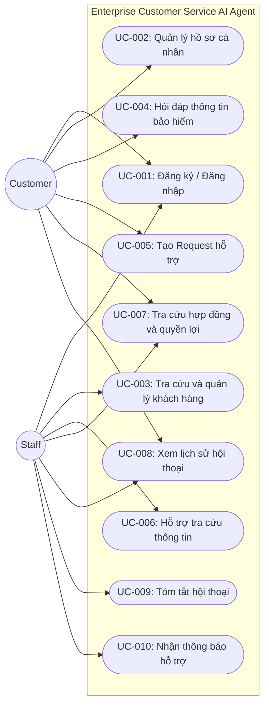

# Tài liệu Đặc tả Yêu cầu Phần mềm (SRS - BHNT)

> **Tên tài liệu:** SRS-BHNT — Enterprise Customer Service AI Agent cho lĩnh vực bảo hiểm nhân thọ  
> **Người viết:** Đặng Phạm Trung  
> **Phiên bản:** 1.1 (Ngày tạo: 08/10/2026)  
> **Người cập nhật:** Tuấn, Vũ, Hậu, Thịnh (Làm rõ các tính năng)

---

## I. Tổng quan

### 1. Thông tin tài liệu

| Thông tin | Nội dung |
| :--- | :--- |
| **Tên tài liệu** | SRS-BHNT |
| **Người viết** | Đặng Phạm Trung |
| **Phiên bản** | 1.1 |
| **Ngày tạo** | 08/10/2026 |

### 2. Lịch sử thay đổi

| Phiên bản | Ngày | Nội dung thay đổi | Người thay đổi |
| :---: | :---: | :--- | :--- |
| **1.0** | 08/10/2026 | Khởi tạo tài liệu | Đặng Phạm Trung |
| **1.1** | 08/10/2026 | Làm rõ các tính năng | Tuấn, Vũ, Hậu, Thịnh |

### 3. Tổng quan nghiệp vụ

**Feature:** Enterprise Customer Service AI Agent cho lĩnh vực bảo hiểm nhân thọ.

Hệ thống cung cấp AI Agent hỗ trợ **Customer** và **Staff** trong việc tra cứu thông tin, giải đáp thắc mắc và hỗ trợ chăm sóc khách hàng:
- **Customer AI Agent:** Hỗ trợ khách hàng tìm hiểu sản phẩm, quyền lợi, hợp đồng và tạo Request khi cần Staff hỗ trợ.
- **Staff AI Agent:** Hỗ trợ Staff tra cứu thông tin khách hàng, hợp đồng, kiến thức sản phẩm và tóm tắt lịch sử trao đổi.

**Mục tiêu:** Giảm thời gian tra cứu thông tin, hỗ trợ các yêu cầu lặp lại và giúp Staff nhanh chóng nắm bắt ngữ cảnh khách hàng. Hệ thống nằm trong phân hệ Customer Service, kết nối với Enterprise Knowledge và các dữ liệu nghiệp vụ liên quan.

*Dữ liệu nguồn:* PDF gốc, metadata và RAG index (chunks/embeddings) được coi là dữ liệu công ty đã có sẵn; trong PoC, nhóm phát triển dựng sẵn bộ dữ liệu tương ứng trước khi chạy ứng dụng. Ứng dụng truy xuất các nguồn này theo quyền được cấp.

---

## II. Phạm vi và Yêu cầu

### 1. Phạm vi

#### a. Trong phạm vi (In Scope)
Hệ thống tập trung vào các chức năng chính:
- **Customer:**
  - Đăng ký, đăng nhập và quản lý thông tin cá nhân.
  - Tra cứu thông tin hợp đồng và quyền lợi bảo hiểm.
  - Chat với Customer AI Agent để hỏi đáp và tra cứu thông tin.
  - AI Agent sử dụng Knowledge/RAG và các công cụ được phép để hỗ trợ khách hàng.
  - Đối với Customer đã đăng nhập: AI Agent đề xuất Ticket, tóm tắt hội thoại và chỉ yêu cầu Core Backend tạo Ticket sau xác nhận hợp lệ. Staff có thể tiếp quản theo quyền nghiệp vụ.
  - Xem lịch sử hội thoại và trạng thái Request/Ticket.
- **Staff & Vận hành:**
  - Quản lý và tra cứu thông tin khách hàng; xem, theo dõi và tiếp nhận Ticket/Request hoặc takeover hội thoại theo phân công. *(Lưu ý: Quy trình giải quyết Ticket → hoàn tất → phản hồi Customer nằm ngoài MVP).*
  - Sử dụng AI Agent để tra cứu thông tin, Knowledge và tóm tắt ngữ cảnh khách hàng.
  - Hệ thống gửi thông báo khi có cuộc hội thoại hoặc Request cần Staff tiếp nhận.

#### b. Ngoài phạm vi (Out of Scope)
- AI tự động phê duyệt hoặc từ chối Claim.
- AI đưa ra cam kết chính thức về quyền lợi bảo hiểm.
- Xử lý Claim end-to-end.
- Tự động thay đổi hợp đồng hoặc thực hiện thanh toán bảo hiểm.
- Thẩm định bảo hiểm và Fraud Detection.
- Triển khai quy trình Staff xử lý Request → hoàn tất → phản hồi Customer.
- AI tự động ra quyết định hoặc thực hiện nghiệp vụ thay Staff.
- Voice AI / Call Center AI.
- Sử dụng dữ liệu khách hàng / hợp đồng thực tế trong prototype.

---

### 2. Yêu cầu chức năng (Functional Requirements)

| ID | Chức năng | Actor | Mô tả | Priority |
| :--- | :--- | :--- | :--- | :---: |
| **FR-001** | Đăng ký / Đăng nhập | Customer, Staff | Người dùng đăng ký, đăng nhập và truy cập hệ thống theo vai trò. | **Must** |
| **FR-002** | Quản lý hồ sơ | Customer, Staff | Customer quản lý thông tin cá nhân; Staff xem thông tin khách hàng được phụ trách. | **Must** |
| **FR-003** | Quản lý khách hàng | Staff | Staff xem và tra cứu danh sách khách hàng được phụ trách. | **Must** |
| **FR-005** | Chat với AI + Staff | Customer | Customer tương tác với AI Agent để hỏi đáp và hỗ trợ tra cứu thông tin theo sản phẩm đã tham gia. Có thể yêu cầu “Chat với Staff” → AI đề xuất handoff/Ticket, Customer xác nhận trước khi Core Backend lưu Ticket và thông báo Staff. | **Must** |
| **FR-006** | Chat với Customer | Staff | • Tiếp nhận đoạn chat từ Ticket để hỗ trợ trực tiếp. • Giành quyền của AI Agent để chat ngay với Customer. | **Must** |
| **FR-007** | Chat với AI | Staff | Hỗ trợ Staff tra cứu thông tin dựa trên context đoạn chat đang hỗ trợ (Triển khai qua sidebar). | **Must** |
| **FR-008** | Tra cứu thông tin bảo hiểm thủ công | Customer, Staff | Hỗ trợ tra cứu sản phẩm, quyền lợi, điều khoản, hợp đồng và các thông tin liên quan (giấy tờ, pdf). | **Must** |
| **FR-009** | Tạo Ticket hỗ trợ | Customer, AI Agent | AI Agent thu thập thông tin và tóm tắt; Customer đã xác thực xác nhận trước khi Core Backend tạo Support Ticket; Staff xử lý Ticket theo quyền nghiệp vụ. | **Must** |
| **FR-010** | Quản lý Ticket (xem/theo dõi/tiếp nhận) | Staff | Staff xem, theo dõi Ticket thuộc phạm vi phân công và tiếp nhận chat liên quan; chưa triển khai workflow xử lý Ticket → hoàn tất → phản hồi Customer. | **Must** |
| **FR-011** | Lịch sử hội thoại | Customer, Staff | Người dùng xem lại lịch sử trao đổi với AI và các cuộc hội thoại liên quan. | **Should** |
| **FR-012** | Tóm tắt hội thoại | AI Agent | AI Agent tóm tắt nội dung trao đổi để hỗ trợ quá trình tạo và tiếp nhận Request. | **Must** |
| **FR-013** | Thông báo | System, Staff | Hệ thống thông báo cho Staff khi có cuộc hội thoại hoặc Request cần tiếp nhận. | **Should** |

---

### 3. Yêu cầu phi chức năng (Non-Functional Requirements)

| ID | Nhóm | Yêu cầu |
| :--- | :--- | :--- |
| **NFR-001** | **Bảo mật và phân quyền** | Backend phải xác thực và kiểm tra quyền ở mỗi API/công cụ truy cập dữ liệu. Customer chỉ xem dữ liệu của mình; Staff chỉ xem dữ liệu thuộc phạm vi được phân công. AI không được tự bỏ qua phân quyền hoặc chạy SQL tùy ý. |
| **NFR-002** | **Quyền riêng tư dữ liệu** | Prototype/PoC chỉ sử dụng dữ liệu khách hàng và hợp đồng giả lập. Chỉ gửi cho LLM dữ liệu tối thiểu cần thiết; không ghi token, thông tin xác thực hoặc dữ liệu nhạy cảm không cần thiết vào log. Private RAG phải lọc quyền truy cập trước khi đưa kết quả vào ngữ cảnh LLM. |
| **NFR-003** | **Độ tin cậy và an toàn của AI** | AI ưu tiên dữ liệu nghiệp vụ đã xác thực và tài liệu đúng phiên bản; cung cấp liên kết nguồn khi có thể. Nếu không đủ căn cứ hoặc nguồn dữ liệu lỗi, AI phải nêu rõ giới hạn và đề xuất Staff hỗ trợ, không tự suy đoán, cam kết quyền lợi hay phê duyệt/từ chối claim. |
| **NFR-004** | **Hiệu năng** | Đánh giá riêng API nghiệp vụ, truy xuất PostgreSQL/pgvector, phản hồi LLM và truyền tệp. Mục tiêu thử nghiệm ban đầu có thể đặt p95 ≤ 2 giây cho API nghiệp vụ cơ bản, không tính thời gian gọi LLM và tải PDF; cần benchmark trong môi trường triển khai để xác nhận. Không xem các mốc <50 ms hoặc 1–3 giây là cam kết khi chưa đo. |
| **NFR-005** | **Độ tin cậy giao dịch** | Chỉ thông báo tạo Ticket thành công sau khi Backend lưu thành công. Thông báo Staff được phát sau khi Ticket đã lưu; hệ thống xử lý timeout/lỗi rõ ràng và hạn chế tạo Ticket trùng khi người dùng thử lại. |
| **NFR-006** | **Thông báo gần thời gian thực** | Hệ thống thông báo cho Staff khi có cuộc hội thoại mới hoặc Ticket đã được tạo. Mục tiêu thử nghiệm đề xuất: thông báo hiển thị trong vòng 5 giây dưới workload W; cần xác nhận bằng kiểm thử. Nếu dịch vụ thông báo lỗi, Ticket vẫn phải được lưu và có thể kiểm tra lại trạng thái gửi. |
| **NFR-007** | **Tệp và tài liệu** | Người dùng chỉ được xem hoặc tải PDF có sẵn trong phạm vi được cấp quyền. Sử dụng Presigned URL có thời hạn hoặc streaming phù hợp để truy xuất tệp gốc từ MinIO/S3; tài liệu được mở phải khớp với hợp đồng và phiên bản mà người dùng được phép xem. |
| **NFR-008** | **Giám sát và truy vết** | Ghi nhận lỗi, thời gian phản hồi, tình trạng gọi LLM/RAG và kết quả gửi thông báo. Các thao tác truy cập dữ liệu nhạy cảm cần có log kiểm toán phù hợp; log không chứa dữ liệu nhạy cảm không cần thiết. |

---

## III. Use Case

### 1. Sơ đồ Use Case (Use Case Diagram)

### 2. Danh sách Use Case tiêu biểu

| Use Case ID | Tên Use Case | Actor | Mô tả |
| :--- | :--- | :--- | :--- |
| **UC-004** | Hỏi đáp thông tin bảo hiểm với AI Agent | Customer | Customer tương tác với AI Agent để đặt câu hỏi, hiểu sâu sản phẩm đã tham gia và nhận hỗ trợ trong quá trình sử dụng dịch vụ. |
| **UC-005** | AI Agent tạo Ticket hỗ trợ | AI Agent, Customer | Khi yêu cầu vượt phạm vi xử lý hoặc cần Staff hỗ trợ, AI Agent thu thập thông tin, tóm tắt hội thoại và tạo Request gửi đến Staff. |
| **UC-006** | Staff chat với Agent | Staff | Staff tương tác với AI Agent để tra cứu thông tin dựa trên context đoạn chat với khách hàng hiện tại, mã hợp đồng cụ thể, tìm kiếm kiến thức nghiệp vụ. |
| **UC-007** | Tra cứu thông tin hợp đồng và quyền lợi | Customer, Staff | Tra cứu trên tài liệu gốc, hợp đồng điện tử được cấp, chứng thực. |

---

## IV. Chi tiết Use Case tiêu biểu

### 1. UC-004: Hỏi đáp thông tin bảo hiểm

| Trường | Chi tiết |
| :--- | :--- |
| **Use case ID** | **UC-004** |
| **Tên** | Hỏi đáp thông tin bảo hiểm với AI Agent |
| **Actor** | Customer |
| **Mô tả** | Customer tương tác với Customer AI Agent để đặt câu hỏi, tìm hiểu thông tin cụ thể sản phẩm mà mình đã tham gia. |
| **Tiền điều kiện** | Customer đã truy cập hệ thống và có thể sử dụng Customer AI Agent. |
| **Hậu điều kiện** | Customer nhận được câu trả lời dựa trên thông tin được truy xuất từ nguồn phù hợp; nội dung hội thoại được lưu lại để duy trì ngữ cảnh cho các lượt trao đổi tiếp theo. |
| **Luồng chính** | 1. Customer gửi câu hỏi hoặc yêu cầu. 2. AI Agent phân tích câu hỏi, yêu cầu, ngữ cảnh hội thoại và xác định ý định, mục đích của Customer. 3. AI Agent quyết định cách xử lý yêu cầu, xác định câu hỏi có thể được giải đáp từ Enterprise Knowledge hay cần truy xuất dữ liệu nghiệp vụ. 4. AI Agent lựa chọn và sử dụng nguồn thông tin hoặc công cụ phù hợp để thu thập dữ liệu cần thiết. 5. AI Agent kiểm tra kết quả truy xuất và sử dụng thông tin thu được để xây dựng câu trả lời. 6. AI Agent trả lời Customer và duy trì ngữ cảnh để xử lý các câu hỏi tiếp theo. |
| **Ngoại lệ** | • **Không tìm thấy thông tin đáng tin cậy:** AI Agent không tự suy đoán, thông báo chưa đủ thông tin và đề xuất tạo Request hỗ trợ. • **Yêu cầu cần dữ liệu cá nhân/hợp đồng nhưng Customer không có quyền truy cập:** AI Agent từ chối truy xuất dữ liệu. • **Yêu cầu vượt phạm vi xử lý:** AI Agent xác định cần Staff hỗ trợ và chuyển sang UC-005. • **Công cụ hoặc nguồn dữ liệu không khả dụng:** AI Agent thông báo không thể hoàn thành yêu cầu thay vì đưa ra thông tin chưa được xác thực. |

---

### 2. UC-005: AI Agent tạo Ticket hỗ trợ

| Trường | Chi tiết |
| :--- | :--- |
| **Use case ID** | **UC-005** |
| **Tên** | AI Agent tạo Ticket hỗ trợ |
| **Actor** | AI Agent, Customer |
| **Mô tả** | Khi Customer đã xác thực cần Staff hỗ trợ, AI Agent thu thập và tóm tắt thông tin; Customer xác nhận trước khi Core Backend tạo Ticket và chuyển đến Staff. |
| **Tiền điều kiện** | Customer đang tương tác với Customer AI Agent và phát sinh yêu cầu cần vượt quá phạm vi mà Agent có thể xử lý. |
| **Hậu điều kiện** | Hội thoại mà Customer đã trao đổi với Agent trước đó được tóm tắt lại, tổng hợp thành Ticket và được chuyển đến Staff để hỗ trợ trực tiếp. |
| **Luồng chính** | 1. Customer đưa ra yêu cầu mà AI Agent không thể hoặc không được phép xử lý. 2. AI Agent phân tích yêu cầu cần Staff hỗ trợ hoặc Customer chủ động yêu cầu hỗ trợ. 3. AI Agent xác định các thông tin cần thiết để tạo Ticket dựa trên nội dung yêu cầu và lịch sử hội thoại. 4. Nếu còn thiếu thông tin quan trọng, AI Agent chủ động hỏi Customer và cập nhật thông tin. 5. AI Agent tổng hợp, tóm tắt hội thoại và trình Customer xác nhận nội dung Ticket trước khi tạo; khi chưa xác nhận thì chỉ lưu bản nháp trong phiên. 6. Sau khi Customer xác nhận, Core Backend kiểm tra quyền và tính hợp lệ, lưu Ticket (kèm ngữ cảnh/tóm tắt và outbox thông báo) trong giao dịch bền vững; Staff được thông báo bất đồng bộ. 7. Chỉ sau khi Core Backend đã commit Ticket, hệ thống mới thông báo cho Customer mã Ticket và trạng thái chuyển giao; không được báo thành công khi lưu thất bại. |
| **Ngoại lệ** | • **Customer không cung cấp đủ thông tin:** AI Agent tiếp tục yêu cầu bổ sung thông tin cần thiết. • **Tạo Ticket thất bại:** Hệ thống thông báo lỗi và AI Agent đề xuất Customer thử lại hoặc thực hiện phương án hỗ trợ khác. • **Yêu cầu có thể được giải quyết bằng Knowledge/Tool:** AI Agent xử lý yêu cầu thay vì tạo Ticket. |

---

### 3. UC-006: Hỗ trợ tra cứu thông tin (Staff chat với Agent)

| Trường | Chi tiết |
| :--- | :--- |
| **Use case ID** | **UC-006** |
| **Tên** | Staff chat với Agent |
| **Actor** | Staff |
| **Mô tả** | Staff tương tác với AI Agent để tra cứu thông tin dựa trên context đoạn chat với khách hàng, mã hợp đồng cụ thể, tìm kiếm kiến thức nghiệp vụ. |
| **Tiền điều kiện** | Staff đã đăng nhập và có quyền sử dụng Staff AI Agent. |
| **Hậu điều kiện** | Staff nhận được thông tin phù hợp với yêu cầu, kèm theo dữ liệu được truy xuất từ các nguồn mà Staff có quyền truy cập. |
| **Luồng chính** | 1. Staff đặt câu hỏi hoặc yêu cầu AI Agent hỗ trợ. 2. Staff AI Agent phân tích yêu cầu và xác định mục tiêu cần thực hiện. 3. AI Agent xác định những thông tin cần thiết và lựa chọn nguồn dữ liệu phù hợp, chẳng hạn Enterprise Knowledge, Customer Data hoặc Policy Data. 4. AI Agent kiểm tra quyền truy cập của Staff trước khi sử dụng dữ liệu nghiệp vụ. 5. AI Agent chủ động gọi một hoặc nhiều công cụ cần thiết để lấy dữ liệu. 6. AI Agent kết hợp và tổng hợp các kết quả thu được thành thông tin phù hợp với yêu cầu của Staff. 7. AI Agent trả kết quả cho Staff và duy trì ngữ cảnh để Staff có thể tiếp tục hỏi hoặc yêu cầu phân tích thêm. |
| **Ngoại lệ** | • **Không tìm thấy dữ liệu cần thiết:** AI Agent thông báo nguồn dữ liệu không đáp ứng yêu cầu thay vì tự suy đoán. • **Một công cụ không khả dụng:** AI Agent thông báo phần thông tin không thể truy xuất và chỉ trả về những thông tin đã xác thực. |

---

### 4. UC-007: Tra cứu hợp đồng và quyền lợi

| Trường | Chi tiết |
| :--- | :--- |
| **Use case ID** | **UC-007** |
| **Tên** | Tra cứu hợp đồng và quyền lợi |
| **Actor** | Customer, Staff |
| **Mô tả** | Customer hoặc Staff mở tài liệu hợp đồng điện tử gốc được cấp quyền. Với quyền lợi cá nhân, hợp đồng đúng phiên bản cùng dữ liệu nghiệp vụ đã xác thực là nguồn có thẩm quyền; PDF sản phẩm công khai chỉ dùng giải thích quy tắc chung, không thay hợp đồng cá nhân hay quyết định claim. |
| **Tiền điều kiện** | Người dùng đã đăng nhập; dữ liệu hợp đồng tồn tại và người dùng có quyền truy cập dữ liệu tương ứng. |
| **Hậu điều kiện** | Người dùng tìm được thông tin hợp đồng hoặc quyền lợi cụ thể đang cần tìm. |
| **Luồng chính** | 1. Người dùng nhấn mục chức năng hợp đồng của tôi / Staff nhấn vào hồ sơ khách, chọn mục hợp đồng được cấp. 2. Chọn Mã hợp đồng / tên hợp đồng cụ thể muốn kiểm tra, rà soát, tra cứu. |
| **Ngoại lệ** | • **Không tìm được hợp đồng cần tra cứu.** |
