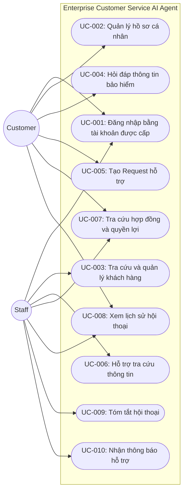

# Tài liệu Đặc tả Yêu cầu Phần mềm (SRS - BHNT)

> **Đồng bộ nghiệp vụ 06/11/2026:** Inbox All/Requests/Active không counts; assignment không cho Staff duyệt chat AI riêng. Direct hợp lệ hoặc Customer consent + Staff Accept mới cho Staff đọc toàn bộ lịch sử Customer-facing của chính cuộc; pending chỉ metadata. Handoff/Accept không tự tạo Ticket; Ticket không cấp quyền đọc chat. ConversationStatus không có CLOSED, TicketStatus.CLOSED giữ riêng. FR/UC trong bản repo bên dưới đã phản ánh các quyết định này; SRS online giữ nguyên. [Quyết định](../source-review.md#quyết-định-inbox-và-quyền-chat--03112026), [plans](../ui/staff/plans/README.md).

> **Hiện trạng application theo main 05/11/2026, đối chiếu 06/11:** Login/session/account, Staff profile/Customers/Policies/Products, chat hai đầu/handoff notifications và Customer Home/Products/Policies/PDF đã có. Staff Ticket read/Accept/UI/status/notification đã có TK01–TK05; I07 tạo Ticket từ đề xuất Agent và xác nhận Customer còn kế hoạch. Customer PATCH và Agent/Copilot chưa được nghiệm thu từ baseline này. Xem [checklist](../ui/implementation-status.md); không suy toàn FR/NFR hoàn tất từ bảng/route/mock.

> **Quyết định 07/11/2026 — tài khoản MVP:** Customer và Staff dùng tài khoản được cấp sẵn. Không có Customer tự đăng ký công khai; FR-001/UC-001 bên dưới áp dụng đăng nhập, phiên và truy cập theo vai trò. Không mở rộng sang tích hợp quy trình phát hành hợp đồng/cấp tài khoản tự động.

> **Tên tài liệu:** SRS-BHNT — Enterprise Customer Service AI Agent cho lĩnh vực bảo hiểm nhân thọ  
> **Người viết:** Đặng Phạm Trung  
> **Phiên bản:** 1.1 (Ngày tạo: 08/10/2026)  
> **Người cập nhật:** Tuấn, Vũ, Hậu, Thịnh (Làm rõ các tính năng)

---

## I. Tổng quan

### 1. Thông tin tài liệu

| Thông tin | Nội dung |
| :--- | :--- |
| **Tên tài liệu** | SRS-BHNT |
| **Người viết** | Đặng Phạm Trung |
| **Phiên bản** | 1.1 |
| **Ngày tạo** | 08/10/2026 |

### 2. Lịch sử thay đổi

| Phiên bản | Ngày | Nội dung thay đổi | Người thay đổi |
| :---: | :---: | :--- | :--- |
| **1.0** | 08/10/2026 | Khởi tạo tài liệu | Đặng Phạm Trung |
| **1.1** | 08/10/2026 | Làm rõ các tính năng | Tuấn, Vũ, Hậu, Thịnh |

### 3. Tổng quan nghiệp vụ

**Feature:** Enterprise Customer Service AI Agent cho lĩnh vực bảo hiểm nhân thọ.

Hệ thống cung cấp AI Agent hỗ trợ **Customer** và **Staff** trong việc tra cứu thông tin, giải đáp thắc mắc và hỗ trợ chăm sóc khách hàng:
- **Customer AI Agent:** Hỗ trợ khách hàng tìm hiểu sản phẩm, quyền lợi, hợp đồng và tạo Request khi cần Staff hỗ trợ.
- **Staff AI Agent:** Hỗ trợ Staff tra cứu thông tin khách hàng, hợp đồng, kiến thức sản phẩm và tóm tắt lịch sử trao đổi.

**Mục tiêu:** Giảm thời gian tra cứu thông tin, hỗ trợ các yêu cầu lặp lại và giúp Staff nhanh chóng nắm bắt ngữ cảnh khách hàng. Hệ thống nằm trong phân hệ Customer Service, kết nối với Enterprise Knowledge và các dữ liệu nghiệp vụ liên quan.

*Dữ liệu nguồn:* PDF gốc, metadata và RAG index (chunks/embeddings) được coi là dữ liệu công ty đã có sẵn; trong PoC, nhóm phát triển dựng sẵn bộ dữ liệu tương ứng trước khi chạy ứng dụng. Ứng dụng truy xuất các nguồn này theo quyền được cấp.

*Phạm vi sản phẩm MVP — cập nhật repo ngày 28/10/2026:* **7 sản phẩm Manulife, gồm 4 chính và 3 bổ trợ**, theo [danh sách chuẩn](Agent_Design.md#mvp-products). Hai lựa chọn điều khoản Xanh Ước Mơ tính là một sản phẩm và phải được phân biệt khi truy xuất. Dữ liệu khách hàng/hợp đồng chỉ được sinh hoàn toàn giả lập. Cập nhật này áp dụng trong repo, không sửa SRS trên Google Docs.

---

## II. Phạm vi và Yêu cầu

### 1. Phạm vi

#### a. Trong phạm vi (In Scope)
Hệ thống tập trung vào các chức năng chính:
- **Customer:**
  - Đăng nhập bằng tài khoản được cấp sẵn và quản lý thông tin cá nhân theo quyền.
  - Tra cứu thông tin hợp đồng và quyền lợi bảo hiểm.
  - Chat với Customer AI Agent để hỏi đáp và tra cứu thông tin.
  - AI Agent sử dụng Knowledge/RAG và các công cụ được phép để hỗ trợ khách hàng.
  - Đối với Customer đã đăng nhập: AI Agent đề xuất Ticket, tóm tắt hội thoại và chỉ yêu cầu Core Backend tạo Ticket sau xác nhận hợp lệ. Staff có thể tiếp quản theo quyền nghiệp vụ.
  - Xem lịch sử hội thoại và trạng thái Request/Ticket.
- **Staff & Vận hành:**
  - Quản lý, tra cứu khách hàng và Ticket theo quyền; chat với Customer trong cuộc Direct hợp lệ hoặc sau Customer consent + Staff Accept. Quyền Ticket và quyền transcript được kiểm riêng. *(Workflow giải quyết nghiệp vụ → hoàn tất → phản hồi Customer nằm ngoài phạm vi nghiệm thu này.)*
  - Sử dụng AI Agent để tra cứu thông tin, Knowledge và tóm tắt ngữ cảnh khách hàng.
  - Hệ thống gửi thông báo khi có cuộc hội thoại hoặc Request cần Staff tiếp nhận.

#### b. Ngoài phạm vi (Out of Scope)
- Customer tự đăng ký tài khoản công khai.
- AI tự động phê duyệt hoặc từ chối Claim.
- AI đưa ra cam kết chính thức về quyền lợi bảo hiểm.
- Xử lý Claim end-to-end.
- Tự động thay đổi hợp đồng hoặc thực hiện thanh toán bảo hiểm.
- Thẩm định bảo hiểm và Fraud Detection.
- Triển khai quy trình Staff xử lý Request → hoàn tất → phản hồi Customer.
- AI tự động ra quyết định hoặc thực hiện nghiệp vụ thay Staff.
- Voice AI / Call Center AI.
- Sử dụng dữ liệu khách hàng / hợp đồng thực tế trong prototype.

---

### 2. Yêu cầu chức năng (Functional Requirements)

**Liên hệ Customer và số hợp đồng — cập nhật 14/11/2026.** Staff đủ phân công/quyền tài nguyên xem đầy đủ số hợp đồng. Email/phone mặc định che và có Hiện/Ẩn để liên hệ, Core kiểm quyền lại khi yêu cầu bản đầy đủ. Mask/reveal còn P trong CU01/CU02, số hợp đồng đã khớp source hiện tại. [Số hợp đồng](../configuration-and-data.md#staff-policy-number), [liên hệ](../configuration-and-data.md#staff-contact-reveal).

**Làm rõ FR-005/006 ngày 14/11/2026.** Customer muốn dùng AI sau trao đổi với Staff chủ động mở New AI chat. Cuộc mới có context/thread riêng, cuộc cũ tiếp tục theo trạng thái và quyền hiện hành. Dừng nhắn không tạo Close hoặc thao tác kết thúc. New AI chat/create đã có, tích hợp Agent/Core còn theo CH02/CH03. [Quyết định chuẩn](Agent_Design.md#new-ai-chat-after-staff).

| ID | Chức năng | Actor | Mô tả | Priority |
| :--- | :--- | :--- | :--- | :---: |
| **FR-001** | Đăng nhập và quản lý phiên | Customer, Staff | Người dùng đăng nhập bằng tài khoản được cấp sẵn, sử dụng phiên và truy cập theo vai trò. Không có Customer tự đăng ký công khai trong MVP. Logout/hết phiên theo B ngày 14/11, phiên cũ bị chặn truy cập dữ liệu riêng, yêu cầu AI Core đã nhận tiếp tục theo quyền hiện hành và người dùng đăng nhập lại xem kết quả. | **Must** |
| **FR-002** | Quản lý hồ sơ | Customer, Staff | Customer chỉ xem hồ sơ cá nhân theo quyết định 13/11/2026; Staff xem thông tin khách hàng được phụ trách. | **Must** |
| **FR-003** | Quản lý khách hàng | Staff | Staff xem và tra cứu danh sách khách hàng được phụ trách. | **Must** |
| **FR-005** | Chat với AI + Staff | Customer | Customer hỏi đáp và tra cứu bằng AI. Khi muốn chuyển cuộc AI sang Staff, Customer xác nhận chia sẻ lịch sử → Core lưu yêu cầu → Staff Accept; trước Accept chỉ chia sẻ metadata. Customer cũng có thể bắt đầu cuộc Direct hợp lệ. Handoff không tự tạo Ticket. Sau hỗ trợ Staff, Customer chủ động tạo chat AI mới với context riêng, cuộc cũ theo quyền/trạng thái hiện hành. | **Must** |
| **FR-006** | Chat với Customer | Staff | Staff tiếp nhận cuộc Direct hợp lệ hoặc yêu cầu handoff đã có Customer consent và Staff Accept; sau Accept được đọc toàn bộ lịch sử Customer-facing của chính cuộc và chat tiếp. Assignment hoặc Ticket đơn lẻ không cấp quyền transcript; không chủ động giành quyền chat AI riêng. | **Must** |
| **FR-007** | Chat với AI | Staff | Copilot nội bộ hỗ trợ tra cứu, giải thích và tóm tắt từ cuộc chat Staff có quyền đọc; kết quả tách khỏi chat Customer. MVP không soạn nháp câu trả lời hoặc có Use draft. Theo B ngày 14/11, Staff xem hợp đồng bằng Policy Lookup và nêu/làm rõ hợp đồng trong câu hỏi, Copilot hỏi lại khi mơ hồ. | **Must** |
| **FR-008** | Tra cứu thông tin bảo hiểm thủ công | Customer, Staff | Hỗ trợ tra cứu sản phẩm, quyền lợi, điều khoản, hợp đồng và các thông tin liên quan (giấy tờ, pdf). | **Must** |
| **FR-009** | Tạo Ticket hỗ trợ | Customer, AI Agent | Customer tạo thủ công hoặc xem/sửa/xác nhận draft Agent; Core kiểm quyền/chống trùng và tạo SupportTicket OPEN + outbox; Staff tiếp nhận theo quyền. | **Must** |
| **FR-010** | Quản lý Ticket (xem/theo dõi/tiếp nhận) | Staff | Staff xem, theo dõi và tiếp nhận Ticket trong phạm vi nghiệp vụ; quyền đọc chat liên quan được kiểm riêng theo FR-006. Đổi trạng thái Ticket không tự cấp/thu hồi quyền chat; workflow giải quyết nghiệp vụ và phản hồi Customer không được coi là hoàn tất chỉ từ thao tác trạng thái. | **Must** |
| **FR-011** | Lịch sử hội thoại | Customer, Staff | Người dùng xem lại lịch sử trao đổi với AI và các cuộc hội thoại liên quan. | **Should** |
| **FR-012** | Tóm tắt hội thoại | AI Agent | Agent chuẩn bị tóm tắt bàn giao Ticket để Customer xem/xác nhận; tách khách khai, kết quả đã xác minh, việc đã thử và phần còn vướng. Copilot tóm tắt cuộc chat được phép theo diễn biến gần hoặc từ đầu khi Staff yêu cầu; không tự gửi Customer. | **Must** |
| **FR-013** | Thông báo | System, Customer, Staff | Staff nhận sự kiện theo quyền. Theo quyết định 08/11 và phương án A ngày 13/11, Customer có chat/SYSTEM và Notification Center persisted cho Staff Accept, Ticket created và tin Staff chưa đọc; own read/read-all, nội dung generic và message read status theo N01/N02. Notification Customer và Staff cùng retention 30 ngày, dù đã đọc hay chưa; Ticket/Message nguồn có lifecycle riêng. | **Should** |

---

### 3. Yêu cầu phi chức năng (Non-Functional Requirements)

| ID | Nhóm | Yêu cầu |
| :--- | :--- | :--- |
| **NFR-001** | **Bảo mật và phân quyền** | Backend phải xác thực và kiểm tra quyền ở mỗi API/công cụ truy cập dữ liệu. Customer chỉ xem dữ liệu của mình; Staff chỉ xem dữ liệu thuộc phạm vi được phân công. AI không được tự bỏ qua phân quyền hoặc chạy SQL tùy ý. |
| **NFR-002** | **Quyền riêng tư dữ liệu** | Prototype/PoC chỉ sử dụng dữ liệu khách hàng và hợp đồng giả lập. Chỉ gửi cho LLM dữ liệu tối thiểu cần thiết; không ghi token, thông tin xác thực hoặc dữ liệu nhạy cảm không cần thiết vào log. Private RAG phải lọc quyền truy cập trước khi đưa kết quả vào ngữ cảnh LLM. |
| **NFR-003** | **Độ tin cậy và an toàn của AI** | AI ưu tiên dữ liệu nghiệp vụ đã xác thực và tài liệu đúng phiên bản; cung cấp liên kết nguồn khi có thể. Nếu không đủ căn cứ hoặc nguồn dữ liệu lỗi, AI phải nêu rõ giới hạn và đề xuất Staff hỗ trợ, không tự suy đoán, cam kết quyền lợi hay phê duyệt/từ chối claim. |
| **NFR-004** | **Hiệu năng** | Đánh giá riêng API nghiệp vụ, truy xuất PostgreSQL/pgvector, phản hồi LLM và truyền tệp. Mục tiêu thử nghiệm ban đầu có thể đặt p95 ≤ 2 giây cho API nghiệp vụ cơ bản, không tính thời gian gọi LLM và tải PDF; cần benchmark trong môi trường triển khai để xác nhận. Không xem các mốc <50 ms hoặc 1–3 giây là cam kết khi chưa đo. |
| **NFR-005** | **Độ tin cậy giao dịch** | Chỉ thông báo tạo Ticket thành công sau khi Backend lưu thành công. Thông báo Staff được phát sau khi Ticket đã lưu; hệ thống xử lý timeout/lỗi rõ ràng và hạn chế tạo Ticket trùng khi người dùng thử lại. |
| **NFR-006** | **Thông báo gần thời gian thực** | Hệ thống thông báo cho Staff khi có cuộc hội thoại mới hoặc Ticket đã được tạo. Mục tiêu thử nghiệm đề xuất: thông báo hiển thị trong vòng 5 giây dưới workload W; cần xác nhận bằng kiểm thử. Nếu dịch vụ thông báo lỗi, Ticket vẫn phải được lưu và có thể kiểm tra lại trạng thái gửi. |
| **NFR-007** | **Tệp và tài liệu** | Người dùng chỉ được xem hoặc tải PDF có sẵn trong phạm vi được cấp quyền. Sử dụng Presigned URL có thời hạn hoặc streaming phù hợp để truy xuất tệp gốc từ MinIO/S3; tài liệu được mở phải khớp với hợp đồng và phiên bản mà người dùng được phép xem. |
| **NFR-008** | **Giám sát và truy vết** | Ghi nhận lỗi, thời gian phản hồi, tình trạng gọi LLM/RAG và kết quả gửi thông báo. Các thao tác truy cập dữ liệu nhạy cảm cần có log kiểm toán phù hợp; log không chứa dữ liệu nhạy cảm không cần thiết. |

---

## III. Use Case

### 1. Sơ đồ Use Case (Use Case Diagram)

### 2. Danh sách Use Case tiêu biểu

| Use Case ID | Tên Use Case | Actor | Mô tả |
| :--- | :--- | :--- | :--- |
| **UC-004** | Hỏi đáp thông tin bảo hiểm với AI Agent | Customer | Customer tương tác với AI Agent để đặt câu hỏi, hiểu sâu sản phẩm đã tham gia và nhận hỗ trợ trong quá trình sử dụng dịch vụ. |
| **UC-005** | Đề xuất và xác nhận tạo Ticket hỗ trợ | AI Agent, Customer | Customer gửi form thủ công hoặc xem/sửa/xác nhận draft Agent; Core kiểm quyền/chống trùng rồi ghi Ticket OPEN + outbox. Handoff là luồng riêng. |
| **UC-006** | Staff chat với Agent | Staff | Staff tương tác với AI Agent để tra cứu thông tin dựa trên context đoạn chat với khách hàng hiện tại, mã hợp đồng cụ thể, tìm kiếm kiến thức nghiệp vụ. |
| **UC-007** | Tra cứu thông tin hợp đồng và quyền lợi | Customer, Staff | Tra cứu trên tài liệu gốc, hợp đồng điện tử được cấp, chứng thực. |

---

## IV. Chi tiết Use Case tiêu biểu

### 1. UC-004: Hỏi đáp thông tin bảo hiểm

| Trường | Chi tiết |
| :--- | :--- |
| **Use case ID** | **UC-004** |
| **Tên** | Hỏi đáp thông tin bảo hiểm với AI Agent |
| **Actor** | Customer |
| **Mô tả** | Customer tương tác với Customer AI Agent để đặt câu hỏi, tìm hiểu thông tin cụ thể sản phẩm mà mình đã tham gia. |
| **Tiền điều kiện** | Customer đã truy cập hệ thống và có thể sử dụng Customer AI Agent. |
| **Hậu điều kiện** | Customer nhận được câu trả lời dựa trên thông tin được truy xuất từ nguồn phù hợp; nội dung hội thoại được lưu lại để duy trì ngữ cảnh cho các lượt trao đổi tiếp theo. |
| **Luồng chính** | 1. Customer gửi câu hỏi hoặc yêu cầu. 2. AI Agent phân tích câu hỏi, yêu cầu, ngữ cảnh hội thoại và xác định ý định, mục đích của Customer. 3. AI Agent quyết định cách xử lý yêu cầu, xác định câu hỏi có thể được giải đáp từ Enterprise Knowledge hay cần truy xuất dữ liệu nghiệp vụ. 4. AI Agent lựa chọn và sử dụng nguồn thông tin hoặc công cụ phù hợp để thu thập dữ liệu cần thiết. 5. AI Agent kiểm tra kết quả truy xuất và sử dụng thông tin thu được để xây dựng câu trả lời. 6. AI Agent trả lời Customer và duy trì ngữ cảnh để xử lý các câu hỏi tiếp theo. |
| **Ngoại lệ** | • **Không tìm thấy thông tin đáng tin cậy:** Agent nêu giới hạn, có thể đề xuất Staff hoặc Ticket theo nhu cầu. • **Không có quyền truy cập:** từ chối truy xuất dữ liệu. • **Cần Staff:** Customer xác nhận chia sẻ cuộc chat, Staff Accept theo FR-005/006; nếu cần ghi nhận Ticket thì theo UC-005 riêng. • **Nguồn/công cụ lỗi:** nêu phần không thể xác minh, không đoán hoặc báo nghiệp vụ thành công. |

---

### 2. UC-005: Đề xuất và xác nhận tạo Ticket hỗ trợ

| Trường | Chi tiết |
| :--- | :--- |
| **Use case ID** | **UC-005** |
| **Tên** | Đề xuất và xác nhận tạo Ticket hỗ trợ |
| **Actor** | AI Agent, Customer |
| **Mô tả** | Customer đã xác thực tạo yêu cầu qua form thủ công hoặc xem/sửa/xác nhận draft Agent; Core tạo Ticket OPEN và thông báo Staff theo quyền. |
| **Tiền điều kiện** | Customer có phiên hợp lệ. Luồng Agent cần draft server thuộc Customer; luồng thủ công cần nội dung form hợp lệ. |
| **Hậu điều kiện** | Ticket và outbox được Core lưu sau xác nhận hợp lệ; Customer nhận mã sau commit. Staff được thông báo theo quyền; Ticket không tự chuyển giao hoặc mở transcript của cuộc chat. |
| **Luồng chính** | 1. Customer có yêu cầu cần ghi nhận hỗ trợ. 2. Agent xác định nội dung từ yêu cầu, lịch sử và nguồn được phép. 3. Nếu thiếu thông tin cần thiết, Agent hỏi làm rõ theo chính sách dữ liệu nhạy cảm; không chủ động hỏi chi tiết sức khỏe. 4. Agent chuẩn bị tóm tắt gồm yêu cầu, bối cảnh, khách khai, kết quả đã xác minh, việc đã thử và phần còn vướng. 5. Customer xem, có thể sửa title/description/policy thành revision mới rồi xác nhận; chưa xác nhận thì draft chưa tạo Ticket. 6. Core kiểm quyền, nội dung/hiệu lực xác nhận và idempotency rồi ghi Ticket OPEN + outbox cùng transaction. 7. Chỉ sau commit mới báo mã Ticket; thông báo Staff xử lý bất đồng bộ. |
| **Luồng tạo thủ công** | Customer mở form Tickets, nhập title/description và policy tùy chọn, chủ động gửi request có key; Core kiểm owner/validation/idempotency rồi commit Ticket OPEN + snapshot/audit/outbox. Customer nhận mã sau commit. |
| **Nội dung bàn giao Agent đã chốt 13/11** | Draft, review và confirmedContent giữ đủ sáu nhóm tóm tắt cùng nguồn. Customer sửa yêu cầu/policy thì review lại revision hiện hành; lời khách không tự thành finding đã xác minh. Staff đọc snapshot theo quyền Ticket và quyền nguồn. |
| **Ngoại lệ** | • **Chưa xác nhận/thiếu thông tin:** không tạo Ticket; làm rõ trong phạm vi được phép hoặc nêu giới hạn/chuyển Staff. • **Lưu thất bại/timeout:** đối soát theo idempotency, không đoán đã tạo hoặc tạo bản mới để thử lại. • **Thông báo lỗi sau commit:** Ticket vẫn tồn tại, xử lý giao lại thông báo. • **Giải quyết được bằng nguồn/tool:** trả lời thay vì buộc tạo Ticket. |

---

### 3. UC-006: Hỗ trợ tra cứu thông tin (Staff chat với Agent)

| Trường | Chi tiết |
| :--- | :--- |
| **Use case ID** | **UC-006** |
| **Tên** | Staff chat với Agent |
| **Actor** | Staff |
| **Mô tả** | Staff tương tác với AI Agent để tra cứu thông tin dựa trên context đoạn chat với khách hàng, mã hợp đồng cụ thể, tìm kiếm kiến thức nghiệp vụ. |
| **Tiền điều kiện** | Staff đã đăng nhập, có phân công và quyền transcript hiện hành của cuộc Direct/đã Accept được liên kết; pending hoặc chat AI riêng không đủ quyền. |
| **Hậu điều kiện** | Staff nhận được thông tin phù hợp với yêu cầu, kèm theo dữ liệu được truy xuất từ các nguồn mà Staff có quyền truy cập. |
| **Luồng chính** | 1. Staff gửi câu hỏi tra cứu, giải thích hoặc tóm tắt. 2. Core kiểm quyền và cố định mốc chat nguồn lúc nhận câu hỏi; retry/resume dùng cùng mốc. 3. Agent lấy lịch sử được phép và chọn tool trong giới hạn; Core kiểm quyền mỗi lời gọi. 4. Agent tổng hợp bằng chứng đúng tài liệu/phiên bản. Tóm tắt mặc định diễn biến gần, yêu cầu từ đầu thì mở phạm vi trong cùng cuộc được phép. 5. Core kiểm và lưu kết quả nội bộ; không đưa vào chat Customer, không soạn nháp hoặc có Use draft. Tin nguồn sau mốc được lấy ở câu hỏi Staff tiếp theo. |
| **Ngoại lệ** | • **Không tìm thấy dữ liệu cần thiết:** AI Agent thông báo nguồn dữ liệu không đáp ứng yêu cầu thay vì tự suy đoán. • **Một công cụ không khả dụng:** AI Agent thông báo phần thông tin không thể truy xuất và chỉ trả về những thông tin đã xác thực. |

---

### 4. UC-007: Tra cứu hợp đồng và quyền lợi

**Làm rõ MVP đã chốt ngày 30/10/2026:** Core giữ mã hợp đồng, chủ sở hữu, sản phẩm chính và danh sách bổ trợ tối thiểu theo [quyết định dữ liệu](Contract_Data_Design.md). Chi tiết khác tra qua RAG đúng hợp đồng/phiên bản sau kiểm tra quyền. Chỉ kết luận không tham gia bổ trợ khi danh sách đã xác minh đầy đủ; nếu chưa đầy đủ thì tìm thêm bằng RAG hoặc trả chưa xác định. PDF/bảng minh họa không thay nguồn cập nhật về phí thực thu, số dư hay trạng thái hiện tại. Cập nhật này áp dụng cho tài liệu repo; không sửa SRS Google Docs.

| Trường | Chi tiết |
| :--- | :--- |
| **Use case ID** | **UC-007** |
| **Tên** | Tra cứu hợp đồng và quyền lợi |
| **Actor** | Customer, Staff |
| **Mô tả** | Customer hoặc Staff mở tài liệu hợp đồng điện tử gốc được cấp quyền. Với quyền lợi cá nhân, hợp đồng đúng phiên bản cùng dữ liệu nghiệp vụ đã xác thực là nguồn có thẩm quyền; PDF sản phẩm công khai chỉ dùng giải thích quy tắc chung, không thay hợp đồng cá nhân hay quyết định claim. |
| **Tiền điều kiện** | Người dùng đã đăng nhập; dữ liệu hợp đồng tồn tại và người dùng có quyền truy cập dữ liệu tương ứng. |
| **Hậu điều kiện** | Người dùng tìm được thông tin hợp đồng hoặc quyền lợi cụ thể đang cần tìm. |
| **Luồng chính** | 1. Người dùng nhấn mục chức năng hợp đồng của tôi / Staff nhấn vào hồ sơ khách, chọn mục hợp đồng được cấp. 2. Chọn Mã hợp đồng / tên hợp đồng cụ thể muốn kiểm tra, rà soát, tra cứu. |
| **Ngoại lệ** | • **Không tìm được hợp đồng cần tra cứu.** |
