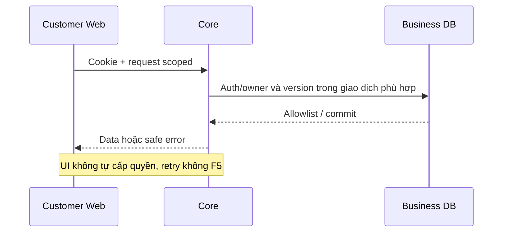

# Customer — contract chung về model, UI và kiểm chứng

04/11/2026 · **Đề xuất triển khai, không phải runtime mới** · [Thứ tự phase](README.md) · [Hiện trạng Customer](../README.md).

## 1. Baseline phải giữ

Runtime `/login`, `/customer`, `/account` đã có. `/customer` hiện ghép hồ sơ/contact và chat tối thiểu; chưa có shell/menu Customer đầy đủ. I03–I06 đã tạo own conversation/Direct, consent/handoff, history/send/reconcile/realtime và SYSTEM sau Accept; chưa Agent trả lời. Auth shared giữ dedup, abort/generation, passive freshness30 giây và force khi invalidate/expiry/retry. Không gọi auth/me lại mỗi selection/tin nhắn.

## 2. Truy vết model

| Quan hệ | Hệ quả thiết kế |
| --- | --- |
| User 1–1 CustomerProfile, User 1–N AuthSession | Actor từ session; profile role CUSTOMER, không nhận userId/role body để sửa người khác |
| CustomerProfile 1–N StaffAssignment | Chỉ contact Staff active khả dụng, không cho Customer chọn/đổi assignment |
| CustomerProfile 1–N InsurancePolicy N–1 InsuranceProduct | My policies theo owner; sản phẩm inactive không xóa policy lịch sử |
| Product/Policy/Customer → Document 1–N DocumentVersion | AccessScope hiện chỉ PUBLIC/PRIVATE_POLICY; policy/owner và exact version binding trước cấp link, không có PRIVATE_CUSTOMER |
| CustomerProfile 1–N Conversation 1–N Message | Own transcript chỉ CUSTOMER_SUPPORT/customer-visible; Copilot/internal không trả Customer |
| Conversation → SupportTicket | Ticket xác nhận riêng; không tạo từ request/Accept Staff |
| Notification → StaffProfile | Chưa có recipient Customer; không tái dùng bằng cách giả StaffId |

CustomerProfile chỉ có fullName/birth/address/citizenId/assignmentVersion và quan hệ; không profile.updatedAt. User có phone/email/accountCode/status/updatedAt. InsuranceProduct chỉ có name/code/summary/isActive, không pricing/benefit table. Policy financials decimal string/null, dates date-only, snapshot whitelist; không paid/unpaid ledger.

## 3. Quyền và protocol dùng chung

Prefix `/api/v1`; E/P theo từng phase. GET no-store. Cookie phiên HttpOnly; CSRF token chỉ trong memory, không browser storage. Ghi sau login cần Origin allowlist + JSON + X-Auth-Request:1 + X-CSRF-Token. Actor/role/owner do Core lấy; UUID đúng không có nghĩa có quyền. 401 hết phiên, 403 role/CSRF, resource ngoài quyền/không tồn tại404, DTO400, conflict409, quota429, dependency503. Error envelope foundation giữ requestId, không echo PII/SDK error/SQL.

API mới dùng quota DB có operation riêng; mức cụ thể là đề xuất local phải chốt theo phase. Response allowlist, không raw Prisma/snapshot/tool trace. Core atomic mutation+audit/outbox nếu có nghiệp vụ cần phát sự kiện; commit trước success. Unknown outcome giữ cùng key/version và reconcile, không tạo key mới để thử lại. Agent checkpoint khác giao dịch nghiệp vụ.

## 4. Hướng giao diện

- Cùng hệ Staff: Tailwind4 prefix `tw:`, Lexend tự host, xanh primary/surface sáng/neutral border, tokens hiện có trong globals.css. Dùng lại token khi đúng nghĩa; không đổi global Staff tokens để Customer đẹp hơn. Không CSS cũ/@apply/inline style hoặc dependency UI mới mặc định.
- Customer gọn hơn Staff: menu ít mục, tiêu đề dễ hiểu, khoảng trắng nhất quán, một thao tác chính mỗi vùng. Tránh nhiều hộp màu/badge/card trùng số liệu. Không nội dung nghiệp vụ giả để lấp giao diện.
- Đề xuất nav: Home, Products, My policies, Conversations, Tickets khi có thật; Profile/Account trong account menu. Notifications chỉ sau scope decision. Có thể gộp Home/profile ban đầu; không cần nhét menu chưa triển khai thành nút chết.
- Responsive: desktop sidebar gọn + content có max-width hợp lý; mobile drawer/list→detail, chat và PDF ưu tiên chiều cao còn lại. Một scroll owner mỗi vùng, tránh cuộn toàn trang lồng viewer không giới hạn.
- Label tiếng Anh, text/nhãn đầy đủ và trạng thái không chỉ dựa màu. Keyboard, focus ring, aria-current/expanded/live/busy, dialog focus return; kiểm375px/768px/desktop, zoom200%, reduced-motion. Không auto-focus lại khi refresh nền.

## 5. Router, cache và lifecycle

Đề xuất routes dưới `/customer/...`, xem H01; giữ deep link cũ `/customer?conversationId=...` và `/account`. Auth boundary chỉ một nơi; không layout/page cùng gọi me. Search/filter/page/selection dùng client router và state scoped actor; abort/generation loại response cũ. Browser Back/Forward đúng; ấn Enter form không document submit; không `window.location.reload`/key remount workspace.

Draft/key gửi trong memory theo actor/conversation, không reset khi chỉ query/list refresh. Signed URL chỉ memory, không URL app/log/localStorage/notification. Viewer giữ src cùng file/version còn hợp lệ; đổi scope/actor/document phải clear. Logout/revoke không vô hiệu ngay URL đã cấp trước TTL; không hứa thu hồi file đã tải. Invalidations có scope recheck bằng REST, không chứa transcript/private details.

## 6. Kiểm chứng và Definition of Done

Mỗi phase ghi rõ Core/unit/HTTP integration, browser mock và E2E gateway thật; không dùng một loại thay loại khác. Fixtures synthetic runId tự dọn, không reset DB/volumes/env hoặc sửa seed chung. Dùng Docker test harness hiện có; không mở FE/Core trên host. PDF kiểm bằng text extraction/metadata/hash/Range/network, không ảnh.

- [ ] Spec/Swagger/model/migration cần thiết được review trước phần phụ thuộc.
- [ ] Happy/empty/null/network/401/404/409/429/stale-response tests tương ứng pass.
- [ ] Keyboard/responsive/no-F5 và cleanup được kiểm; luồng Staff/auth/chat cũ không hồi quy.
- [ ] Cập nhật trạng thái đúng phạm vi; phần chưa có Agent không đánh dấu LLM/Ticket E2E hoàn tất.
