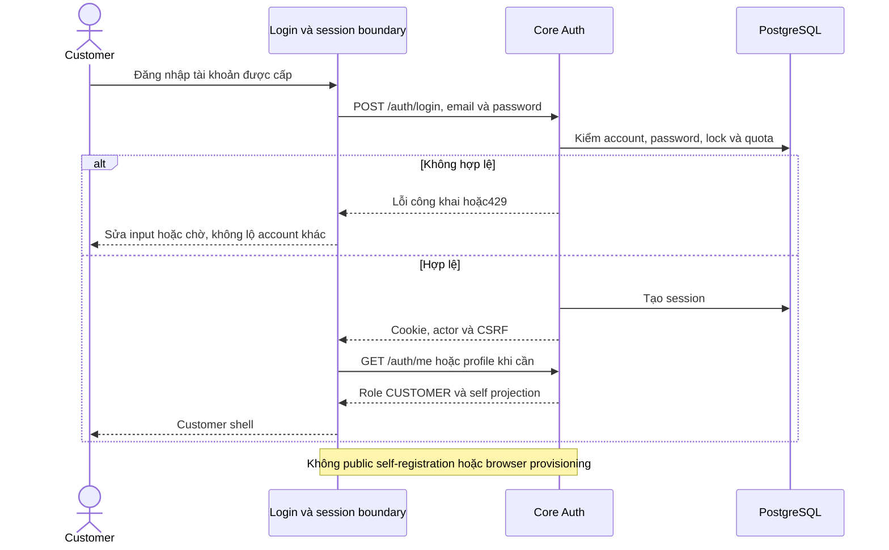

# C01 — Đăng nhập và xác thực tài khoản Customer

07/11/2026 · **Phạm vi đã xác nhận: tài khoản được cấp sẵn; login/session đã có** · [Chung](00-customer-contract.md) · C01.

## 1. Yêu cầu và nguyên tắc xác thực

- **Không có Customer tự đăng ký công khai:** MVP dùng tài khoản được cấp sẵn theo xác nhận 07/11/2026 và FR-001. Không yêu cầu triển khai tích hợp phát hành hợp đồng hoặc quy trình cấp tài khoản tự động; tài khoản dev synthetic được chuẩn bị theo Getting Started.
- Mật khẩu ban đầu được hệ thống cấp (`passwordChangeRecommended = true`).
- Khách hàng đăng nhập qua cổng `/login` bằng email được cấp và được khuyến nghị đổi mật khẩu tại `/account` sau lần đăng nhập đầu tiên.
- Không triển khai luồng tự đăng ký công khai (`/register`), OTP kích hoạt tự do, SSO bên ngoài hoặc reset mật khẩu tự động mà không qua quy trình định danh hợp đồng.

## 2. Luồng xác thực vận hành

- **Đăng nhập**: `POST /api/v1/auth/login` nhận `{ email, password }`. Cookie phiên HttpOnly được cấp phát, `GET /api/v1/auth/me` xác định vai trò `CUSTOMER` và tự chuyển hướng vào Cổng khách hàng `/customer`.
- **Bảo mật phiên & CSRF**: Xác thực qua cookie phiên, kiểm tra header `X-Auth-Request: 1` và token `X-CSRF-Token` cho mọi thao tác ghi dữ liệu.
- **Đổi mật khẩu**: `POST /api/v1/auth/change-password` cho phép chủ tài khoản tự cập nhật mật khẩu, xóa cờ khuyến nghị đổi mật khẩu.
- **Đăng xuất**: `POST /api/v1/auth/logout` hủy phiên an toàn và chuyển hướng về `/login`.

## 3. Trạng thái và checklist

- [x] Khôi phục phiên, điều hướng theo actor; phiên hết hạn về login.
- [x] Form disabled khi gửi, hiện/ẩn password, lỗi công khai và xử lý 429 theo API.
- [x] Đăng xuất/đổi password dùng API thật, xem [C08](08-profile-contract.md).
- [x] Chốt dùng tài khoản được cấp sẵn; không có luồng tự đăng ký công khai hoặc yêu cầu cấp tự động trong MVP.
- [x] Điều hướng vào shell H01 (`CustomerWorkspace`) tràn viền toàn màn hình.

## Test cases

Các ca dưới đây là **đặc tả kiểm thử**, không phải báo cáo kết quả. Kiểm từng lớp API/service/DB/browser đúng nhãn; mock UI không thay kiểm quyền Core hoặc E2E thật.

**Quy ước dữ liệu:** S-A/S-B là hai Staff synthetic; C-A/C-B là hai Customer synthetic khác nhau. Thay alias bằng UUID/token của fixture cô lập; các path HTTP dùng prefix /api/v1 nếu chưa ghi đầy đủ. Chỉ thay assignment, khóa account, inject lỗi hoặc migration trong harness/môi trường test, không trên tài khoản/dữ liệu đang sử dụng.

### C01-T01 — Đăng nhập tài khoản được cấp

**Lớp kiểm thử:** Browser + API.
**Điều kiện và dữ liệu:** C-A ACTIVE có email/password synthetic được cấp; không dùng dữ liệu tài khoản thật.

**Các bước:**

1. Mở /login, nhập credential C-A và submit.
2. Kiểm POST /auth/login, GET /auth/me và route đích.
3. Dùng account Staff thử cổng Customer ở context khác.

**Kết quả mong đợi:** Customer vào đúng shell/role; không tạo quyền Staff hoặc tự đăng ký. Không ghi credential/cookie vào log.

### C01-T02 — Không có self-registration công khai

**Lớp kiểm thử:** Browser + Route review.
**Điều kiện và dữ liệu:** Cổng Customer đang chạy theo policy cấp tài khoản từ nghiệp vụ.

**Các bước:**

1. Kiểm login/menu và mở /register nếu URL được nhập trực tiếp.
2. Kiểm route/backend có được công bố là registration E hay không.
3. Không gọi endpoint provisioning/operator bằng browser Customer.

**Kết quả mong đợi:** Không form/endpoint đăng ký công khai trái policy; route thiếu không được coi là lỗi login. Không cấp tài khoản từ LLM hoặc client.

### C01-T03 — Đổi mật khẩu và logout

**Lớp kiểm thử:** Browser E2E.
**Điều kiện và dữ liệu:** C-A dùng mật khẩu synthetic ban đầu, có hai phiên riêng; passwordChangeRecommended=true.

**Các bước:**

1. Mở /account và đổi password theo policy hiện hành.
2. Dùng phiên cũ gọi /auth/me; kiểm cờ khuyến nghị ở phiên mới.
3. Logout và thử mở route Customer được bảo vệ.

**Kết quả mong đợi:** Phiên cũ bị thu hồi, cờ khuyến nghị cập nhật; logout clear state và về login; không F5 để ép hoàn tất thao tác.

### C01-T04 — Lỗi login,429 và session pending

**Lớp kiểm thử:** Browser + API mock.
**Điều kiện và dữ liệu:** Biến thể password sai, locked user,429 Retry-After và request auth chậm.

**Các bước:**

1. Submit credential sai/locked rồi phục hồi đúng.
2. Cho429 và thử tương tác khi pending.
3. Đổi actor/portal trước khi auth response cũ về.

**Kết quả mong đợi:** Lỗi công khai không lộ account existence; pending chống submit trùng/cooldown theo contract; response cũ không khôi phục actor.

**Dọn sau kiểm thử:** xóa đúng fixture/session/object/schema theo runId; phục hồi fault injection và đóng context/socket test. Không reset DB/credential, sửa bootstrap hoặc xóa volumes. Với PDF kiểm metadata/bytes/hash; với UI kiểm DOM/focus/network, không cần screenshot.

## Sequence diagram

Luồng chính và nhánh quyền/lỗi; test case ở trên chỉ rõ dữ liệu và điểm kiểm tương ứng.

