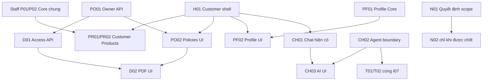

# Customer — thứ tự triển khai theo chức năng và phase

04/11/2026 · **Customer UI mới chưa implement; baseline chat/auth và shared APIs đã có** · [Chỉ mục Customer](../README.md) · [Contract chung](00-customer-contract.md).

## 1. Phạm vi và cách dùng

Mỗi chức năng có một contract giống cấu trúc Staff Inbox; bên trong là các file phase riêng có vị trí code, API, model, flow, kiểm thử và gate. Không chạy một lần toàn bộ. Khi bắt đầu phase, rà lại runtime/schema, chốt các đề xuất kỹ thuật của phase đó, triển khai và cập nhật checkbox trong chính file phase. Không tạo report khác.

Baseline bổ sung04/11: Staff P01/A17 và P02/A19/access Core đã có và được test cho cả hai role. Các phase Customer dưới đây chưa triển khai UI mới; PR01/PR02 có thể dùng API thật. Owner policy/PDF Customer vẫn chờ PO01/D01 riêng.

## 2. Các nhánh

| Chức năng | Phase nhỏ và phụ thuộc | Có cần Agent? |
| --- | --- | --- |
| [C01 — Auth](01-auth-contract.md) | A01 registration Core → A02 registration UI; login hiện có giữ nguyên | Không; cần chốt signup policy |
| [C02 — Workspace/Home](02-home-contract.md) | H01 shell/router → H02 Home nhẹ | Không |
| [C03 — Products](03-products-contract.md) | Staff P01/P02 Core chung → PR01 list/detail UI → PR02 PDF chung | Không |
| [C04 — Policies](04-policies-contract.md) | PO01 ownership API → PO02 list/detail UI; PDF do C05 | Không |
| [C05 — Documents](05-documents-contract.md) | PO01 → D01 policy catalog/access → D02 viewer; PR02 tái dùng viewer lifecycle | Không |
| [C08 — Profile](08-profile-contract.md) | PF01 Core + concurrency model → PF02 editor/account UI | Không |
| [C06 — Chat](06-chat-contract.md) | CH01 ghép UI trên I03–I06; CH02 Agent boundary → CH03 Agent answers/citations | CH01 không; CH02/03 có |
| [C07 — Tickets](07-tickets-contract.md) | T01 triển khai Core chung theo Staff I07 → T02 Customer review/result | Nguồn draft thật phụ thuộc Agent |
| [C09 — Notifications](09-notifications-contract.md) | N01 scope/recipient decision → N02 center nếu được chốt | Chưa đưa vào đường triển khai bắt buộc |

H01 không chặn việc viết Core PO01/PF01. T01 là phần Customer của cùng I07, không một module Ticket thứ hai. H02 không cần chờ toàn bộ tính năng, chỉ thêm lối tắt đã chạy.

## 3. Thứ tự khuyên làm trước để ít rối

1. **Staff P01/P02/P03 đã hoàn tất**; API sản phẩm dùng chung hai role. Mốc hiện tại ưu tiên Staff TK01–TK05 với tests trong từng phase, chưa mở Customer UI mới.
2. **Customer H01**, giữ chat/profile/account đang chạy; sau đó **PR01 → PR02** để có trang hoàn chỉnh đầu tiên.
3. **PO01 → D01 → PO02 → D02**: ownership policy và PDF cá nhân, dùng lại parser/storage/viewer Staff. Không gộp thêm Agent.
4. **PF01 → PF02**, rồi **H02**: sửa hồ sơ đúng FR-002 và Home nhẹ từ dữ liệu hiện có.
5. **A01 → A02** khi đã chốt cơ chế đăng ký local theo FR-001; CH01 có thể làm sau H01 để hoàn thiện bố cục chat đang chạy.
6. CH02/CH03 và T01/T02 để nhánh Agent riêng. N01/N02 chỉ làm nếu chốt Customer notification center.

Đây là thứ tự chia việc, không deadline hoặc cam kết hoàn thành tất cả hôm nay. Staff catalog Core/UI đã có; khi mở đợt Customer bắt đầu H01, không triển khai lại P01/P02.

## 4. Tiêu chuẩn chung

- Source FR/NFR và model field phải truy được từ contract. Dữ liệu/trường mới cần migration mới và backfill an toàn, không sửa migration đã apply.
- API P chỉ thành E sau implementation/test; mock UI không chứng minh quyền hoặc LLM thật. Core HTTP, browser mock và browser E2E thật ghi riêng.
- Session/ownership/version/CSRF/idempotency thực thi tại Core, không LLM/URL/FE tự cấp.
- Kiểm thử DOM/network/console; PDF text/metadata/hash; không screenshot, trace/video hoặc render ảnh. Không tạo tài khoản/dữ liệu thử vào bootstrap chung.
- Không F5 khi search/filter/save/retry/chọn tài liệu/chat. Ghi kết quả vào checklist phase và chat; dọn fixture/artifact mình tạo, giữ dữ liệu/credential đang dùng.
