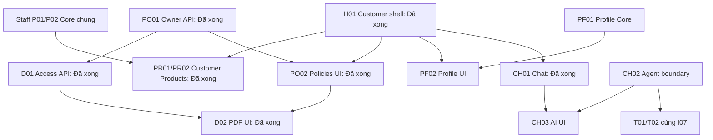

# Customer — thứ tự triển khai theo chức năng và phase

05/11/2026 · **Customer Portal đã triển khai hoàn tất UI tích hợp (H01, H02, PR01, PR02, PO01, PO02, D01, D02, CH01)** · [Chỉ mục Customer](../README.md) · [Contract chung](00-customer-contract.md).

## 1. Phạm vi và cách dùng

Các phase có test case với dữ liệu, bước làm và kỳ vọng cụ thể, kèm sequence diagram; áp dụng [quy ước chung](../../README.md#quy-ước-test-case-và-sequence-diagram). Phase còn đề xuất chỉ mô tả kịch bản dự kiến, không ghi kết quả chưa được chạy.

Mỗi chức năng có một contract giống cấu trúc Staff Inbox; bên trong là các file phase riêng có vị trí code, API, model, flow, kiểm thử và gate. Không chạy một lần toàn bộ. Khi bắt đầu phase, rà lại runtime/schema, chốt các đề xuất kỹ thuật của phase đó, triển khai và cập nhật checkbox trong chính file phase. Không tạo report khác.

Baseline hiện tại:
- Customer Shell & Home (`C02` / `H01`, `H02`): Shell điều hướng, account menu, popover thông báo, dashboard danh mục bảo hiểm thực tế.
- Products (`C03` / `PR01`, `PR02`): Danh sách giải pháp bảo hiểm, tìm kiếm, xem chi tiết (`View Details`), nút quay lại và xem/tải PDF tài liệu chính thức (`SignedPdfPreview`). Không ép luồng chat trực tiếp.
- Policies & Documents (`C04` / `PO01`, `PO02` và `C05` / `D01`, `D02`): Danh sách hợp đồng sở hữu, lọc trạng thái, chi tiết quyền lợi & lịch phí, và xem/tải PDF hợp đồng qua MinIO.
- Conversations (`C06` / `CH01`): Chat hai đầu AI Assistant / Chuyên viên hỗ trợ với đầy đủ consent, handoff và realtime.

## 2. Các nhánh

| Chức năng | Phase nhỏ và phụ thuộc | Trạng thái | Có cần Agent? |
| --- | --- | --- | --- |
| [C01 — Auth](01-auth-contract.md) | Tài khoản được cấp sẵn; login/logout/change-password hiện có; không tự đăng ký | Đã có login/session; phạm vi xác nhận 07/11 | Không |
| [C02 — Workspace/Home](02-home-contract.md) | H01 shell/router → H02 Home nhẹ | Đã triển khai | Không |
| [C03 — Products](03-products-contract.md) | Staff P01/P02 Core chung → PR01 list/detail UI → PR02 PDF chung | Đã triển khai | Không |
| [C04 — Policies](04-policies-contract.md) | PO01 ownership API → PO02 list/detail UI; PDF do C05 | Đã triển khai | Không |
| [C05 — Documents](05-documents-contract.md) | PO01 → D01 policy catalog/access → D02 viewer; PR02 tái dùng viewer lifecycle | Đã triển khai | Không |
| [C08 — Profile](08-profile-contract.md) | PF01 Core + concurrency model → PF02 editor/account UI | Đã có xem, PF01/02 sửa | Không |
| [C06 — Chat](06-chat-contract.md) | CH01 ghép UI trên I03–I06; CH02 Agent boundary → CH03 Agent answers/citations | CH01 đã có; CH02/03 còn P | CH01 không; CH02/03 có |
| [C07 — Tickets](07-tickets-contract.md) | T01 triển khai Core chung theo Staff I07 → T02 Customer review/result | I07/T01/T02 còn P; UI mẫu không là nghiệp vụ đã có | Nguồn draft thật phụ thuộc Agent |
| [C09 — Notifications](09-notifications-contract.md) | N01 scope/recipient decision → N02 center nếu được chốt | Có Toolbar popover/client state; chưa Core Customer notification | Chưa đưa vào đường triển khai bắt buộc |

## 3. Thứ tự triển khai

1. **Customer Shell & Home (H01, H02)**: Đã hoàn tất và tích hợp mượt mà vào `CustomerWorkspace` và `CustomerHome`.
2. **Customer Products (PR01, PR02)**: Đã hoàn tất danh sách, tìm kiếm, xem chi tiết và đọc PDF tài liệu chính thức.
3. **Owner Policies & Documents (PO01, PO02, D01, D02)**: Đã hoàn tất tra cứu hợp đồng cá nhân, quyền lợi và xem hợp đồng điện tử PDF.
4. **Chat (CH01)**: Giao diện trò chuyện AI và kết nối chuyên viên đã hoạt động trên nền tảng I03–I06.
5. **Tiếp theo**: Tích hợp Core–Agent cho CH02/CH03 và Ticket theo đề xuất Agent → Customer xác nhận → Core commit ở I07/T01/T02.

## 4. Tiêu chuẩn chung

- Toàn bộ UI tuân thủ hệ thống thiết kế AegisLife, 100% tiếng Anh nhất quán.
- Không F5 khi tìm kiếm, lọc, xem chi tiết sản phẩm/hợp đồng hay thao tác tài liệu.
- Phân biệt quyền chặt chẽ: chỉ cho phép xem thông tin và tài liệu thuộc phạm vi sở hữu của khách hàng.
