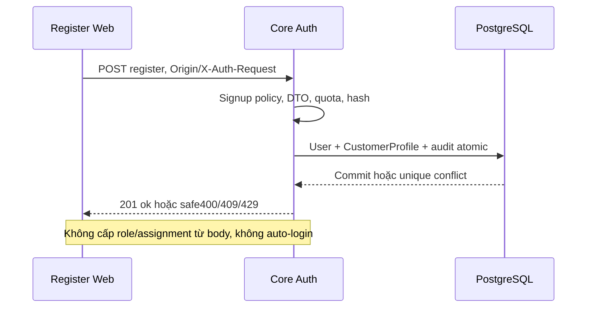

# A01 — Contract đăng ký và Core transaction

04/11/2026 · **P, chưa triển khai** · [C01 contract](../01-auth-contract.md) · Tiếp: [A02](02-registration-ui.md).

## 1. Kết quả và gate trước code

FR-001 Customer signup, không Agent. Chốt và ghi ngay tại phase này: phạm vi local, signup enable/disable, email verification có cần trước ACTIVE không, response khi email đã dùng và quota abuse. Phương án cơ sở để review là local signup không gửi email, sau commit về login; chưa phải phương án cloud. Không tự triển khai OTP/IdP hoặc coi email chưa verify đã được xác minh.

## 2. API spec đề xuất

`POST /api/v1/auth/register`, body `{email,password,confirmPassword,fullName}`. Email normalize/validate như login/account service; fullName trim1–255, password đúng policy đang có6 ký tự đến72 byte UTF-8, không trim, confirm phải khớp. Chỉ bốn field này; role/customerId/accountCode/status/phone/KYC/assignment lạ400.

Trước đăng nhập dùng Origin allowlist + application/json + X-Auth-Request:1; không yêu cầu CSRF token của phiên chưa có. Actor đang đăng nhập không tự đổi account hoặc nối hồ sơ; đề xuất409 và yêu cầu logout theo flow rõ ràng. Không echo password. Thành công sau commit `201 {ok:true}` không tự cấp session, không accountCode/PII echo. Duplicate email trả409 với thông điệp đăng ký không khả dụng an toàn; quyết định mức chống enumeration phải chốt cùng signup policy. Network timeout chưa biết commit thì không tự POST nhiều lần; hướng dẫn thử login hoặc retry cùng dữ liệu, unique email chặn tạo trùng, không khẳng định thất bại từ timeout.

Đề xuất quota registration riêng5 lần/15 phút/IP đáng tin cậy theo cấu hình proxy thực; không tin X-Forwarded-For tùy ý. Trong gateway local nếu chỉ thấy một IP, phải ghi giới hạn này và tránh khóa mọi người lâu. RateLimitBucket dùng key hash, không log email/IP thô. DTO400, Origin403, duplicate409, quota429, dependency503 theo foundation.

## 3. Vị trí và model

Đề xuất `apps/core/src/auth/dto/register.dto.ts`, route tại `auth.controller.ts`, service registration riêng trong AuthModule khi đủ nhu cầu. Đọc `accounts/services/account-management.service.ts` để dùng đúng normalization/hash/code allocation; không gọi operator HTTP hoặc cấp operator secret cho Web.

Transaction: kiểm quota → hash ngoài lock DB dài → insert User CUSTOMER/CustomerProfile + accountCode bằng allocator an toàn → audit tối thiểu → commit. Nếu local signup không verification được chốt, status ACTIVE, passwordChangeRecommended=false vì Customer tự đặt; không tạo StaffAssignment hoặc sample policy. Unique email/accountCode và composite role FK chặn race. Lỗi profile/audit rollback User; không MAX(code)+1 không khóa. Không migration mặc định nếu schema đủ; nếu verification cần field mới thì tách migration/backfill, dừng phần phụ thuộc cho tới contract rõ.

## 4. Luồng

## 5. Test và hoàn tất

Đề xuất `apps/core/test/customer-registration.test.cjs`, Docker harness và fixture tự dọn.

| ID | Case | Kỳ vọng |
| --- | --- | --- |
| A01-T01 | Signup hợp lệ rồi login Customer | Role/customer profile đúng; không Staff/policy/assignment |
| A01-T02 | Cùng email đồng thời, allocator chạy song song | Một User, code unique; không profile mồ côi |
| A01-T03 | Role/status/KYC injection, Origin sai, password UTF-8 quá byte | 400/403, không insert |
| A01-T04 | DB fail giữa insertUser/profile/audit | Rollback hoàn toàn; không false success |
| A01-T05 | Duplicate/timeout/quota/log scan | Response an toàn; không password/hash/secret trong log |

- [ ] Signup policy được ghi cụ thể trước enable; tests pass; login/session/password cũ không đổi.
- [ ] API/Swagger chỉ P→E sau controller thật; không tạo tài khoản thử trong bootstrap.
