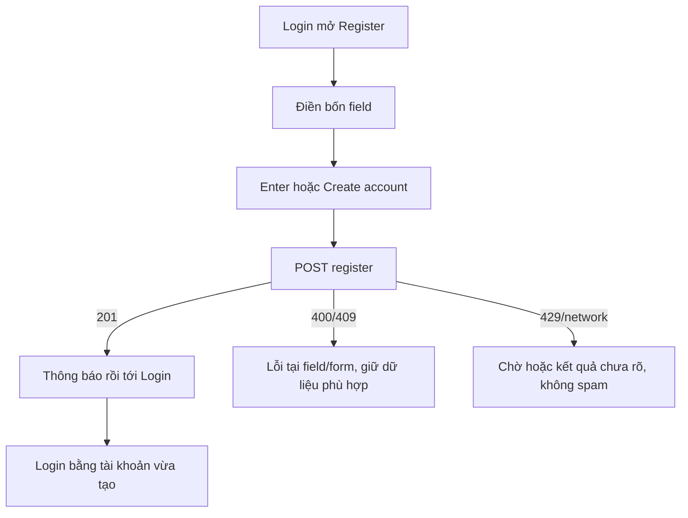

# A02 — Form đăng ký Customer

04/11/2026 · **Chưa triển khai** · [C01](../01-auth-contract.md) · Cần [A01](01-registration-core.md).

## 1. File và ranh giới

Route đề xuất `/register`: `apps/web/src/app/register/page.tsx`, `components/customer-register.tsx`, API helper trong `lib/auth-api.ts`. Giữ LoginPanel/auth-screen và session boundary; không thay cổng Staff hoặc tự tạo FE role. Thiết kế cùng blue/Lexend/Tailwind `tw:`; không thêm global CSS hoặc ảnh marketing bắt buộc.

## 2. API và thao tác

Dùng P `POST /auth/register` đúng bốn field A01; không gọi `/ops/v1`. Form fullName/email/password/confirmPassword, autocomplete phù hợp, label + show/hide cho từng password. Kiểm client giúp nhập nhưng server quyết định. Enter submit một lần, pending disable, không reset text khi lỗi có thể sửa; password chỉ memory, xóa sau success/unmount. Không tự trim password.

201 → thông báo đăng ký thành công và client navigation `/login`; không nói email đã verified hoặc auto-login nếu A01 không làm. 409 dùng thông điệp an toàn và lối về login;429 hiển thị retry timing; network unknown không khẳng định chưa tạo hoặc tạo lại liên tục. Existing session theo A01, không ghi đè actor. Signup bị disable thì route hiển thị trạng thái phù hợp, không nút hỏng.

## 3. Luồng

## 4. Test plan

Đề xuất `apps/web/tests/browser/customer-register.spec.mjs` (mock) và `customer-registration.integration.spec.mjs` (gateway thật); fixture email synthetic riêng, teardown API/DB harness, không ghi credential ra file.

| ID | Thao tác | Kỳ vọng |
| --- | --- | --- |
| A02-T01 | Tab qua form, show/hide, Enter liên tiếp | Focus đúng, một request, không document reload |
| A02-T02 | Confirm lệch/password UTF-8/duplicate email | Validation rõ, không echo secret, sửa lại được |
| A02-T03 | Offline trước/sau commit,429,route disabled | Không false success/failure, không auto retry vô hạn |
| A02-T04 | 375px/zoom200%/screen reader labels | Không tràn, lỗi được announce, focus giữ đúng |
| A02-T05 | E2E signup→login→profile | Customer mới đúng mình, UNASSIGNED, không dữ liệu mẫu của người khác |

- [ ] A01 thật và browser E2E pass; login/logout/password Staff/Customer không hồi quy.
- [ ] C01/checklist cập nhật đúng signup phạm vi local; không đánh dấu OTP/reset/SSO xong.
