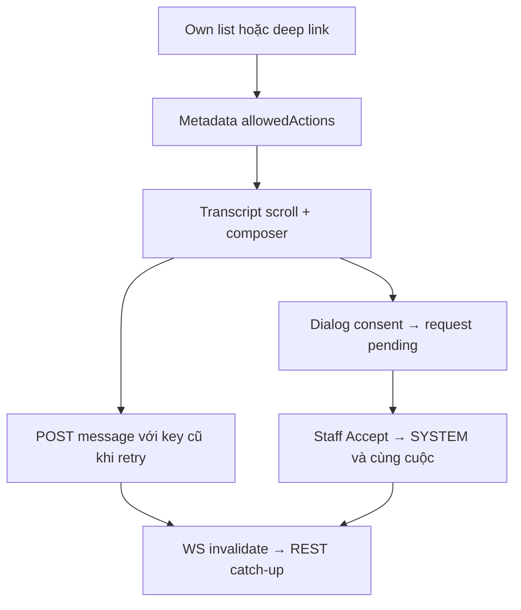

# CH01 — Ghép Conversations UI trên I03–I06

05/11/2026 · **Đã triển khai** · [C06](../06-chat-contract.md) · Cần H01.

## 1. Vị trí và UI

Triển khai tại `apps/web/src/components/customer-conversations.tsx`, tích hợp trong `CustomerWorkspace` khi mở tab `chat`.
- Sử dụng các component dùng chung: `customer-handoff-dialog.tsx`, `conversation-composer.tsx`, `conversation-transcript.tsx`.
- Client API: `lib/conversation-api.ts` và `chat-realtime.ts`.
- Danh sách cuộc trò chuyện: Hiển thị tiêu đề, thời gian, nhãn vai trò (*AI Assistant 24/7*, *Support Specialist*), trạng thái (*Active*, *Transferred*).
- Đã bỏ nút Refresh dư thừa trên header theo yêu cầu người dùng, lược bỏ gợi ý phím Enter/Shift+Enter thừa thãi ở composer.
- Toàn bộ giao diện chat 100% tiếng Anh nhất quán.

## 2. API contract E

Dựa trên nền tảng I03–I06:
- `GET /customers/me/chat-support`, `GET/POST /customers/me/conversations`
- `GET .../conversations/:id/messages` (phân trang bằng cursor prepend giữ vị trí cuộn)
- `POST .../conversations/:id/messages` (gửi tin nhắn chống trùng lặp qua `clientMessageId`)
- `POST .../conversations/:id/handoff-requests` (yêu cầu chuyển giao sang chuyên viên hỗ trợ có xác nhận đồng ý chia sẻ lịch sử rõ ràng)

## 3. Luồng handoff và realtime

- Dialog xác nhận chuyển giao: Hiển thị phạm vi chia sẻ toàn bộ lịch sử trò chuyện hiển thị cho khách hàng; Cancel/Escape không ghi nhận chia sẻ.
- Khi Staff Accept: Hệ thống tự động chuyển trạng thái cuộc chat và chèn tin nhắn thông báo SYSTEM.
- WebSocket realtime thông báo vô hiệu hóa (`invalidation`) để client tự động catch-up tin nhắn mới.

## 4. Test và hoàn tất

Đã kiểm chứng toàn bộ qua suite `apps/web/tests/browser/customer-conversations.spec.mjs`:
- `handoff cancel/Escape restores focus and never records consent`: Pass
- `routing conflict refreshes Staff and requires a new explicit confirmation`: Pass
- `unavailable Staff blocks Direct confirmation; legacy chat has no composer`: Pass
- `unknown create retries same UUID/payload, disables cancellation and does not duplicate intent`: Pass
- `mobile chat and consent dialog fit viewport and trap keyboard focus`: Pass

- [x] CH01 tích hợp hoàn tất vào shell Customer, giao diện tiếng Anh chuẩn.
- [x] Đã bỏ nút refresh và đơn giản hóa footer composer theo phản hồi người dùng.
- [x] 5/5 browser tests pass không flaky.
