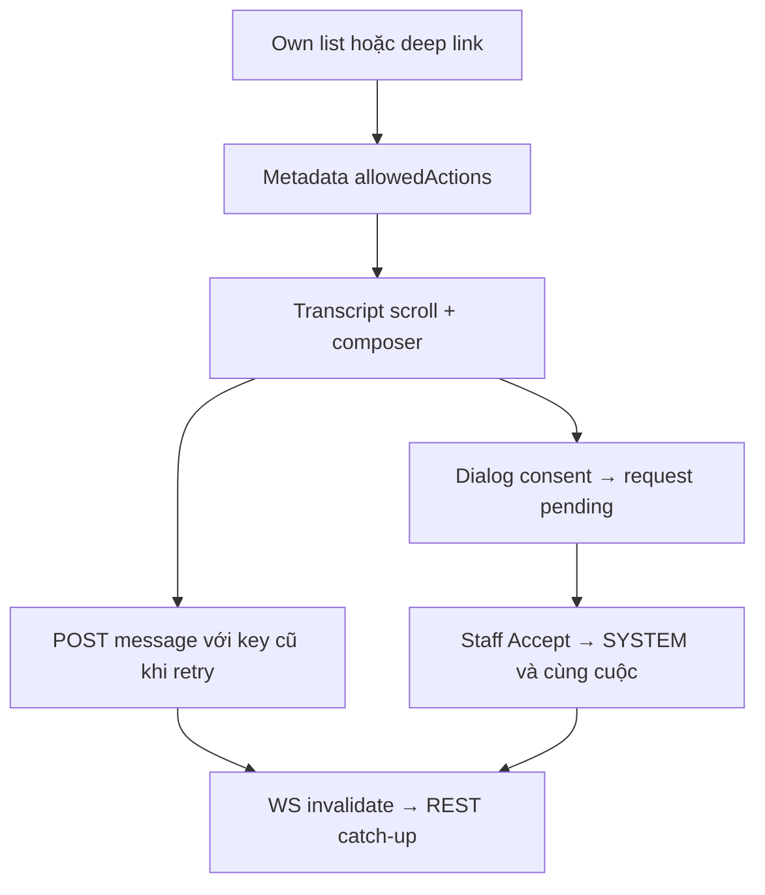
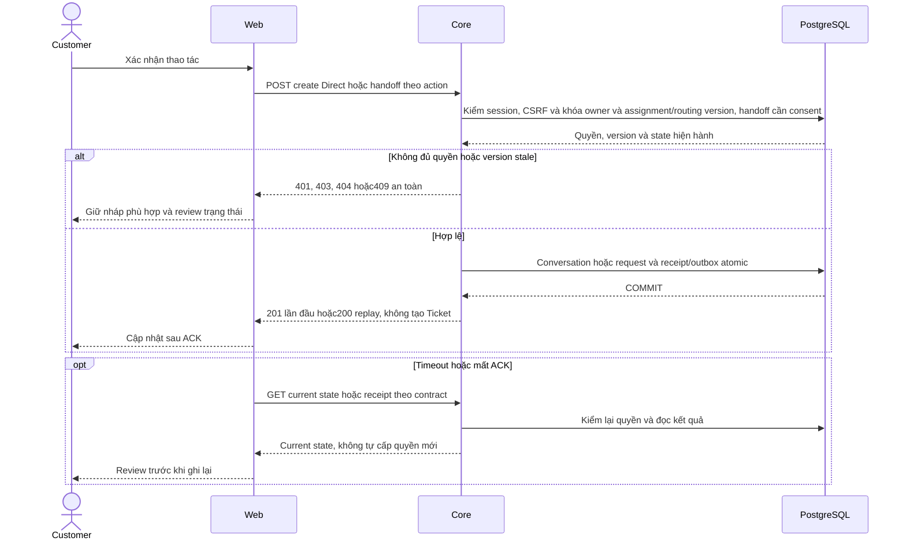

# CH01 — Ghép Conversations UI trên I03–I06

05/11/2026 · **Đã triển khai** · [C06](../06-chat-contract.md) · Cần H01.

## Bổ sung bảo vệ dữ liệu Customer — 12/11/2026

**Chính sách thông tin liên hệ:** [Ma trận dữ liệu chung](../../../../configuration-and-data.md#customer-sensitive-data) quy định che email/phone Customer mặc định và Hiện/Ẩn sau kiểm quyền Core. Phase 1 đã triển khai tại Customers; DTO Customer ở Policy/Inbox/Ticket hiện chỉ có tên/mã, không có contact card raw. Quy định này không thay quyền đọc PDF/transcript hoặc trạng thái triển khai của chức năng trong plan.

**Thay đổi của phase:** Rà subject/preview/composer; văn bản khách tự nhập vẫn có thể chứa PII. Không rewrite lịch sử/consent vì masking profile; bản dùng model thuộc CH02, browser không gửi raw history sang provider.

**Kiểm thử cần bổ sung, chưa chạy:** DOM/network: đúng self-history/chat gate, canary không xuất thêm trong URL/notification/error; chuyển cuộc/logout clear state.

## Data model và phạm vi ảnh hưởng

Bảng bên dưới mô tả tác động của phase, gồm cả ghi gián tiếp qua Core. Tên bảng thuộc schema `business` trừ nơi ghi rõ; cột còn đề xuất được đánh dấu **P**. Web không truy cập DB trực tiếp.

| Bảng/model | Cột hoặc dữ liệu liên quan | Thao tác của phase | Quan hệ/ràng buộc cần giữ | Mức ảnh hưởng và nơi bị tác động |
| --- | --- | --- | --- | --- |
| users + auth_sessions | users.id/role/status, auth_sessions.user_id/token_hash/expires_at/revoked_at | Đọc | AuthSession.user_id → User.id; session phải còn hạn, không bị thu hồi | Cao — mọi API dùng session; không trả token/hash trong DTO |
| staff_assignments + customer_profiles + staff_profiles | staff_id/customer_id/is_active/ended_at, assignment_version, user_id/full_name | Đọc | Assignment gắn đúng Customer/Staff; Inbox còn ràng buộc assignment id cụ thể | Cao — Customers, Policy Lookup, Ticket và Inbox cùng phụ thuộc phân công |
| conversations + conversation_handoffs | customer_id/channel_type/support_origin/direct_assignment_id/assigned_staff_id/status/control_version/subject, state/assignment_id/recipient_staff_id/shared_subject/shared_reason/accepted_at/revoked_at | Đọc | Direct đúng assignment lúc tạo hoặc handoff ACCEPTED còn grant; PENDING chỉ shared metadata, không AI subject/transcript | Cao — Inbox filter/deep link/REST/WS phải cùng gate; không suy grant từ status/assigned_staff_id |
| messages | conversation_id/sequence/audience/sender_type/sender_id/content/citations/created_at | Đọc | Unique (conversation_id,sequence); chỉ CUSTOMER_VISIBLE sau transcript gate; sequence bigint ra DTO dạng string | Cao — không lộ INTERNAL/LEGACY_REVIEW/tool_calls_metadata cho Customer/Staff transcript |
| conversations + messages + conversation_handoffs + conversation_command_receipts | status/control_version/direct_assignment_id/next_message_sequence; sequence/audience/client_message_id; consent/accepted evidence; operation/request_hash/resource_id | Ghi gián tiếp qua I03/I05, không từ UI trực tiếp | Unique keys/assignment composite FK hiện có; AI riêng không vào Staff, Accept mới chia sẻ lịch sử CUSTOMER_VISIBLE | Cao — chat/consent/send atomic Core, không tạo Ticket qua handoff |
| rate_limit_buckets | client_token/endpoint_group/window_start/request_count/blocked_until | Ghi phụ trợ khi endpoint áp quota | PK (client_token,endpoint_group); tăng atomic, giới hạn theo actor/nhóm endpoint | Trung bình — quota có thể ghi dù nghiệp vụ bị từ chối; không log định danh nhạy cảm |
| audit_logs | actor_id/action/target_type/target_id/outcome/request_id/metadata/created_at | Thêm khi mutation/cấp PDF theo service | actor_id → User.id; không sửa/xóa audit cũ; chỉ metadata allowlist | Cao — phải giữ bằng chứng đúng transaction nghiệp vụ; không lưu transcript/password/signed URL |
| outbox_events | aggregate_type/aggregate_id/event_type/payload/status/retry_count/next_attempt_at/lease_owner/lease_expires_at/last_error | Thêm trong transaction nguồn; worker cập nhật trạng thái/lease | Index status/next_attempt_at/lease_expires_at; aggregate_id là reference kiểm bởi service, không FK đa loại | Cao — retry/reclaim/dedup, commit nghiệp vụ khác delivery; REST vẫn là nguồn dữ liệu |

**Schema/migration:** Không migration trong UI; Web chỉ gọi API Core, không có DB credentials hoặc quyền ghi trực tiếp bảng.

**Nhất quán và hồi quy:** Core I03/I05 là owner transaction, UI chỉ key/version/consent hợp lệ; WS I06 invalidate rồi REST. Kiểm direct availability, consent/cancel, Accept SYSTEM, send retry và không dựng AI reply giả.

## 1. Vị trí và UI

**New AI chat sau Staff — quyết định 14/11/2026, UI/create hiện có.** Customer chủ động tạo cuộc AI mới bằng New AI chat. Mở lại cuộc cũ dùng allowedActions Core, dừng nhắn không tạo Close/khóa composer. Intent mới dùng key mới, retry một intent giữ key và đối soát receipt. Context/thread cuộc mới độc lập với lịch sử/summary/checkpoint cuộc cũ, phần tích hợp Agent cần kiểm ở CH02/CH03. [Quyết định chuẩn](../../../../specifications/Agent_Design.md#new-ai-chat-after-staff).

Triển khai tại `apps/web/src/components/customer-conversations.tsx`, tích hợp trong `CustomerWorkspace` khi mở tab `chat`.
- Sử dụng các component dùng chung: `customer-handoff-dialog.tsx`, `conversation-composer.tsx`, `conversation-transcript.tsx`.
- Client API: `lib/conversation-api.ts` và `chat-realtime.ts`.
- Danh sách cuộc trò chuyện: Hiển thị tiêu đề, thời gian, nhãn vai trò (*AI Assistant 24/7*, *Support Specialist*), trạng thái (*Active*, *Transferred*).
- Đã bỏ nút Refresh dư thừa trên header theo yêu cầu người dùng, lược bỏ gợi ý phím Enter/Shift+Enter thừa thãi ở composer.
- Toàn bộ giao diện chat 100% tiếng Anh nhất quán.

| Vị trí từ root repo | Hiện trạng | Trách nhiệm trong phase | Mức ảnh hưởng | Phạm vi cần kiểm lại |
| --- | --- | --- | --- | --- |
| [apps/web/src/components/customer-conversations.tsx](<../../../../../apps/web/src/components/customer-conversations.tsx>) | Hiện có | Own list/entry/handoff/selection | Trung bình | Customer shell và Direct/AI tabs |
| [apps/web/src/components/customer-handoff-dialog.tsx](<../../../../../apps/web/src/components/customer-handoff-dialog.tsx>) | Hiện có | Consent text/scope và xác nhận explicit | Cao | I03 metadata chia sẻ/entire history |
| [apps/web/src/components/conversation-transcript.tsx](<../../../../../apps/web/src/components/conversation-transcript.tsx>) | Hiện có | Shared transcript/order/scroll | Cao | Staff view sau Accept |
| [apps/web/src/components/conversation-composer.tsx](<../../../../../apps/web/src/components/conversation-composer.tsx>) | Hiện có | Shared send/reconcile/draft | Cao | Hai role send và idempotency |
| [apps/web/src/lib/conversation-api.ts](<../../../../../apps/web/src/lib/conversation-api.ts>) | Hiện có | Owner entry/send/receipt/CSRF wrappers | Cao | Không nhận actor quyền từ UI |

## 2. API contract E

Dựa trên nền tảng I03–I06:
- `GET /customers/me/chat-support`, `GET/POST /customers/me/conversations`
- `GET .../conversations/:id/messages` (phân trang bằng cursor prepend giữ vị trí cuộn)
- `POST .../conversations/:id/messages` (gửi tin nhắn chống trùng lặp qua `clientMessageId`)
- `POST .../conversations/:id/handoff-requests` (yêu cầu chuyển giao sang chuyên viên hỗ trợ có xác nhận đồng ý chia sẻ lịch sử rõ ràng)

## 3. Luồng handoff và realtime

- Dialog xác nhận chuyển giao: Hiển thị phạm vi chia sẻ toàn bộ lịch sử trò chuyện hiển thị cho khách hàng; Cancel/Escape không ghi nhận chia sẻ.
- Khi Staff Accept: Hệ thống tự động chuyển trạng thái cuộc chat và chèn tin nhắn thông báo SYSTEM.
- WebSocket realtime thông báo vô hiệu hóa (`invalidation`) để client tự động catch-up tin nhắn mới.

## 4. Test cases

Các ca dưới đây là **đặc tả kiểm thử**, không phải báo cáo kết quả. Kiểm từng lớp API/service/DB/browser đúng nhãn; mock UI không thay kiểm quyền Core hoặc E2E thật.

**Quy ước dữ liệu:** S-A/S-B là hai Staff synthetic; C-A/C-B là hai Customer synthetic khác nhau. Thay alias bằng UUID/token của fixture cô lập; các path HTTP dùng prefix /api/v1 nếu chưa ghi đầy đủ. Chỉ thay assignment, khóa account, inject lỗi hoặc migration trong harness/môi trường test, không trên tài khoản/dữ liệu đang sử dụng.

### CH01-T01 — AI riêng và Direct đúng routing

**Lớp kiểm thử:** Browser E2E.
**Điều kiện và dữ liệu:** C-A được gán S-A khả dụng; có cuộc AI riêng và Direct.

**Các bước:**

1. Mở Conversations, chọn AI rồi Direct.
2. Gửi tin synthetic vào Direct.
3. Kiểm bên Staff theo scope.

**Kết quả mong đợi:** Cuộc/id/nháp tách biệt; Direct gửi đúng Staff, AI riêng không tự lộ cho Staff; không giả Agent trả lời.

### CH01-T02 — Cancel không ghi consent

**Lớp kiểm thử:** Browser + Network.
**Điều kiện và dữ liệu:** C-A có AI_ACTIVE, dialog handoff mở từ control hiện có.

**Các bước:**

1. Tab qua dialog rồi Escape/Cancel.
2. Kiểm không POST handoff.
3. Mở lại và Confirm chia sẻ toàn lịch sử.

**Kết quả mong đợi:** Cancel trả focus, không consent; Confirm gửi version/scope server hợp lệ, không tự tạo Ticket.

### CH01-T03 — Routing conflict cần xác nhận lại

**Lớp kiểm thử:** Browser + API mock.
**Điều kiện và dữ liệu:** Dialog hiển thị S-A, assignmentVersion=v0; fixture chuyển sang S-B.

**Các bước:**

1. Confirm bằng v0 và trả ROUTING_CHANGED.
2. Tải availability mới.
3. Kiểm chưa có handoff trước khi Customer xác nhận lại.

**Kết quả mong đợi:** Không tự chuyển đồng ý sang S-B; UI yêu cầu review/xác nhận mới và giữ state an toàn.

### CH01-T04 — Unknown create, unavailable và mobile

**Lớp kiểm thử:** Browser + API barrier.
**Điều kiện và dữ liệu:** Giữ ACK tạo Direct; biến thể khác Staff unavailable và legacy cuộc không grant.

**Các bước:**

1. Tạo Direct rồi ngắt ACK, kiểm/retry cùng key.
2. Thử Message Staff khi unavailable.
3. Dùng consent dialog 375px bằng Tab/Escape.

**Kết quả mong đợi:** Không key mới/cuộc trùng, không hủy intent chưa rõ kết quả; unavailable/legacy không có composer trái quyền; dialog nằm trong viewport.

**Suite tham khảo:** [customer-conversations.spec.mjs](../../../../../apps/web/tests/browser/customer-conversations.spec.mjs). Tên suite là vị trí tự động hóa, không phải chứng nhận các ca đã chạy.

**Checklist chức năng liên quan** (giữ trạng thái triển khai, không phải kết quả của lần sửa tài liệu):

- [x] CH01 tích hợp hoàn tất vào shell Customer, giao diện tiếng Anh chuẩn.
- [x] Đã bỏ nút refresh và đơn giản hóa footer composer theo phản hồi người dùng.

**Dọn sau kiểm thử:** xóa đúng fixture/session/object/schema theo runId; phục hồi fault injection và đóng context/socket test. Không reset DB/credential, sửa bootstrap hoặc xóa volumes. Với PDF kiểm metadata/bytes/hash; với UI kiểm DOM/focus/network, không cần screenshot.

### CH01-T05 — Tạo AI chat mới sau trao đổi Staff

**P — ca hồi quy bổ sung chưa chạy.** Qua gateway, từ cuộc đã Accept chọn New AI chat, thử double-click/timeout/đối soát rồi mở lại cuộc cũ. Kiểm DOM, network request và metadata Core.

**Kết quả mong đợi.** Intent mới tạo ID mới với kind AI, retry cùng intent không tạo trùng. Cuộc cũ giữ đúng quyền đọc/gửi, không phát sinh Close hoặc command kết thúc. Staff không tự thấy cuộc AI mới. Context/callback Agent kiểm tiếp theo CH02-T06.

### CH01-T06 — Giữ lịch sử trong MVP

**P — ca hồi quy bổ sung chưa chạy.** Fixture synthetic có cuộc/tin cũ hơn 30 ngày và notification đủ điều kiện cleanup. Mở list/detail/messages nhiều trang, reload/reconnect, tạo New AI chat rồi đọc lại cuộc cũ. Chạy cleanup Notification trên fixture cô lập, kiểm owner khác và Staff bị revoke.

**Kết quả mong đợi.** Lịch sử Conversation/Message còn đầy đủ theo quyền, thứ tự/cursor ổn định và không biến mất do tuổi dữ liệu, New AI chat hoặc Notification cleanup. Notification vẫn theo retention 30 ngày. Ngoài quyền/revoke bị chặn dù bản ghi còn lưu. Fixture của suite được dọn theo quy trình kiểm thử hiện hành. [Chính sách A ngày 14/11](../../../../configuration-and-data.md#mvp-chat-history-retention).

## Sequence diagram

Luồng chính và nhánh quyền/lỗi; test case ở trên chỉ rõ dữ liệu và điểm kiểm tương ứng.

