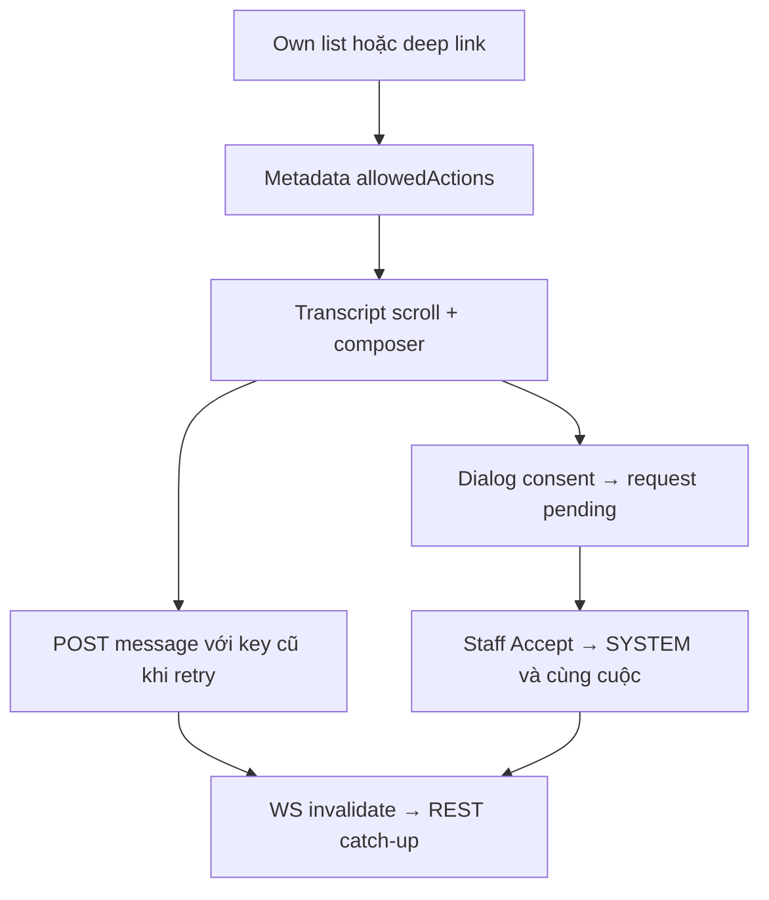

# CH01 — Ghép Conversations UI trên I03–I06

05/11/2026 · **Đã triển khai** · [C06](../06-chat-contract.md) · Cần H01.

## 1. Vị trí và UI

Triển khai tại `apps/web/src/components/customer-conversations.tsx`, tích hợp trong `CustomerWorkspace` khi mở tab `chat`.
- Sử dụng các component dùng chung: `customer-handoff-dialog.tsx`, `conversation-composer.tsx`, `conversation-transcript.tsx`.
- Client API: `lib/conversation-api.ts` và `chat-realtime.ts`.
- Danh sách cuộc trò chuyện: Hiển thị tiêu đề, thời gian, nhãn vai trò (*AI Assistant 24/7*, *Support Specialist*), trạng thái (*Active*, *Transferred*).
- Đã bỏ nút Refresh dư thừa trên header theo yêu cầu người dùng, lược bỏ gợi ý phím Enter/Shift+Enter thừa thãi ở composer.
- Toàn bộ giao diện chat 100% tiếng Anh nhất quán.

## 2. API contract E

Dựa trên nền tảng I03–I06:
- `GET /customers/me/chat-support`, `GET/POST /customers/me/conversations`
- `GET .../conversations/:id/messages` (phân trang bằng cursor prepend giữ vị trí cuộn)
- `POST .../conversations/:id/messages` (gửi tin nhắn chống trùng lặp qua `clientMessageId`)
- `POST .../conversations/:id/handoff-requests` (yêu cầu chuyển giao sang chuyên viên hỗ trợ có xác nhận đồng ý chia sẻ lịch sử rõ ràng)

## 3. Luồng handoff và realtime

- Dialog xác nhận chuyển giao: Hiển thị phạm vi chia sẻ toàn bộ lịch sử trò chuyện hiển thị cho khách hàng; Cancel/Escape không ghi nhận chia sẻ.
- Khi Staff Accept: Hệ thống tự động chuyển trạng thái cuộc chat và chèn tin nhắn thông báo SYSTEM.
- WebSocket realtime thông báo vô hiệu hóa (`invalidation`) để client tự động catch-up tin nhắn mới.



## 4. Test cases

Các ca dưới đây là **đặc tả kiểm thử**, không phải báo cáo kết quả. Kiểm từng lớp API/service/DB/browser đúng nhãn; mock UI không thay kiểm quyền Core hoặc E2E thật.

**Quy ước dữ liệu:** S-A/S-B là hai Staff synthetic; C-A/C-B là hai Customer synthetic khác nhau. Thay alias bằng UUID/token của fixture cô lập; các path HTTP dùng prefix /api/v1 nếu chưa ghi đầy đủ. Chỉ thay assignment, khóa account, inject lỗi hoặc migration trong harness/môi trường test, không trên tài khoản/dữ liệu đang sử dụng.

### CH01-T01 — AI riêng và Direct đúng routing

**Lớp kiểm thử:** Browser E2E.
**Điều kiện và dữ liệu:** C-A được gán S-A khả dụng; có cuộc AI riêng và Direct.

**Các bước:**

1. Mở Conversations, chọn AI rồi Direct.
2. Gửi tin synthetic vào Direct.
3. Kiểm bên Staff theo scope.

**Kết quả mong đợi:** Cuộc/id/nháp tách biệt; Direct gửi đúng Staff, AI riêng không tự lộ cho Staff; không giả Agent trả lời.

### CH01-T02 — Cancel không ghi consent

**Lớp kiểm thử:** Browser + Network.
**Điều kiện và dữ liệu:** C-A có AI_ACTIVE, dialog handoff mở từ control hiện có.

**Các bước:**

1. Tab qua dialog rồi Escape/Cancel.
2. Kiểm không POST handoff.
3. Mở lại và Confirm chia sẻ toàn lịch sử.

**Kết quả mong đợi:** Cancel trả focus, không consent; Confirm gửi version/scope server hợp lệ, không tự tạo Ticket.

### CH01-T03 — Routing conflict cần xác nhận lại

**Lớp kiểm thử:** Browser + API mock.
**Điều kiện và dữ liệu:** Dialog hiển thị S-A, assignmentVersion=v0; fixture chuyển sang S-B.

**Các bước:**

1. Confirm bằng v0 và trả ROUTING_CHANGED.
2. Tải availability mới.
3. Kiểm chưa có handoff trước khi Customer xác nhận lại.

**Kết quả mong đợi:** Không tự chuyển đồng ý sang S-B; UI yêu cầu review/xác nhận mới và giữ state an toàn.

### CH01-T04 — Unknown create, unavailable và mobile

**Lớp kiểm thử:** Browser + API barrier.
**Điều kiện và dữ liệu:** Giữ ACK tạo Direct; biến thể khác Staff unavailable và legacy cuộc không grant.

**Các bước:**

1. Tạo Direct rồi ngắt ACK, kiểm/retry cùng key.
2. Thử Message Staff khi unavailable.
3. Dùng consent dialog 375px bằng Tab/Escape.

**Kết quả mong đợi:** Không key mới/cuộc trùng, không hủy intent chưa rõ kết quả; unavailable/legacy không có composer trái quyền; dialog nằm trong viewport.

**Suite tham khảo:** [customer-conversations.spec.mjs](../../../../../apps/web/tests/browser/customer-conversations.spec.mjs). Tên suite là vị trí tự động hóa, không phải chứng nhận các ca đã chạy.

**Checklist chức năng liên quan** (giữ trạng thái triển khai, không phải kết quả của lần sửa tài liệu):

- [x] CH01 tích hợp hoàn tất vào shell Customer, giao diện tiếng Anh chuẩn.
- [x] Đã bỏ nút refresh và đơn giản hóa footer composer theo phản hồi người dùng.

**Dọn sau kiểm thử:** xóa đúng fixture/session/object/schema theo runId; phục hồi fault injection và đóng context/socket test. Không reset DB/credential, sửa bootstrap hoặc xóa volumes. Với PDF kiểm metadata/bytes/hash; với UI kiểm DOM/focus/network, không cần screenshot.

## Sequence diagram

Luồng chính và nhánh quyền/lỗi; test case ở trên chỉ rõ dữ liệu và điểm kiểm tương ứng.

```mermaid
sequenceDiagram
    actor U as Customer
    participant W as Web
    participant C as Core
    participant D as PostgreSQL
    U->>W: Xác nhận thao tác
    W->>C: POST create Direct hoặc handoff theo action
    C->>D: Kiểm session, CSRF và khóa owner và assignment/routing version; handoff cần consent
    D-->>C: Quyền, version và state hiện hành
    alt Không đủ quyền hoặc version stale
        C-->>W: 401, 403, 404 hoặc409 an toàn
        W-->>U: Giữ nháp phù hợp và review trạng thái
    else Hợp lệ
        C->>D: Conversation hoặc request và receipt/outbox atomic
        D-->>C: COMMIT
        C-->>W: 201 lần đầu hoặc200 replay, không tạo Ticket
        W-->>U: Cập nhật sau ACK
    end
    opt Timeout hoặc mất ACK
        W->>C: GET current state hoặc receipt theo contract
        C->>D: Kiểm lại quyền và đọc kết quả
        C-->>W: Current state, không tự cấp quyền mới
        W-->>U: Review trước khi ghi lại
    end
```
