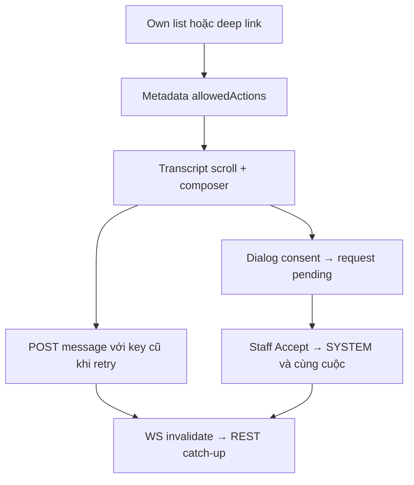

# CH01 — Ghép Conversations UI trên I03–I06

04/11/2026 · **Chưa làm layout mới; API chat đã E** · [C06](../06-chat-contract.md) · Cần H01.

## 1. Vị trí và UI

Đề xuất `app/customer/conversations/page.tsx`, `conversations/[conversationId]/page.tsx`; tái cấu trúc `components/customer-conversations.tsx`, giữ `customer-handoff-dialog.tsx`, `conversation-composer.tsx`, `conversation-transcript.tsx`, `lib/conversation-api.ts` và `chat-realtime.ts`. Không duplicate command state/socket. Sidebar cuộc của chính Customer với subject/time, nút cuộc AI mới hoặc Direct tới Staff hiện hành; main chat cuộn, header ngắn, composer cố định trong vùng chat. Không bảng metadata thay transcript, không số badge/counts, không search lịch sử toàn văn khi chưa API.

## 2. API contract E — giữ nguyên owner

Theo [I03](../../../staff/plans/inbox/03-handoff-transcript.md), [I05](../../../staff/plans/inbox/05-messaging-customer.md), [I06](../../../staff/plans/inbox/06-realtime-routing.md):

- GET `/customers/me/chat-support`, GET/POST `/customers/me/conversations`; create clientRequestId dạng UUID, kind AI/DIRECT, subject?, Direct mới cần expectedAssignmentVersion.
- GET `.../conversations/:id`, GET messages limit/before/after; load older bằng cursor prepend giữ scroll, messages mới append/catch-up sequence string, không nút phân trang Page1/2 giữa chat.
- POST `.../:id/messages` `{clientMessageId,expectedVersion,content}`; reconcile by-client-id; timeout giữ key, không coi404lookup là chắc chưa gửi.
- POST `.../:id/handoff-requests` dùng expectedVersion/expectedAssignmentVersion, sharedSubject/reason và explicit consent toàn bộ lịch sử đúng textVersion/scope; command lookup giữ contract I03.

Đây là tóm tắt, DTO/error/quota chính thức ở I03/I05; không thêm field/search/counts/status filter theo UI. GET list keyset hasMore/nextCursor, không total. Sender/allowedActions/controlVersion do Core quyết định. AI_ACTIVE hiện chỉ lưu tin, không tự tạo câu trả lời giả.

## 3. Handoff/state/realtime

Dialog chia sẻ **toàn bộ Customer-visible trong cuộc**, Cancel/Escape không ghi gì; pending thông báo chờ, sau Accept SYSTEM chỉ một tin. Mất Staff/routing đổi/legacy cần review theo allowedActions; không tự chuyển người nhận hoặc tạo Ticket. Nháp/key theo actor/cuộc trong memory; mở route cũ `?conversationId=` qua adapter H01, Back/Forward không xóa command chưa rõ kết quả. Realtime chỉ invalidate, REST recheck; giữ cơ chế dirty flag/coalesce/catch-up hiện có, không gọi me theo từng tin hoặc F5 khi visibilitychange.

## 4. Test và hoàn tất

Mở rộng browser suite Customer I05/I06, thêm `customer-conversations-layout.spec.mjs`; gateway hai context thật. Không tạo bootstrap seed.

| ID | Case | Kỳ vọng |
| --- | --- | --- |
| CH01-T01 | Tạo AI/Direct, đổi cuộc, Back/deep link cũ | Đúng cuộc của mình, draft/key không mất, không F5 |
| CH01-T02 | Scroll lịch sử, incoming khi đang đọc cũ | Prepend giữ vị trí; không kéo cuối vô cớ |
| CH01-T03 | Cancel/confirmhandoff/Accept | Consent chuẩn, trướcAccept Staff nhận404 history, sauAccept toàn bộ history + một SYSTEM |
| CH01-T04 | Timeout gửi/reconnect/reassignment/401 | Không duplicate/khôi phục response cũ/leak, actions đúng |
| CH01-T05 | Keyboard/375px/200%zoom/composer | Chat cuộn và gửi dùng được; không giả AI/read receipt |

- [ ] I03–I06 hồi quy pass, không schema/API mutation mới.
- [ ] C06 chỉ ghi layout đã xong; Agent/Ticket vẫn phase sau.
