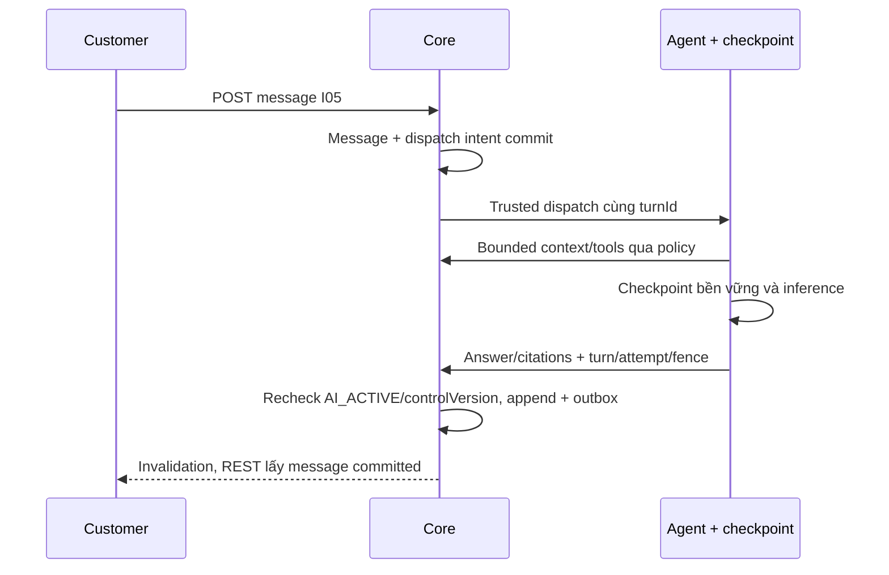

# CH02 — Contract Core–Agent, durable turns và tool scope

04/11/2026 · **Đề xuất, chưa triển khai; chưa chọn transport/provider hoặc thêm model** · [C06](../06-chat-contract.md) · Trước phần phụ thuộc: review kiến trúc/source-review.

## 1. Kết quả và gate

FR-005/009/012, NFR-001/002/003/005/008. Chốt service identity, giao thức, checkpoint store, Core turn dispatch/result và retrieval source/version trước Agent thật. Phase không triển khai Staff Copilot; có thể tái dùng hạ tầng sau nhưng channel/customer/internal boundary khác nhau. Không dùng cookie Customer trong Agent hoặc body `{role,customerId}` do LLM sinh làm authority.

## 2. Vị trí và model cần thiết

Owner đề xuất: `apps/core/src/conversations/` cho orchestration adapter/access/append, `apps/agent/` cho workflow/checkpoint/retrieval/tools; giữ business writes ở Core. Dùng `conversation-message.service.ts` và fence hiện có, không Agent Prisma/business credentials. Chỉ thêm module/dependency khi chốt runtime cụ thể.

Đề xuất Core durable Turn record riêng: id,conversationId,triggerMessageId,expectedControlVersion,state,attempt,leaseOwner/expiresAt,resultMessageId?,safeErrorCode?,created/updated; unique conversation+trigger. Tên bảng/state/constraints phải được chốt trong migration spec trước code; không ghi trạng thái turn vào ConversationStatus. Checkpoint Agent giữ graph state theo conversation/turn/attempt với credential riêng, không thay Message/Turn/Ticket commit. Không backfill AI reply/turn giả cho lịch sử cũ.

## 3. API/service spec để review

Customer gửi vẫn E POST messages I05; không yêu cầu browser gửi thêm LLM prompt. Sau message CUSTOMER commit trong AI_ACTIVE, Core transaction có durable dispatch intent tương ứng trigger; enqueue fail sau commit phải retry từ outbox, không mất turn. Chốt batch/serialization khi Customer gửi nhiều tin: đề xuất serial theo conversation sequence, mỗi trigger một turn, không hai worker xuất hai answer.

Interfaces **P, chưa HTTP endpoints**; giao thức wire/auth sẽ ghi sau khi review:

| Operation | Request tối thiểu | Response/quy tắc |
| --- | --- | --- |
| dispatchTurn | Trusted service envelope do Core ký/xác thực, turnId/conversationId/triggerMessageId/expectedControlVersion | Durable accepted receipt; retry cùng turnId không khởi chạy độc lập |
| readContext | Service identity + turnId + bounded cursor | Core resolve actor/channel/owner, chỉ CUSTOMER_VISIBLE đến trigger sequence |
| readPolicy/retrieveSources | Trusted turn context + resource query | Core cấp đúng owner policy và applied version; retrieval filter trước LLM |
| appendAnswer | turnId/attempt/controlVersion/content/citations | Core kiểm lease/fence/sender/audience, append idempotent bằng internalMessageId; không browser gọi |
| proposeHandoff/proposeTicketDraft | turnId + allowlist suggestion payload | Chỉ gợi ý/draft; không consent, không confirmedAt/Ticket |

Proposal read trạng thái cho UI: `GET /api/v1/customers/me/conversations/:id/assistant-turns/:turnId` → `{turn:{id,triggerMessageId,state:'QUEUED'|'RUNNING'|'COMPLETED'|'FAILED'|'CANCELLED',resultMessageId:null|UUID,errorCode:null|string}}`. Owner/channel gate404, no-store, không prompt/checkpoint/raw exception. Cần chốt cách DTO messages/durable event cung cấp turnId và bounded discovery sau reconnect trước triển khai route này; **chưa đủ gate để code CH03 khi phần này còn mở**. Không polling không giới hạn hoặc coi trạng thái turn là trạng thái chat.

## 4. Fence, citations và business writes

Khi request handoff commit, Agent dừng quyền append từ PENDING_HANDOFF; result đến muộn không được ghi/customer thấy, dù inference đã xong. Recheck controlVersion/lease/session/routing/owner cả lúc đọc tools và append; retry worker không tạo duplicate tin AI. Tool timeout/uncertainty không hứa quyền lợi/chi trả. Citations chỉ documentId/versionId/page hợp lệ từ nguồn authorized, page integer≥1 và trong phạm vi có metadata; không raw URL/id do LLM bịa. D01 cấp quyền xem sau này, citation không tự mở kho file.

Ticket tạo qua [I07](../../../staff/plans/tickets/06-agent-confirmation.md): trusted draft → Customer xem/xác nhận → Core snapshot+outbox; Agent chỉ proposeDraft, không tạo trực tiếp. Summary ghi mốc source sequence/version, không sửa immutable confirmedContent. Handoff suggestion gọi dialog có consent thật, không tự POST request từ text “đồng ý” do LLM diễn giải.

## 5. Test và điều kiện hoàn tất

Đề xuất Core `agent-turns.test.cjs`, Agent contract/checkpoint tests theo framework được chọn; adapter giả trong harness rồi integration với Agent thật riêng.

| ID | Case | Kỳ vọng |
| --- | --- | --- |
| CH02-T01 | Service giả/role từ LLM/tool injection | Deny, không business SQL/context ngoài quyền |
| CH02-T02 | Private doc/owner khác/current v2 thay applied v1 | Chỉ authorized exact version trước prompt/citation |
| CH02-T03 | Worker crash/retry/callback trùng/trigger đồng thời | Durable resume, một answer/trigger, sequence đúng |
| CH02-T04 | Handoff/reassign/expiry trước result | Fence loại result muộn, không leak hoặc duplicate |
| CH02-T05 | LLM/retrieval lỗi/câu trả lời chưa chắc | Lỗi an toàn/fallback, không quyết định Claim/chi trả |
| CH02-T06 | Draft/suggestion chưa Customer xác nhận | Không Ticket hoặc handoff tự ghi |

- [ ] Identity/transport/checkpoint/schema/turn discovery được ghi cụ thể và review; ADR đề xuất không tự thành mặc định.
- [ ] Durable/fence/security tests pass; logs không prompt/raw Private/secret.
- [ ] Actual Agent test phân biệt fake adapter; CH03 chỉ bắt đầu khi API discovery/status stable.
