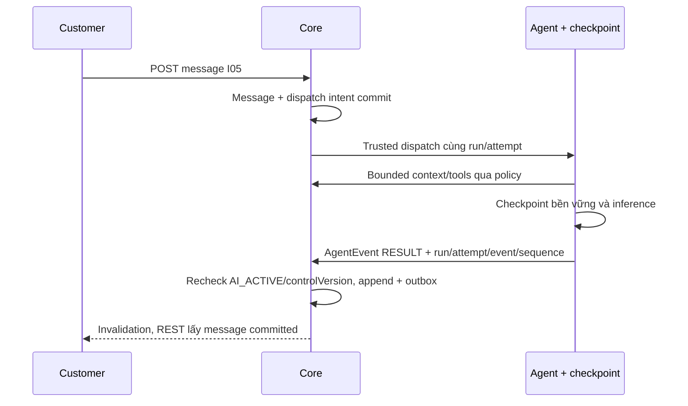

# CH02 — Contract Core–Agent, durable runs và tool scope

06/11/2026 · **Đề xuất, chưa triển khai API Agent thật** · [C06](../06-chat-contract.md). Theo [Agent Design](../../../../specifications/Agent_Design.md) và [plan](../../../../superpowers/plans/2026-10-31-agent-rag-implementation.md): HTTP + callback JSON đã chọn; HMAC tạm chốt, profile/framework/provider/DDL còn gate review.

## 1. Kết quả và gate

FR-005/009/012, NFR-001/002/003/005/008. Chốt service identity, giao thức, checkpoint store, Core turn dispatch/result và retrieval source/version trước Agent thật. Phase không triển khai Staff Copilot; có thể tái dùng hạ tầng sau nhưng channel/customer/internal boundary khác nhau. Không dùng cookie Customer trong Agent hoặc body `{role,customerId}` do LLM sinh làm authority.

## 2. Vị trí và model cần thiết

Owner đề xuất: `apps/core/src/conversations/` cho orchestration adapter/access/append, `apps/agent/` cho workflow/checkpoint/retrieval/tools; giữ business writes ở Core. Dùng `conversation-message.service.ts` và fence hiện có, không Agent Prisma/business credentials. Chỉ thêm module/dependency khi chốt runtime cụ thể.

Core cần Run/Attempt/Event persistence theo Tasks 2–3: run gắn conversation/tin nguồn, trạng thái QUEUED/RUNNING/COMPLETED/FAILED/CANCELLED, attempt hiện hành, thứ tự/dispatch/dedup và history view. `Turn` trong bản cũ là cùng khái niệm `Run`, không thêm lifecycle thứ hai. Ánh xạ controlVersion/receipt/Message hiện có với contract G1; DDL/lease/fencing/atomicity chờ G2. Không ghi trạng thái run vào ConversationStatus hoặc backfill AI reply/run giả. Checkpoint Agent lưu context/work riêng quyền, không thay Message/Run/Ticket commit.

## 3. API/service spec để review

Customer gửi vẫn E POST messages I05; không yêu cầu browser gửi thêm LLM prompt. Sau message CUSTOMER commit trong AI_ACTIVE, Core transaction có durable dispatch intent tương ứng trigger; enqueue fail sau commit phải retry từ outbox, không mất turn. Chốt batch/serialization khi Customer gửi nhiều tin: đề xuất serial theo conversation sequence, mỗi trigger một turn, không hai worker xuất hai answer.

Interfaces **P**, ánh xạ tên/DTO với contract G1 trước code; không thay HMAC bằng session browser:

| Operation | Request tối thiểu | Response/quy tắc |
| --- | --- | --- |
| dispatchRun | RunRequest do Core cấp: run/attempt/conversation/message, actor, channel, history view, limits | Durable ACK sau lưu; retry cùng IDs/fingerprint, không chạy độc lập |
| readContext | Service identity + run/attempt + HistoryView/cursor Core cấp | Lịch sử xử lý gồm kết quả/lỗi lượt trước được chấp nhận trước khi xử lý tin hiện tại, kể cả commit sau khi tin đó vào queue; không lấy tin queue phía sau |
| readPolicy/retrieveSources | Trusted execution context + resource query | Hai Business Tools và hai retrieval tools đúng Agent Design; scope xin bằng code, chỉ document/version được phép |
| receiveEvent/appendAnswer | AgentEvent gắn run/attempt/event/sequence; RESULT có AgentResult | Core kiểm attempt/fence/quyền và lưu idempotent; không browser gọi, không ACK trước lưu |
| proposeHandoff/proposeTicketDraft | AgentResult.actions với PROPOSE_HANDOFF/PROPOSE_TICKET | Chỉ đề xuất; Customer xác nhận riêng ở Core, không tự tạo consent/confirmedAt/Ticket |

Đọc trạng thái theo RunSummary của Task 1 và route đề xuất `GET /api/v1/agent-runs/:id` ở Task 3; tên route/DTO cuối phải ánh xạ với API App ở G1. Create/list/read/history có currentRun để reopen không phụ thuộc browser nhớ ID; GET không tạo run. Core kiểm owner/channel/quyền, no-store và không trả prompt/checkpoint/raw exception. Bounded discovery/transport Web–Core còn cần review trước CH03; không tự thêm API `assistant-turns` song song hoặc coi trạng thái run là trạng thái chat.

## 4. Fence, citations và business writes

Khi request handoff commit, Core chặn Agent append từ PENDING_HANDOFF; result đến muộn không được công bố dù inference đã xong. Recheck controlVersion/attempt/routing/owner khi đọc tools và nhận kết quả; protocol chặn stale checkpoint writer theo G2. Core vẫn kiểm quyền API hiện hành; chính sách tự dừng/tiếp tục task khi logout/hết phiên chờ G3. Retry không tạo duplicate tin AI. Citation do code lấy metadata từ evidence_id thật: document/version/title/type/location với pages/clause/anchor phù hợp nguồn; Markdown không bịa trang PDF. D01 đã có quyền mở PDF; citation không tự cấp quyền.

Ticket tạo qua [I07](../../../staff/plans/tickets/06-agent-confirmation.md): trusted draft → Customer xem/xác nhận → Core snapshot+outbox; Agent chỉ proposeDraft, không tạo trực tiếp. Summary ghi mốc source sequence/version, không sửa immutable confirmedContent. Handoff suggestion gọi dialog có consent thật, không tự POST request từ text “đồng ý” do LLM diễn giải.

## 5. Test và điều kiện hoàn tất

Đề xuất Core `agent-turns.test.cjs`, Agent contract/checkpoint tests theo framework được chọn; adapter giả trong harness rồi integration với Agent thật riêng.

| ID | Case | Kỳ vọng |
| --- | --- | --- |
| CH02-T01 | Service giả/role từ LLM/tool injection | Deny, không business SQL/context ngoài quyền |
| CH02-T02 | Private doc/owner khác/current v2 thay applied v1 | Chỉ authorized exact version trước prompt/citation |
| CH02-T03 | Worker crash/retry/callback trùng/trigger đồng thời | Durable resume, một answer/trigger, sequence đúng |
| CH02-T04 | Handoff/reassign/expiry trước result | Fence loại result muộn, không leak hoặc duplicate |
| CH02-T05 | LLM/retrieval lỗi/câu trả lời chưa chắc | Lỗi an toàn/fallback, không quyết định Claim/chi trả |
| CH02-T06 | Draft/suggestion chưa Customer xác nhận | Không Ticket hoặc handoff tự ghi |

- [ ] Identity/transport/checkpoint/schema/turn discovery được ghi cụ thể và review; ADR đề xuất không tự thành mặc định.
- [ ] Durable/fence/security tests pass; logs không prompt/raw Private/secret.
- [ ] Actual Agent test phân biệt fake adapter; CH03 chỉ bắt đầu khi API discovery/status stable.
