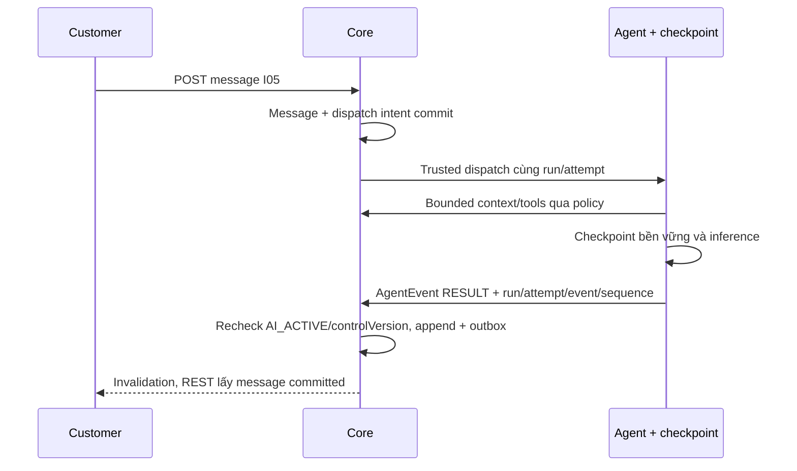

# CH02 — Contract Core–Agent, durable runs và tool scope

06/11/2026 · **Đề xuất, chưa triển khai API Agent thật** · [C06](../06-chat-contract.md). Theo [Agent Design](../../../../specifications/Agent_Design.md) và [plan](../../../../superpowers/plans/2026-10-31-agent-rag-implementation.md): HTTP + callback JSON đã chọn; HMAC tạm chốt, profile/framework/provider/DDL còn gate review.

## Bổ sung bảo vệ dữ liệu Customer — 12/11/2026

**P — chưa triển khai phần bảo vệ bổ sung; giữ trạng thái baseline của phase.** Theo [ma trận dữ liệu chung](../../../../configuration-and-data.md#customer-sensitive-data); mức che/quyền xem đầy đủ còn chờ chốt. Vị trí code/API và data model của phase bên dưới là nơi rà tác động; bổ sung này không tự yêu cầu migration hoặc sửa dữ liệu gốc.

**Thay đổi của phase:** Tách nguồn có quyền khỏi bản context đã giảm/che tại dispatch/history/tool/evidence và mọi model/embedding/summary/repair call, kể cả retry/resume. Alias không cấp quyền; mapping/retention và evidence/error schema phối hợp G1–G4.

**Kiểm thử cần bổ sung, chưa chạy:** Fake boundary/Core: canary mọi nguồn không tới provider ngoài allowlist; processor lỗi không fallback raw, stale attempt không phát output, checkpoint/callback không lộ mapping.

## Data model và phạm vi ảnh hưởng

Bảng bên dưới mô tả tác động của phase, gồm cả ghi gián tiếp qua Core. Tên bảng thuộc schema `business` trừ nơi ghi rõ; cột còn đề xuất được đánh dấu **P**. Web không truy cập DB trực tiếp.

| Bảng/model | Cột hoặc dữ liệu liên quan | Thao tác của phase | Quan hệ/ràng buộc cần giữ | Mức ảnh hưởng và nơi bị tác động |
| --- | --- | --- | --- | --- |
| users + auth_sessions | users.id/role/status, auth_sessions.user_id/token_hash/expires_at/revoked_at | Đọc | AuthSession.user_id → User.id; session phải còn hạn, không bị thu hồi | Cao — mọi API dùng session; không trả token/hash trong DTO |
| conversations + conversation_handoffs | customer_id/channel_type/support_origin/direct_assignment_id/assigned_staff_id/status/control_version/subject, state/assignment_id/recipient_staff_id/shared_subject/shared_reason/accepted_at/revoked_at | Đọc | Direct đúng assignment lúc tạo hoặc handoff ACCEPTED còn grant; PENDING chỉ shared metadata, không AI subject/transcript | Cao — Inbox filter/deep link/REST/WS phải cùng gate; không suy grant từ status/assigned_staff_id |
| messages | conversation_id/sequence/audience/sender_type/sender_id/content/citations/created_at | Đọc | Unique (conversation_id,sequence); chỉ CUSTOMER_VISIBLE sau transcript gate; sequence bigint ra DTO dạng string | Cao — không lộ INTERNAL/LEGACY_REVIEW/tool_calls_metadata cho Customer/Staff transcript |
| insurance_policies + insurance_products | customer_id/product_id/policy_number/status, premium_amount/payment_frequency/next_due_date, effective_date/expiry_date/sum_assured/benefits_snapshot, product_code/name | Đọc | Policy.customer_id → CustomerProfile.user_id; product_id → InsuranceProduct.id; unique policy_number | Cao — DTO tiền/ngày/snapshot dùng chung Staff/Customer; không OCR PDF để cập nhật DB |
| documents + document_versions | access_scope/policy_id/owner_customer_id/product_id/current_version, document_id/version_number/is_active/checksum_sha256/storage_bucket/storage_object_key | Đọc | FK (policy_id,owner_customer_id) → Policy(id,customer_id); unique (document_id,version_number); policy dùng exact binding trong benefits_snapshot, Products dùng current_version | Cao — đổi version/scope ảnh hưởng viewer, download và nguồn retrieval; bucket/key không ra DTO |
| Durable turn — P, chưa có bảng app | Dự kiến conversationId/triggerMessageId/expectedControlVersion/state/attempt/lease/resultMessageId | DDL và ghi dự kiến, chưa triển khai | Unique conversation+trigger, stale attempt fence; Agent checkpoint tách transaction Message/Ticket | Cao — không ghi task state vào ConversationStatus và không thêm quyền DB cho Agent |

**Schema/migration:** P — phải chốt tên bảng/cột/index/retention trước migration mới. Không tạo AI turn/reply cho lịch sử cũ hoặc sửa model business chỉ để khớp Agent.

**Nhất quán và hồi quy:** Core cấp scope và recheck controlVersion/assignment ở tool và append. Checkpoint không thay business commit, stale/cancel không append kết quả. Chỉ cập nhật ranh giới kế hoạch, không triển khai Agent ở đợt này.

## 1. Kết quả và gate

FR-005/009/012, NFR-001/002/003/005/008. Chốt service identity, giao thức, checkpoint store, Core run dispatch/result và retrieval source/version trước Agent thật. Phase không triển khai Staff Copilot; có thể tái dùng hạ tầng sau nhưng channel/customer/internal boundary khác nhau. Không dùng cookie Customer trong Agent hoặc body `{role,customerId}` do LLM sinh làm authority.

## 2. Vị trí và model cần thiết

Owner đề xuất: `apps/core/src/conversations/` cho orchestration adapter/access/append, `apps/agent/` cho workflow/checkpoint/retrieval/tools; giữ business writes ở Core. Dùng `conversation-message.service.ts` và fence hiện có, không Agent Prisma/business credentials. Chỉ thêm module/dependency khi chốt runtime cụ thể.

Core cần Run/Attempt/Event persistence theo Tasks 2–3: run gắn conversation/tin nguồn, trạng thái QUEUED/RUNNING/COMPLETED/FAILED/CANCELLED, attempt hiện hành, thứ tự/dispatch/dedup và history view. `Turn` trong bản cũ là cùng khái niệm `Run`, không thêm lifecycle thứ hai. Ánh xạ controlVersion/receipt/Message hiện có với contract G1; DDL/lease/fencing/atomicity chờ G2. Không ghi trạng thái run vào ConversationStatus hoặc backfill AI reply/run giả. Checkpoint Agent lưu context/work riêng quyền, không thay Message/Run/Ticket commit.

| Vị trí từ root repo | Hiện trạng | Trách nhiệm trong phase | Mức ảnh hưởng | Phạm vi cần kiểm lại |
| --- | --- | --- | --- | --- |
| [apps/core/src/conversations/services/conversation-message.service.ts](<../../../../../apps/core/src/conversations/services/conversation-message.service.ts>) | Hiện có | Trusted append nền, P turn-fenced adapter | Cao | SYSTEM/Customer/Staff append giữ semantics |
| [apps/core/src/conversations/services/conversation-access.service.ts](<../../../../../apps/core/src/conversations/services/conversation-access.service.ts>) | Hiện có | Core source/owner gate | Cao | AI/Direct/accepted scope |
| [apps/agent/](<../../../../../apps/agent>) | Hiện có | Owner Agent runtime/checkpoint, contract phối hợp còn P | Cao | Không business DB credentials |
| [apps/core/prisma/schema.prisma](<../../../../../apps/core/prisma/schema.prisma>) | Hiện có | P durable turn sau review schema | Cao | Core readiness, retries và migration |

## 3. API/service spec để review

Customer gửi vẫn E POST messages I05; không yêu cầu browser gửi thêm LLM prompt. Sau message CUSTOMER commit trong AI_ACTIVE, Core transaction có durable dispatch intent tương ứng trigger; enqueue fail sau commit phải retry từ outbox, không mất run. Chốt batch/serialization khi Customer gửi nhiều tin: đề xuất serial theo conversation sequence, mỗi trigger một run, không hai worker xuất hai answer.

Interfaces **P**, ánh xạ tên/DTO với contract G1 trước code; không thay HMAC bằng session browser:

| Operation | Request tối thiểu | Response/quy tắc |
| --- | --- | --- |
| dispatchRun | RunRequest do Core cấp: run/attempt/conversation/message, actor, channel, history view, limits | Durable ACK sau lưu; retry cùng IDs/fingerprint, không chạy độc lập |
| readContext | Service identity + run/attempt + HistoryView/cursor Core cấp | Lịch sử xử lý gồm kết quả/lỗi lượt trước được chấp nhận trước khi xử lý tin hiện tại, kể cả commit sau khi tin đó vào queue; không lấy tin queue phía sau |
| readPolicy/retrieveSources | Trusted execution context + resource query | Hai Business Tools và hai retrieval tools đúng Agent Design; scope xin bằng code, chỉ document/version được phép |
| receiveEvent/appendAnswer | AgentEvent gắn run/attempt/event/sequence; RESULT có AgentResult | Core kiểm attempt/fence/quyền và lưu idempotent; không browser gọi, không ACK trước lưu |
| proposeHandoff/proposeTicketDraft | AgentResult.actions với PROPOSE_HANDOFF/PROPOSE_TICKET | Chỉ đề xuất; Customer xác nhận riêng ở Core, không tự tạo consent/confirmedAt/Ticket |

Đọc trạng thái theo RunSummary của Task 1 và route đề xuất `GET /api/v1/agent-runs/:id` ở Task 3; tên route/DTO cuối phải ánh xạ với API App ở G1. Create/list/read/history có currentRun để reopen không phụ thuộc browser nhớ ID; GET không tạo run. Core kiểm owner/channel/quyền, no-store và không trả prompt/checkpoint/raw exception. Bounded discovery/transport Web–Core còn cần review trước CH03; không tự thêm API `assistant-turns` song song hoặc coi trạng thái run là trạng thái chat.

## 4. Fence, citations và business writes

Khi request handoff commit, Core chặn Agent append từ PENDING_HANDOFF; result đến muộn không được công bố dù inference đã xong. Recheck controlVersion/attempt/routing/owner khi đọc tools và nhận kết quả; protocol chặn stale checkpoint writer theo G2. Core vẫn kiểm quyền API hiện hành; chính sách tự dừng/tiếp tục task khi logout/hết phiên chờ G3. Retry không tạo duplicate tin AI. Citation do code lấy metadata từ evidence_id thật: document/version/title/type/location với pages/clause/anchor phù hợp nguồn; Markdown không bịa trang PDF. D01 đã có quyền mở PDF; citation không tự cấp quyền.

Ticket tạo qua [I07](../../../staff/plans/tickets/06-agent-confirmation.md): trusted draft → Customer xem/xác nhận → Core snapshot+outbox; Agent chỉ proposeDraft, không tạo trực tiếp. Summary ghi mốc source sequence/version, không sửa immutable confirmedContent. Handoff suggestion gọi dialog có consent thật, không tự POST request từ text “đồng ý” do LLM diễn giải.

## 5. Test cases

Các ca dưới đây là **kịch bản dự kiến**, chỉ thực thi sau dependency/contract đã chốt trong phần phạm vi; không đánh dấu chức năng đã có.

**Quy ước dữ liệu:** S-A/S-B là hai Staff synthetic; C-A/C-B là hai Customer synthetic khác nhau. Thay alias bằng UUID/token của fixture cô lập; các path HTTP dùng prefix /api/v1 nếu chưa ghi đầy đủ. Chỉ thay assignment, khóa account, inject lỗi hoặc migration trong harness/môi trường test, không trên tài khoản/dữ liệu đang sử dụng.

### CH02-T01 — Service identity và nguồn đúng owner

**Lớp kiểm thử:** Service/Agent contract dự kiến.
**Điều kiện và dữ liệu:** CH02 transport/auth đã chốt; run của C-A dùng policyA applied v1, product current v2.

**Các bước:**

1. Gọi readContext/retrieveSources bằng service hợp lệ.
2. Thử fake service, actor/role từ payload LLM và policy C-B.
3. Đối chiếu context/citations trước prompt.

**Kết quả mong đợi:** Chỉ trusted run/owner/applied v1 được cấp; deny nguồn ngoài quyền trước retrieval/prompt, không business DB trực tiếp từ Agent.

### CH02-T02 — Durable run, crash và callback trùng

**Lớp kiểm thử:** Worker + DB dự kiến.
**Điều kiện và dữ liệu:** Hai Customer messages với sequence khác nhau; trigger/run ID bền vững.

**Các bước:**

1. Dispatch cùng runId hai lần.
2. Crash worker rồi resume từ checkpoint.
3. Gửi appendAnswer callback lặp cho một trigger.

**Kết quả mong đợi:** Không mất run, không hai answer cho cùng trigger; sequence/idempotency nhất quán, không lấy checkpoint làm business commit.

### CH02-T03 — Fence khi handoff/reassign

**Lớp kiểm thử:** Agent integration dự kiến.
**Điều kiện và dữ liệu:** Agent đang chạy ở controlVersion n; result bị giữ tại barrier.

**Các bước:**

1. Commit handoff hoặc đổi assignment/control.
2. Trả result/attempt n muộn.
3. Đọc Customer-visible messages và task state.

**Kết quả mong đợi:** Result cũ bị fence, không append answer/trả Private theo scope cũ; không chỉ dựa hủy UI.

### CH02-T04 — Suggestion không thay xác nhận

**Lớp kiểm thử:** Agent integration dự kiến.
**Điều kiện và dữ liệu:** Trusted Agent có thể proposeHandoff/proposeTicketDraft; Customer chưa xác nhận.

**Các bước:**

1. Tạo suggestion/draft.
2. Kết thúc Agent run mà không Customer action.
3. Kiểm handoff/Ticket business tables.

**Kết quả mong đợi:** Không consent hoặc Ticket tự tạo; lỗi provider/retrieval an toàn, không cam kết Claim/chi trả hoặc citation giả.

**Checklist chức năng liên quan** (giữ trạng thái triển khai, không phải kết quả của lần sửa tài liệu):

- [ ] Identity/transport/checkpoint/schema/run discovery được ghi cụ thể và review; ADR đề xuất không tự thành mặc định.
- [ ] Actual Agent test phân biệt fake adapter; CH03 chỉ bắt đầu khi API discovery/status stable.

**Dọn sau kiểm thử:** xóa đúng fixture/session/object/schema theo runId; phục hồi fault injection và đóng context/socket test. Không reset DB/credential, sửa bootstrap hoặc xóa volumes. Với PDF kiểm metadata/bytes/hash; với UI kiểm DOM/focus/network, không cần screenshot.
