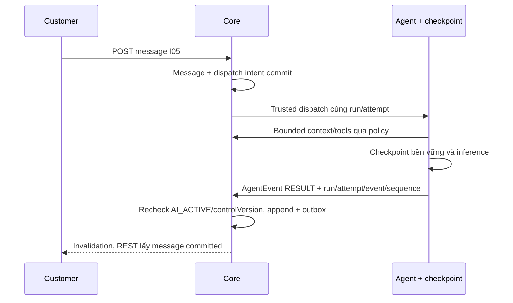

# CH02 — Contract Core–Agent, durable runs và tool scope

06/11/2026 · **Agent đã có code; tích hợp Core–Agent còn P** · [C06](../06-chat-contract.md). Theo [Agent Design](../../../../specifications/Agent_Design.md) và [plan](../../../../superpowers/plans/2026-10-31-agent-rag-implementation.md): HTTP + callback JSON, Starlette + uvicorn và LI-HMAC-SHA256-v1 đã chốt. Model MVP dùng gemini-3.8-flash/gemini-embedding-2, 1536 chiều. Tích hợp Core, DDL và các tiêu chí G1–G4 còn lại tiếp tục được review.

## Bàn giao triển khai Core–Agent

**Hiện có:** Agent có graph, retrieval, durable store và HTTP/HMAC trong `apps/agent/src/life_agent/`; Core có chat, handoff, Ticket, outbox và kiểm quyền. `apps/core/src/agent/` và các bảng run/attempt/event/nonce chưa có. Test Agent với Core double không chứng minh tích hợp thật.

Đọc [bàn giao Core/Web](../../../../superpowers/plans/2026-11-07-agent-core-handoff.md) để lấy endpoint/ACK hiện Agent đang dùng; [contract và schema chung](../../../../../contracts/agent-v1.md) là chuẩn wire. CH02 sở hữu nền Core; CH03 sở hữu UI Customer; I03 sở hữu handoff; I07/T01/T02 sở hữu Ticket. Copilot CP01–CP04 dùng nền chung và triển khai trong cùng đợt với Customer. Đóng từng luồng bằng test riêng; chỉ hoàn tất đợt nối khi cả Customer và Copilot đạt tiêu chí.

| Bước | Việc bàn giao | Vị trí code / điều kiện hoàn tất |
| --- | --- | --- |
| 1. Khóa contract | Đối chiếu schema/fixtures, API nội bộ, ACK và version. Chốt bổ sung nguồn Ticket và operation chuẩn bị handoff summary trước khi viết adapter | `contracts/agent-v1.md`, schema/fixtures; không tự gửi field mới vào agent-v1 |
| 2. Lưu bền Core | Migration additive run/attempt/event/nonce, FIFO, lease, dedup và dispatch intent cùng transaction Message | `apps/core/prisma/`, module P `apps/core/src/agent/`; hồi quy verify/reset và upgrade có dữ liệu cũ |
| 3. Giao tiếp và quyền | HMAC hai chiều, nonce, history/scope/contracts, callback RESULT/PROGRESS, ACK sau commit và retry/revoke | Module Agent mới phối hợp `conversations`; kiểm quyền mỗi call, không business DB cho Agent |
| 4. Hai đề xuất riêng | Map PROPOSE_HANDOFF sang bản chuẩn bị subject/reason; PROPOSE_TICKET sang draft có sáu nhóm/nguồn | I03 và I07; đề xuất/callback không tự commit handoff hoặc Ticket |
| 5. UI | Customer: run/progress/kết quả committed, citations, hai CTA/review riêng và Request Staff support có AI summary; Staff: CP01–CP04 context/history/citations nội bộ | `customer-conversations.tsx`, `customer-handoff-dialog.tsx`, `customer-ticket-confirmation.tsx`, API clients; reload không tạo run/action mới |
| 6. Nghiệm thu | Contract → Core/DB → Agent/Core thật → browser gateway; HMAC, crash/restart, mất ACK, duplicate/out-of-order, revoke, history lớn và quyền | CH02/CH03 + I03/I07; kiểm hai chiều callback/handoff race và hồi quy chat/Ticket/manual hiện có |

Các mục **P** là việc người nhận cần triển khai, không phải code đã có. Những mở rộng wire ở bước 1 phải có schema/fixture và test tương thích hai bên trước khi merge; không tự đóng gate bằng test mock.

### Quyết định triển khai đã chốt

- **Customer duyệt nội dung:** mọi bản summary ban đầu hoặc tạo lại đều phải được Customer xem/sửa và bấm xác nhận trước khi gửi Staff. Ticket có xác nhận revision riêng. Summary sinh xong không tự submit và không dùng consent cũ cho nội dung mới.
- **AI summary lỗi:** báo lỗi, cho thử lại hoặc Customer chủ động tự nhập để tiếp tục nhờ Staff; bản tự nhập vẫn phải được Customer duyệt/gửi và không gắn nhãn AI summary.
- **Có tin mới:** cập nhật summary đến mốc mới và yêu cầu Customer review lại. Giữ riêng phần đang sửa, không tự ghi đè. Mọi cập nhật nội dung làm mất hiệu lực xác nhận cũ; bản đã commit không bị sửa lại.
- **Phạm vi cùng đợt:** Customer chat/citations, hai đề xuất hỗ trợ và Staff Copilot CP01–CP04. Copilot vẫn nội bộ, không tự gửi cho Customer hoặc xác nhận thay Customer.
- **Giới hạn local:** giữ nguyên bộ giới hạn hiện có trong `apps/agent/evaluation/trial-config.json`: 3 retrieval, 4 Core reads, timeout Core 3000 ms và 1 retry/call; 6 model calls, 30 graph steps, 120000 token/lượt gồm 12000 token dự phòng kết thúc, deadline 120 giây. Dùng khi nối/test local, không đổi code/config để tự tăng giảm; không coi đây là nghiệm thu production, giá API hoặc duyệt corpus.

### Hai hành động hỗ trợ Customer

| Hành động | Agent chuẩn bị | Customer xác nhận | Core ghi |
| --- | --- | --- | --- |
| Nhờ Staff hỗ trợ chat | PROPOSE_HANDOFF.subject/reason; reason là bản tóm tắt yêu cầu, phần đã trao đổi và vấn đề cần Staff xử lý | Review/sửa nội dung chia sẻ và consent toàn bộ lịch sử Customer-facing của cuộc này | ConversationHandoff/PENDING_HANDOFF; chỉ sau Staff Accept mới mở transcript; không Ticket |
| Nhờ hỗ trợ tạo Ticket | PROPOSE_TICKET.summary sáu nhóm và metadata nguồn hợp lệ | Review/sửa draft và xác nhận revision Ticket | SupportTicket OPEN + snapshot/audit/outbox; không tạo chat grant hoặc tự chuyển Staff |

Một RESULT có thể đề xuất cả hai, nhưng mỗi action có ID/intent và bước xác nhận riêng. Không suy consent hành động còn lại từ một lần bấm hoặc lời đồng ý trong chat. Copilot không được dùng các action Customer này.

### Chuẩn bị AI summary khi Customer tự bấm Request Staff support — P

1. Core kiểm owner/phiên/assignment/controlVersion rồi chốt mốc transcript Customer-facing của chính cuộc. Chưa chuyển PENDING_HANDOFF, chưa chia sẻ summary cho Staff và chưa hủy run AI chỉ vì mở dialog.
2. Nếu có PROPOSE_HANDOFF đã commit còn đúng cuộc/version/mốc nguồn, dùng đề xuất đó. Nếu chưa có hoặc stale, Core yêu cầu Agent tóm tắt theo operation chuẩn bị handoff; không chèn tin Customer giả, không gọi model từ Web và không sửa transcript cũ.
3. Core lưu proposal có ID, actor/conversation, run/attempt/event nếu có, controlVersion, sourceThroughSequence, subject/reason và trạng thái chuẩn bị. Đây là persistence **P**: chốt model/FK/unique/expiry và migration ở bước 1–2; không dùng ConversationHandoff PENDING làm nơi giữ bản chưa consent.
4. API chuẩn bị/đọc proposal là **P**, cần chốt path/DTO cùng run-purpose trước code. Request chỉ mang intent/version; Core suy identity và nguồn. Trả trạng thái pending/ready/failed để Web đối soát theo ID sau timeout/reload. Retry cùng intent không sinh thêm summary job; GET không chạy model. Agent-v1 chưa có operation chuyên biệt này: phải chốt extension có version/fixtures, không nhét vào trường message như câu người dùng.
5. Web điền subject/reason cho Customer xem/sửa. Reason AI phải có nội dung, tối đa 1000 ký tự; không cắt âm thầm hoặc tự thay thành reason rỗng. Lỗi/thiếu căn cứ hiển thị rõ và cho thử lại; Customer có thể chủ động chọn tự nhập theo luồng thủ công hiện có, không gắn nhãn AI summary cho nội dung tự nhập.
6. Handoff command cuối bind proposal/revision hoặc payload đã được Customer sửa, giữ consent/version/idempotency I03. Nếu có tin mới/routing đổi khiến bản tóm tắt không còn đúng mốc, yêu cầu cập nhật và review lại; response muộn không ghi đè phần Customer đang sửa. Chỉ transaction xác nhận handoff mới lưu shared_reason, chuyển pending, fence run và phát notification.

Không thêm dữ liệu Copilot, tool trace, checkpoint hoặc cuộc khác vào reason. Nội dung AI là bản tóm tắt để chuyển tiếp, không phải kết luận nghiệp vụ đã xác minh. Staff pending chỉ đọc bản subject/reason Customer đã duyệt chia sẻ; các summary Private khác vẫn bị chặn.

## Bổ sung bảo vệ dữ liệu Customer — 12/11/2026

**Chính sách thông tin liên hệ:** [Ma trận dữ liệu chung](../../../../configuration-and-data.md#customer-sensitive-data) quy định che email/phone Customer mặc định và Hiện/Ẩn sau kiểm quyền Core. Phase 1 đã triển khai tại Customers; DTO Customer ở Policy/Inbox/Ticket hiện chỉ có tên/mã, không có contact card raw. Quy định này không thay quyền đọc PDF/transcript hoặc trạng thái triển khai của chức năng trong plan.

**MVP B:** sáu quy tắc system prompt và dữ liệu synthetic; quyền/scope/fence và schema theo contract. [Quyết định chuẩn](../../../../specifications/Agent_Design.md#mvp-model-data-policy).

## Data model và phạm vi ảnh hưởng

Bảng bên dưới mô tả tác động của phase, gồm cả ghi gián tiếp qua Core. Tên bảng thuộc schema `business` trừ nơi ghi rõ; cột còn đề xuất được đánh dấu **P**. Web không truy cập DB trực tiếp.

| Bảng/model | Cột hoặc dữ liệu liên quan | Thao tác của phase | Quan hệ/ràng buộc cần giữ | Mức ảnh hưởng và nơi bị tác động |
| --- | --- | --- | --- | --- |
| users + auth_sessions | users.id/role/status, auth_sessions.user_id/token_hash/expires_at/revoked_at | Đọc | AuthSession.user_id → User.id; session phải còn hạn, không bị thu hồi | Cao — mọi API dùng session; không trả token/hash trong DTO |
| conversations + conversation_handoffs | customer_id/channel_type/support_origin/direct_assignment_id/assigned_staff_id/status/control_version/subject, state/assignment_id/recipient_staff_id/shared_subject/shared_reason/accepted_at/revoked_at | Đọc | Direct đúng assignment lúc tạo hoặc handoff ACCEPTED còn grant; PENDING chỉ shared metadata, không AI subject/transcript | Cao — Inbox filter/deep link/REST/WS phải cùng gate; không suy grant từ status/assigned_staff_id |
| messages | conversation_id/sequence/audience/sender_type/sender_id/content/citations/created_at | Đọc | Unique (conversation_id,sequence); chỉ CUSTOMER_VISIBLE sau transcript gate; sequence bigint ra DTO dạng string | Cao — không lộ INTERNAL/LEGACY_REVIEW/tool_calls_metadata cho Customer/Staff transcript |
| insurance_policies + insurance_products | customer_id/product_id/policy_number/status, premium_amount/payment_frequency/next_due_date, effective_date/expiry_date/sum_assured/benefits_snapshot, product_code/name | Đọc | Policy.customer_id → CustomerProfile.user_id; product_id → InsuranceProduct.id; unique policy_number | Cao — DTO tiền/ngày/snapshot dùng chung Staff/Customer; không OCR PDF để cập nhật DB |
| documents + document_versions | access_scope/policy_id/owner_customer_id/product_id/current_version, document_id/version_number/is_active/checksum_sha256/storage_bucket/storage_object_key | Đọc | FK (policy_id,owner_customer_id) → Policy(id,customer_id); unique (document_id,version_number); policy dùng exact binding trong benefits_snapshot, Products dùng current_version | Cao — đổi version/scope ảnh hưởng viewer, download và nguồn retrieval; bucket/key không ra DTO |
| Handoff proposal — P, model/schema cần chốt | Owner/cuộc, intent, sourceThroughSequence/controlVersion, subject/reason, trạng thái, revision/expiry | Chuẩn bị/lưu/đọc summary trước consent | Unique intent/action nguồn, FK theo owner/cuộc; chưa tạo ConversationHandoff hoặc grant | Cao — callback, dialog, retry và xác nhận I03 |
| Durable turn — P, chưa có bảng app | Dự kiến conversationId/triggerMessageId/expectedControlVersion/state/attempt/lease/resultMessageId | DDL và ghi dự kiến, chưa triển khai | Unique conversation+trigger, stale attempt fence; Agent checkpoint tách transaction Message/Ticket | Cao — không ghi task state vào ConversationStatus và không thêm quyền DB cho Agent |

**Schema/migration:** P — phải chốt tên bảng/cột/index/retention trước migration mới. Không tạo AI turn/reply cho lịch sử cũ hoặc sửa model business chỉ để khớp Agent.

**Nhất quán và hồi quy:** Core cấp scope và recheck controlVersion/assignment ở tool và append. Checkpoint không thay business commit, stale/cancel không append kết quả. Chỉ cập nhật ranh giới kế hoạch, không triển khai Agent ở đợt này.

## 1. Kết quả và gate

FR-005/009/012, NFR-001/002/003/005/008. Chốt service identity, giao thức, checkpoint store, Core run dispatch/result và retrieval source/version trước Agent thật. Phase không triển khai Staff Copilot; có thể tái dùng hạ tầng sau nhưng channel/customer/internal boundary khác nhau. Không dùng cookie Customer trong Agent hoặc body `{role,customerId}` do LLM sinh làm authority.

## 2. Vị trí và model cần thiết

Owner đã chọn: `apps/core/src/conversations/` cho public API/access/append, `apps/core/src/agent/` cho run/attempt/event/HMAC/dispatch/API nội bộ, `apps/agent/` cho workflow/checkpoint/retrieval/tools; giữ business writes ở Core. Dùng `conversation-message.service.ts` và fence hiện có, không Agent Prisma/business credentials. Chỉ thêm module/dependency khi chốt runtime cụ thể.

Core cần Run/Attempt/Event persistence theo Tasks 2–3: run gắn conversation/tin nguồn, trạng thái QUEUED/RUNNING/COMPLETED/FAILED/CANCELLED, attempt hiện hành, thứ tự/dispatch/dedup và history view. `Turn` trong bản cũ là cùng khái niệm `Run`, không thêm lifecycle thứ hai. Ánh xạ controlVersion/receipt/Message hiện có với contract G1; DDL/lease/fencing/atomicity chờ G2. Không ghi trạng thái run vào ConversationStatus hoặc backfill AI reply/run giả. Checkpoint Agent lưu context/work riêng quyền, không thay Message/Run/Ticket commit.

| Vị trí từ root repo | Hiện trạng | Trách nhiệm trong phase | Mức ảnh hưởng | Phạm vi cần kiểm lại |
| --- | --- | --- | --- | --- |
| [apps/core/src/conversations/services/conversation-message.service.ts](<../../../../../apps/core/src/conversations/services/conversation-message.service.ts>) | Hiện có | Trusted append nền, P turn-fenced adapter | Cao | SYSTEM/Customer/Staff append giữ semantics |
| [apps/core/src/conversations/services/conversation-access.service.ts](<../../../../../apps/core/src/conversations/services/conversation-access.service.ts>) | Hiện có | Core source/owner gate | Cao | AI/Direct/accepted scope |
| [apps/agent/](<../../../../../apps/agent>) | Hiện có | Owner Agent runtime/checkpoint, contract phối hợp còn P | Cao | Không business DB credentials |
| [apps/core/prisma/schema.prisma](<../../../../../apps/core/prisma/schema.prisma>) | Hiện có | P durable turn sau review schema | Cao | Core readiness, retries và migration |

## 3. API/service spec để review

Customer gửi vẫn E POST messages I05; không yêu cầu browser gửi thêm LLM prompt. Với tin CUSTOMER cần AI trong AI_ACTIVE, Core lưu message + run + durable dispatch intent cùng transaction trước ACK; lỗi giao nhận sau commit được reconcile từ intent đã lưu. Mỗi trigger một run, serial/FIFO theo conversation sequence; không hai worker xuất hai answer. Đây là yêu cầu tích hợp còn P.

Interfaces **P**, ánh xạ tên/DTO với contract G1 trước code; không thay HMAC bằng session browser:

| Operation | Request tối thiểu | Response/quy tắc |
| --- | --- | --- |
| dispatchRun | RunRequest do Core cấp: run/attempt/conversation/message, actor, channel, history view, limits | Durable ACK sau lưu; retry cùng IDs/fingerprint, không chạy độc lập |
| readContext | Service identity + run/attempt + HistoryView/cursor Core cấp | Lịch sử xử lý gồm kết quả/lỗi lượt trước được chấp nhận trước khi xử lý tin hiện tại, kể cả commit sau khi tin đó vào queue; không lấy tin queue phía sau |
| readPolicy/retrieveSources | Trusted execution context + resource query | Hai Business Tools và hai retrieval tools đúng Agent Design; scope xin bằng code, chỉ document/version được phép |
| receiveEvent/appendAnswer | AgentEvent gắn run/attempt/event/sequence; RESULT có AgentResult | Core kiểm attempt/fence/quyền và lưu idempotent; không browser gọi, không ACK trước lưu |
| proposeHandoff/proposeTicketDraft | AgentResult.actions với PROPOSE_HANDOFF/PROPOSE_TICKET | Core lưu đề xuất idempotent theo run/attempt/event/actionIndex (vị trí action trong RESULT đã lưu); bind revision/nguồn. Customer review và xác nhận riêng từng hành động; không tự tạo consent/confirmedAt/Ticket |

Đọc trạng thái theo RunSummary trên API conversations hiện có theo [ánh xạ đã chọn](../../../../../contracts/agent-v1.md#application-conversation-api-mapping); giữ create `clientRequestId`, send `clientMessageId`, expectedVersion/controlVersion. Không bắt Web chuyển sang `/agent-runs/:id`; DTO bổ sung còn phải review/kiểm trước code. Create/list/read/history có currentRun để reopen không phụ thuộc browser nhớ ID; GET không tạo run. Core kiểm owner/channel/quyền, no-store và không trả prompt/checkpoint/raw exception. Bounded discovery/transport Web–Core còn cần review trước CH03; không tự thêm API `assistant-turns` song song hoặc coi trạng thái run là trạng thái chat.

## 4. Fence, citations và business writes

**Logout/hết phiên — B đã chốt 14/11/2026, tích hợp P.** Core giữ intent/run đã nhận và queued messages, authorize Agent bằng service/run/actor/target tin cậy, kiểm quyền tài khoản/tài nguyên/attempt khi claim, đọc tools và nhận kết quả. API tương tác vẫn kiểm phiên, re-login đọc history/current run bằng phiên mới. CH02 phối hợp Auth kiểm race accept/logout và callback trong thời gian client đã logout. [Chính sách chuẩn](../../../../specifications/Agent_Design.md#agent-logout-session-policy).

**Lượt lỗi/quá hạn — A đã chốt 14/11/2026, tích hợp P.** Khi lượt AI kết thúc vì lỗi kỹ thuật hoặc hết deadline, Core ghi FAILED và UI hiển thị lỗi an toàn. Customer chủ động gửi lại câu hỏi hoặc hỏi tiếp bằng một tin nhắn mới. Lượt lỗi giữ trạng thái kết thúc, hệ thống không tự chạy lại toàn bộ lượt hoặc tạo attempt thay thế. Gửi lại request/kết quả do mất ACK dùng cùng ID và receipt để chống trùng. Retry tạm thời bên trong một lần gọi tool/model vẫn theo ngân sách và chính sách đã chốt. Tin nhắn mới của Customer tạo lượt mới theo quyền hiện hành, tin đã xếp hàng tiếp tục theo FIFO/fence. Reload/reconnect chỉ đối soát trạng thái, không tự chạy lại lượt FAILED. CH02 sở hữu lưu lỗi/history/discovery và fence callback, CH03 hiển thị lỗi. [Quyết định chuẩn](../../../../specifications/Agent_Design.md#failed-turn-policy).

**Chat mới sau Staff — đã chốt 14/11/2026.** Customer muốn hỏi AI sau khi trao đổi với Staff thì chủ động chọn New AI chat. Core tạo conversation mới qua luồng create hiện có, Agent dùng thread/context riêng của cuộc mới. Cuộc cũ nằm trong lịch sử, quyền đọc/gửi tiếp tục theo allowedActions và grant hiện hành. ConversationStatus giữ AI_ACTIVE/PENDING_HANDOFF/STAFF_ACTIVE. Dừng trao đổi sau khi đã hỗ trợ xong không tạo trạng thái Close hoặc command kết thúc, cũng không tự khóa composer thành chỉ đọc.

New AI chat đã có trên Web, Core đã có create với receipt/idempotency. Khác intent tạo mới dùng key mới, retry cùng intent dùng lại key và nhận cùng conversation. Context/checkpoint cuộc cũ không tự đi sang cuộc mới, Staff không kế thừa quyền cuộc AI mới từ grant cuộc cũ. Consent/Accept và fence takeover áp theo luồng hiện hành, nghiệm thu Agent/Core end-to-end còn P. CH02 kiểm context/history view/run/callback theo đúng conversation. Mở lại cuộc cũ đọc/gửi theo capability Core, không tự tạo lượt AI cho cuộc Staff đang hỗ trợ. [Quyết định chuẩn](../../../../specifications/Agent_Design.md#new-ai-chat-after-staff).

Khi REQUEST_HANDOFF commit, Core fence ngay từ PENDING_HANDOFF theo [chính sách chuẩn](../../../../../contracts/agent-v1.md#handoff-request-agent-fence): chặn tools/kết quả của attempt cũ, hủy run AI đang chạy/queued của cuộc và lưu revoke intent cùng transaction; không đợi Staff Accept. Revoke ACK vẫn là barrier cho writer Agent kế tiếp, không hủy Copilot riêng còn đúng quyền; tích hợp còn P. Recheck controlVersion/attempt/routing/owner khi đọc tools và nhận kết quả; protocol chặn stale checkpoint writer theo G2. Core vẫn kiểm quyền API hiện hành; B đã chốt 14/11, logout/hết phiên đơn thuần giữ các run đã được Core tiếp nhận tiếp tục xử lý theo quyền hiện hành. Retry không tạo duplicate tin AI. Citation do code lấy metadata từ evidence_id thật: document/version/title/type/location với pages/clause/anchor phù hợp nguồn; Markdown không bịa trang PDF. D01 đã có quyền mở PDF; citation không tự cấp quyền.

Ticket tạo qua [I07](../../../staff/plans/tickets/06-agent-confirmation.md): trusted draft → Customer xem/xác nhận → Core snapshot+outbox; Agent chỉ proposeDraft, không tạo trực tiếp. Summary ghi mốc source sequence/version, không sửa immutable confirmedContent. Handoff suggestion gọi dialog có consent thật, không tự POST request từ text “đồng ý” do LLM diễn giải.

### Nghiệm thu bổ sung cho hai đề xuất — P

- Handoff do Agent gợi ý và do Customer tự bấm đều có reason tóm tắt từ đúng mốc; proposal còn mới được tái dùng, stale phải chuẩn bị/review lại.
- Chuẩn bị lỗi/timeout/restart hoặc callback lặp không tự pending, không tự tạo Ticket và không làm mất intent; đọc proposal không gọi model.
- Pending chỉ lộ bản summary đã consent; nguồn ngoài owner/cuộc, Copilot và attempt cũ bị từ chối.
- Một RESULT có cả hai action: chỉ confirm Ticket thì chat giữ quyền cũ; chỉ confirm handoff thì không có Ticket; Cancel cả hai không có mutation nghiệp vụ.
- Confirm rồi mất ACK/restart dùng cùng intent và snapshot; race tin mới/đổi assignment/Customer sửa dialog không dùng reason cũ hoặc response muộn.

## 5. Test cases

Các ca dưới đây là **kịch bản dự kiến**, chỉ thực thi sau dependency/contract đã chốt trong phần phạm vi; không đánh dấu chức năng đã có.

**Quy ước dữ liệu:** S-A/S-B là hai Staff synthetic; C-A/C-B là hai Customer synthetic khác nhau. Thay alias bằng UUID/token của fixture cô lập; các path HTTP dùng prefix /api/v1 nếu chưa ghi đầy đủ. Chỉ thay assignment, khóa account, inject lỗi hoặc migration trong harness/môi trường test, không trên tài khoản/dữ liệu đang sử dụng.

### CH02-T01 — Service identity và nguồn đúng owner

**Lớp kiểm thử:** Service/Agent contract dự kiến.
**Điều kiện và dữ liệu:** CH02 transport/auth đã chốt; run của C-A dùng policyA applied v1, product current v2.

**Các bước:**

1. Gọi readContext/retrieveSources bằng service hợp lệ.
2. Thử fake service, actor/role từ payload LLM và policy C-B.
3. Đối chiếu context/citations trước prompt.

**Kết quả mong đợi:** Chỉ trusted run/owner/applied v1 được cấp; deny nguồn ngoài quyền trước retrieval/prompt, không business DB trực tiếp từ Agent.

### CH02-T02 — Durable run, crash và callback trùng

**Lớp kiểm thử:** Worker + DB dự kiến.
**Điều kiện và dữ liệu:** Hai Customer messages với sequence khác nhau; trigger/run ID bền vững.

**Các bước:**

1. Dispatch cùng runId hai lần.
2. Crash worker rồi resume từ checkpoint.
3. Gửi appendAnswer callback lặp cho một trigger.

**Kết quả mong đợi:** Không mất run, không hai answer cho cùng trigger; sequence/idempotency nhất quán, không lấy checkpoint làm business commit.

### CH02-T03 — Fence khi handoff/reassign

**Lớp kiểm thử:** Agent integration dự kiến.
**Điều kiện và dữ liệu:** Agent đang chạy ở controlVersion n; result bị giữ tại barrier.

**Các bước:**

1. Commit handoff hoặc đổi assignment/control.
2. Trả result/attempt n muộn.
3. Đọc Customer-visible messages và task state.

**Kết quả mong đợi:** Result cũ bị fence, không append answer/trả Private theo scope cũ; không chỉ dựa hủy UI.

### CH02-T04 — Suggestion không thay xác nhận

**Lớp kiểm thử:** Agent integration dự kiến.
**Điều kiện và dữ liệu:** Trusted Agent có thể proposeHandoff/proposeTicketDraft; Customer chưa xác nhận.

**Các bước:**

1. Tạo suggestion/draft.
2. Kết thúc Agent run mà không Customer action.
3. Kiểm handoff/Ticket business tables.

**Kết quả mong đợi:** Không consent hoặc Ticket tự tạo; lỗi provider/retrieval an toàn, không cam kết Claim/chi trả hoặc citation giả.

### CH02-T05 — Cuộc Staff giữ quyền và fence hiện hành

**P — kiểm tích hợp Agent/Core chưa chạy.** Fixture synthetic có cuộc đã Accept, attempt AI bị takeover vô hiệu và phân công hiện hành. Dừng nhắn, đổi tab/reload/reconnect rồi mở lại cuộc cũ, kiểm allowedActions, send và callback muộn. Sau đó revoke/đổi assignment.

**Kết quả mong đợi.** Việc dừng nhắn không tạo Close/command kết thúc hoặc tự chuyển về AI. Quyền đọc/gửi theo Core và phân công/grant hiện hành, attempt AI cũ tiếp tục bị fence. Revoke/đổi assignment chặn Staff cũ theo policy hiện có.

### CH02-T06 — Customer chủ động mở cuộc AI mới

**P — kiểm tích hợp Agent/Core chưa chạy.** Từ cuộc Staff đang hỗ trợ, Customer chọn New AI chat qua luồng create hiện có. Kiểm retry tạo cuộc, refresh/reconnect, ID/thread/context, callback cuộc cũ và truy cập Staff.

**Kết quả mong đợi.** Intent mới tạo conversation mới, retry cùng key trả cùng ID. Cuộc mới dùng thread/context riêng, không tự kế thừa summary/checkpoint/lịch sử hoặc grant cuộc cũ. Callback tới đúng conversation/run/attempt. Cuộc cũ theo trạng thái và allowedActions hiện hành. Staff chỉ đọc cuộc AI mới sau consent/Accept hợp lệ, Copilot/internal/raw tool metadata nằm ngoài context Customer.

### CH02-T07 — FAILED không tự chạy lại lượt

**P — chưa chạy.** Fixture synthetic có lượt đang chạy, tin khác đã xếp hàng, lỗi Agent và biến thể hết deadline. Kiểm callback RESULT đến muộn, duplicate ERROR, crash/restart, mất ACK dispatch/callback và Customer gửi tin mới.

**Kết quả mong đợi.** Core lưu FAILED terminal đúng một lần, history/discovery báo cùng lỗi. Không dispatch thực thi mới hoặc cấp attempt thay thế cho lượt FAILED. Giao lại cùng request/event được chống trùng. Tin chờ được claim theo FIFO/quyền hiện hành sau fence/revoke ACK, tin Customer gửi lại là lượt mới. RESULT cũ không hồi sinh FAILED hoặc ghi checkpoint trái quyền. Tách ca retry tạm thời theo ngân sách hiện hành với việc chạy lại toàn lượt.

### CH02-T08 — Yêu cầu đã nhận tiếp tục sau logout/hết phiên

**P — chưa chạy.** Fixture synthetic có run đang chạy, tin queued, phiên logout và biến thể hết hạn. Kiểm request accept/logout đồng thời, callback sau logout, claim queued, login lại cùng actor, đổi actor và biến thể quyền tài nguyên/tài khoản bị thu hồi.

**Kết quả mong đợi.** Request được chấp nhận theo thứ tự commit và phiên hợp lệ tại lúc tiếp nhận. Run đã nhận tiếp tục với cùng IDs/budget/deadline, queued theo FIFO và quyền hiện hành. Core lưu kết quả đúng owner, phiên cũ bị chặn Web/API/WS, phiên mới cùng actor xem được lịch sử/current run và không tạo trùng. Actor khác không nhận kết quả. Quyền bị thu hồi theo revoke/fence hiện hành, logout không tự cấp xác nhận Ticket hoặc quyền mới.

**Checklist chức năng liên quan** (giữ trạng thái triển khai, không phải kết quả của lần sửa tài liệu):

- [ ] Identity/transport/checkpoint/schema/run discovery được ghi cụ thể và review; ADR đề xuất không tự thành mặc định.
- [ ] Actual Agent test phân biệt fake adapter; CH03 chỉ bắt đầu khi API discovery/status stable.

**Dọn sau kiểm thử:** xóa đúng fixture/session/object/schema theo runId; phục hồi fault injection và đóng context/socket test. Không reset DB/credential, sửa bootstrap hoặc xóa volumes. Với PDF kiểm metadata/bytes/hash; với UI kiểm DOM/focus/network, không cần screenshot.
