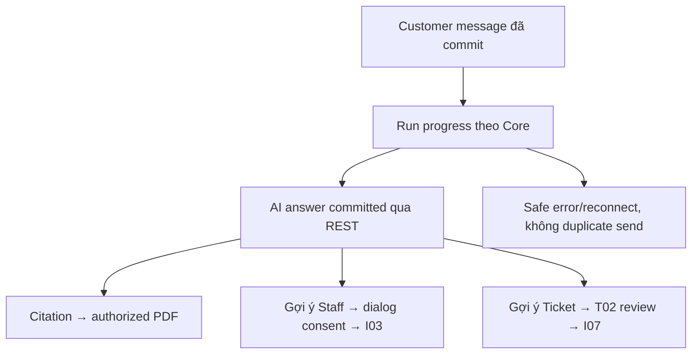
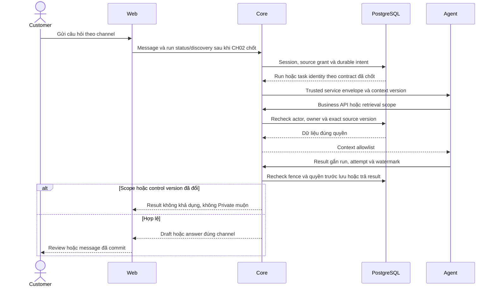

# CH03 — AI answers, citations và lời gợi ý có xác nhận

04/11/2026 · **Bị phụ thuộc CH02/Agent, chưa triển khai** · [C06](../06-chat-contract.md) · Cần CH01+[CH02](02-agent-boundary.md).

## Bổ sung bảo vệ dữ liệu Customer — 12/11/2026

**P — chưa triển khai phần bảo vệ bổ sung; giữ trạng thái baseline của phase.** Theo [ma trận dữ liệu chung](../../../../configuration-and-data.md#customer-sensitive-data); mức che/quyền xem đầy đủ còn chờ chốt. Vị trí code/API và data model của phase bên dưới là nơi rà tác động; bổ sung này không tự yêu cầu migration hoặc sửa dữ liệu gốc.

**Thay đổi của phase:** Chỉ render answer committed đã kiểm output; không rehydrate alias từ raw history. Citation giữ document/version/anchor, phân biệt đoạn lược bỏ với nguyên văn; PDF kiểm quyền riêng.

**Kiểm thử cần bổ sung, chưa chạy:** Network/DOM: answer/clarification/error không phát canary bị loại, citation đúng nguồn; revoke/response cũ không phục hồi PII.

## Data model và phạm vi ảnh hưởng

Bảng bên dưới mô tả tác động của phase, gồm cả ghi gián tiếp qua Core. Tên bảng thuộc schema `business` trừ nơi ghi rõ; cột còn đề xuất được đánh dấu **P**. Web không truy cập DB trực tiếp.

| Bảng/model | Cột hoặc dữ liệu liên quan | Thao tác của phase | Quan hệ/ràng buộc cần giữ | Mức ảnh hưởng và nơi bị tác động |
| --- | --- | --- | --- | --- |
| users + auth_sessions | users.id/role/status, auth_sessions.user_id/token_hash/expires_at/revoked_at | Đọc | AuthSession.user_id → User.id; session phải còn hạn, không bị thu hồi | Cao — mọi API dùng session; không trả token/hash trong DTO |
| messages | conversation_id/sequence/audience/sender_type/sender_id/content/citations/created_at | Đọc | Unique (conversation_id,sequence); chỉ CUSTOMER_VISIBLE sau transcript gate; sequence bigint ra DTO dạng string | Cao — không lộ INTERNAL/LEGACY_REVIEW/tool_calls_metadata cho Customer/Staff transcript |
| documents + document_versions | access_scope/policy_id/owner_customer_id/product_id/current_version, document_id/version_number/is_active/checksum_sha256/storage_bucket/storage_object_key | Đọc | FK (policy_id,owner_customer_id) → Policy(id,customer_id); unique (document_id,version_number); policy dùng exact binding trong benefits_snapshot, Products dùng current_version | Cao — đổi version/scope ảnh hưởng viewer, download và nguồn retrieval; bucket/key không ra DTO |
| Durable turn — P, chưa có bảng app | Dự kiến conversationId/triggerMessageId/expectedControlVersion/state/attempt/lease/resultMessageId | DDL và ghi dự kiến, chưa triển khai | Unique conversation+trigger, stale attempt fence; Agent checkpoint tách transaction Message/Ticket | Cao — không ghi task state vào ConversationStatus và không thêm quyền DB cho Agent |

**Schema/migration:** Không migration trong UI; phụ thuộc turn/Agent API P của CH02, không tự đặt endpoint/schema thành E.

**Nhất quán và hồi quy:** Message đã commit từ Core mới là answer; stream/token nếu có phải contract riêng. Không browser giả sender AI, citations reauthorize exact version. Kiểm stale answer, missing evidence, consent Ticket/handoff tách riêng.

## 1. API/file

Mở rộng `customer-conversations.tsx`, `conversation-transcript.tsx`, `lib/conversation-api.ts`; dùng Message REST I05 làm nguồn answer committed và trạng thái run/discovery **P** do CH02 chốt trước code. Không browser gọi Agent/provider hoặc tự append answer như server đã lưu. Không đọc Copilot Staff. Nếu cần SSE/tokenstream phải contract riêng, không suy ra từ WS invalidation.

| Vị trí từ root repo | Hiện trạng | Trách nhiệm trong phase | Mức ảnh hưởng | Phạm vi cần kiểm lại |
| --- | --- | --- | --- | --- |
| [apps/web/src/components/customer-conversations.tsx](<../../../../../apps/web/src/components/customer-conversations.tsx>) | Hiện có | Own list/entry/handoff/selection | Trung bình | Customer shell và Direct/AI tabs |
| [apps/web/src/components/conversation-transcript.tsx](<../../../../../apps/web/src/components/conversation-transcript.tsx>) | Hiện có | Shared transcript/order/scroll | Cao | Staff view sau Accept |
| [apps/web/src/components/conversation-composer.tsx](<../../../../../apps/web/src/components/conversation-composer.tsx>) | Hiện có | Shared send/reconcile/draft | Cao | Hai role send và idempotency |
| [apps/web/src/lib/conversation-api.ts](<../../../../../apps/web/src/lib/conversation-api.ts>) | Hiện có | Owner entry/send/receipt/CSRF wrappers | Cao | Không nhận actor quyền từ UI |

## 2. Trải nghiệm

AI thinking/queued/error gắn đúng trigger/run, không chiếm ConversationStatus. Retry inference nếu có phải cùng lệnh run do CH02 quy định; không gửi lại message Customer bằng key mới. Chỉ render content đã xử lý an toàn; Markdown nếu cần phải có sanitizer và allowlist link theo dependency được review. Answer cuối lấy qua REST có sequence, không nhân đôi nội dung khi nhận lại message đã commit.

Citation có title/version/page rõ từ DTO authorized, bấm mở D01/D02 exact version và page hợp lệ; không URL ký trong Message. Quyền mất/tài liệu thiếu hiển thị unavailable, không mở bản newest. Không có nguồn hoặc câu trả lời chưa chắc nói rõ hạn chế, không hứa claim/chi trả.

Gợi ý Staff chỉ mở consent dialog I03, Customer Cancel không tạo request; consent vẫn toàn bộ lịch sử và Staff Accept. Gợi ý Ticket chỉ mở T02 review khi I07 thật, không bấm một nút lập tức ghi Ticket hoặc coi consent handoff thay xác nhận Ticket. Chưa có tool thì không hiện action chết. Không đưa tool trace/raw LLM JSON vào giao diện Customer.

## 3. Test cases

Các ca dưới đây là **kịch bản dự kiến**, chỉ thực thi sau dependency/contract đã chốt trong phần phạm vi; không đánh dấu chức năng đã có.

**Quy ước dữ liệu:** S-A/S-B là hai Staff synthetic; C-A/C-B là hai Customer synthetic khác nhau. Thay alias bằng UUID/token của fixture cô lập; các path HTTP dùng prefix /api/v1 nếu chưa ghi đầy đủ. Chỉ thay assignment, khóa account, inject lỗi hoặc migration trong harness/môi trường test, không trên tài khoản/dữ liệu đang sử dụng.

### CH03-T01 — Run state và answer committed

**Lớp kiểm thử:** Browser dự kiến.
**Điều kiện và dữ liệu:** CH02 đã có stable run discovery/status; một trigger Customer synthetic.

**Các bước:**

1. Cho run QUEUED→RUNNING→COMPLETED.
2. Ngắt WS/reconnect trước khi answer về.
3. REST resync messages và task.

**Kết quả mong đợi:** Typing/task gắn đúng trigger, answer chỉ từ Message committed, không bubble trùng hoặc stuck typing.

### CH03-T02 — Citations và nội dung độc hại

**Lớp kiểm thử:** Browser + API dự kiến.
**Điều kiện và dữ liệu:** Answer có citation hợp lệ, forged/outside-owner và Markdown/HTML synthetic độc hại.

**Các bước:**

1. Mở từng citation qua Core.
2. Cho tài liệu mất quyền hoặc thiếu page metadata.
3. Render answer và tool-output fixture.

**Kết quả mong đợi:** Không mở URL do LLM cấp tùy ý, không script/tool trace/raw Private; lỗi citation không mở rộng quyền.

### CH03-T03 — Cancel suggestion và fence UI

**Lớp kiểm thử:** Browser dự kiến.
**Điều kiện và dữ liệu:** Có suggestion handoff/Ticket và inference còn pending.

**Các bước:**

1. Cancel review rồi kiểm không business POST.
2. Confirm một suggestion hợp lệ ở biến thể khác.
3. Commit handoff, sau đó trả answer AI cũ.

**Kết quả mong đợi:** Chỉ action xác nhận hợp lệ ghi nghiệp vụ; answer cũ không hiện sau fence, không F5 hoặc tự gửi lại.

### CH03-T04 — Error/session và responsive

**Lớp kiểm thử:** Browser + API mock dự kiến.
**Điều kiện và dữ liệu:** Các biến thể timeout/429/401; viewport 375px/zoom 200%.

**Các bước:**

1. Nhập draft rồi cho Agent task lỗi.
2. Retry theo contract đã chốt.
3. Cho401 khi response pending và dùng keyboard ở mobile.

**Kết quả mong đợi:** Không mất draft cùng actor do lỗi mạng; không retry vô hạn;401 clear state; chưa Agent thật không nghiệm thu E2E.

**Checklist chức năng liên quan** (giữ trạng thái triển khai, không phải kết quả của lần sửa tài liệu):

- [ ] C06/FR-005 coverage cập nhật riêng; Copilot/Claim/payment vẫn ngoài scope.

**Dọn sau kiểm thử:** xóa đúng fixture/session/object/schema theo runId; phục hồi fault injection và đóng context/socket test. Không reset DB/credential, sửa bootstrap hoặc xóa volumes. Với PDF kiểm metadata/bytes/hash; với UI kiểm DOM/focus/network, không cần screenshot.

## Sequence diagram

**Luồng dự kiến:** chỉ áp dụng sau khi các dependency và API ở phần phạm vi được chốt.

