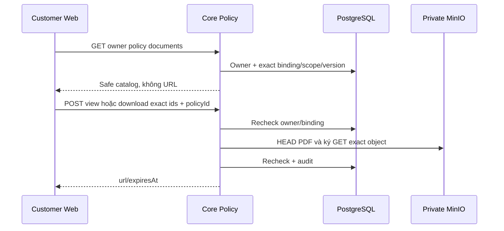

# D01 — Customer policy catalog và cấp quyền PDF

05/11/2026 · **Đã triển khai** · [C05](../05-documents-contract.md) · Cần [PO01](../policies/01-owner-read-api.md); tiếp [D02](02-pdf-viewer-ui.md).

## 1. Vị trí

Triển khai tại `apps/core/src/policies/controllers/customer-policy.controller.ts` và mở rộng `PolicyService` (`ownerDocuments`, `ownerAccess`).
Sử dụng `PolicyStorageService` để xác thực binding và tạo link ký MinIO có thời hạn cho đúng phiên bản tài liệu áp dụng.

## 2. API spec đã triển khai

- `GET /api/v1/customers/me/policies/:policyId/documents`
  - Đọc danh mục tài liệu ràng buộc (`applied bindings`) thuộc hợp đồng sở hữu của khách hàng.
  - Trả về `PolicyDocumentsResponseDto` gồm: danh sách tài liệu (`documentId`, `title`, `kind`, `accessScope`, `versionId`, `versionNumber`), trạng thái `availability`, `mainDocumentStatus`.
- `POST /api/v1/customers/me/documents/:documentId/versions/:versionId/view` và `.../download`
  - Body `{ policyId: UUID }`.
  - Kiểm tra nghiêm ngặt: Session CUSTOMER + quyền sở hữu policy + ràng buộc đúng `documentId`/`versionId` + phiên bản active.
  - Cấp phát URL ký ngắn hạn từ MinIO (`{ url, expiresAt }`).
  - `view`: Phục vụ xem trực tiếp trên trình duyệt (`inline`).
  - `download`: Phục vụ tải file về máy (`attachment`).

## 3. Transaction và bảo mật

- Kiểm tra quyền sở hữu và binding trong transaction.
- Quá trình HEAD object và ký URL thực hiện với MinIO private local qua `PolicyStorageService`.
- Bảo mật CSRF: Yêu cầu Origin allowlist + `X-Auth-Request: 1` + `X-CSRF-Token`.
- Client helper: `ownPolicyDocuments`, `ownDocumentAccess` trong `apps/web/src/lib/policy-api.ts`.

## 4. Test cases

Các ca dưới đây là **đặc tả kiểm thử**, không phải báo cáo kết quả. Kiểm từng lớp API/service/DB/browser đúng nhãn; mock UI không thay kiểm quyền Core hoặc E2E thật.

**Quy ước dữ liệu:** S-A/S-B là hai Staff synthetic; C-A/C-B là hai Customer synthetic khác nhau. Thay alias bằng UUID/token của fixture cô lập; các path HTTP dùng prefix /api/v1 nếu chưa ghi đầy đủ. Chỉ thay assignment, khóa account, inject lỗi hoặc migration trong harness/môi trường test, không trên tài khoản/dữ liệu đang sử dụng.

### D01-T01 — Owner applied version

**Lớp kiểm thử:** API + Storage.
**Điều kiện và dữ liệu:** PolicyA của C-A bind D1/v1, product current v2; có hash cả 2 bản.

**Các bước:**

1. C-A GET catalog PolicyA.
2. POST owner view/download D1/v1, body policyId=PolicyA và CSRF.
3. Đối chiếu hash/headers.

**Kết quả mong đợi:** Đúng applied v1, không trôi current v2; view inline/download attachment; không URL/bucket/key trong catalog.

### D01-T02 — Không dùng tài liệu của owner khác

**Lớp kiểm thử:** API.
**Điều kiện và dữ liệu:** PolicyB thuộc C-B; D2 không bind PolicyA; phiên C-A hợp lệ.

**Các bước:**

1. Xin catalog PolicyB.
2. Xin access D2 với PolicyA và D1/v1 với PolicyB.
3. Gửi thêm bucket/key vào body.

**Kết quả mong đợi:** Ngoài owner/binding 404, DTO lạ 400; không signed URL, không hé tài liệu Private khác.

### D01-T03 — Revoke hoặc binding đổi lúc cấp link

**Lớp kiểm thử:** API + DB/Storage barrier.
**Điều kiện và dữ liệu:** D1/v1 hợp lệ trước request, barrier dừng trong bước storage.

**Các bước:**

1. Bắt đầu view.
2. Thu hồi quyền hoặc binding/v1 trong fixture.
3. Thả request và đọc response/audit.

**Kết quả mong đợi:** Check cuối fail không trả link, không auto-fallback; không SUCCESS audit sai hoặc private data trong lỗi.

### D01-T04 — Storage và bảo vệ ghi

**Lớp kiểm thử:** API.
**Điều kiện và dữ liệu:** Các biến thể object thiếu/non-PDF/storage unavailable; session Customer hợp lệ.

**Các bước:**

1. Xin view từng biến thể.
2. Lặp với CSRF sai/không cookie và role Staff.
3. Kiểm trạng thái và payload lỗi.

**Kết quả mong đợi:** Storage404/503 an toàn; CSRF/role/session 403/401 đúng; không credential hoặc SDK exception.

**Checklist chức năng liên quan** (giữ trạng thái triển khai, không phải kết quả của lần sửa tài liệu):

- [x] Endpoints catalog tài liệu và cấp quyền PDF (`ownerDocuments`, `ownerAccess`) hoạt động trên Core.
- [x] Client API `ownPolicyDocuments` và `ownDocumentAccess` hoạt động trơn tru.
- [x] Kiểm tra bảo mật: Không thể truy cập tài liệu hợp đồng của người khác (trả về 404 an toàn).
- [x] Đã tích hợp vào giao diện xem hợp đồng PO02/D02 với `SignedPdfPreview`.

**Dọn sau kiểm thử:** xóa đúng fixture/session/object/schema theo runId; phục hồi fault injection và đóng context/socket test. Không reset DB/credential, sửa bootstrap hoặc xóa volumes. Với PDF kiểm metadata/bytes/hash; với UI kiểm DOM/focus/network, không cần screenshot.
