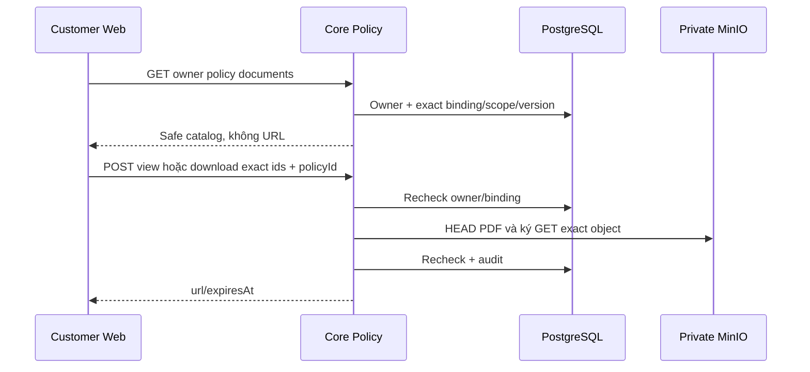

# D01 — Customer policy catalog và cấp quyền PDF

04/11/2026 · **P, chưa triển khai** · [C05](../05-documents-contract.md) · Cần [PO01](../policies/01-owner-read-api.md); tiếp [D02](02-pdf-viewer-ui.md).

## 1. Vị trí

Bổ sung Customer controller trong `apps/core/src/policies/`, role-aware access methods/DTO trong module hiện có. Tái dùng `PolicyService.catalog(...,role='CUSTOMER')` hiện đang phục vụ citation nội bộ, snapshot binding parser và `PolicyStorageService.access`. Helper nội bộ có role không thay việc thêm route/auth/quota/audit tests. Không đổi default gate Staff hoặc lấy customerId từ client.

## 2. API spec đề xuất

`GET /api/v1/customers/me/policies/:policyId/documents`, không query → `PolicyDocumentsResponseDto` hiện có:

```json
{
  "policyId":"10000000-0000-4000-8000-000000000001",
  "items":[{"documentId":"20000000-0000-4000-8000-000000000001","title":"Synthetic policy PDF","kind":"POLICY","accessScope":"PRIVATE_POLICY","versionId":"30000000-0000-4000-8000-000000000001","versionNumber":"1.0","versionCreatedAt":"2026-11-04T00:00:00.000Z"}],
  "total":1,"availability":"AVAILABLE","mainDocumentStatus":"AVAILABLE","issues":[]
}
```

Giữ DTO hiện có AVAILABLE/PARTIAL/EMPTY/UNAVAILABLE, main AVAILABLE/NOT_PROVIDED/UNAVAILABLE, issue allowlist không raw id/key. Catalog availability là metadata, không chứng minh object còn tồn tại. Không thêm pagination tổng quát vì đây là applied bindings hữu hạn của một policy; không counts Inbox.

`POST /api/v1/customers/me/documents/:documentId/versions/:versionId/view` hoặc `/download`, body `{policyId:UUID}` → `200 {url,expiresAt}`. Recheck session CUSTOMER + owner policy + binding exact document/version + version.isActive + scope consistency. Không chỉ kiểm document.ownerCustomerId rồi mở mọi version. Không nhận bucket/key/url/kind/filename hay tự cho Customer nhập versionNumber khác.

POLICY/POLICY_DRAFT/ENDORSEMENT phải PRIVATE_POLICY đúng policy/owner, product khớp hoặc null; TERMS/PRODUCT_GUIDE phải PUBLIC đúng product, không policy/owner. PUBLIC ngoài binding không qua được endpoint này. AccessScope hiện chỉ PUBLIC/PRIVATE_POLICY. Cùng PUBLIC source có thể xuất hiện trong nhiều hợp đồng với version khác nhau; luôn chọn theo policy đang đọc.

## 3. Transaction và lỗi

Read/check owner/binding trong transaction; storage HEAD/sign ngoài transaction dài; recheck gate trước trả link và audit theo pattern rõ ràng, bỏ kết quả nếu binding/quyền đổi. Không thể đồng bộ atomically DB/S3; ghi mốc kiểm quyền và TTL residual. Tên file server sanitize; view inline/download attachment. Không log signed URL/storage credential/key/checksum/PDF. Đề xuất quota120 read và30 cấp link/phút/actor; cần chốt với nhóm policy operation trước code.

UUID/field lạ400; session401/role403; policy/document/version thiếu hoặc ngoài owner/binding/inactive404; object mất/không PDF404; storage timeout503; quota429. Catalog partial không âm thầm fallback newest. GET/POST no-store. CSRF/Origin theo common contract; GET catalog không tự cấp URL.



## 4. Test và gate

Đề xuất `apps/core/test/customer-policy-documents.test.cjs`, synthetic DB/object fixtures riêng, text/hash/metadata assertions.

| ID | Case | Kỳ vọng |
| --- | --- | --- |
| D01-T01 | Owner/Customer khác/Staff gọi Customer endpoint | Owner200,404 hoặc403, không leak catalog/link |
| D01-T02 | Applied v1/current v2, inactive v1, document từ policy khác | Chỉ exactv1 còn active; không fallback v2 |
| D01-T03 | PRIVATE_POLICY sai owner/PUBLIC sai product | 404, không ký URL |
| D01-T04 | Empty/invalid/duplicate/partial bindings | DTO issues/main status đúng, không raw JSON |
| D01-T05 | HEAD404/nonPDF/timeout, CSRF sai, quota | An toàn404/503/403/429; summary vẫn độc lập |
| D01-T06 | Range/CORS/inline/attachment/expiry/recheck race | File/hash đúng; không URL trả sau check cuối fail |

- [ ] Core+MinIO tests thật; Staff A18/A20/citation projection không hồi quy.
- [ ] Swagger/API Customer cập nhật E đúng routes, chưa đánh dấu D02 browser xong.
