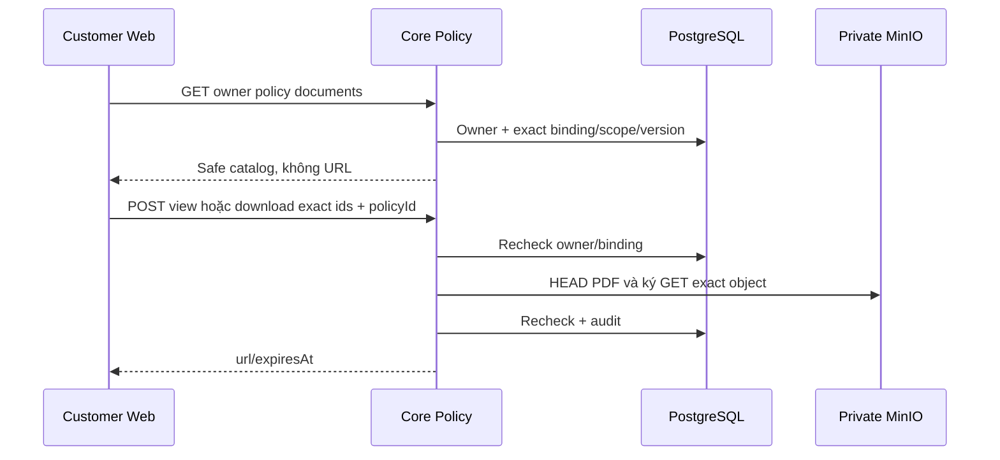

# D01 — Customer policy catalog và cấp quyền PDF

05/11/2026 · **Đã triển khai** · [C05](../05-documents-contract.md) · Cần [PO01](../policies/01-owner-read-api.md); tiếp [D02](02-pdf-viewer-ui.md).

## 1. Vị trí

Triển khai tại `apps/core/src/policies/controllers/customer-policy.controller.ts` và mở rộng `PolicyService` (`ownerDocuments`, `ownerAccess`).
Sử dụng `PolicyStorageService` để xác thực binding và tạo link ký MinIO có thời hạn cho đúng phiên bản tài liệu áp dụng.

## 2. API spec đã triển khai

- `GET /api/v1/customers/me/policies/:policyId/documents`
  - Đọc danh mục tài liệu ràng buộc (`applied bindings`) thuộc hợp đồng sở hữu của khách hàng.
  - Trả về `PolicyDocumentsResponseDto` gồm: danh sách tài liệu (`documentId`, `title`, `kind`, `accessScope`, `versionId`, `versionNumber`), trạng thái `availability`, `mainDocumentStatus`.
- `POST /api/v1/customers/me/documents/:documentId/versions/:versionId/view` và `.../download`
  - Body `{ policyId: UUID }`.
  - Kiểm tra nghiêm ngặt: Session CUSTOMER + quyền sở hữu policy + ràng buộc đúng `documentId`/`versionId` + phiên bản active.
  - Cấp phát URL ký ngắn hạn từ MinIO (`{ url, expiresAt }`).
  - `view`: Phục vụ xem trực tiếp trên trình duyệt (`inline`).
  - `download`: Phục vụ tải file về máy (`attachment`).

## 3. Transaction và bảo mật

- Kiểm tra quyền sở hữu và binding trong transaction.
- Quá trình HEAD object và ký URL thực hiện với MinIO private local qua `PolicyStorageService`.
- Bảo mật CSRF: Yêu cầu Origin allowlist + `X-Auth-Request: 1` + `X-CSRF-Token`.
- Client helper: `ownPolicyDocuments`, `ownDocumentAccess` trong `apps/web/src/lib/policy-api.ts`.

## 4. Test và hoàn tất

- [x] Endpoints catalog tài liệu và cấp quyền PDF (`ownerDocuments`, `ownerAccess`) hoạt động trên Core.
- [x] Client API `ownPolicyDocuments` và `ownDocumentAccess` hoạt động trơn tru.
- [x] Kiểm tra bảo mật: Không thể truy cập tài liệu hợp đồng của người khác (trả về 404 an toàn).
- [x] Đã tích hợp vào giao diện xem hợp đồng PO02/D02 với `SignedPdfPreview`.
