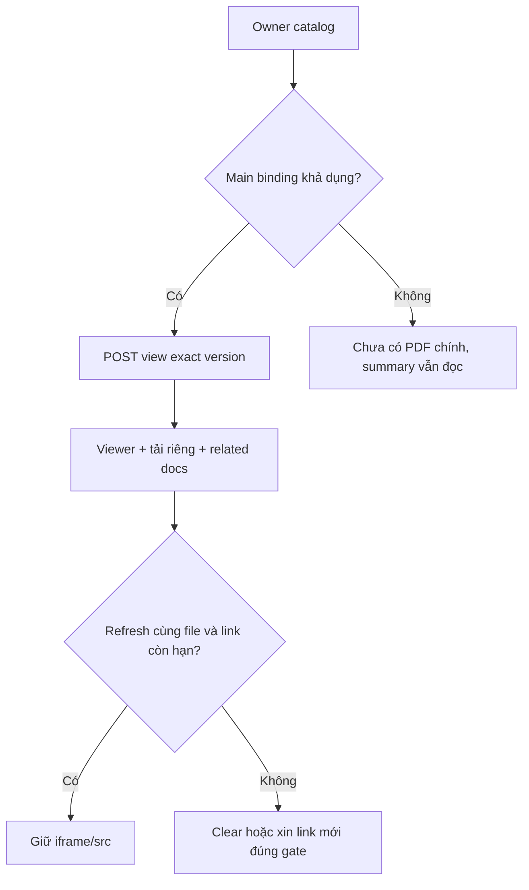
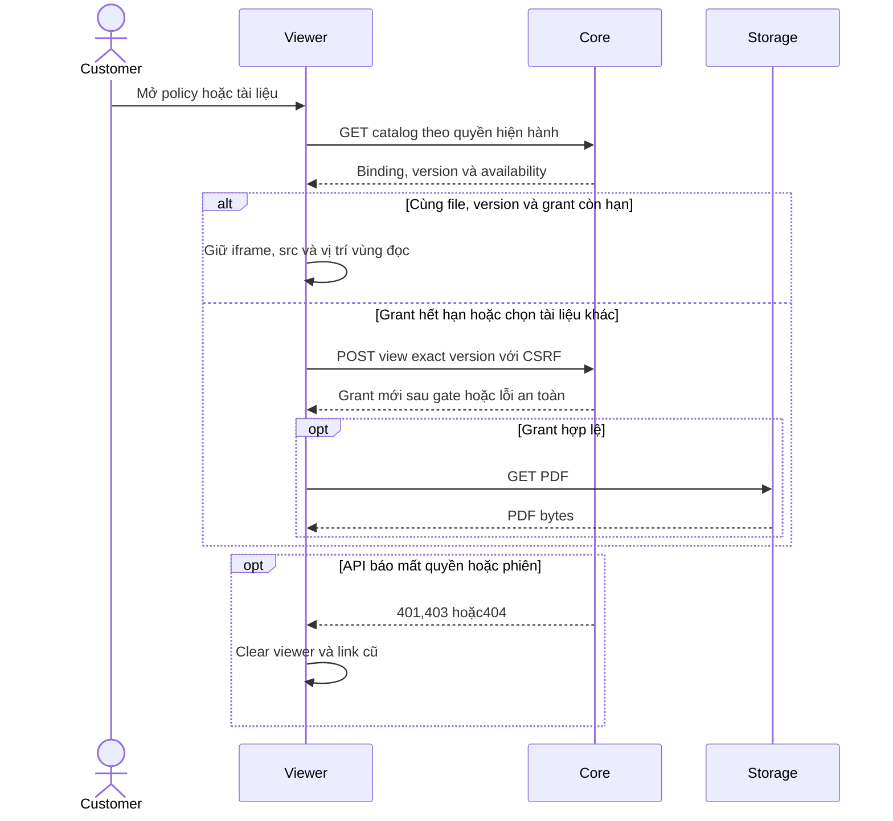

# D02 — Customer policy PDF và vòng đời viewer

05/11/2026 · **Đã triển khai** · [C05](../05-documents-contract.md) · Cần PO02 và [D01](01-owner-document-access.md).

## Bổ sung bảo vệ dữ liệu Customer — 12/11/2026

**Chính sách thông tin liên hệ:** [Ma trận dữ liệu chung](../../../../configuration-and-data.md#customer-sensitive-data) quy định che email/phone Customer mặc định và Hiện/Ẩn sau kiểm quyền Core. Phase 1 đã triển khai tại Customers; DTO Customer ở Policy/Inbox/Ticket hiện chỉ có tên/mã, không có contact card raw. Quy định này không thay quyền đọc PDF/transcript hoặc trạng thái triển khai của chức năng trong plan.

**Thay đổi của phase:** SignedPdfPreview/customer-policies không ghi PDF đã che chỉ vì summary mask. Giữ grant theo actor/version trong memory, không URL ký hoặc profile trong analytics/URL ứng dụng.

**Kiểm thử cần bổ sung, chưa chạy:** Network/DOM: summary đúng projection, viewer đúng file; revoke/logout dọn grant. Không sửa byte PDF hoặc dùng screenshot để nghiệm thu.

## Data model và phạm vi ảnh hưởng

Bảng bên dưới mô tả tác động của phase, gồm cả ghi gián tiếp qua Core. Tên bảng thuộc schema `business` trừ nơi ghi rõ; cột còn đề xuất được đánh dấu **P**. Web không truy cập DB trực tiếp.

| Bảng/model | Cột hoặc dữ liệu liên quan | Thao tác của phase | Quan hệ/ràng buộc cần giữ | Mức ảnh hưởng và nơi bị tác động |
| --- | --- | --- | --- | --- |
| users + auth_sessions | users.id/role/status, auth_sessions.user_id/token_hash/expires_at/revoked_at | Đọc | AuthSession.user_id → User.id; session phải còn hạn, không bị thu hồi | Cao — mọi API dùng session; không trả token/hash trong DTO |
| insurance_policies + insurance_products | customer_id/product_id/policy_number/status, premium_amount/payment_frequency/next_due_date, effective_date/expiry_date/sum_assured/benefits_snapshot, product_code/name | Đọc | Policy.customer_id → CustomerProfile.user_id; product_id → InsuranceProduct.id; unique policy_number | Cao — DTO tiền/ngày/snapshot dùng chung Staff/Customer; không OCR PDF để cập nhật DB |
| documents + document_versions | access_scope/policy_id/owner_customer_id/product_id/current_version, document_id/version_number/is_active/checksum_sha256/storage_bucket/storage_object_key | Đọc | FK (policy_id,owner_customer_id) → Policy(id,customer_id); unique (document_id,version_number); policy dùng exact binding trong benefits_snapshot, Products dùng current_version | Cao — đổi version/scope ảnh hưởng viewer, download và nguồn retrieval; bucket/key không ra DTO |
| audit_logs | actor_id/action/target_type/target_id/outcome/request_id/metadata/created_at | Thêm khi mutation/cấp PDF theo service | actor_id → User.id; không sửa/xóa audit cũ; chỉ metadata allowlist | Cao — phải giữ bằng chứng đúng transaction nghiệp vụ; không lưu transcript/password/signed URL |
| MinIO/S3 — ngoài PostgreSQL | PDF object exact version/checksum, HEAD/GET/Range | Đọc/ký, không upload/overwrite | DB và object store không có transaction chung; URL còn TTL sau revoke | Cao — không lưu signed URL vào DB/URL navigation/log |

**Schema/migration:** Không migration trong UI; Web chỉ gọi API Core, không có DB credentials hoặc quyền ghi trực tiếp bảng.

**Nhất quán và hồi quy:** View/download ghi audit gián tiếp D01, không sinh DocumentVersion mới. Giữ iframe khi cùng actor/document/version; version/quyền đổi clear/recheck. Kiểm related docs, null/empty, signed URL hết hạn và focus/scroll.

## 1. Bố cục và file

Triển khai tại `apps/web/src/components/customer-policies.tsx` tích hợp component `SignedPdfPreview` (`signed-pdf-preview.tsx`).
- Vùng PDF chính: Hiển thị bản hợp đồng chính thức (`POLICY`), tiêu đề, số phiên bản, và nút **Download PDF** tải về trực tiếp.
- Danh mục tài liệu liên quan (*Related documents*): Liệt kê các điều khoản (*TERMS*) và phụ lục (*ENDORSEMENT*) đi kèm hợp đồng.
- Vùng thông tin tóm tắt: Nằm gọn gàng bên cạnh/phía trên viewer, cho phép đóng/mở linh hoạt mà không che khuất tài liệu.

| Vị trí từ root repo | Hiện trạng | Trách nhiệm trong phase | Mức ảnh hưởng | Phạm vi cần kiểm lại |
| --- | --- | --- | --- | --- |
| [apps/web/src/components/customer-policies.tsx](<../../../../../apps/web/src/components/customer-policies.tsx>) | Hiện có | Chọn POLICY/TERMS/ENDORSEMENT đúng binding | Trung bình | Customer policy summary và document panel |
| [apps/web/src/components/signed-pdf-preview.tsx](<../../../../../apps/web/src/components/signed-pdf-preview.tsx>) | Hiện có | Shared viewer lifecycle/grant/download | Cao | Staff policy và hai role Products |
| [apps/web/src/lib/policy-api.ts](<../../../../../apps/web/src/lib/policy-api.ts>) | Hiện có | Owner access và AbortSignal | Cao | Không dùng Staff access path cho Customer |

## 2. API và vòng đời viewer

- Sử dụng `SignedPdfPreview` với cơ chế quản lý grant trong bộ nhớ (`PdfGrant`).
- Tự động phát hiện khi URL ký hết hạn để yêu cầu link mới.
- Hỗ trợ xem trực tiếp qua `iframe` và tải về với filename chuẩn hóa (`{policyNumber}-{documentId}-v{version}.pdf`).
- Xử lý lỗi an toàn: 404/401 xóa viewer, 503 hiển thị trạng thái thử lại tại chỗ mà không làm hỏng trang hoặc buộc reload F5.

## 3. Test cases

Các ca dưới đây là **đặc tả kiểm thử**, không phải báo cáo kết quả. Kiểm từng lớp API/service/DB/browser đúng nhãn; mock UI không thay kiểm quyền Core hoặc E2E thật.

**Quy ước dữ liệu:** S-A/S-B là hai Staff synthetic; C-A/C-B là hai Customer synthetic khác nhau. Thay alias bằng UUID/token của fixture cô lập; các path HTTP dùng prefix /api/v1 nếu chưa ghi đầy đủ. Chỉ thay assignment, khóa account, inject lỗi hoặc migration trong harness/môi trường test, không trên tài khoản/dữ liệu đang sử dụng.

### D02-T01 — PDF chính và related documents

**Lớp kiểm thử:** Browser + E2E Storage.
**Điều kiện và dữ liệu:** PolicyA có main v1 và endorsement v1, file hash synthetic đã biết.

**Các bước:**

1. Mở PolicyA, xem PDF chính.
2. Chọn related document.
3. Download đúng bản đang chọn.

**Kết quả mong đợi:** Label/version/file khớp binding, phân biệt main và related; bytes/hash tải đúng, không main được chọn từ title tùy tiện.

### D02-T02 — Refresh cùng file giữ iframe

**Lớp kiểm thử:** Browser + API mock.
**Điều kiện và dữ liệu:** ViewerD1/v1 đang mở; lưu iframe identity/src và scroll bên ngoài.

**Các bước:**

1. Cuộn dossier và phát metadata invalidation cùng version.
2. Đối chiếu iframe/src và focus.
3. Lặp refresh nhiều lần.

**Kết quả mong đợi:** Không remount/reset parent scroll hoặc tạo grant loop; không tuyên bố đo native PDF page/zoom bằng DOM ngoài iframe.

### D02-T03 — Expiry khác mất quyền

**Lớp kiểm thử:** Browser + API mock.
**Điều kiện và dữ liệu:** Grant sắp hết hạn; có biến thể metadata 404/401 riêng.

**Các bước:**

1. Cho grant expired rồi regrant.
2. Cho metadata 404 hoặc session 401.
3. Kiểm iframe/download link.

**Kết quả mong đợi:** Expiry có thể regrant exact version; denied clear viewer/link, không stale Private hoặc silent fallback.

### D02-T04 — Không main PDF và lỗi vùng

**Lớp kiểm thử:** Browser.
**Điều kiện và dữ liệu:** PolicyZ không có main PDF, PolicyA có storage 503; viewport 375px.

**Các bước:**

1. Mở Z rồi A.
2. Retry PDF khi Storage phục hồi.
3. Tab/zoom 200% qua selector/download/back.

**Kết quả mong đợi:** Summary vẫn hiển thị; empty/error đúng vùng, controls không tràn và không F5.

**Suite tham khảo:** [customer-policies.spec.mjs](../../../../../apps/web/tests/browser/customer-policies.spec.mjs). Tên suite là vị trí tự động hóa, không phải chứng nhận các ca đã chạy.

**Checklist chức năng liên quan** (giữ trạng thái triển khai, không phải kết quả của lần sửa tài liệu):

- [x] Tích hợp `SignedPdfPreview` vào màn hình chi tiết hợp đồng của khách hàng.
- [x] Đọc đúng bản hợp đồng chính và tài liệu liên quan; nút Download hoạt động ổn định.
- [x] Trải nghiệm mượt mà không reload F5, responsive trên mobile và desktop.
- [x] Xử lý an toàn khi tài liệu chưa phát hành hoặc không khả dụng.

**Dọn sau kiểm thử:** xóa đúng fixture/session/object/schema theo runId; phục hồi fault injection và đóng context/socket test. Không reset DB/credential, sửa bootstrap hoặc xóa volumes. Với PDF kiểm metadata/bytes/hash; với UI kiểm DOM/focus/network, không cần screenshot.

## Sequence diagram

Luồng chính và nhánh quyền/lỗi; test case ở trên chỉ rõ dữ liệu và điểm kiểm tương ứng.

