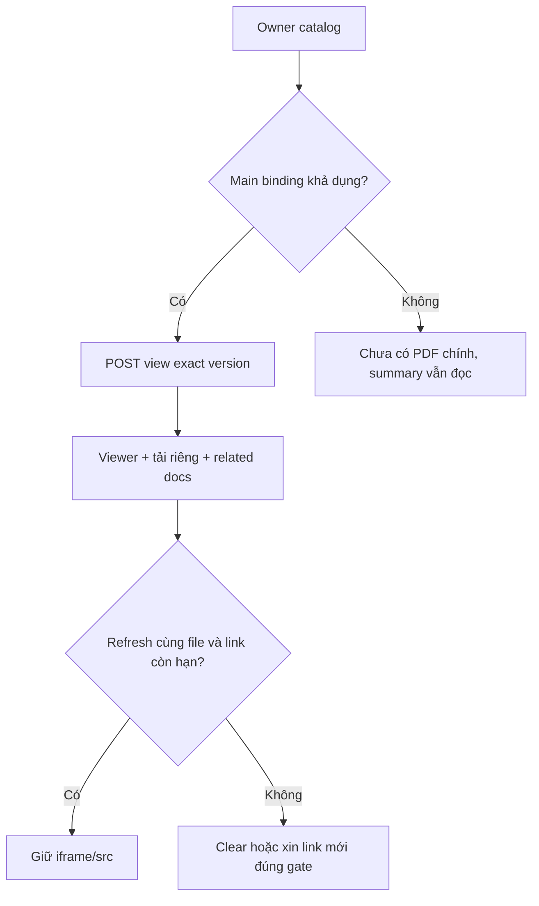

# D02 — Customer policy PDF và vòng đời viewer

04/11/2026 · **Chưa triển khai** · [C05](../05-documents-contract.md) · Cần PO02 và [D01](01-owner-document-access.md).

## 1. Bố cục và file

Bổ sung `components/customer-policies.tsx` hoặc viewer adapter nhỏ dùng chung với `staff-policies.tsx`; client Customer trong `lib/policy-api.ts`. Không copy UI dài/trùng policy information. Header policy gọn, PDF chính ở giữa với title/version và Download PDF; thông tin DB trong vùng thu gọn; **Related documents** gồm TERMS/ENDORSEMENT như Staff. PRODUCT_GUIDE ở trang Products. Không dropdown trộn hợp đồng chính với tài liệu phụ. Main thiếu không lấy supporting file làm main.

Tái dùng native iframe/viewer đang chạy và cơ chế fit width/lifecycle Staff, không chọn thư viện PDF mới mặc định. Product PUBLIC PR02 có thể dùng adapter cùng lifecycle nhưng API/gate khác; không ghép policyId giả vào product access.

## 2. API và state machine

GET owner catalog D01 → chọn main POLICY/POLICY_DRAFT hợp lệ theo catalog. POST view exact ids+policyId → memory `{documentId,versionId,url,expiresAt,actorId,policyId}`. Download gọi intent riêng; không dùng view URL thay attachment hoặc điều hướng toàn app tới storage.

| Sự kiện | Hành vi |
| --- | --- |
| Metadata refresh, cùng actor/policy/file/version và URL còn hạn | Giữ iframe node/src/scroll/focus, chỉ cập nhật metadata |
| Chọn file/policy/actor khác | Abort/generation guard, clear cũ trước dựng viewer mới |
| Link hết hạn hoặc file lỗi | Hiển thị lỗi/expiry và retry vùng PDF; xin link lại sau recheck |
| 401/404/binding không còn | Clear URL/iframe/private metadata, không restore từ response cũ |
| 503/offline | Giữ policy summary, retry có kiểm soát, không loop/false empty |

Iframe load không chứng minh PDF tải thành công; native viewer cross-origin không cho đọc DOM nội bộ. Kiểm network/Range và nội dung file bằng text/hash trong E2E; UI có fallback Open PDF/Download nếu browser không nhúng được, chỉ sau cấp link hợp lệ, mở tab mới dùng noopener. Không auto-regrant vô hạn từ iframe loaderror không rõ nguồn. URL ký không lưu history/log/browser storage. Logout không hứa thu hồi URL trước TTL.

## 3. Test plan và gate

Đề xuất `apps/web/tests/browser/customer-policy-pdf.spec.mjs` và `customer-policy-flow.integration.spec.mjs`. Browser mock kiểm state/DOM; E2E gateway Core+MinIO thật kiểm HTTP/file, không đánh đồng. PDF lấy text/metadata/hash, không render ảnh.

| ID | Case | Kỳ vọng |
| --- | --- | --- |
| D02-T01 | Owner mở main, supporting, Download | Đúng binding/version/file, filename/disposition đúng |
| D02-T02 | Same-version refresh, nhanh đổi policy rồi response cũ về | Giữ src đúng lúc; không stale PDF |
| D02-T03 | Main missing/partial catalog/null summary | Thông báo rõ, không chọn file phụ làm main |
| D02-T04 | Expired/404/401/503/network | Clear/retry đúng vùng; không lộ dữ liệu cũ hoặc F5 |
| D02-T05 | Keyboard/375px/zoom200%/native viewer unavailable | Layout cuộn hợp lý, controls/fallback dùng được |

- [ ] D01 thật, browser/E2E pass; source PDF là cùng version Staff đọc được theo quyền.
- [ ] Viewer refresh không remount vô cớ; không thêm runtime dependency/stylesheet mới.
