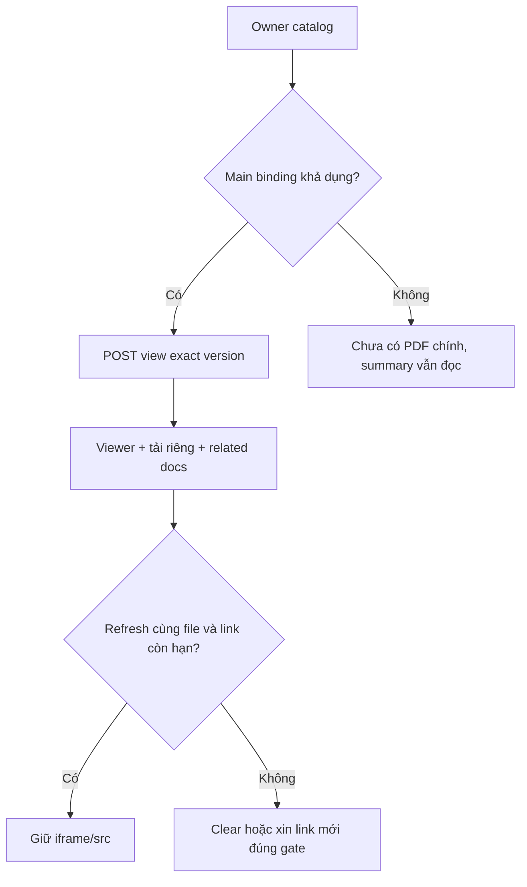
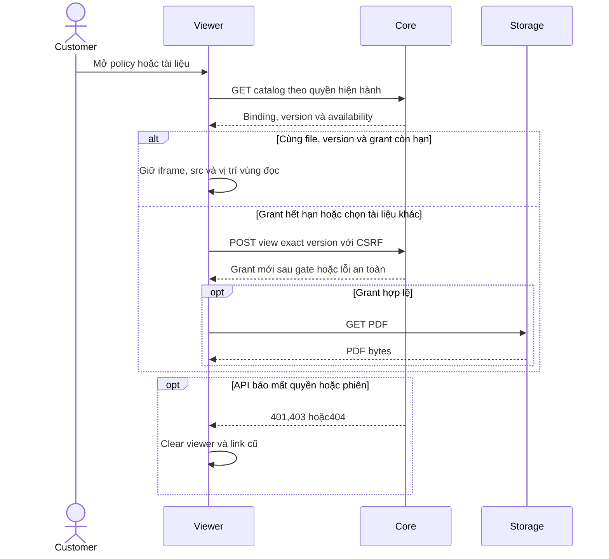

# D02 — Customer policy PDF và vòng đời viewer

05/11/2026 · **Đã triển khai** · [C05](../05-documents-contract.md) · Cần PO02 và [D01](01-owner-document-access.md).

## 1. Bố cục và file

Triển khai tại `apps/web/src/components/customer-policies.tsx` tích hợp component `SignedPdfPreview` (`signed-pdf-preview.tsx`).
- Vùng PDF chính: Hiển thị bản hợp đồng chính thức (`POLICY`), tiêu đề, số phiên bản, và nút **Download PDF** tải về trực tiếp.
- Danh mục tài liệu liên quan (*Related documents*): Liệt kê các điều khoản (*TERMS*) và phụ lục (*ENDORSEMENT*) đi kèm hợp đồng.
- Vùng thông tin tóm tắt: Nằm gọn gàng bên cạnh/phía trên viewer, cho phép đóng/mở linh hoạt mà không che khuất tài liệu.

## 2. API và vòng đời viewer

- Sử dụng `SignedPdfPreview` với cơ chế quản lý grant trong bộ nhớ (`PdfGrant`).
- Tự động phát hiện khi URL ký hết hạn để yêu cầu link mới.
- Hỗ trợ xem trực tiếp qua `iframe` và tải về với filename chuẩn hóa (`{policyNumber}-{documentId}-v{version}.pdf`).
- Xử lý lỗi an toàn: 404/401 xóa viewer, 503 hiển thị trạng thái thử lại tại chỗ mà không làm hỏng trang hoặc buộc reload F5.

## 3. Test cases

Các ca dưới đây là **đặc tả kiểm thử**, không phải báo cáo kết quả. Kiểm từng lớp API/service/DB/browser đúng nhãn; mock UI không thay kiểm quyền Core hoặc E2E thật.

**Quy ước dữ liệu:** S-A/S-B là hai Staff synthetic; C-A/C-B là hai Customer synthetic khác nhau. Thay alias bằng UUID/token của fixture cô lập; các path HTTP dùng prefix /api/v1 nếu chưa ghi đầy đủ. Chỉ thay assignment, khóa account, inject lỗi hoặc migration trong harness/môi trường test, không trên tài khoản/dữ liệu đang sử dụng.

### D02-T01 — PDF chính và related documents

**Lớp kiểm thử:** Browser + E2E Storage.
**Điều kiện và dữ liệu:** PolicyA có main v1 và endorsement v1, file hash synthetic đã biết.

**Các bước:**

1. Mở PolicyA, xem PDF chính.
2. Chọn related document.
3. Download đúng bản đang chọn.

**Kết quả mong đợi:** Label/version/file khớp binding, phân biệt main và related; bytes/hash tải đúng, không main được chọn từ title tùy tiện.

### D02-T02 — Refresh cùng file giữ iframe

**Lớp kiểm thử:** Browser + API mock.
**Điều kiện và dữ liệu:** ViewerD1/v1 đang mở; lưu iframe identity/src và scroll bên ngoài.

**Các bước:**

1. Cuộn dossier và phát metadata invalidation cùng version.
2. Đối chiếu iframe/src và focus.
3. Lặp refresh nhiều lần.

**Kết quả mong đợi:** Không remount/reset parent scroll hoặc tạo grant loop; không tuyên bố đo native PDF page/zoom bằng DOM ngoài iframe.

### D02-T03 — Expiry khác mất quyền

**Lớp kiểm thử:** Browser + API mock.
**Điều kiện và dữ liệu:** Grant sắp hết hạn; có biến thể metadata 404/401 riêng.

**Các bước:**

1. Cho grant expired rồi regrant.
2. Cho metadata 404 hoặc session 401.
3. Kiểm iframe/download link.

**Kết quả mong đợi:** Expiry có thể regrant exact version; denied clear viewer/link, không stale Private hoặc silent fallback.

### D02-T04 — Không main PDF và lỗi vùng

**Lớp kiểm thử:** Browser.
**Điều kiện và dữ liệu:** PolicyZ không có main PDF, PolicyA có storage 503; viewport 375px.

**Các bước:**

1. Mở Z rồi A.
2. Retry PDF khi Storage phục hồi.
3. Tab/zoom 200% qua selector/download/back.

**Kết quả mong đợi:** Summary vẫn hiển thị; empty/error đúng vùng, controls không tràn và không F5.

**Suite tham khảo:** [customer-policies.spec.mjs](../../../../../apps/web/tests/browser/customer-policies.spec.mjs). Tên suite là vị trí tự động hóa, không phải chứng nhận các ca đã chạy.

**Checklist chức năng liên quan** (giữ trạng thái triển khai, không phải kết quả của lần sửa tài liệu):

- [x] Tích hợp `SignedPdfPreview` vào màn hình chi tiết hợp đồng của khách hàng.
- [x] Đọc đúng bản hợp đồng chính và tài liệu liên quan; nút Download hoạt động ổn định.
- [x] Trải nghiệm mượt mà không reload F5, responsive trên mobile và desktop.
- [x] Xử lý an toàn khi tài liệu chưa phát hành hoặc không khả dụng.

**Dọn sau kiểm thử:** xóa đúng fixture/session/object/schema theo runId; phục hồi fault injection và đóng context/socket test. Không reset DB/credential, sửa bootstrap hoặc xóa volumes. Với PDF kiểm metadata/bytes/hash; với UI kiểm DOM/focus/network, không cần screenshot.

## Sequence diagram

Luồng chính và nhánh quyền/lỗi; test case ở trên chỉ rõ dữ liệu và điểm kiểm tương ứng.

