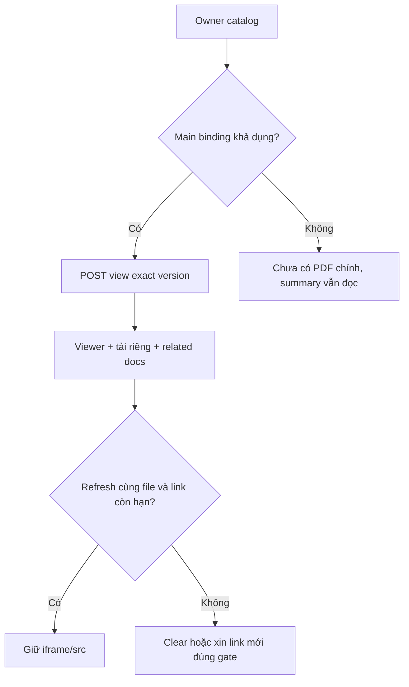

# D02 — Customer policy PDF và vòng đời viewer

05/11/2026 · **Đã triển khai** · [C05](../05-documents-contract.md) · Cần PO02 và [D01](01-owner-document-access.md).

## 1. Bố cục và file

Triển khai tại `apps/web/src/components/customer-policies.tsx` tích hợp component `SignedPdfPreview` (`signed-pdf-preview.tsx`).
- Vùng PDF chính: Hiển thị bản hợp đồng chính thức (`POLICY`), tiêu đề, số phiên bản, và nút **Download PDF** tải về trực tiếp.
- Danh mục tài liệu liên quan (*Related documents*): Liệt kê các điều khoản (*TERMS*) và phụ lục (*ENDORSEMENT*) đi kèm hợp đồng.
- Vùng thông tin tóm tắt: Nằm gọn gàng bên cạnh/phía trên viewer, cho phép đóng/mở linh hoạt mà không che khuất tài liệu.

## 2. API và vòng đời viewer

- Sử dụng `SignedPdfPreview` với cơ chế quản lý grant trong bộ nhớ (`PdfGrant`).
- Tự động phát hiện khi URL ký hết hạn để yêu cầu link mới.
- Hỗ trợ xem trực tiếp qua `iframe` và tải về với filename chuẩn hóa (`{policyNumber}-{documentId}-v{version}.pdf`).
- Xử lý lỗi an toàn: 404/401 xóa viewer, 503 hiển thị trạng thái thử lại tại chỗ mà không làm hỏng trang hoặc buộc reload F5.

## 3. Test và hoàn tất

Đã kiểm chứng qua bộ test `apps/web/tests/browser/customer-policies.spec.mjs` (PO02-T01 đến PO02-T05).

- [x] Tích hợp `SignedPdfPreview` vào màn hình chi tiết hợp đồng của khách hàng.
- [x] Đọc đúng bản hợp đồng chính và tài liệu liên quan; nút Download hoạt động ổn định.
- [x] Trải nghiệm mượt mà không reload F5, responsive trên mobile và desktop.
- [x] Xử lý an toàn khi tài liệu chưa phát hành hoặc không khả dụng.
