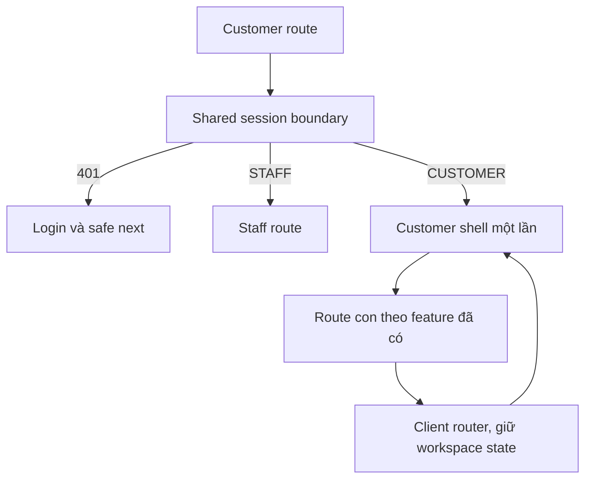

# H01 — Shell, routes và chuyển tiếp giao diện hiện có

05/11/2026 · **Đã triển khai** · [C02](../02-home-contract.md) · [Chung](../00-customer-contract.md).

## 1. Kết quả và files

Thiết kế Customer cùng hệ Staff nhưng trực quan, hiện đại, tone màu emerald/slate trang nhã. Đã triển khai `apps/web/src/components/customer-workspace.tsx`, `customer-header.tsx`, `customer-account-menu.tsx`; routes/layout dưới `app/customer/` (`layout.tsx`, `page.tsx`). Dùng chung auth session; quản lý tab mượt mà không reload F5.

## 2. Route contract

| Route | Chủ sở hữu | Trạng thái |
| --- | --- | --- |
| `/customer` | Home / Workspace shell tích hợp | Đã triển khai |
| `/customer/products` | PR01/PR02 Products catalog & details | Đã triển khai |
| `/customer/policies`, `/customer/policies/:policyId` | PO02/D02 My Policies & PDF contract | Đã triển khai |
| `/customer` (tab `chat`) | CH01 Conversations, I03–I06 | Đã triển khai |
| `/customer` (tab `advisor`) | C08 Assigned Support Specialist | Đã triển khai |
| `/customer` (tab `tickets`) | C07 Support Tickets tracking | Đã triển khai |
| `/account`, `/login` | Shared account & auth session | Đã triển khai |

Sidebar desktop có tính năng thu gọn/mở rộng, account menu ở góc dưới với popover cá nhân và nút Sign out (thay thế Policyholder bằng accountCode/email sạch sẽ). Tiêu đề trang phân biệt rành mạch: `AegisLife · Customer Portal`.

## 3. State/API và UI

GET `/auth/me` dùng chung hiện có, GET `/customers/me` lấy hồ sơ khách và chuyên viên hỗ trợ. Memory state và abort controller đảm bảo an toàn phiên; logout dọn sạch trạng thái nháp.

Toolbar tích hợp chuông thông báo (Notification Center popover) hiển thị số lượng badge chưa đọc, đánh dấu đã đọc từng mục hoặc tất cả tại chỗ.

## 4. Test và hoàn tất

| ID | Case | Kỳ vọng |
| --- | --- | --- |
| H01-T01 | Login→nav→Back/Forward, route cũ có conversationId | Đúng màn/cuộc, không document request/F5 |
| H01-T02 | Chuyển menu nhanh, focus tab, WS ready | Không me mỗi click, không duplicate socket/query |
| H01-T03 | Logout/role đổi khi response cũ pending | Không restore dữ liệu actor cũ |
| H01-T04 | Chat đang có nháp/unknown send rồi chuyển nav | Giữ key/nháp theo actor/cuộc, không gửi trùng |
| H01-T05 | 375px/768px/zoom200%, drawer keyboard | Tab/escape/focus return/aria-current đúng |

- [x] Auth/profile/account/I03–I06 pass; không thay code Core hoặc model từ việc dựng shell.
- [x] Route/menu/docs cập nhật đồng thời; H01, Home, Products, Policies hoạt động liền mạch.
