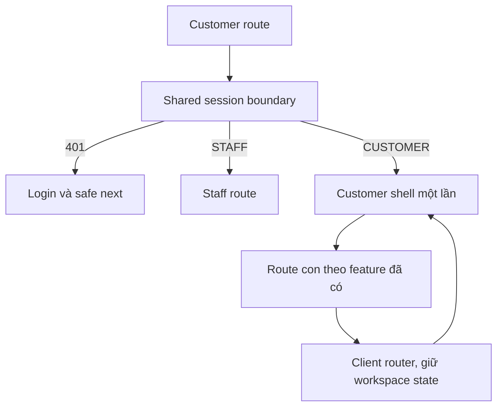
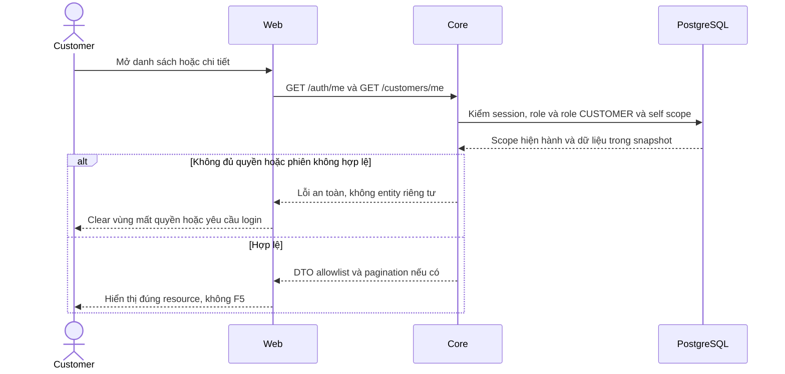

# H01 — Shell, routes và chuyển tiếp giao diện hiện có

05/11/2026 · **Đã triển khai** · [C02](../02-home-contract.md) · [Chung](../00-customer-contract.md).

## Data model và phạm vi ảnh hưởng

Bảng bên dưới mô tả tác động của phase, gồm cả ghi gián tiếp qua Core. Tên bảng thuộc schema `business` trừ nơi ghi rõ; cột còn đề xuất được đánh dấu **P**. Web không truy cập DB trực tiếp.

| Bảng/model | Cột hoặc dữ liệu liên quan | Thao tác của phase | Quan hệ/ràng buộc cần giữ | Mức ảnh hưởng và nơi bị tác động |
| --- | --- | --- | --- | --- |
| users + auth_sessions | users.id/role/status, auth_sessions.user_id/token_hash/expires_at/revoked_at | Đọc | AuthSession.user_id → User.id; session phải còn hạn, không bị thu hồi | Cao — mọi API dùng session; không trả token/hash trong DTO |
| users + customer_profiles | users.id/account_code/email/phone/status/updated_at; customer_profiles.user_id/full_name/birth/address/assignment_version | Đọc own profile | CustomerProfile.user_id/role → User.id/role; owner actor từ session, không nhận customerId tự chọn | Cao — Customer header/Home/profile và Staff customer projection dùng chung dữ liệu |
| staff_assignments + customer_profiles + staff_profiles | staff_id/customer_id/is_active/ended_at, assignment_version, user_id/full_name | Đọc | Assignment gắn đúng Customer/Staff; Inbox còn ràng buộc assignment id cụ thể | Cao — Customers, Policy Lookup, Ticket và Inbox cùng phụ thuộc phân công |

**Schema/migration:** Không migration trong UI; Web chỉ gọi API Core, không có DB credentials hoặc quyền ghi trực tiếp bảng.

**Nhất quán và hồi quy:** Session/actor lifecycle giữ cùng Auth boundary, route đổi không remount ứng dụng hay F5. Chỉ dữ liệu contact Core cho phép mới hiện; không tạo assignment khi click shortcut.

## 1. Kết quả và files

Thiết kế Customer cùng hệ Staff nhưng trực quan, hiện đại, tone màu emerald/slate trang nhã. Đã triển khai `apps/web/src/components/customer-workspace.tsx`, `customer-header.tsx`, `customer-account-menu.tsx`; routes/layout dưới `app/customer/` (`layout.tsx`, `page.tsx`). Dùng chung auth session; quản lý tab mượt mà không reload F5.

| Vị trí từ root repo | Hiện trạng | Trách nhiệm trong phase | Mức ảnh hưởng | Phạm vi cần kiểm lại |
| --- | --- | --- | --- | --- |
| [apps/web/src/components/customer-workspace.tsx](<../../../../../apps/web/src/components/customer-workspace.tsx>) | Hiện có | Shell/tab/router và actor scope | Trung bình | Home/Products/Policies/Conversations/Tickets/Account |
| [apps/web/src/components/customer-header.tsx](<../../../../../apps/web/src/components/customer-header.tsx>) | Hiện có | Profile/contact/navigation | Trung bình | Self projection và availability |
| [apps/web/src/components/customer-account-menu.tsx](<../../../../../apps/web/src/components/customer-account-menu.tsx>) | Hiện có | Menu/logout/đổi password | Cao | Auth session hai portal |
| [apps/web/src/app/customer/layout.tsx](<../../../../../apps/web/src/app/customer/layout.tsx>) | Hiện có | Route boundary Customer | Cao | Không mở Staff data bằng route |

## 2. Route contract

| Route | Chủ sở hữu | Trạng thái |
| --- | --- | --- |
| `/customer` | Home / Workspace shell tích hợp | Đã triển khai |
| `/customer/products` | PR01/PR02 Products catalog & details | Đã triển khai |
| `/customer/policies`, `/customer/policies/:policyId` | PO02/D02 My Policies & PDF contract | Đã triển khai |
| `/customer` (tab `chat`) | CH01 Conversations, I03–I06 | Đã triển khai |
| `/customer` (tab `advisor`) | C08 Assigned Support Specialist | Đã triển khai |
| `/customer` (tab `tickets`) | C07 Support Tickets tracking | Đã triển khai |
| `/account`, `/login` | Shared account & auth session | Đã triển khai |

Sidebar desktop có tính năng thu gọn/mở rộng, account menu ở góc dưới với popover cá nhân và nút Sign out (thay thế Policyholder bằng accountCode/email sạch sẽ). Tiêu đề trang phân biệt rành mạch: `AegisLife · Customer Portal`.

## 3. State/API và UI

GET `/auth/me` dùng chung hiện có, GET `/customers/me` lấy hồ sơ khách và chuyên viên hỗ trợ. Memory state và abort controller đảm bảo an toàn phiên; logout dọn sạch trạng thái nháp.

Toolbar tích hợp chuông thông báo (Notification Center popover) hiển thị số lượng badge chưa đọc, đánh dấu đã đọc từng mục hoặc tất cả tại chỗ.

## 4. Test cases

Các ca dưới đây là **đặc tả kiểm thử**, không phải báo cáo kết quả. Kiểm từng lớp API/service/DB/browser đúng nhãn; mock UI không thay kiểm quyền Core hoặc E2E thật.

**Quy ước dữ liệu:** S-A/S-B là hai Staff synthetic; C-A/C-B là hai Customer synthetic khác nhau. Thay alias bằng UUID/token của fixture cô lập; các path HTTP dùng prefix /api/v1 nếu chưa ghi đầy đủ. Chỉ thay assignment, khóa account, inject lỗi hoặc migration trong harness/môi trường test, không trên tài khoản/dữ liệu đang sử dụng.

### H01-T01 — Route, Back và session dùng chung

**Lớp kiểm thử:** Browser.
**Điều kiện và dữ liệu:** C-A đăng nhập Customer; chuẩn bị deep link hợp lệ tới một cuộc của C-A.

**Các bước:**

1. Mở Home → Products → My Policies → Conversations.
2. Back/Forward rồi mở deep link cuộc chat.
3. Quan sát document navigation, auth/me và socket.

**Kết quả mong đợi:** Route/selection đúng, không F5 hoặc tạo auth/socket mới theo mỗi click; chỉ render dữ liệu owner.

### H01-T02 — Sai role và response actor cũ

**Lớp kiểm thử:** Browser + API mock.
**Điều kiện và dữ liệu:** Giữ chậm auth/profile C-A; có session S-A và Customer C-B riêng.

**Các bước:**

1. Mở route Customer bằng S-A.
2. Ở biến thể C-A, logout/đổi actor khi request pending.
3. Trả response C-A sau khi C-B đăng nhập.

**Kết quả mong đợi:** Staff không render Customer shell; response cũ không phục hồi dữ liệu/nháp của C-A cho C-B.

### H01-T03 — Giữ chat draft khi đổi menu

**Lớp kiểm thử:** Browser.
**Điều kiện và dữ liệu:** C-A có cuộc Direct đang nhập nháp, chưa Send.

**Các bước:**

1. Nhập nháp rồi đi Products/Home.
2. Quay lại đúng cuộc.
3. Lặp khi message đang unknown outcome bằng harness.

**Kết quả mong đợi:** Nháp/intent gắn đúng actor/cuộc, không tự gửi hoặc tạo key mới; không lẫn nháp giữa các cuộc.

### H01-T04 — Mobile và bàn phím

**Lớp kiểm thử:** Browser.
**Điều kiện và dữ liệu:** Viewport375px và 768px, Customer shell có drawer.

**Các bước:**

1. Dùng Tab mở/đóng menu, chọn Policies.
2. Escape rồi kiểm focus về nút mở.
3. Đặt zoom 200% và kiểm bounds các control.

**Kết quả mong đợi:** Menu/current route có nhãn truy cập đúng, focus thấy được, không overflow hoặc link chết.

**Checklist chức năng liên quan** (giữ trạng thái triển khai, không phải kết quả của lần sửa tài liệu):

- [x] Route/menu/docs cập nhật đồng thời; H01, Home, Products, Policies hoạt động liền mạch.

**Dọn sau kiểm thử:** xóa đúng fixture/session/object/schema theo runId; phục hồi fault injection và đóng context/socket test. Không reset DB/credential, sửa bootstrap hoặc xóa volumes. Với PDF kiểm metadata/bytes/hash; với UI kiểm DOM/focus/network, không cần screenshot.

## Sequence diagram

Luồng chính và nhánh quyền/lỗi; test case ở trên chỉ rõ dữ liệu và điểm kiểm tương ứng.

