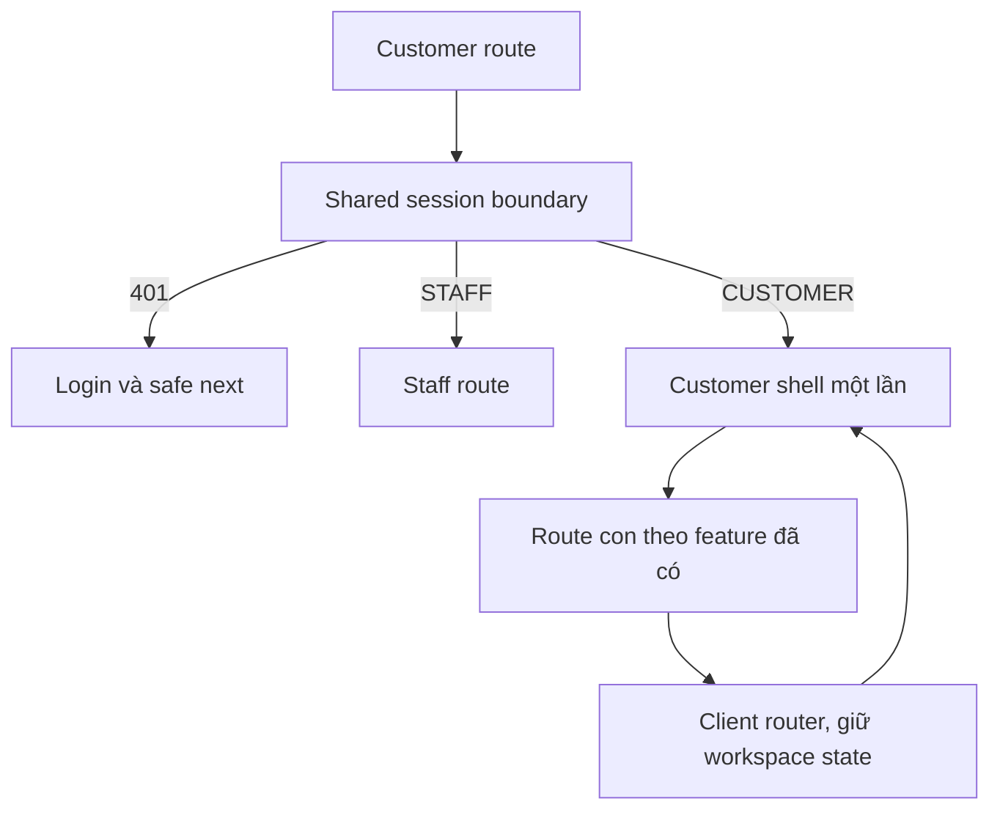

# H01 — Shell, routes và chuyển tiếp giao diện hiện có

04/11/2026 · **Chưa triển khai** · [C02](../02-home-contract.md) · [Chung](../00-customer-contract.md).

## 1. Kết quả và files

Thiết kế Customer cùng hệ Staff nhưng ít mật độ hơn. Đề xuất `apps/web/src/components/customer-portal.tsx`, `customer-shell.tsx`, refactor có kiểm soát `auth-screen.tsx`, `customer-workspace.tsx`; routes/layout dưới `app/customer/`. Đọc `apps/web/AGENTS.md` và Next docs cài trong repo trước code. Giữ shared auth hook/API; không tạo session provider thứ hai hoặc app mới.

## 2. Route contract — đề xuất

| Route | Chủ sở hữu |
| --- | --- |
| `/customer` | Home; giai đoạn chuyển tiếp còn profile/chat thật |
| `/customer/products`, `/customer/products/:productId` | PR01/PR02 |
| `/customer/policies`, `/customer/policies/:policyId` | PO02/D02 |
| `/customer/conversations`, `/customer/conversations/:conversationId` | CH01, I03–I06 |
| `/customer/profile` | PF02, read-only hiện có cho tới khi PATCH E |
| `/customer/tickets/:ticketId` | T02 khi Core E; list route chưa mặc định |
| `/account`, `/login` | Giữ shared account/auth hiện có |

Chỉ hiện menu chức năng đã có; không tạo route giả để checkbox xanh. `/customer?conversationId=<uuid>` cũ vẫn mở đúng cuộc qua client replace sang canonical chat khi CH01 chạy, không mất nháp/consent. `next` chỉ same-origin allowlisted route theo role; chặn external/encoded bypass. Staff vào Customer route chuyển đúng role, không lộ Customer content trong chớp mắt.

## 3. State/API và UI

GET `/auth/me` dùng chung hiện có, freshness passive30s; initial/expiry/invalidate/retry force. GET `/customers/me` qua resource scoped actor, không tải lại mỗi chọn menu. Các route con không fetch me trùng. Memory state/abort generation giữ đúng actor; logout xóa draft/profile/URL ký và reconnect timer. Chuyển màn không resubscribe WS nhiều lần.

Sidebar desktop/menu drawer mobile, account menu có profile/account/logout; một heading mỗi trang, content width hợp lý, focus visible và skip link. Tailwind `tw:`/Lexend/token Staff, không sửa token global cho cả Staff. Chat/PDF layout dùng chiều cao viewport còn lại và scroll owner rõ. Không CSS cũ/inline style hoặc card/charts vô dữ liệu.

Thông số bố cục để bắt đầu review: sidebar desktop khoảng240px, nội dung đọc max-width1200px; padding16px mobile/24–32px desktop, body14–16px và heading24–28px. Đây là hướng thiết kế, không yêu cầu pixel cứng: dùng utility/token hiện có và chỉnh theo độ dài dữ liệu/zoom. Dưới breakpoint tablet chuyển drawer; không bóp list/chat/PDF thành ba cột hẹp. Chat và PDF được phép dùng chiều ngang rộng hơn trang hồ sơ. Primary button chỉ cho hành động chính; lỗi/nhãn không chỉ dùng màu. Kiểm contrast và DOM/focus, không chụp ảnh để nghiệm thu.

## 4. Test và gate

Đề xuất `apps/web/tests/browser/customer-shell.spec.mjs` và gateway smoke. Kiểm DOM/network/console, không screenshot.

| ID | Case | Kỳ vọng |
| --- | --- | --- |
| H01-T01 | Login→nav→Back/Forward, route cũ có conversationId | Đúng màn/cuộc, không document request/F5 |
| H01-T02 | Chuyển menu nhanh, focus tab, WS ready | Không me mỗi click, không duplicate socket/query |
| H01-T03 | Logout/role đổi khi response cũ pending | Không restore dữ liệu actor cũ |
| H01-T04 | Chat đang có nháp/unknown send rồi chuyển nav | Giữ key/nháp theo actor/cuộc, không gửi trùng |
| H01-T05 | 375px/768px/zoom200%, drawer keyboard | Tab/escape/focus return/aria-current đúng |

- [ ] Auth/profile/account/I03–I06 pass; không thay code Core hoặc model từ việc dựng shell.
- [ ] Route/menu/docs cập nhật đồng thời; chỉ đánh dấu H01, chưa Home/products/policies xong.
