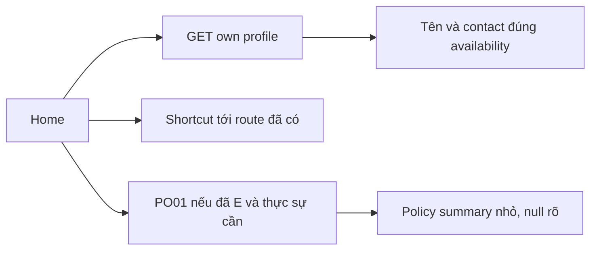

# H02 — Home từ nguồn dữ liệu có thật

04/11/2026 · **Chưa triển khai** · [C02](../02-home-contract.md) · Cần [H01](01-shell-navigation.md).

## 1. UI và API

Đề xuất `components/customer-home.tsx` trong shell H01. Dùng E `GET /customers/me`: lời chào fullName, mã tài khoản nếu cần và Staff contact theo assignmentStatus. Home có shortcut tới Products/My policies/Conversations đã triển khai. Không sao chép toàn bộ hồ sơ hay transcript vào Home, không cards tổng số/biểu đồ/chuông giả.

Nếu đã có PO01, có thể hiển thị một nhóm policy nhỏ từ `GET /customers/me/policies?page=1&pageSize=3` (P cho tới PO01). Tên/mã/status/ngày đến hạn từ DTO, không gọi mọi page để tổng hợp. Không có endpoint `/customer/dashboard` trong phase này. Nếu chưa PO01 thì bỏ vùng policy, không fixture placeholder mang nghĩa nghiệp vụ.

## 2. Quy tắc dữ liệu

ASSIGNED mới dùng staff contact Core trả; UNASSIGNED/STAFF_UNAVAILABLE có giải thích khác nhau, không hiện PII Staff không khả dụng. Null birth/phone/address không cần đưa Home. nextDueDate là ngày đến hạn đã lưu, không kết luận nợ/phạt/đã thanh toán. Product inactive trong policy lịch sử vẫn hiển thị tên đã tham chiếu. Không LLM/RAG để tạo greeting hoặc mô tả quyền lợi.

## 3. Lifecycle và kiểm thử

Giữ nội dung khi same-actor background refresh; loading đầu khác refresh; profile lỗi retry vùng profile, shortcuts còn dùng được. No-F5, không auto-focus lại. Dùng token/spacing chung H01, mobile một cột.

Đề xuất `apps/web/tests/browser/customer-home.spec.mjs`; gateway E2E xem home và mở feature thật.

| ID | Case | Kỳ vọng |
| --- | --- | --- |
| H02-T01 | Assigned/unassigned/staff locked | Đúng contact/status; không leak contact cũ |
| H02-T02 | Không policy hoặc PO01 chưa có | Home hữu ích, không số liệu/tài liệu giả |
| H02-T03 | Ngày/financial null và past nextDueDate | Không suy ra payment state |
| H02-T04 | Refresh lỗi, logout, Back/mobile/keyboard | Scope cleanup đúng; retry tại vùng; không F5 |

- [ ] H02 không tạo model/API/metrics thừa; test đúng dữ liệu và thao tác pass.
- [ ] Ghi Home là UX composition, không đánh dấu một FR dashboard không tồn tại.
