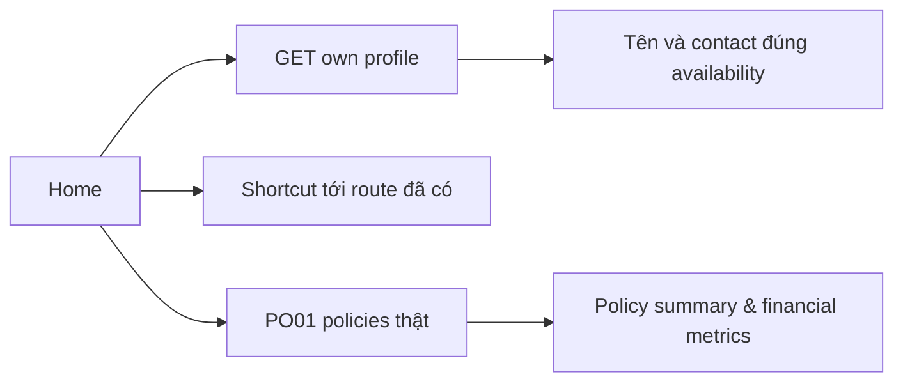
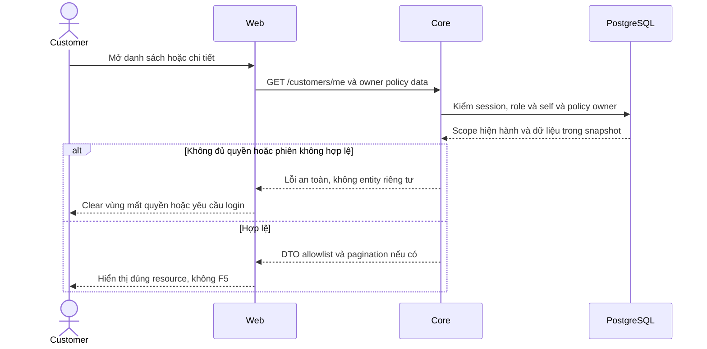

# H02 — Home từ nguồn dữ liệu có thật

05/11/2026 · **Đã triển khai** · [C02](../02-home-contract.md) · Cần [H01](01-shell-navigation.md).

## 1. UI và API

Triển khai tại `apps/web/src/components/customer-home.tsx` trong shell H01. Sử dụng dữ liệu thực từ `GET /customers/me`:
- Lời chào kèm `fullName` khách hàng, mã tài khoản `accountCode`.
- Lối tắt nhanh: *View My Policies* và *Contact Staff*.
- Số liệu danh mục bảo vệ: Tổng quyền lợi bảo vệ (*Total Protection Value* tính tổng từ các hợp đồng ACTIVE), số lượng hợp đồng hiệu lực (*In-force Policies*), và ngày đến hạn phí gần nhất (*Next Due Date*).
- Thẻ dịch vụ nhanh (*Policyholder Quick Services*).
- Danh sách giải pháp bảo hiểm nổi bật (*Featured Insurance Solutions*) kèm nút *Explore Details & Terms*.
- Thẻ thông tin chuyên viên phụ trách (*Assigned Support Staff*): hiển thị tiêu đề chữ đen tiêu chuẩn (`ASSIGNED SUPPORT STAFF`), đã gỡ bỏ nhãn trạng thái dư thừa (`Assigned & Active`), kèm email, số điện thoại và nút nhắn tin trực tiếp (`Message Staff`).
- Đã lược bỏ thẻ tĩnh *Paperless Electronic Policy* theo yêu cầu tối ưu không gian hiển thị.

## 2. Quy tắc dữ liệu

- ASSIGNED mới dùng staff contact Core trả; UNASSIGNED/STAFF_UNAVAILABLE có giải thích rõ ràng.
- Quyền lợi và số liệu tài chính tính toán từ hợp đồng thật, không bịa đặt số liệu giả định.
- Toàn bộ giao diện 100% tiếng Anh, không lẫn tiếng Việt.

## 3. Test cases

Các ca dưới đây là **đặc tả kiểm thử**, không phải báo cáo kết quả. Kiểm từng lớp API/service/DB/browser đúng nhãn; mock UI không thay kiểm quyền Core hoặc E2E thật.

**Quy ước dữ liệu:** S-A/S-B là hai Staff synthetic; C-A/C-B là hai Customer synthetic khác nhau. Thay alias bằng UUID/token của fixture cô lập; các path HTTP dùng prefix /api/v1 nếu chưa ghi đầy đủ. Chỉ thay assignment, khóa account, inject lỗi hoặc migration trong harness/môi trường test, không trên tài khoản/dữ liệu đang sử dụng.

### H02-T01 — Home chỉ dùng dữ liệu của chính Customer

**Lớp kiểm thử:** Browser + API.
**Điều kiện và dữ liệu:** C-A/C-B có hồ sơ và portfolio synthetic khác nhau.

**Các bước:**

1. Đăng nhập C-A, mở Home.
2. Đối chiếu tên/mã, portfolio với API owner.
3. Mở View My Policies và một Featured solution.

**Kết quả mong đợi:** Không lộ C-B, không số liệu tĩnh giả; links mở đúng tính năng và không document reload.

### H02-T02 — Số liệu policy và null/date

**Lớp kiểm thử:** Browser + API mock.
**Điều kiện và dữ liệu:** C-A có 2 ACTIVE và 1 LAPSED; các biến thể premium/nextDueDate null.

**Các bước:**

1. Tính tổng quyền lợi ACTIVE từ fixture, đối chiếu Home.
2. Đổi một policy thành LAPSED trong response cập nhật.
3. Cho ngày phí đã qua và một field tài chính null.

**Kết quả mong đợi:** Không cộng policy ngoài tập ACTIVE; null không thành0 tùy tiện; ngày quá hạn không tự suy đã thanh toán hoặc quyết định nghiệp vụ.

### H02-T03 — Assigned Staff và unavailable

**Lớp kiểm thử:** Browser + API mock.
**Điều kiện và dữ liệu:** Ba biến thể: C-A có S-A khả dụng, không assignment, Staff unavailable.

**Các bước:**

1. Mở Home từng biến thể.
2. Kiểm contact/Message Staff.
3. Đổi availability qua cập nhật nền.

**Kết quả mong đợi:** Contact/action đúng contract và xóa contact cũ khi không còn; không tự tạo Direct tới Staff khác.

### H02-T04 — Refresh lỗi không làm mất Home

**Lớp kiểm thử:** Browser + API mock.
**Điều kiện và dữ liệu:** C-A đã tải Home; profile request tiếp theo503.

**Các bước:**

1. Phát update nền.
2. Retry vùng lỗi sau khi API phục hồi.
3. Dùng keyboard và viewport 375px.

**Kết quả mong đợi:** Không biến lỗi mạng thành logout, giữ dữ liệu cùng actor có nhãn lỗi phù hợp; retry không F5, links/focus dùng được.

**Checklist chức năng liên quan** (giữ trạng thái triển khai, không phải kết quả của lần sửa tài liệu):

- [x] H02 không tạo model/API/metrics thừa; liên kết dữ liệu thật hoàn tất.
- [x] Đã cập nhật theo các phản hồi UX của người dùng (tiêu đề đen ASSIGNED SUPPORT STAFF, gỡ nhãn dư, gỡ card Paperless Policy).

**Dọn sau kiểm thử:** xóa đúng fixture/session/object/schema theo runId; phục hồi fault injection và đóng context/socket test. Không reset DB/credential, sửa bootstrap hoặc xóa volumes. Với PDF kiểm metadata/bytes/hash; với UI kiểm DOM/focus/network, không cần screenshot.

## Sequence diagram

Luồng chính và nhánh quyền/lỗi; test case ở trên chỉ rõ dữ liệu và điểm kiểm tương ứng.

