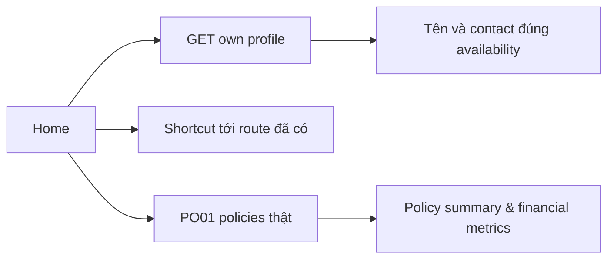

# H02 — Home từ nguồn dữ liệu có thật

05/11/2026 · **Đã triển khai** · [C02](../02-home-contract.md) · Cần [H01](01-shell-navigation.md).

## 1. UI và API

Triển khai tại `apps/web/src/components/customer-home.tsx` trong shell H01. Sử dụng dữ liệu thực từ `GET /customers/me`:
- Lời chào kèm `fullName` khách hàng, mã tài khoản `accountCode`.
- Lối tắt nhanh: *View My Policies* và *Contact Staff*.
- Số liệu danh mục bảo vệ: Tổng quyền lợi bảo vệ (*Total Protection Value* tính tổng từ các hợp đồng ACTIVE), số lượng hợp đồng hiệu lực (*In-force Policies*), và ngày đến hạn phí gần nhất (*Next Due Date*).
- Thẻ dịch vụ nhanh (*Policyholder Quick Services*).
- Danh sách giải pháp bảo hiểm nổi bật (*Featured Insurance Solutions*) kèm nút *Explore Details & Terms*.
- Thẻ thông tin chuyên viên phụ trách (*Assigned Support Staff*): hiển thị tiêu đề chữ đen tiêu chuẩn (`ASSIGNED SUPPORT STAFF`), đã gỡ bỏ nhãn trạng thái dư thừa (`Assigned & Active`), kèm email, số điện thoại và nút nhắn tin trực tiếp (`Message Staff`).
- Đã lược bỏ thẻ tĩnh *Paperless Electronic Policy* theo yêu cầu tối ưu không gian hiển thị.

## 2. Quy tắc dữ liệu

- ASSIGNED mới dùng staff contact Core trả; UNASSIGNED/STAFF_UNAVAILABLE có giải thích rõ ràng.
- Quyền lợi và số liệu tài chính tính toán từ hợp đồng thật, không bịa đặt số liệu giả định.
- Toàn bộ giao diện 100% tiếng Anh, không lẫn tiếng Việt.

## 3. Lifecycle và kiểm thử

- Giữ nội dung khi same-actor background refresh; loading đầu khác refresh; profile lỗi retry tại vùng.
- Không reload F5 khi tương tác.
- Responsive hoàn hảo từ mobile (375px) đến desktop.

| ID | Case | Kỳ vọng |
| --- | --- | --- |
| H02-T01 | Assigned/unassigned/staff locked | Đúng contact/status; không leak contact cũ |
| H02-T02 | Không policy hoặc PO01 chưa có | Home hữu ích, không số liệu/tài liệu giả |
| H02-T03 | Ngày/financial null và past nextDueDate | Không suy ra payment state |
| H02-T04 | Refresh lỗi, logout, Back/mobile/keyboard | Scope cleanup đúng; retry tại vùng; không F5 |

- [x] H02 không tạo model/API/metrics thừa; liên kết dữ liệu thật hoàn tất.
- [x] Đã cập nhật theo các phản hồi UX của người dùng (tiêu đề đen ASSIGNED SUPPORT STAFF, gỡ nhãn dư, gỡ card Paperless Policy).
