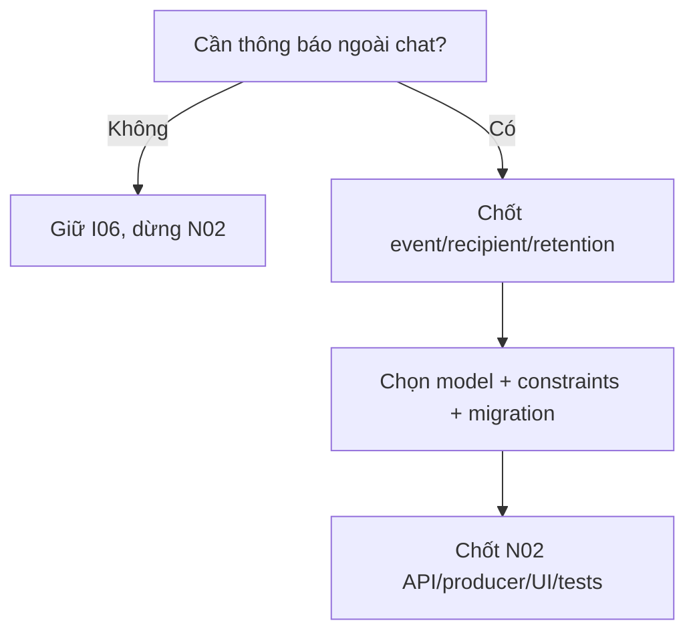

# N01 — Chốt Customer notification scope và recipient

04/11/2026 · **Chưa quyết định triển khai center** · [C09](../09-notifications-contract.md).

## 1. Việc cần chốt trước code

Xác định liệu chat realtime/SYSTEM I06 đã đủ hay cần một hộp thông báo bền vững ngoài chat. Nếu cần, chọn event tối thiểu (ví dụ Staff đã nhận hoặc Ticket đã tạo), ai nhận, lưu bao lâu và nội dung generic nào được phép hiển thị. Tin mới/unread là yêu cầu riêng, không tự thêm per-message Notification row hoặc counts.

## 2. Model và vị trí dự kiến

Rà `apps/core/src/notifications/`, `outbox/`, `realtime/`, Prisma Notification/OutboxEvent và producer I06/I07. Hai phương án để review: mở rộng Notification bằng recipientCustomerId với CHECK đúng một recipient theo role; hoặc bảng CustomerNotification riêng nếu lifecycle/quyền khác. **Chưa chọn phương án**, không migration trong lượt viết plan. Giữ rows/unique/dedup Staff đang dùng; không backfill người nhận Customer từ recipientStaffId.

Contract event đề xuất nội bộ `{eventId,kind,recipientCustomerId,conversationId?,ticketId?,createdAt}` từ transaction Core, không từ browser/Agent. Resolve owner tại producer và consumer/read; links cùng actor, không raw chattext/PII. Retention/dedup unique theo recipient+event phải chốt, không xóa business Ticket khi dọn notification. Không reuse deliveredAt như user-read hoặc message-read acknowledgement.

## 3. API và flow

Chưa có Customer Notification API E. Candidate P GET `/customers/me/notifications` và POST `.../:notificationId/read` chỉ được chốt ở N02 sau quyết định model. N01 không cần endpoint hoặc UI giả để “test center”. I06 chat REST/WS giữ nguyên.

## 4. Review/tests và điều kiện hoàn tất

Review bảng quyền: Customer A/B, Staff A/B, resource đã xóa/mất quyền, payload pending không lộ history, dedup retries. Nếu chọn mở rộng bảng, migration test giữ nguyên A27/A28 và unique recipient; nếu tách bảng, kiểm writer không gửi sai loại. Đây là test plan, chưa kết quả pass.

- [ ] Có quyết định cần/không cần center, event tối thiểu và source truy vết.
- [ ] Nếu làm: model/constraints/retention/error/producer được ghi cụ thể trước N02.
- [ ] Nếu không làm: đánh dấu N02 deferred, không tạo route/badge/UI chết.
