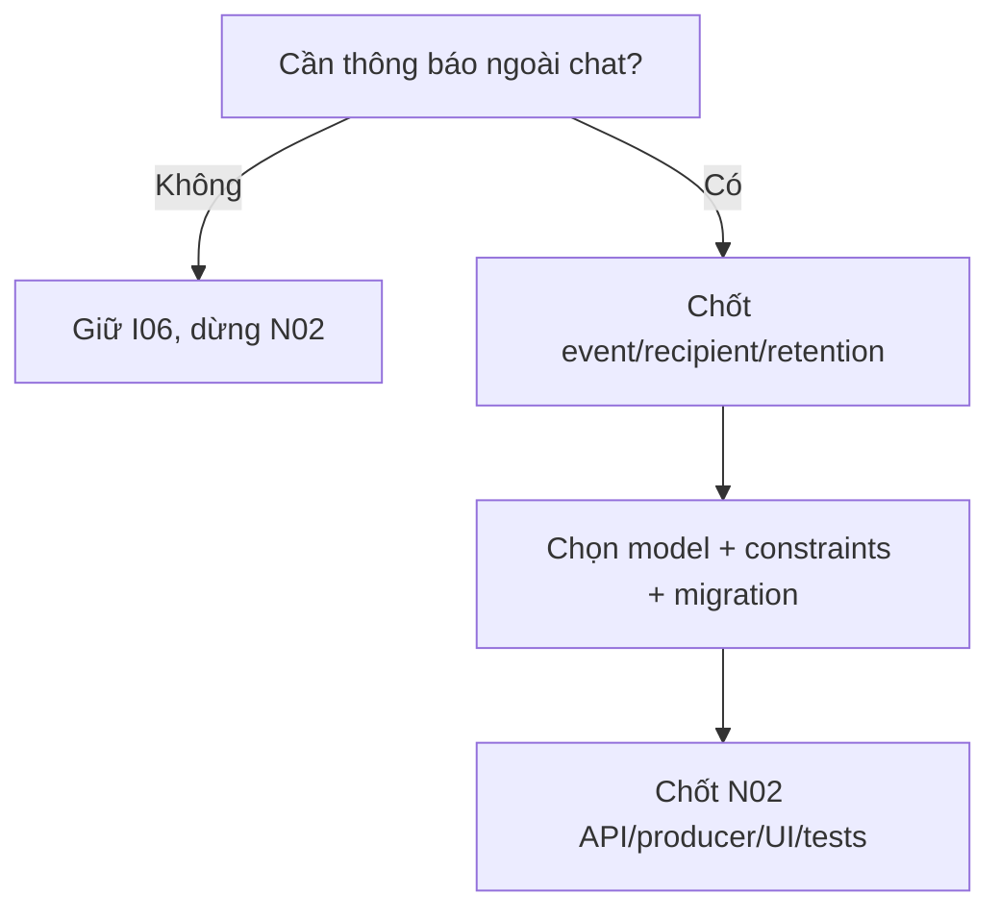
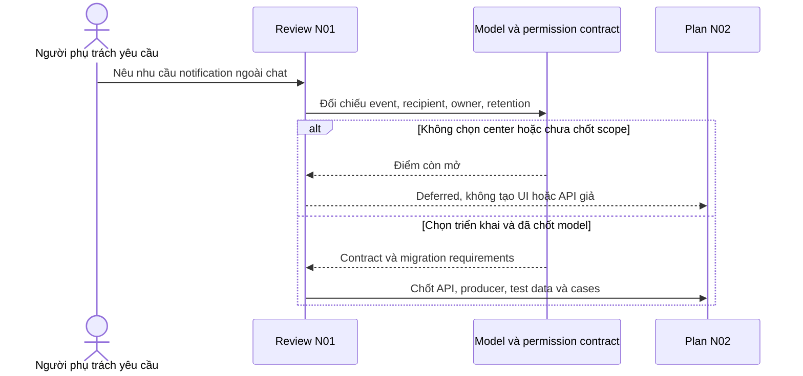

# N01 — Chốt Customer notification scope và recipient

04/11/2026 · **Chưa quyết định triển khai center** · [C09](../09-notifications-contract.md).

## Data model và phạm vi ảnh hưởng

Bảng bên dưới mô tả tác động của phase, gồm cả ghi gián tiếp qua Core. Tên bảng thuộc schema `business` trừ nơi ghi rõ; cột còn đề xuất được đánh dấu **P**. Web không truy cập DB trực tiếp.

| Bảng/model | Cột hoặc dữ liệu liên quan | Thao tác của phase | Quan hệ/ràng buộc cần giữ | Mức ảnh hưởng và nơi bị tác động |
| --- | --- | --- | --- | --- |
| users + auth_sessions | users.id/role/status, auth_sessions.user_id/token_hash/expires_at/revoked_at | Đọc | AuthSession.user_id → User.id; session phải còn hạn, không bị thu hồi | Cao — mọi API dùng session; không trả token/hash trong DTO |
| Customer notification recipient — P, chưa có schema | recipient_customer_id hoặc bảng CustomerNotification riêng chưa chọn; kind/target/dedup/read/retention cần chốt | DDL dự kiến, không reuse recipient_staff_id | Hiện Notification.recipient_staff_id FK StaffProfile; phải chọn CHECK đúng một recipient hoặc bảng riêng | Cao — Staff notification/dedup/outbox/query scope cần giữ nguyên, không backfill người nhận từ Staff |
| outbox_events | aggregate_type/aggregate_id/event_type/payload/status/retry_count/next_attempt_at/lease_owner/lease_expires_at/last_error | Thêm trong transaction nguồn; worker cập nhật trạng thái/lease | Index status/next_attempt_at/lease_expires_at; aggregate_id là reference kiểm bởi service, không FK đa loại | Cao — retry/reclaim/dedup, commit nghiệp vụ khác delivery; REST vẫn là nguồn dữ liệu |

**Schema/migration:** P — N01 chưa chọn mở rộng Notification hay bảng riêng. N02 chỉ triển khai sau quyết định, không coi staff notification API là Customer API.

**Nhất quán và hồi quy:** Producer/consumer/read đều kiểm Customer owner và target; chat SYSTEM/realtime hiện có không tự biến thành hộp notification. Kiểm không lẫn recipient, dedup/revoke/read và bảo toàn Staff bell.

## 1. Việc cần chốt trước code

Xác định liệu chat realtime/SYSTEM I06 đã đủ hay cần một hộp thông báo bền vững ngoài chat. Nếu cần, chọn event tối thiểu (ví dụ Staff đã nhận hoặc Ticket đã tạo), ai nhận, lưu bao lâu và nội dung generic nào được phép hiển thị. Tin mới/unread là yêu cầu riêng, không tự thêm per-message Notification row hoặc counts.

| Vị trí từ root repo | Hiện trạng | Trách nhiệm trong phase | Mức ảnh hưởng | Phạm vi cần kiểm lại |
| --- | --- | --- | --- | --- |
| [apps/core/prisma/schema.prisma](<../../../../../apps/core/prisma/schema.prisma>) | Hiện có | Hiện recipient Staff, P Customer schema sau review | Cao | Migrations/index/check và Staff data |
| [apps/core/src/notifications/notifications.service.ts](<../../../../../apps/core/src/notifications/notifications.service.ts>) | Hiện có | Hiện Staff; Customer policy/endpoint còn P | Cao | Không nới gate Staff để dùng cho Customer |
| [apps/core/src/outbox/services/outbox-dispatcher.service.ts](<../../../../../apps/core/src/outbox/services/outbox-dispatcher.service.ts>) | Hiện có | P Customer recipient dispatch sau chốt event | Cao | Handoff/Ticket consumers hiện có |
| `apps/web/src/components/customer-notifications.tsx` | Dự kiến — chưa có file | P conditional UI sau N01, chưa có file | Trung bình | Customer header và deep links |

## 2. Model và vị trí dự kiến

Rà `apps/core/src/notifications/`, `outbox/`, `realtime/`, Prisma Notification/OutboxEvent và producer I06/I07. Hai phương án để review: mở rộng Notification bằng recipientCustomerId với CHECK đúng một recipient theo role; hoặc bảng CustomerNotification riêng nếu lifecycle/quyền khác. **Chưa chọn phương án**, không migration trong lượt viết plan. Giữ rows/unique/dedup Staff đang dùng; không backfill người nhận Customer từ recipientStaffId.

Contract event đề xuất nội bộ `{eventId,kind,recipientCustomerId,conversationId?,ticketId?,createdAt}` từ transaction Core, không từ browser/Agent. Resolve owner tại producer và consumer/read; links cùng actor, không raw chattext/PII. Retention/dedup unique theo recipient+event phải chốt, không xóa business Ticket khi dọn notification. Không reuse deliveredAt như user-read hoặc message-read acknowledgement.

## 3. API và flow

Chưa có Customer Notification API E. Candidate P GET `/customers/me/notifications` và POST `.../:notificationId/read` chỉ được chốt ở N02 sau quyết định model. N01 không cần endpoint hoặc UI giả để “test center”. I06 chat REST/WS giữ nguyên.

## 4. Test cases

Các ca dưới đây là **kịch bản dự kiến**, chỉ thực thi sau dependency/contract đã chốt trong phần phạm vi; không đánh dấu chức năng đã có.

**Quy ước dữ liệu:** S-A/S-B là hai Staff synthetic; C-A/C-B là hai Customer synthetic khác nhau. Thay alias bằng UUID/token của fixture cô lập; các path HTTP dùng prefix /api/v1 nếu chưa ghi đầy đủ. Chỉ thay assignment, khóa account, inject lỗi hoặc migration trong harness/môi trường test, không trên tài khoản/dữ liệu đang sử dụng.

### N01-T01 — Review owner và loại sự kiện

**Lớp kiểm thử:** Contract review dự kiến.
**Điều kiện và dữ liệu:** Danh sách event/recipient/retention phải được chốt trước N02; dùng C-A/C-B/S-A synthetic.

**Các bước:**

1. Lập bảng mỗi event với recipient và target.
2. Thử truy vết case CustomerB đọc mục A hoặc Staff giả recipient.
3. Review target đã xóa/mất quyền.

**Kết quả mong đợi:** Mỗi loại có owner/gate rõ; không lấy client/LLM quyết recipient; không public API E chỉ từ proposal.

### N01-T02 — Không làm center khi chưa được chọn

**Lớp kiểm thử:** Contract review dự kiến.
**Điều kiện và dữ liệu:** N01 chưa có quyết định triển khai hoặc quyết định không cần center.

**Các bước:**

1. Kiểm routes/menu/badge dự kiến.
2. Đối chiếu yêu cầu nguồn và khả năng I06 hiện có.
3. Đánh dấu gate N02 theo quyết định.

**Kết quả mong đợi:** Không tạo endpoint/UI chết hoặc bắt FR-013 phải có Customer center; N02 chỉ mở khi dependency đã chốt.

### N01-T03 — Migration không phá Staff notifications

**Lớp kiểm thử:** Migration harness dự kiến.
**Điều kiện và dữ liệu:** Nếu chọn model mới, có snapshot Staff A27/A28 với handoff/Ticket fixtures.

**Các bước:**

1. Apply migration trên schema riêng.
2. Chạy lại recipient/dedup/read Staff bằng API harness.
3. Thử payload pending chứa private preview trong fixture.

**Kết quả mong đợi:** Không mất bảng/quyền/unique Staff; typed recipient không chồng lẫn; preview/private history không được public cho Customer sai scope.

**Checklist chức năng liên quan** (giữ trạng thái triển khai, không phải kết quả của lần sửa tài liệu):

- [ ] Có quyết định cần/không cần center, event tối thiểu và source truy vết.
- [ ] Nếu làm: model/constraints/retention/error/producer được ghi cụ thể trước N02.
- [ ] Nếu không làm: đánh dấu N02 deferred, không tạo route/badge/UI chết.

**Dọn sau kiểm thử:** xóa đúng fixture/session/object/schema theo runId; phục hồi fault injection và đóng context/socket test. Không reset DB/credential, sửa bootstrap hoặc xóa volumes. Với PDF kiểm metadata/bytes/hash; với UI kiểm DOM/focus/network, không cần screenshot.

## Sequence diagram

**Luồng dự kiến:** chỉ áp dụng sau khi các dependency và API ở phần phạm vi được chốt.

