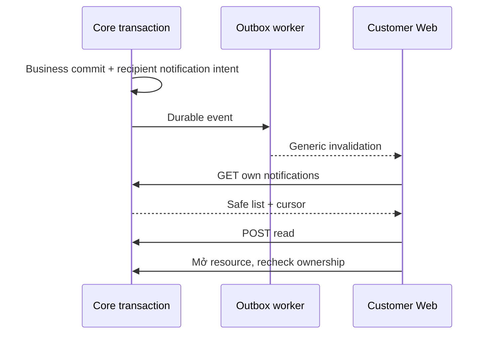

# N02 — Notification center tối thiểu, chỉ sau quyết định N01

04/11/2026 · **Có điều kiện, chưa triển khai** · [C09](../09-notifications-contract.md) · Cần [N01](01-scope-recipient-contract.md) chốt làm.

## 1. API proposal

GET `/api/v1/customers/me/notifications?limit=20&cursor=...` → `{items:[{id,kind,createdAt,isRead,link:{type,id}|null}],pageInfo:{hasMore,nextCursor}}`. limit1–50, keyset createdAt DESC/id DESC, owner và visibility trước pagination, cursor bind actor/endpoint; không total/counts. Nội dung label từ kind allowlist, không raw event body/preview tin nhắn.

POST `/api/v1/customers/me/notifications/:notificationId/read`, body `{}` → `{notification:{id,isRead:true}}`, idempotent khi đã đọc. Customer session/CSRF; read không Accept chat/Ticket hoặc mark messages read. UUID400, owner/resource ngoài quyền404, session401/role403, quota429. GET no-store; quota đề xuất120read/30mutation/phút/actor, phải chốt với N01. Links phải recheck owner ở đích, không tự mở scope từ notificationId.

## 2. Implementation và UI

Model/constraints/migration dùng phương án N01 đã ghi, không code cả hai. Core recipient producer trong transaction nghiệp vụ + outbox, dedup/lease/retry theo nền I06; event generic báo cần resync, không websocket payload riêng tư. Không claim SLA ≤5s hoặc delivered/read nếu chưa đo/ACK contract. Cleanup retention không xóa Ticket/conversation.

Files đề xuất Customer controller/service trong notifications module, tests `customer-notifications.test.cjs`; Web `components/customer-notifications.tsx`, client `lib/notification-api.ts` nếu chưa có phù hợp. Panel hoặc page trong shell H01, không unread badge. Load more, read/click/focus/errors; link tới own conversation/Ticket thật, không action chết. Mobile drawer/page có close/focus return, không F5. Giữ Staff A27/A28/UI hiện có.

## 3. Test và gate

Browser `customer-notifications.spec.mjs` và gateway test thật, synthetic runId tự dọn.

| ID | Case | Kỳ vọng |
| --- | --- | --- |
| N02-T01 | Customer khác/Staff giả recipient/forged link | Không lộ metadata hoặc scope |
| N02-T02 | Retry outbox/read nhiều lần/reconnect | Không notification trùng, read idempotent |
| N02-T03 | Resource hết quyền/cursor sai/retention | Safe404 hoặc list loại đúng, không leak |
| N02-T04 | Worker fail sau business commit | Không mất Ticket/chat; delivery retry riêng |
| N02-T05 | Keyboard/mobile/offline/401/không F5 | Focus/state cleanup đúng, không unread counts |

- [ ] N01 chốt làm, Core/schema/UI/tests pass, Staff notifications không hồi quy.
- [ ] Không đánh dấu center này là điều kiện bắt buộc của FR-013 nguồn.
