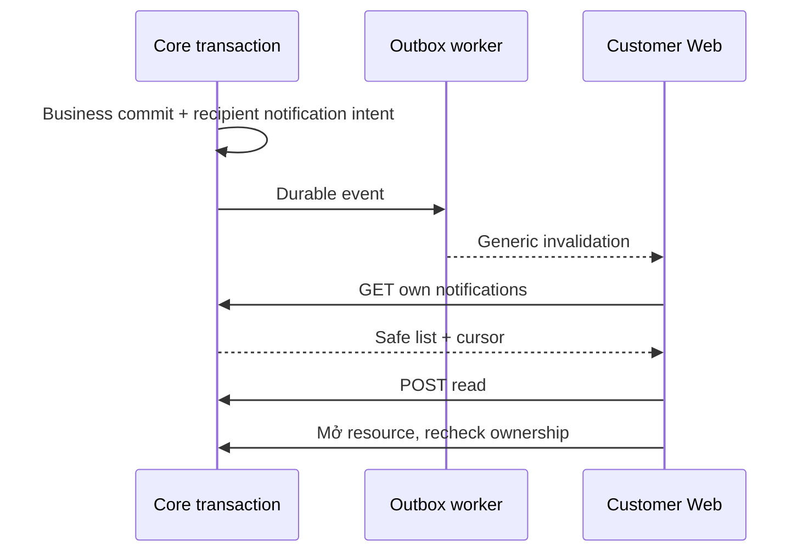

# N02 — Notification center tối thiểu và message read status

Cập nhật **08/11/2026** · **Đã chốt thiết kế chi tiết theo N01** · [C09](../09-notifications-contract.md) · [N01](01-scope-recipient-contract.md).

## Bổ sung bảo vệ dữ liệu Customer — 12/11/2026

**P — chưa triển khai phần bảo vệ bổ sung; giữ trạng thái baseline của phase.** Theo [ma trận dữ liệu chung](../../../../configuration-and-data.md#customer-sensitive-data); mức che/quyền xem đầy đủ còn chờ chốt. Vị trí code/API và data model của phase bên dưới là nơi rà tác động; bổ sung này không tự yêu cầu migration hoặc sửa dữ liệu gốc.

**Thay đổi của phase:** Sau N01, dùng DTO đã lọc, không bổ sung preview bằng raw profile. Rà customer-workspace/cache/realtime; fixture popover không là dữ liệu nghiệp vụ.

**Kiểm thử cần bổ sung, chưa chạy:** DOM/network: mở/mark-read không lộ canary; revoke/logout/đổi actor xóa preview, response muộn không phục hồi raw.

## Data model và phạm vi ảnh hưởng

Bảng bên dưới mô tả tác động của phase, gồm cả ghi gián tiếp qua Core. Tên bảng thuộc schema `business` trừ nơi ghi rõ; cột còn đề xuất được đánh dấu **P**. Web không truy cập DB trực tiếp.

| Bảng/model | Cột hoặc dữ liệu liên quan | Thao tác của phase | Quan hệ/ràng buộc cần giữ | Mức ảnh hưởng và nơi bị tác động |
| --- | --- | --- | --- | --- |
| users + auth_sessions | users.id/role/status, auth_sessions.user_id/token_hash/expires_at/revoked_at | Đọc | AuthSession.user_id → User.id; session phải còn hạn, không bị thu hồi | Cao — mọi API dùng session; không trả token/hash trong DTO |
| Customer notification recipient — P, chưa có schema | recipient_customer_id hoặc bảng CustomerNotification riêng chưa chọn; kind/target/dedup/read/retention cần chốt | DDL dự kiến, không reuse recipient_staff_id | Hiện Notification.recipient_staff_id FK StaffProfile; phải chọn CHECK đúng một recipient hoặc bảng riêng | Cao — Staff notification/dedup/outbox/query scope cần giữ nguyên, không backfill người nhận từ Staff |
| outbox_events | aggregate_type/aggregate_id/event_type/payload/status/retry_count/next_attempt_at/lease_owner/lease_expires_at/last_error | Thêm trong transaction nguồn; worker cập nhật trạng thái/lease | Index status/next_attempt_at/lease_expires_at; aggregate_id là reference kiểm bởi service, không FK đa loại | Cao — retry/reclaim/dedup, commit nghiệp vụ khác delivery; REST vẫn là nguồn dữ liệu |

**Schema/migration:** P — N01 chưa chọn mở rộng Notification hay bảng riêng. N02 chỉ triển khai sau quyết định, không coi staff notification API là Customer API.

**Nhất quán và hồi quy:** Producer/consumer/read đều kiểm Customer owner và target; chat SYSTEM/realtime hiện có không tự biến thành hộp notification. Kiểm không lẫn recipient, dedup/revoke/read và bảo toàn Staff bell.

## Vị trí code và mức ảnh hưởng

| Vị trí từ root repo | Hiện trạng | Trách nhiệm trong phase | Mức ảnh hưởng | Phạm vi cần kiểm lại |
| --- | --- | --- | --- | --- |
| [apps/core/prisma/schema.prisma](<../../../../../apps/core/prisma/schema.prisma>) | Hiện có | Hiện recipient Staff, P Customer schema sau review | Cao | Migrations/index/check và Staff data |
| [apps/core/src/notifications/notifications.service.ts](<../../../../../apps/core/src/notifications/notifications.service.ts>) | Hiện có | Hiện Staff; Customer policy/endpoint còn P | Cao | Không nới gate Staff để dùng cho Customer |
| [apps/core/src/outbox/services/outbox-dispatcher.service.ts](<../../../../../apps/core/src/outbox/services/outbox-dispatcher.service.ts>) | Hiện có | P Customer recipient dispatch sau chốt event | Cao | Handoff/Ticket consumers hiện có |
| `apps/web/src/components/customer-notifications.tsx` | Dự kiến — chưa có file | P conditional UI sau N01, chưa có file | Trung bình | Customer header và deep links |

## 1. API proposal

### A. Notifications API
- `GET /api/v1/customers/me/notifications?limit=20&cursor=...` → `{items:[{id,kind,createdAt,isRead,title,link:{type,id}|null}],pageInfo:{hasMore,nextCursor}}`.
  - Limit 1–50, keyset `createdAt DESC, id DESC`.
  - Lọc theo `recipient_customer_id = currentCustomer.id`.
  - Nội dung title/label chuẩn hóa từ kind allowlist, đảm bảo định dạng generic:
    - `STAFF_ACCEPTED_HANDOFF`: *"Nhân viên đã tiếp nhận yêu cầu chat"*
    - `SUPPORT_TICKET_CREATED`: *"Phiếu hỗ trợ #[ticketCode] của bạn đã được tạo"*
    - `STAFF_MESSAGE_UNREAD`: *"Bạn có tin nhắn mới từ nhân viên hỗ trợ"*
  - Tuyệt đối cấm đưa chi tiết PII, nội dung raw chat, số tiền bồi thường hay hồ sơ y tế vào thông báo.

- `POST /api/v1/customers/me/notifications/:notificationId/read`, body `{}` → `{notification:{id,isRead:true}}`, idempotent khi đã đọc.
  - Phân quyền: chỉ đánh dấu đọc nếu đúng `recipient_customer_id`.

- `POST /api/v1/customers/me/notifications/read-all`, body `{}` → `{success:true, markedCount:number}`, đánh dấu đọc toàn bộ thông báo của khách hàng.

### B. Message Read Status API
- `POST /api/v1/conversations/:id/read`, body `{}` → `{success:true, readAt:string}`:
  - Khi Customer hoặc Staff mở xem cuộc hội thoại, gọi endpoint này để cập nhật `messages.read_at = NOW()` cho toàn bộ các tin nhắn do đối phương gửi mà chưa đọc (`read_at IS NULL`).
  - Hỗ trợ cả 2 vai trò:
    - Customer gọi: `POST /api/v1/customers/me/conversations/:id/read` (đọc tin nhắn từ Staff/System/AI).
    - Staff gọi: `POST /api/v1/staff/conversations/:id/read` (đọc tin nhắn từ Customer).
  - Phục vụ tính năng hiển thị trạng thái "Đã xem" (read receipts) realtime hai chiều:
    - Nếu có ít nhất 1 tin nhắn được cập nhật (`count > 0`), Core tự động ghi Outbox event để WebSocket push frame `chat-invalidated` tới bên đối phương (người gửi tin). Phía người gửi nhận sự kiện và refresh transcript, nhãn tin nhắn chuyển ngay từ *"Đã gửi"* sang *"Đã xem"* mà không cần reload trang.
  - Đồng thời tự động đánh dấu đã đọc thông báo `STAFF_MESSAGE_UNREAD` tương ứng nếu có.

### C. Realtime WebSocket Invalidation Contract
- **Backend Outbox & Realtime**:
  - Khi có sự kiện tạo hoặc thay đổi thông báo (Staff Accept, Ticket Created, Staff New Message), outbox dispatcher xử lý và `RealtimeService.publishChat` / `publishTicket` gửi frame WebSocket tới các peer kết nối của Customer:
    `{ "type": "notifications-invalidated", "eventId": "<uuid>" }`
  - Khi có tin nhắn mới hoặc có sự kiện đọc tin nhắn (`read_at` được cập nhật): Core phát sinh Outbox event và gửi frame WebSocket tới cả hai bên (Customer & Staff):
    `{ "type": "chat-invalidated", "eventId": "<uuid>", "conversationId": "<uuid>" }`
  - Tuân thủ nguyên tắc Generic Invalidation: WebSocket chỉ mang tín hiệu vô hại báo dữ liệu đã thay đổi, không bao giờ gửi nội dung thông báo, tin nhắn hay thông tin cá nhân (PII) qua WebSocket payload.
- **Client Realtime Bridge** (`apps/web/src/lib/realtime.ts`):
  - Nhận frame `notifications-invalidated`, dedup theo key `${type}:${eventId}` (tối đa 256 entries).
  - Dispatch CustomEvent trên trình duyệt: `window.dispatchEvent(new CustomEvent('core:notifications-changed', { detail: message }))` (hằng số `notificationEvent`).
  - Nhận frame `chat-invalidated`, dispatch CustomEvent: `window.dispatchEvent(new CustomEvent('core:chat-changed', { detail: message }))` (hằng số `chatEvent`).
- **Customer Workspace Bell Component** (`apps/web/src/components/customer-workspace.tsx`):
  - Lắng nghe sự kiện `notificationEvent` (`core:notifications-changed`).
  - Khi nhận sự kiện, tự động gọi lại API `GET /api/v1/customers/me/notifications` (debounce/single-flight) để cập nhật danh sách thông báo và số lượng unread badge ngay lập tức trên giao diện mà không cần reload trang.
- **Chat Transcript Realtime Sync (Customer & Staff)**:
  - Khi nhận `chatEvent` (`chat-invalidated`), cả Customer (`customer-conversations.tsx`) và Staff (`staff-inbox.tsx`) kích hoạt resync transcript, đồng thời cập nhật realtime nhãn trạng thái "Đã xem" (Seen) khi đối phương đã đọc tin nhắn.

### D. Single Active Notification per Conversation (Quy tắc gộp thông báo tin nhắn chưa đọc)
- **Quy tắc cốt lõi**: Trong mỗi cuộc hội thoại, tại một thời điểm chỉ tồn tại tối đa **1 thông báo chưa đọc** (`isRead = false`) cho sự kiện tin nhắn mới. Dù đối phương có gửi bao nhiêu tin nhắn liên tiếp khi người nhận chưa đọc, hệ thống chỉ hiển thị đúng 1 thông báo và cập nhật lại thời gian mới nhất.
- **Cơ chế cập nhật**:
  - Khi nhận sự kiện tin nhắn mới từ đối phương, Core kiểm tra xem người nhận đã có thông báo tin nhắn chưa đọc (`isRead = false`) gắn với `conversation_id` này chưa.
  - Nếu **đã tồn tại**: Cập nhật thời gian `createdAt = NOW()` của thông báo chưa đọc hiện có và gửi WebSocket invalidation. Không insert thêm row mới gây spam hoặc phình dữ liệu.
  - Nếu **chưa tồn tại** (tin nhắn đầu tiên hoặc người nhận đã đọc hết các tin trước đó): Tạo 1 thông báo mới.
- **Áp dụng đối xứng cho cả hai vai trò**:
  - Phía Customer: nhận `STAFF_MESSAGE_UNREAD` (*"Bạn có tin nhắn mới từ nhân viên hỗ trợ"*).
  - Phía Staff: nhận `CUSTOMER_MESSAGE_UNREAD` (*"Bạn có tin nhắn mới từ khách hàng"*).
  - Khi người nhận mở cuộc trò chuyện (gọi `POST /conversations/:id/read`), hệ thống tự động đánh dấu đọc toàn bộ tin nhắn chưa đọc và chuyển thông báo chưa đọc tương ứng sang `isRead = true`.

## 2. Implementation và UI

1. **Schema & Migration**:
   - Mở rộng bảng `business.notifications`: thêm `recipient_customer_id UUID REFERENCES business.customer_profiles(id)`. CHECK constraint đảm bảo duy nhất 1 trong 2 (`recipient_staff_id`, `recipient_customer_id`) có giá trị.
   - Bảng `business.messages`: thêm `read_at TIMESTAMPTZ NULL`.
2. **Transactional Outbox & Worker**:
   - Khi commit sự kiện Staff Accept, Ticket Create, hoặc Staff gửi tin nhắn mới, outbox event được ghi cùng transaction.
   - Worker xử lý event, insert vào `business.notifications` và push realtime invalidation qua WebSocket `/api/v1/realtime`.
3. **Scheduled Cleanup (Dọn rác 30 ngày)**:
   - Worker chạy job định kỳ (cron daily) dọn dẹp các thông báo đã cũ hơn 30 ngày:
     `DELETE FROM business.notifications WHERE created_at < NOW() - INTERVAL '30 days'`.
4. **UI Integration**:
   - Kết nối component `apps/web/src/components/customer-workspace.tsx` (popover chuông thông báo) với API REST `GET /customers/me/notifications` và mutation `POST /read`.
   - Trong khung chat `customer-conversations.tsx`, hiển thị nhãn "Đã xem" (Seen / Read at ...) khi tin nhắn có `read_at != null`.

## 3. Test cases

Các ca dưới đây là **kịch bản dự kiến**, chỉ thực thi sau dependency/contract đã chốt trong phần phạm vi; không đánh dấu chức năng đã có.

**Quy ước dữ liệu:** S-A/S-B là hai Staff synthetic; C-A/C-B là hai Customer synthetic khác nhau. Thay alias bằng UUID/token của fixture cô lập; các path HTTP dùng prefix /api/v1 nếu chưa ghi đầy đủ. Chỉ thay assignment, khóa account, inject lỗi hoặc migration trong harness/môi trường test, không trên tài khoản/dữ liệu đang sử dụng.

### N02-T01 — Owner trước keyset và target recheck

**Lớp kiểm thử:** API dự kiến.
**Điều kiện và dữ liệu:** N01 đã duyệt model/API; C-A có nhiều mục, C-B có mục riêng.

**Các bước:**

1. C-A lấy các trang notifications.
2. Dùng cursor A bằng B/Staff.
3. Mở target sau khi quyền bị thu hồi.

**Kết quả mong đợi:** Không leak ở items/pageInfo; cursor sai/role bị chặn; notification không cấp quyền target.

### N02-T02 — Read và delivery retry idempotent

**Lớp kiểm thử:** API + Worker dự kiến.
**Điều kiện và dữ liệu:** Một event committed cho C-A; worker có thể crash sau notification insert.

**Các bước:**

1. Replay event qua hai worker/lease recovery.
2. POST read cùng mục nhiều lần với CSRF.
3. Thử body actor/recipient giả.

**Kết quả mong đợi:** Một notification theo dedup; read không Accept chat/Ticket; request giả bị từ chối.

### N02-T03 — Offline,401 và bàn phím

**Lớp kiểm thử:** Browser dự kiến.
**Điều kiện và dữ liệu:** Sau khi N02 UI được triển khai; C-A có mục đọc/chưa đọc.

**Các bước:**

1. Mở center bằng keyboard, dùng Escape/Close.
2. Ngắt mạng rồi reconnect và Retry.
3. Cho401 hoặc đổi actor khi fetch pending.

**Kết quả mong đợi:** Focus về nút mở; không F5 hoặc restore state actor cũ; labels/controls phù hợp proposal đã chốt, không suy center đã E.

### N02-T04 — Worker lỗi không mất business record

**Lớp kiểm thử:** Worker + DB dự kiến.
**Điều kiện và dữ liệu:** Ticket/chat fixture committed trước event delivery.

**Các bước:**

1. Inject lỗi gửi notification sau business commit.
2. Cho retry/backoff rồi delivery thành công.
3. Đọc business record và đếm notification theo key.

**Kết quả mong đợi:** Business record còn nguyên; delivery có retry/dedup riêng, không thông báo thành công trước commit.

**Checklist chức năng liên quan** (giữ trạng thái triển khai, không phải kết quả của lần sửa tài liệu):

- [ ] Không đánh dấu center này là điều kiện bắt buộc của FR-013 nguồn.

**Dọn sau kiểm thử:** xóa đúng fixture/session/object/schema theo runId; phục hồi fault injection và đóng context/socket test. Không reset DB/credential, sửa bootstrap hoặc xóa volumes. Với PDF kiểm metadata/bytes/hash; với UI kiểm DOM/focus/network, không cần screenshot.
