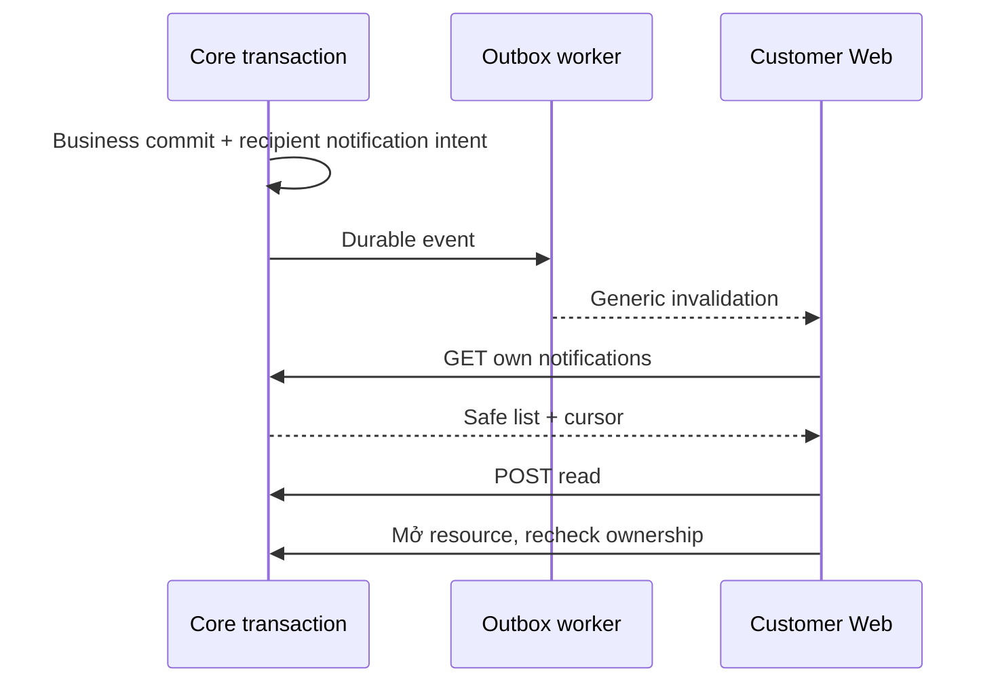

# N02 — Notification center tối thiểu, chỉ sau quyết định N01

04/11/2026 · **Có điều kiện, chưa triển khai** · [C09](../09-notifications-contract.md) · Cần [N01](01-scope-recipient-contract.md) chốt làm.

## 1. API proposal

GET `/api/v1/customers/me/notifications?limit=20&cursor=...` → `{items:[{id,kind,createdAt,isRead,link:{type,id}|null}],pageInfo:{hasMore,nextCursor}}`. limit 1–50, keyset createdAt DESC/id DESC, owner và visibility trước pagination, cursor bind actor/endpoint; không total/counts. Nội dung label từ kind allowlist, không raw event body/preview tin nhắn.

POST `/api/v1/customers/me/notifications/:notificationId/read`, body `{}` → `{notification:{id,isRead:true}}`, idempotent khi đã đọc. Customer session/CSRF; read không Accept chat/Ticket hoặc mark messages read. UUID400, owner/resource ngoài quyền404, session 401/role403, quota 429. GET no-store; quota đề xuất120read/30mutation/phút/actor, phải chốt với N01. Links phải recheck owner ở đích, không tự mở scope từ notificationId.

## 2. Implementation và UI

Model/constraints/migration dùng phương án N01 đã ghi, không code cả hai. Core recipient producer trong transaction nghiệp vụ + outbox, dedup/lease/retry theo nền I06; event generic báo cần resync, không websocket payload riêng tư. Không claim SLA ≤5s hoặc delivered/read nếu chưa đo/ACK contract. Cleanup retention không xóa Ticket/conversation.

Files đề xuất Customer controller/service trong notifications module, tests `customer-notifications.test.cjs`; Web `components/customer-notifications.tsx`, client `lib/notification-api.ts` nếu chưa có phù hợp. Panel hoặc page trong shell H01, không unread badge. Load more, read/click/focus/errors; link tới own conversation/Ticket thật, không action chết. Mobile drawer/page có close/focus return, không F5. Giữ Staff A27/A28/UI hiện có.

## 3. Test cases

Các ca dưới đây là **kịch bản dự kiến**, chỉ thực thi sau dependency/contract đã chốt trong phần phạm vi; không đánh dấu chức năng đã có.

**Quy ước dữ liệu:** S-A/S-B là hai Staff synthetic; C-A/C-B là hai Customer synthetic khác nhau. Thay alias bằng UUID/token của fixture cô lập; các path HTTP dùng prefix /api/v1 nếu chưa ghi đầy đủ. Chỉ thay assignment, khóa account, inject lỗi hoặc migration trong harness/môi trường test, không trên tài khoản/dữ liệu đang sử dụng.

### N02-T01 — Owner trước keyset và target recheck

**Lớp kiểm thử:** API dự kiến.
**Điều kiện và dữ liệu:** N01 đã duyệt model/API; C-A có nhiều mục, C-B có mục riêng.

**Các bước:**

1. C-A lấy các trang notifications.
2. Dùng cursor A bằng B/Staff.
3. Mở target sau khi quyền bị thu hồi.

**Kết quả mong đợi:** Không leak ở items/pageInfo; cursor sai/role bị chặn; notification không cấp quyền target.

### N02-T02 — Read và delivery retry idempotent

**Lớp kiểm thử:** API + Worker dự kiến.
**Điều kiện và dữ liệu:** Một event committed cho C-A; worker có thể crash sau notification insert.

**Các bước:**

1. Replay event qua hai worker/lease recovery.
2. POST read cùng mục nhiều lần với CSRF.
3. Thử body actor/recipient giả.

**Kết quả mong đợi:** Một notification theo dedup; read không Accept chat/Ticket; request giả bị từ chối.

### N02-T03 — Offline,401 và bàn phím

**Lớp kiểm thử:** Browser dự kiến.
**Điều kiện và dữ liệu:** Sau khi N02 UI được triển khai; C-A có mục đọc/chưa đọc.

**Các bước:**

1. Mở center bằng keyboard, dùng Escape/Close.
2. Ngắt mạng rồi reconnect và Retry.
3. Cho401 hoặc đổi actor khi fetch pending.

**Kết quả mong đợi:** Focus về nút mở; không F5 hoặc restore state actor cũ; labels/controls phù hợp proposal đã chốt, không suy center đã E.

### N02-T04 — Worker lỗi không mất business record

**Lớp kiểm thử:** Worker + DB dự kiến.
**Điều kiện và dữ liệu:** Ticket/chat fixture committed trước event delivery.

**Các bước:**

1. Inject lỗi gửi notification sau business commit.
2. Cho retry/backoff rồi delivery thành công.
3. Đọc business record và đếm notification theo key.

**Kết quả mong đợi:** Business record còn nguyên; delivery có retry/dedup riêng, không thông báo thành công trước commit.

**Checklist chức năng liên quan** (giữ trạng thái triển khai, không phải kết quả của lần sửa tài liệu):

- [ ] Không đánh dấu center này là điều kiện bắt buộc của FR-013 nguồn.

**Dọn sau kiểm thử:** xóa đúng fixture/session/object/schema theo runId; phục hồi fault injection và đóng context/socket test. Không reset DB/credential, sửa bootstrap hoặc xóa volumes. Với PDF kiểm metadata/bytes/hash; với UI kiểm DOM/focus/network, không cần screenshot.
