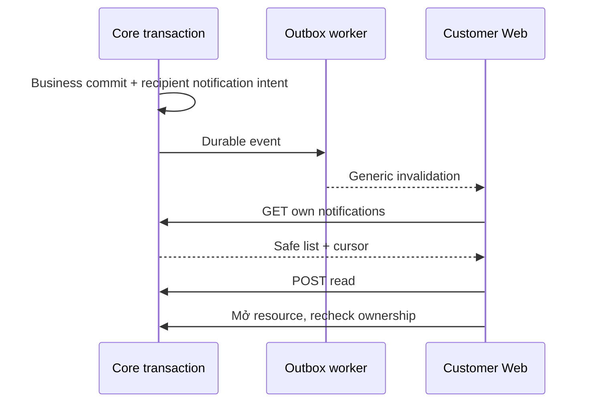

# N02 — Notification center tối thiểu, chỉ sau quyết định N01

04/11/2026 · **Có điều kiện, chưa triển khai** · [C09](../09-notifications-contract.md) · Cần [N01](01-scope-recipient-contract.md) chốt làm.

## Bổ sung bảo vệ dữ liệu Customer — 12/11/2026

**P — chưa triển khai phần bảo vệ bổ sung; giữ trạng thái baseline của phase.** Theo [ma trận dữ liệu chung](../../../../configuration-and-data.md#customer-sensitive-data); mức che/quyền xem đầy đủ còn chờ chốt. Vị trí code/API và data model của phase bên dưới là nơi rà tác động; bổ sung này không tự yêu cầu migration hoặc sửa dữ liệu gốc.

**Thay đổi của phase:** Sau N01, dùng DTO đã lọc, không bổ sung preview bằng raw profile. Rà customer-workspace/cache/realtime; fixture popover không là dữ liệu nghiệp vụ.

**Kiểm thử cần bổ sung, chưa chạy:** DOM/network: mở/mark-read không lộ canary; revoke/logout/đổi actor xóa preview, response muộn không phục hồi raw.

## Data model và phạm vi ảnh hưởng

Bảng bên dưới mô tả tác động của phase, gồm cả ghi gián tiếp qua Core. Tên bảng thuộc schema `business` trừ nơi ghi rõ; cột còn đề xuất được đánh dấu **P**. Web không truy cập DB trực tiếp.

| Bảng/model | Cột hoặc dữ liệu liên quan | Thao tác của phase | Quan hệ/ràng buộc cần giữ | Mức ảnh hưởng và nơi bị tác động |
| --- | --- | --- | --- | --- |
| users + auth_sessions | users.id/role/status, auth_sessions.user_id/token_hash/expires_at/revoked_at | Đọc | AuthSession.user_id → User.id; session phải còn hạn, không bị thu hồi | Cao — mọi API dùng session; không trả token/hash trong DTO |
| Customer notification recipient — P, chưa có schema | recipient_customer_id hoặc bảng CustomerNotification riêng chưa chọn; kind/target/dedup/read/retention cần chốt | DDL dự kiến, không reuse recipient_staff_id | Hiện Notification.recipient_staff_id FK StaffProfile; phải chọn CHECK đúng một recipient hoặc bảng riêng | Cao — Staff notification/dedup/outbox/query scope cần giữ nguyên, không backfill người nhận từ Staff |
| outbox_events | aggregate_type/aggregate_id/event_type/payload/status/retry_count/next_attempt_at/lease_owner/lease_expires_at/last_error | Thêm trong transaction nguồn; worker cập nhật trạng thái/lease | Index status/next_attempt_at/lease_expires_at; aggregate_id là reference kiểm bởi service, không FK đa loại | Cao — retry/reclaim/dedup, commit nghiệp vụ khác delivery; REST vẫn là nguồn dữ liệu |

**Schema/migration:** P — N01 chưa chọn mở rộng Notification hay bảng riêng. N02 chỉ triển khai sau quyết định, không coi staff notification API là Customer API.

**Nhất quán và hồi quy:** Producer/consumer/read đều kiểm Customer owner và target; chat SYSTEM/realtime hiện có không tự biến thành hộp notification. Kiểm không lẫn recipient, dedup/revoke/read và bảo toàn Staff bell.

## Vị trí code và mức ảnh hưởng

| Vị trí từ root repo | Hiện trạng | Trách nhiệm trong phase | Mức ảnh hưởng | Phạm vi cần kiểm lại |
| --- | --- | --- | --- | --- |
| [apps/core/prisma/schema.prisma](<../../../../../apps/core/prisma/schema.prisma>) | Hiện có | Hiện recipient Staff, P Customer schema sau review | Cao | Migrations/index/check và Staff data |
| [apps/core/src/notifications/notifications.service.ts](<../../../../../apps/core/src/notifications/notifications.service.ts>) | Hiện có | Hiện Staff; Customer policy/endpoint còn P | Cao | Không nới gate Staff để dùng cho Customer |
| [apps/core/src/outbox/services/outbox-dispatcher.service.ts](<../../../../../apps/core/src/outbox/services/outbox-dispatcher.service.ts>) | Hiện có | P Customer recipient dispatch sau chốt event | Cao | Handoff/Ticket consumers hiện có |
| `apps/web/src/components/customer-notifications.tsx` | Dự kiến — chưa có file | P conditional UI sau N01, chưa có file | Trung bình | Customer header và deep links |

## 1. API proposal

GET `/api/v1/customers/me/notifications?limit=20&cursor=...` → `{items:[{id,kind,createdAt,isRead,link:{type,id}|null}],pageInfo:{hasMore,nextCursor}}`. limit 1–50, keyset createdAt DESC/id DESC, owner và visibility trước pagination, cursor bind actor/endpoint; không total/counts. Nội dung label từ kind allowlist, không raw event body/preview tin nhắn.

POST `/api/v1/customers/me/notifications/:notificationId/read`, body `{}` → `{notification:{id,isRead:true}}`, idempotent khi đã đọc. Customer session/CSRF; read không Accept chat/Ticket hoặc mark messages read. UUID400, owner/resource ngoài quyền404, session 401/role403, quota 429. GET no-store; quota đề xuất120read/30mutation/phút/actor, phải chốt với N01. Links phải recheck owner ở đích, không tự mở scope từ notificationId.

## 2. Implementation và UI

Model/constraints/migration dùng phương án N01 đã ghi, không code cả hai. Core recipient producer trong transaction nghiệp vụ + outbox, dedup/lease/retry theo nền I06; event generic báo cần resync, không websocket payload riêng tư. Không claim SLA ≤5s hoặc delivered/read nếu chưa đo/ACK contract. Cleanup retention không xóa Ticket/conversation.

Files đề xuất Customer controller/service trong notifications module, tests `customer-notifications.test.cjs`; Web `components/customer-notifications.tsx`, client `lib/notification-api.ts` nếu chưa có phù hợp. Panel hoặc page trong shell H01, không unread badge. Load more, read/click/focus/errors; link tới own conversation/Ticket thật, không action chết. Mobile drawer/page có close/focus return, không F5. Giữ Staff A27/A28/UI hiện có.

## 3. Test cases

Các ca dưới đây là **kịch bản dự kiến**, chỉ thực thi sau dependency/contract đã chốt trong phần phạm vi; không đánh dấu chức năng đã có.

**Quy ước dữ liệu:** S-A/S-B là hai Staff synthetic; C-A/C-B là hai Customer synthetic khác nhau. Thay alias bằng UUID/token của fixture cô lập; các path HTTP dùng prefix /api/v1 nếu chưa ghi đầy đủ. Chỉ thay assignment, khóa account, inject lỗi hoặc migration trong harness/môi trường test, không trên tài khoản/dữ liệu đang sử dụng.

### N02-T01 — Owner trước keyset và target recheck

**Lớp kiểm thử:** API dự kiến.
**Điều kiện và dữ liệu:** N01 đã duyệt model/API; C-A có nhiều mục, C-B có mục riêng.

**Các bước:**

1. C-A lấy các trang notifications.
2. Dùng cursor A bằng B/Staff.
3. Mở target sau khi quyền bị thu hồi.

**Kết quả mong đợi:** Không leak ở items/pageInfo; cursor sai/role bị chặn; notification không cấp quyền target.

### N02-T02 — Read và delivery retry idempotent

**Lớp kiểm thử:** API + Worker dự kiến.
**Điều kiện và dữ liệu:** Một event committed cho C-A; worker có thể crash sau notification insert.

**Các bước:**

1. Replay event qua hai worker/lease recovery.
2. POST read cùng mục nhiều lần với CSRF.
3. Thử body actor/recipient giả.

**Kết quả mong đợi:** Một notification theo dedup; read không Accept chat/Ticket; request giả bị từ chối.

### N02-T03 — Offline,401 và bàn phím

**Lớp kiểm thử:** Browser dự kiến.
**Điều kiện và dữ liệu:** Sau khi N02 UI được triển khai; C-A có mục đọc/chưa đọc.

**Các bước:**

1. Mở center bằng keyboard, dùng Escape/Close.
2. Ngắt mạng rồi reconnect và Retry.
3. Cho401 hoặc đổi actor khi fetch pending.

**Kết quả mong đợi:** Focus về nút mở; không F5 hoặc restore state actor cũ; labels/controls phù hợp proposal đã chốt, không suy center đã E.

### N02-T04 — Worker lỗi không mất business record

**Lớp kiểm thử:** Worker + DB dự kiến.
**Điều kiện và dữ liệu:** Ticket/chat fixture committed trước event delivery.

**Các bước:**

1. Inject lỗi gửi notification sau business commit.
2. Cho retry/backoff rồi delivery thành công.
3. Đọc business record và đếm notification theo key.

**Kết quả mong đợi:** Business record còn nguyên; delivery có retry/dedup riêng, không thông báo thành công trước commit.

**Checklist chức năng liên quan** (giữ trạng thái triển khai, không phải kết quả của lần sửa tài liệu):

- [ ] Không đánh dấu center này là điều kiện bắt buộc của FR-013 nguồn.

**Dọn sau kiểm thử:** xóa đúng fixture/session/object/schema theo runId; phục hồi fault injection và đóng context/socket test. Không reset DB/credential, sửa bootstrap hoặc xóa volumes. Với PDF kiểm metadata/bytes/hash; với UI kiểm DOM/focus/network, không cần screenshot.
