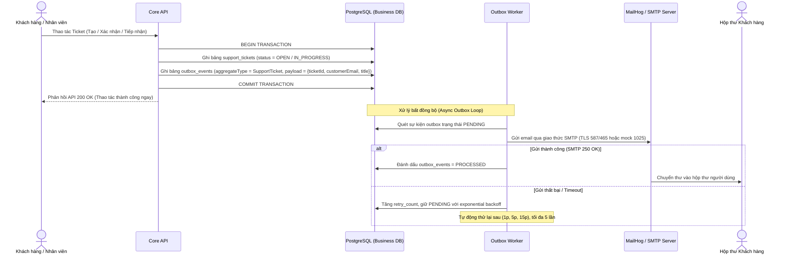

# N03 — Dịch vụ gửi Email qua SMTP cho Ticket và kiểm thử MailHog

Cập nhật **17/11/2026** · **Kế hoạch triển khai dịch vụ Email SMTP & Kiểm thử Local** · [C09](../09-notifications-contract.md) · [07-tickets-contract.md](../07-tickets-contract.md).

## 1. Mục tiêu và phạm vi nghiệp vụ

Dịch vụ Email Notification qua SMTP đảm bảo khách hàng (Customer) nhận được thư thông báo tự động vào hộp thư cá nhân đối với các biến động của Phiếu hỗ trợ (Support Ticket):

| Sự kiện nghiệp vụ | Kích hoạt khi | Mục đích gửi email |
| --- | --- | --- |
| **`CUSTOMER_TICKET_CREATED`** | Customer xác nhận bản thảo (draft) hoặc gửi form tạo Ticket thủ công thành công. | Xác nhận hệ thống đã tiếp nhận phiếu với mã số `#TK-xxx`, lưu thời gian và link portal để theo dõi. |
| **`CUSTOMER_TICKET_CREATION_FAILED`** | Yêu cầu tạo Ticket thất bại (draft hết hạn, xung đột phiên bản, lỗi hệ thống). | Thông báo lý do tạo phiếu không thành công và hướng dẫn khách hàng thao tác lại hoặc liên hệ CSKH. |
| **`STAFF_TICKET_ACCEPTED`** | Nhân viên CSKH/Dịch vụ bấm **Accept** hoặc chuyển trạng thái Ticket sang `IN_PROGRESS`. | Thông báo phiếu đã có chuyên viên phụ trách xử lý và thời gian xử lý dự kiến. |

## 2. Nguyên tắc an toàn dữ liệu và bảo vệ quyền riêng tư (PII Protection)

Theo quy tắc trong [AGENTS.md](../../../../AGENTS.md) và [configuration-and-data.md](../../../../docs/configuration-and-data.md):
- **Nội dung Generic (Không để lộ thông tin nhạy cảm):** Giao thức SMTP qua Internet không mã hóa đầu cuối. Email **chỉ chứa thông tin tóm lược/mã tham chiếu an toàn** (`ticketCode`, `title` tóm tắt không chứa PII, ngày giờ tạo, họ tên người nhận).
- **Tuyệt đối cấm:** Không đưa bệnh án, tiền sử y khoa, số CCCD/CMND, địa chỉ nhà chi tiết hoặc số tiền bồi thường bảo hiểm vào nội dung email.
- **Deep-link bảo mật:** Mọi thông báo đều đính kèm nút/link dẫn người dùng đăng nhập vào Customer Portal (`http://localhost:8080/tickets/:id`) để xem toàn văn chi tiết sau khi đã xác thực phiên.
- **Nguyên tắc "Độc lập lỗi" (Fault Isolation):** Sự cố gửi email (máy chủ SMTP sập, sai địa chỉ email, timeout) **tuyệt đối không được làm rollback hoặc hủy Ticket đã commit**.

## 3. Kiến trúc kỹ thuật (Transactional Outbox Pattern)

Hệ thống sử dụng mô hình **Transactional Outbox** để tách biệt giao dịch ghi dữ liệu với quá trình gửi email:



## 4. Thiết lập môi trường và kiểm thử với MailHog (Local Dev)

Trong môi trường phát triển local, toàn bộ email được đón bắt qua **MailHog** (máy chủ SMTP giả lập chạy trong Docker). Không cần tài khoản email thật, không rò rỉ thư ra ngoài.

### 4.1. Cấu hình Docker Compose (`compose.yaml`)

Dịch vụ `mailhog` được bổ sung vào `compose.yaml`:
```yaml
  mailhog:
    image: mailhog/mailhog:v1.0.1
    restart: unless-stopped
    ports:
      - "127.0.0.1:1025:1025" # Cổng SMTP để Core gửi mail
      - "127.0.0.1:8025:8025" # Cổng Web UI để lập trình viên xem email
```

### 4.2. Cấu hình biến môi trường (`.env` và `.env.example`)

```bash
# SMTP Email Configuration
SMTP_HOST=mailhog
SMTP_PORT=1025
SMTP_SECURE=false
SMTP_USER=
SMTP_PASS=
EMAIL_FROM="Life Insurance Assistant <no-reply@life-assistant.local>"
```

### 4.3. Kiểm tra email trực quan trên giao diện MailHog
- Mở trình duyệt tại: **`http://localhost:8025`**
- Giao diện MailHog sẽ hiển thị danh sách toàn bộ email vừa được Core phát đi: xem người nhận (`To`), người gửi (`From`), tiêu đề (`Subject`), định dạng HTML/Text và headers.

## 5. Kịch bản kiểm thử (Test Cases)

### N03-T01 — Gửi email khi tạo Ticket thành công
- **Điều kiện:** Tài khoản Customer `anh.customer@dev.example.invalid` đã đăng nhập.
- **Thao tác:** Khách hàng gửi form tạo Ticket thủ công hoặc xác nhận bản thảo Ticket.
- **Kết quả mong đợi:**
  - API trả về HTTP 200 kèm `ticketCode`.
  - Trên MailHog Web UI (`http://localhost:8025`) xuất hiện email gửi tới `anh.customer@dev.example.invalid`.
  - Tiêu đề: *`[Life Insurance] Tiếp nhận Phiếu hỗ trợ #[ticketCode]`*.
  - Nội dung có mã phiếu, tiêu đề tóm tắt và đường link trỏ về `/tickets/:ticketId`. Không chứa PII nhạy cảm.

### N03-T02 — Gửi email khi tạo Ticket thất bại
- **Điều kiện:** Draft Ticket đã bị hết hạn (quá 24 giờ) hoặc bị xung đột phiên bản.
- **Thao tác:** Khách hàng cố gắng xác nhận draft cũ.
- **Kết quả mong đợi:**
  - Core trả về HTTP 409 `DRAFT_EXPIRED`.
  - MailHog nhận email gửi tới khách hàng thông báo yêu cầu tạo phiếu không thành công, hướng dẫn mở lại cuộc trò chuyện để tạo bản thảo mới.

### N03-T03 — Gửi email khi Staff tiếp nhận Ticket
- **Điều kiện:** Ticket đang ở trạng thái `OPEN`. Nhân viên CSKH `minh.staff@dev.example.invalid` đăng nhập Staff Portal.
- **Thao tác:** Nhân viên nhấn nút **Accept** hoặc đổi trạng thái Ticket sang `IN_PROGRESS`.
- **Kết quả mong đợi:**
  - Ticket chuyển sang `IN_PROGRESS`.
  - MailHog nhận email gửi tới khách hàng sở hữu Ticket thông báo phiếu đã có chuyên viên tiếp nhận xử lý.

### N03-T04 — Khả năng chịu lỗi và Retry khi máy chủ SMTP tạm dừng (Fault Injection)
- **Điều kiện:** Tạm dừng container MailHog (`docker compose stop mailhog`).
- **Thao tác:** Tạo Ticket mới.
- **Kết quả mong đợi:**
  - Ticket vẫn được tạo thành công trong DB (không bị lỗi 500 hay rollback).
  - Bản ghi trong `outbox_events` có `retry_count` tăng dần và `last_error` ghi nhận lỗi kết nối SMTP.
  - Bật lại MailHog (`docker compose start mailhog`): Worker tự động quét lại và gửi thư thành công, cập nhật trạng thái outbox thành `PROCESSED`.

## 6. Checklist hoàn tất

- [x] Đặc tả phạm vi 3 sự kiện Ticket và kiểm soát PII email.
- [x] Thiết kế luồng xử lý Transactional Outbox tách biệt giao dịch DB với SMTP.
- [x] Lựa chọn giải pháp mock SMTP local bằng MailHog (cổng 1025/8025).
- [x] Bổ sung service `mailhog` vào `compose.yaml` và biến môi trường vào `.env.example`.
- [x] Triển khai `EmailNotificationService` trong `apps/core/src/notifications/`.
- [x] Tích hợp worker xử lý outbox event cho email Ticket và chạy kiểm thử tự động.
