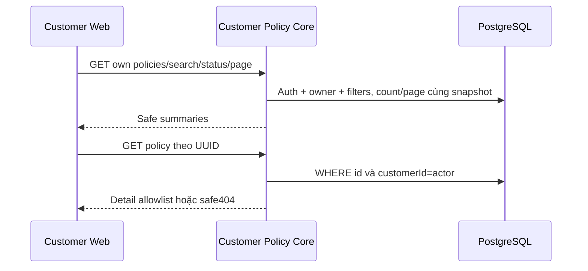

# PO01 — Customer policy list/detail Core

05/11/2026 · **Đã triển khai** · [C04](../04-policies-contract.md) · Tiếp: [PO02](02-policy-ui.md), [D01](../documents/01-owner-document-access.md).

## 1. Vị trí và scope

Triển khai tại `apps/core/src/policies/controllers/customer-policy.controller.ts`, tích hợp vào `PoliciesModule` và `PolicyService` (`ownerList`, `ownerDetail`). Xác thực session `CUSTOMER` → truy vấn `InsurancePolicy.customerId = actor.id`, kiểm tra quyền sở hữu nghiêm ngặt, không cho phép truyền `customerId` từ client để xem hợp đồng của người khác.

## 2. API spec đã triển khai

- `GET /api/v1/customers/me/policies?search=...&status=ACTIVE&page=1&pageSize=10`
  - Tìm kiếm theo `policyNumber`, `productCode`, `product.name`.
  - Lọc theo enum trạng thái: `ACTIVE`, `LAPSED`, `MATURED`, `PENDING`.
  - Phân trang chuẩn với `page`, `pageSize`, trả về `PolicyListResponseDto`.
  - Sort theo `createdAt DESC, id DESC`.
- `GET /api/v1/customers/me/policies/:policyId`
  - Đọc chi tiết hợp đồng sở hữu kèm `benefitsSnapshot` đã whitelist.
  - Trả về 404 an toàn nếu hợp đồng không tồn tại hoặc không thuộc quyền sở hữu của khách hàng đang đăng nhập.

## 3. Model và implementation

- Projection whitelist dữ liệu tài chính (decimal string chính xác, không ép về số 0 giả) và ngày tháng (YYYY-MM-DD).
- Parser `policy-snapshot.ts` đảm bảo an toàn snapshot, không phơi bày dữ liệu kỹ thuật nội bộ.
- Client API phía web: `ownPolicies`, `ownPolicyDetail` trong `apps/web/src/lib/policy-api.ts`.

## 4. Test và hoàn tất

Đã kiểm chứng qua bộ kiểm thử trình duyệt `apps/web/tests/browser/customer-policies.spec.mjs` (PO02-T01 đến PO02-T05).

- [x] Core controller và service methods cho quyền sở hữu Customer (`CustomerPolicyController`, `PolicyService.ownerList`, `PolicyService.ownerDetail`).
- [x] Swagger documentation được công bố tại `/api/docs`.
- [x] Client API `ownPolicies` và `ownPolicyDetail` kết nối Gateway hoạt động ổn định.
- [x] Không mở rộng quyền Staff hoặc rò rỉ dữ liệu ngoài phạm vi tài khoản khách hàng.
