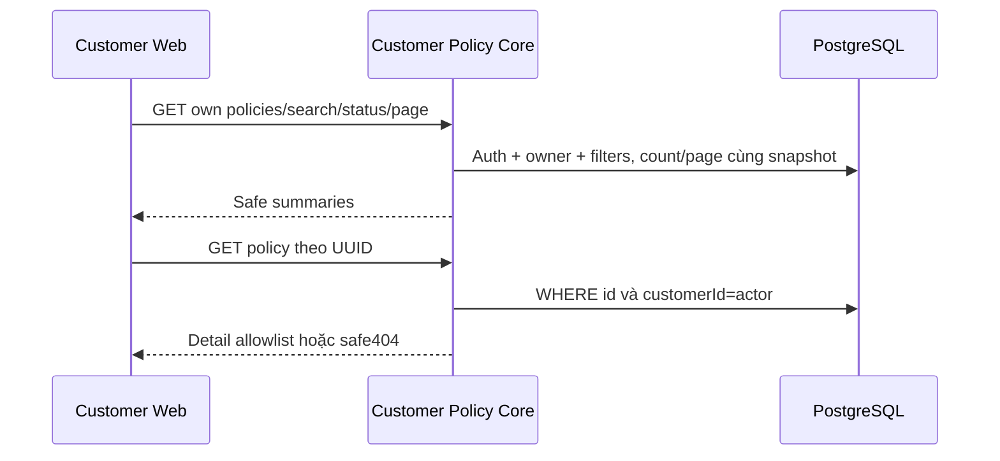

# PO01 — Customer policy list/detail Core

04/11/2026 · **P, chưa triển khai** · [C04](../04-policies-contract.md) · Tiếp: [PO02](02-policy-ui.md), [D01](../documents/01-owner-document-access.md).

## 1. Vị trí và scope

Đề xuất `apps/core/src/policies/controllers/customer-policy.controller.ts`, bổ sung owner methods/access helper vào module/service hiện có, DTO query riêng để không mở rộng nhầm Staff A14/A15. Không gọi Staff endpoint từ Customer Web. Trong read transaction: session CUSTOMER → InsurancePolicy.customerId=actor.id; không phụ thuộc assignment Staff. Không dùng body/query customerId, role hoặc policyNumber thay ownership.

## 2. API spec đề xuất

`GET /api/v1/customers/me/policies?search=...&status=ACTIVE&page=1&pageSize=10`

search trim0–100 literal case-insensitive trên policyNumber/productCode/product.name; không owner name/CCCD/PDF. status optional chỉ ACTIVE/LAPSED/MATURED/PENDING; không ALL enum. page≥1/default1, pageSize1–50/default10; query lạ400. Owner+search+status trước total/page, sort createdAt DESC,id DESC, cùng snapshot. Quota read đề xuất120/phút/actor shared nhóm Customer policy; chốt trước code.

Response `{items:[PolicySummaryDto],total,page,pageSize}`. Dùng projection whitelist cùng Staff: id/policyNumber/customerId/product/status/premiumAmount/paymentFrequency/nextDueDate/effectiveDate/expiryDate/sumAssured/currency. Decimal fixed2 strings/null, date YYYY-MM-DD/null; product gồm id/code/name/isActive/summary. Không trả raw benefitsSnapshot hoặc relation khách khác.

`GET /api/v1/customers/me/policies/:policyId` → `{policy:PolicyDetailDto}`: summary + own customer `{id,fullName,accountCode}` + benefitsSnapshot allowlist và benefitsSnapshotStatus AVAILABLE/NOT_PROVIDED/INVALID. Dùng `policy-snapshot.ts`, không đổi parser để phơi JSON documents/fixture metadata. Thiếu/ngoài owner cùng404; UUID sai400;401/403/429 theo common contract. Không include signed URLs/documents trong detail.

## 3. Model và implementation

Không migration mặc định. Tái dùng projection/snapshot parser thuần, nhưng tách caller auth/scope rõ: Staff active assignment, Customer owner. Nếu refactor read helper nhận role, controller không nhận role client và parity tests cả hai nhánh bắt buộc. Kiểm index `(customerId,createdAt,id)` và query plan trước thêm migration mới. Product isActive không là owner gate của hợp đồng đã phát hành.

## 4. Test và gate

Đề xuất `apps/core/test/customer-policies.test.cjs`, fixtures0/1/nhiều policy, hai Customer/hai Staff, inactiveproduct, null/invalidsnapshot, >2pages.

| ID | Case | Kỳ vọng |
| --- | --- | --- |
| PO01-T01 | Owner list/detail, Customer khác biết UUID | Owner200; người khác404, không tổng/leak |
| PO01-T02 | Chưa assignment/Staff locked | Owner policy vẫn xem được |
| PO01-T03 | Search/status/page và `%_\` | Scope trước filter/count/page, literal, sort ổn định |
| PO01-T04 | Null/invalidsnapshot/inactiveproduct/large decimal | Đúng kiểu, không raw JSON/lossy Number |
| PO01-T05 | Staff gọi Customer API, query lạ, expired | 403/400/401; Staff APIs vẫn giữ assignment gate |

- [ ] Core PostgreSQL/HTTP tests pass; Swagger E chỉ sau code thật.
- [ ] Không mở rộng quyền catalog/citation/Staff từ refactor; D01 access còn phase riêng.
