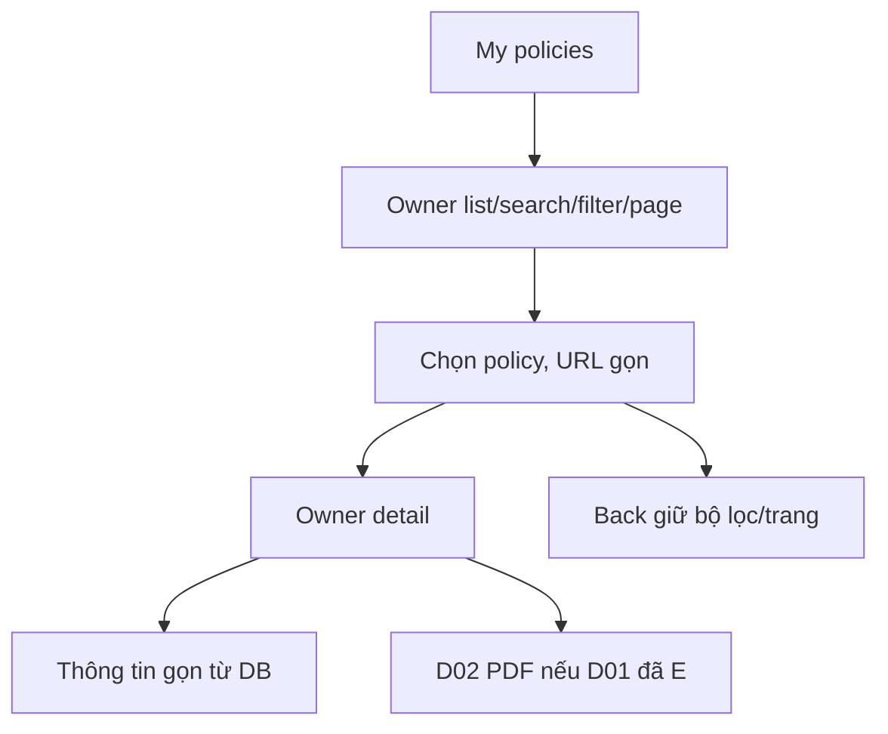
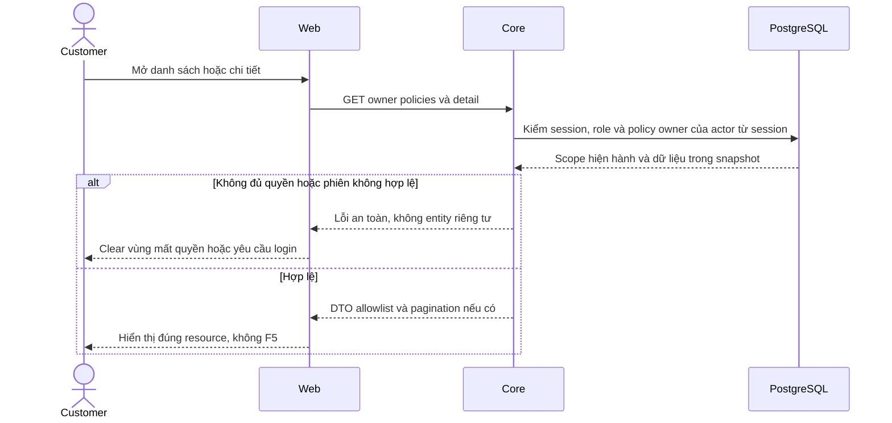

# PO02 — My policies list và detail

05/11/2026 · **Đã triển khai** · [C04](../04-policies-contract.md) · Cần H01, [PO01](01-owner-read-api.md).

## Data model và phạm vi ảnh hưởng

Bảng bên dưới mô tả tác động của phase, gồm cả ghi gián tiếp qua Core. Tên bảng thuộc schema `business` trừ nơi ghi rõ; cột còn đề xuất được đánh dấu **P**. Web không truy cập DB trực tiếp.

| Bảng/model | Cột hoặc dữ liệu liên quan | Thao tác của phase | Quan hệ/ràng buộc cần giữ | Mức ảnh hưởng và nơi bị tác động |
| --- | --- | --- | --- | --- |
| users + auth_sessions | users.id/role/status, auth_sessions.user_id/token_hash/expires_at/revoked_at | Đọc | AuthSession.user_id → User.id; session phải còn hạn, không bị thu hồi | Cao — mọi API dùng session; không trả token/hash trong DTO |
| insurance_policies + insurance_products | customer_id/product_id/policy_number/status, premium_amount/payment_frequency/next_due_date, effective_date/expiry_date/sum_assured/benefits_snapshot, product_code/name | Đọc | Policy.customer_id → CustomerProfile.user_id; product_id → InsuranceProduct.id; unique policy_number | Cao — DTO tiền/ngày/snapshot dùng chung Staff/Customer; không OCR PDF để cập nhật DB |

**Schema/migration:** Không migration trong UI; Web chỉ gọi API Core, không có DB credentials hoặc quyền ghi trực tiếp bảng.

**Nhất quán và hồi quy:** Owner filter customer_id=actor trước search/status/count/page; không lấy Staff assignment làm quyền Customer. Kiểm UUID khách khác/không tồn tại, decimal/null/ngày và late response sau đổi actor. Chọn policy không ghi conversations.linked_policy_id; kiểm route/back/search và missing/inactive relation.

## 1. File và API

Đề xuất `app/customer/policies/page.tsx`, `policies/[policyId]/page.tsx`, `components/customer-policies.tsx`, role-specific helpers trong `lib/policy-api.ts`. Dùng GET `/customers/me/policies` và `.../:policyId`, không Staff URL. Shared summary/formatter/viewer chỉ tách khi có nhu cầu thật; không copy toàn bộ Staff page rồi giữ field quyền Staff.

| Vị trí từ root repo | Hiện trạng | Trách nhiệm trong phase | Mức ảnh hưởng | Phạm vi cần kiểm lại |
| --- | --- | --- | --- | --- |
| [apps/web/src/components/customer-policies.tsx](<../../../../../apps/web/src/components/customer-policies.tsx>) | Hiện có | Own list/detail và selection | Trung bình | PDF tab và summary |
| [apps/web/src/app/customer/policies/page.tsx](<../../../../../apps/web/src/app/customer/policies/page.tsx>) | Hiện có | Policy route entry | Thấp | Customer shell |
| [apps/web/src/app/customer/policies/[policyId]/page.tsx](<../../../../../apps/web/src/app/customer/policies/[policyId]/page.tsx>) | Hiện có | Deep link detail | Trung bình | Core owner gate bắt buộc |
| [apps/web/src/lib/policy-api.ts](<../../../../../apps/web/src/lib/policy-api.ts>) | Hiện có | Owner wrappers, AbortSignal | Cao | Staff callers trong cùng client module |

## 2. Bố cục và hành vi

Danh sách dễ đọc: policyNumber, product, status, premium/frequency và nextDueDate nếu có; search theo PO01, filter đúng enum, pagination. Detail header mã/tên/status, thông tin cấu trúc thu gọn; vùng PDF chính do D02 khi D01 E. Không hai tab dài PDF/Policy information hoặc dropdown trộn mọi loại tài liệu. Tài liệu liên quan ở vùng riêng dưới viewer. Khi chỉ PO01 sẵn sàng, thông tin hợp đồng thật vẫn dùng được; không nút PDF giả.

URL search/status/page và policy path; Enter search hoặc một debounce rõ ràng, reset page 1 khi filter đổi, Back giữ state. Chọn policy không thay context chat. Null ghi Not provided; tiền format theo currency hợp lệ, không ghép VND hai lần hoặc mặc định0. Không gọi là paid/overdue chỉ từ ngày; status labels Active/Lapsed/Matured/Pending.

401/404 clear detail/iframe,503 retry vùng; list/error không đánh đồng empty. Abort/generation guard theo actor/policy/query, không stale restore. Mobile list→detail, focus heading/Back và list restoration phù hợp, không F5 hoặc remount cả shell.

## 3. Test cases

Các ca dưới đây là **đặc tả kiểm thử**, không phải báo cáo kết quả. Kiểm từng lớp API/service/DB/browser đúng nhãn; mock UI không thay kiểm quyền Core hoặc E2E thật.

**Quy ước dữ liệu:** S-A/S-B là hai Staff synthetic; C-A/C-B là hai Customer synthetic khác nhau. Thay alias bằng UUID/token của fixture cô lập; các path HTTP dùng prefix /api/v1 nếu chưa ghi đầy đủ. Chỉ thay assignment, khóa account, inject lỗi hoặc migration trong harness/môi trường test, không trên tài khoản/dữ liệu đang sử dụng.

### PO02-T01 — Search/page/detail/Back

**Lớp kiểm thử:** Browser.
**Điều kiện và dữ liệu:** C-A có hơn10 policies; C-Z không có policy.

**Các bước:**

1. Trong My Policies search mã, lọc status và đổi trang.
2. Mở detail rồi Back.
3. Lặp với C-Z.

**Kết quả mong đợi:** URL/filter/page khôi phục, không F5; empty state hữu ích, không hợp đồng giả.

### PO02-T02 — Hiển thị số tiền và ngày

**Lớp kiểm thử:** Browser + API mock.
**Điều kiện và dữ liệu:** Policy có decimal lớn/null/date-only và currency VND.

**Các bước:**

1. Mở detail.
2. Đối chiếu premium/sum assured/date với response.
3. Đổi selection sang policy khác có field null.

**Kết quả mong đợi:** Không nhân đôi đơn vị, mất số lẻ hoặc lệch ngày; null có nhãn thiếu dữ liệu, không hiện giá trị của policy trước.

### PO02-T03 — Owner denied và race selection

**Lớp kiểm thử:** Browser + API barrier.
**Điều kiện và dữ liệu:** Giữ detail PolicyA; PolicyB được chọn sau; có UUID C-B ngoài owner.

**Các bước:**

1. Cho B trả trước A.
2. Mở deep link policy C-B.
3. Cho session 401 khi detail pending.

**Kết quả mong đợi:** Không response cũ ghi đè selection;404 không preview/dữ liệu stale;401 clear và login.

### PO02-T04 — PDF không khả dụng và mobile

**Lớp kiểm thử:** Browser + API mock.
**Điều kiện và dữ liệu:** Summary policy tải được nhưng catalog/PDF có biến thể rỗng/503; viewport 375px.

**Các bước:**

1. Mở summary rồi vùng PDF.
2. Retry lỗi PDF.
3. Tab/zoom 200% và Back.

**Kết quả mong đợi:** Summary vẫn dùng được, không false PDF; retry/no-F5; labels/controls không overflow.

**Suite tham khảo:** [customer-policies.spec.mjs](../../../../../apps/web/tests/browser/customer-policies.spec.mjs). Tên suite là vị trí tự động hóa, không phải chứng nhận các ca đã chạy.

**Checklist chức năng liên quan** (giữ trạng thái triển khai, không phải kết quả của lần sửa tài liệu):

- [x] C04 cập nhật read UI (`CustomerPolicies`, `CustomerPolicyDetail`), tích hợp xem và tải PDF thật qua MinIO presigned URL.

**Dọn sau kiểm thử:** xóa đúng fixture/session/object/schema theo runId; phục hồi fault injection và đóng context/socket test. Không reset DB/credential, sửa bootstrap hoặc xóa volumes. Với PDF kiểm metadata/bytes/hash; với UI kiểm DOM/focus/network, không cần screenshot.

## Sequence diagram

Luồng chính và nhánh quyền/lỗi; test case ở trên chỉ rõ dữ liệu và điểm kiểm tương ứng.

