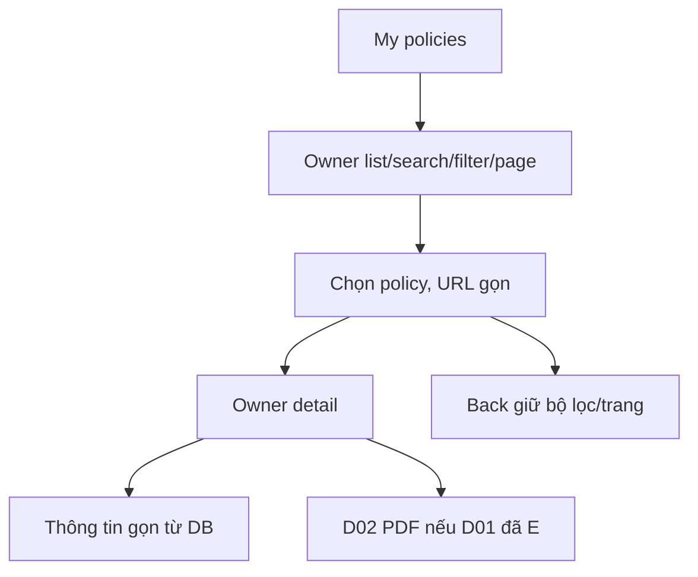

# PO02 — My policies list và detail

04/11/2026 · **Chưa triển khai** · [C04](../04-policies-contract.md) · Cần H01, [PO01](01-owner-read-api.md).

## 1. File và API

Đề xuất `app/customer/policies/page.tsx`, `policies/[policyId]/page.tsx`, `components/customer-policies.tsx`, role-specific helpers trong `lib/policy-api.ts`. Dùng GET `/customers/me/policies` và `.../:policyId`, không Staff URL. Shared summary/formatter/viewer chỉ tách khi có nhu cầu thật; không copy toàn bộ Staff page rồi giữ field quyền Staff.

## 2. Bố cục và hành vi

Danh sách dễ đọc: policyNumber, product, status, premium/frequency và nextDueDate nếu có; search theo PO01, filter đúng enum, pagination. Detail header mã/tên/status, thông tin cấu trúc thu gọn; vùng PDF chính do D02 khi D01 E. Không hai tab dài PDF/Policy information hoặc dropdown trộn mọi loại tài liệu. Tài liệu liên quan ở vùng riêng dưới viewer. Khi chỉ PO01 sẵn sàng, thông tin hợp đồng thật vẫn dùng được; không nút PDF giả.

URL search/status/page và policy path; Enter search hoặc một debounce rõ ràng, reset page1 khi filter đổi, Back giữ state. Chọn policy không thay context chat. Null ghi Not provided; tiền format theo currency hợp lệ, không ghép VND hai lần hoặc mặc định0. Không gọi là paid/overdue chỉ từ ngày; status labels Active/Lapsed/Matured/Pending.

401/404 clear detail/iframe,503 retry vùng; list/error không đánh đồng empty. Abort/generation guard theo actor/policy/query, không stale restore. Mobile list→detail, focus heading/Back và list restoration phù hợp, không F5 hoặc remount cả shell.

## 3. Test và hoàn tất

Đề xuất `apps/web/tests/browser/customer-policies.spec.mjs`, gateway E2E owner flow cùng D02.

| ID | Case | Kỳ vọng |
| --- | --- | --- |
| PO02-T01 | 0/1/nhiều policy, search/status/page2→detail→Back | Đúng owner/state, không F5 |
| PO02-T02 | Null/currency/large decimals/dates | Không0 giả, mất chính xác, trùng đơn vị hoặc lệch ngày |
| PO02-T03 | UUID Customer khác, rapid switch, expired | Safe404/401, không stale detail |
| PO02-T04 | PO01 có nhưng D01 chưa E/storage fail | Summary dùng được, không nút hỏng/falsePDF |
| PO02-T05 | Keyboard/375px/200%zoom | Không tràn; labels/focus/scroll đúng |

- [ ] PO01 thật, browser/E2E pass; Staff Policy Lookup không đổi.
- [ ] C04 cập nhật riêng read UI, C05 chưa xong nếu chưa có xem/tải PDF thật.
