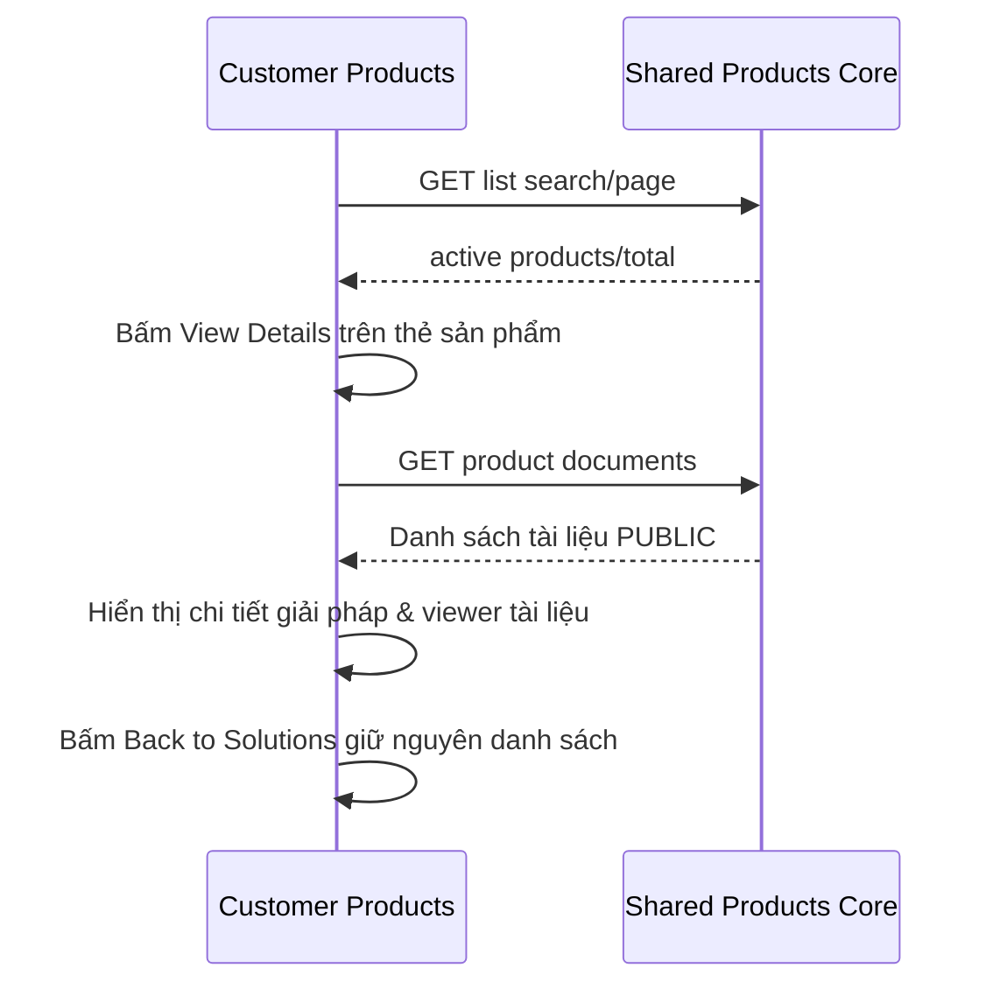

# PR01 — Customer catalog và chi tiết sản phẩm

05/11/2026 · **Đã triển khai** · [C03](../03-products-contract.md) · Cần H01, [Staff P01](../../../staff/plans/products/01-catalog-read-api.md).

## 1. File và UI

Triển khai tại `apps/web/src/components/customer-products.tsx`, tích hợp trong `CustomerWorkspace` (`app/customer/page.tsx`). Sử dụng client API `lib/product-api.ts` dùng chung.

Bố cục giao diện:
- **Danh sách giải pháp**:
  - Tiêu đề: *Explore Insurance Solutions*.
  - Ô tìm kiếm: Nhập tên giải pháp hoặc mã code (`DEV-CARE-01`, `DEV-LIFE-01`,...).
  - Thẻ sản phẩm: Monospace badge mã sản phẩm, nhãn trạng thái *Available Protection*, tên giải pháp và tóm tắt quyền lợi.
  - Thao tác: Toàn bộ thẻ có hiệu ứng hover bấm mở chi tiết, kèm nút hành động **`View Details →`**.
  - Đã loại bỏ nút *Request Quote from Advisor →* tự động mở chat; khách hàng chủ động vào tab Conversations khi có nhu cầu.
- **Màn hình chi tiết sản phẩm**:
  - Nút **`← Back to Solutions`** ở đầu trang giúp quay lại danh sách nhanh chóng mà không reload F5.
  - Header chi tiết: Mã code, nhãn chứng nhận *Certified AegisLife Product*, tiêu đề lớn và phần mô tả đầy đủ.
  - Bảng thông số: Plan Category (*Life & Health Protection*), Product Code, Contract Format (*Paperless Electronic Policy*), Currency (*VND*).

## 2. API và luồng dữ liệu

Dùng endpoint dùng chung: `GET /products?search=&page=1&pageSize=10` và `GET /products/:productId/documents`.
- Debounce tìm kiếm 200ms với AbortController chống race conditions.
- Loading indicator, thông báo lỗi rõ ràng và empty state khi không tìm thấy kết quả.

## 3. Checklist hoàn tất

- [x] Shared API catalog hoạt động trên session Customer.
- [x] Không ép luồng chat khi xem sản phẩm; cho phép khách hàng xem chi tiết đầy đủ tại chỗ.
- [x] Hỗ trợ tìm kiếm, chuyển đổi list/detail mượt mà không reload trang.
- [x] Giao diện responsive từ mobile 375px đến desktop.
