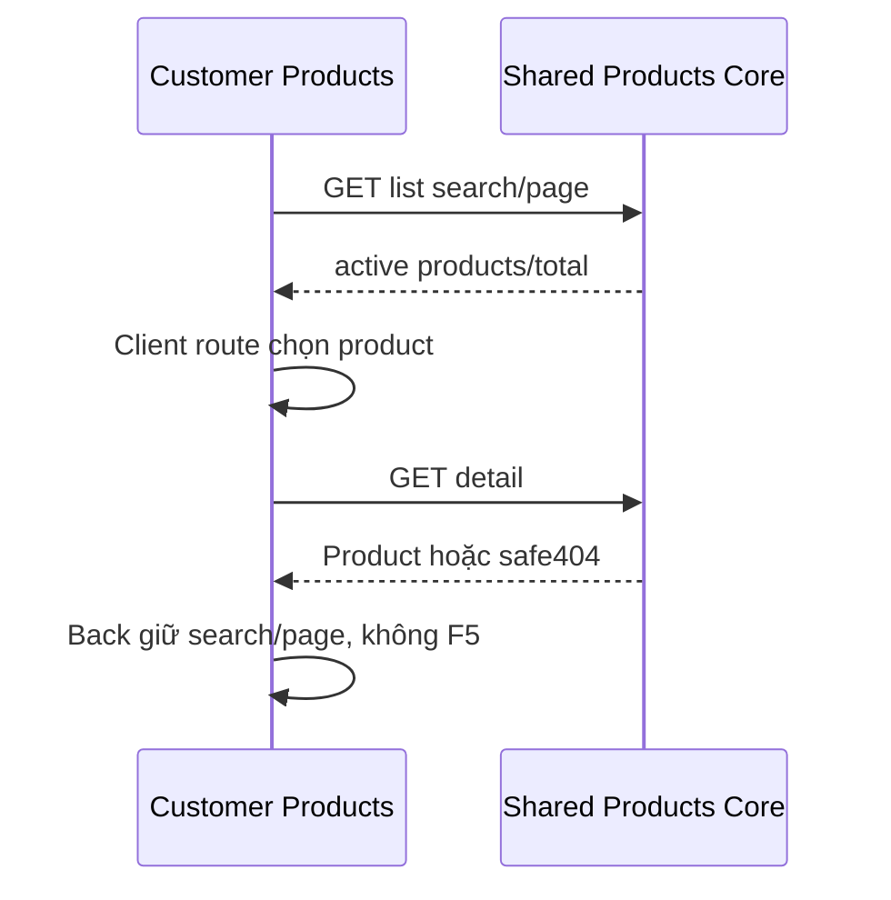

# PR01 — Customer catalog và chi tiết sản phẩm

04/11/2026 · **Chưa triển khai** · [C03](../03-products-contract.md) · Cần H01, [Staff P01](../../../staff/plans/products/01-catalog-read-api.md).

## 1. File và UI

Đề xuất routes `app/customer/products/page.tsx`, `products/[productId]/page.tsx`; components `customer-products.tsx`, API `lib/product-api.ts` dùng chung Staff. Card/list nhẹ tên/mã/summary, detail đọc thuận mắt có khoảng trắng, một CTA mở tài liệu. Dùng tokens Staff/Tailwind `tw:`/Lexend, không nhét badge/gradient/charts thiếu dữ liệu. Không nút Buy/Apply/AI advice từ mẫu UI.

## 2. API/state

A17 **E từ P01**: GET `/products?search=&page=1&pageSize=10` → `{items,total,page,pageSize}`; GET `/products/:productId` → `{product}`. Search chỉ name/code, không full PDF hoặc quyền lợi cá nhân. Auth session Customer; endpoint chấp nhận hai role do P01 quy định. Phase PR01 UI vẫn chưa triển khai.

URL lưu search/page và product path, Back giữ query; Enter tìm hoặc debounce300ms nếu chọn cơ chế đó trước code, không hai request cho cùng hành động. Abort/generation chống response cũ; page reset1 khi search đổi. Loading đầu, refresh nền, no-results, inactive404 và summary null rõ. Page vượt cuối sau refetch điều chỉnh một lần theo total, không loop. 401 clear và login,429 chờ/retry; lỗi list không giả kết quả trống.

## 3. Luồng

## 4. Test và hoàn tất

Đề xuất `apps/web/tests/browser/customer-products.spec.mjs`; Core authorization do P01, gateway E2E dùng catalog thật đã chuẩn bị bởi harness.

| ID | Case | Kỳ vọng |
| --- | --- | --- |
| PR01-T01 | Search code/tên, Enter, page2→detail→Back | URL/results đúng, không document reload |
| PR01-T02 | Search nhanh, response cũ muộn, inactive giữa list/detail | Không stale overwrite,404 có lối quay lại |
| PR01-T03 | Null/empty/401/429/offline | Phân biệt trạng thái và retry đúng vùng |
| PR01-T04 | Keyboard,375px,zoom200% | List/detail/heading/focus đọc được |

- [ ] Shared API thật, no runtime mock; test browser và E2E phân biệt.
- [ ] Không sửa model hoặc private policy service từ UI catalog; PR02 còn riêng.
