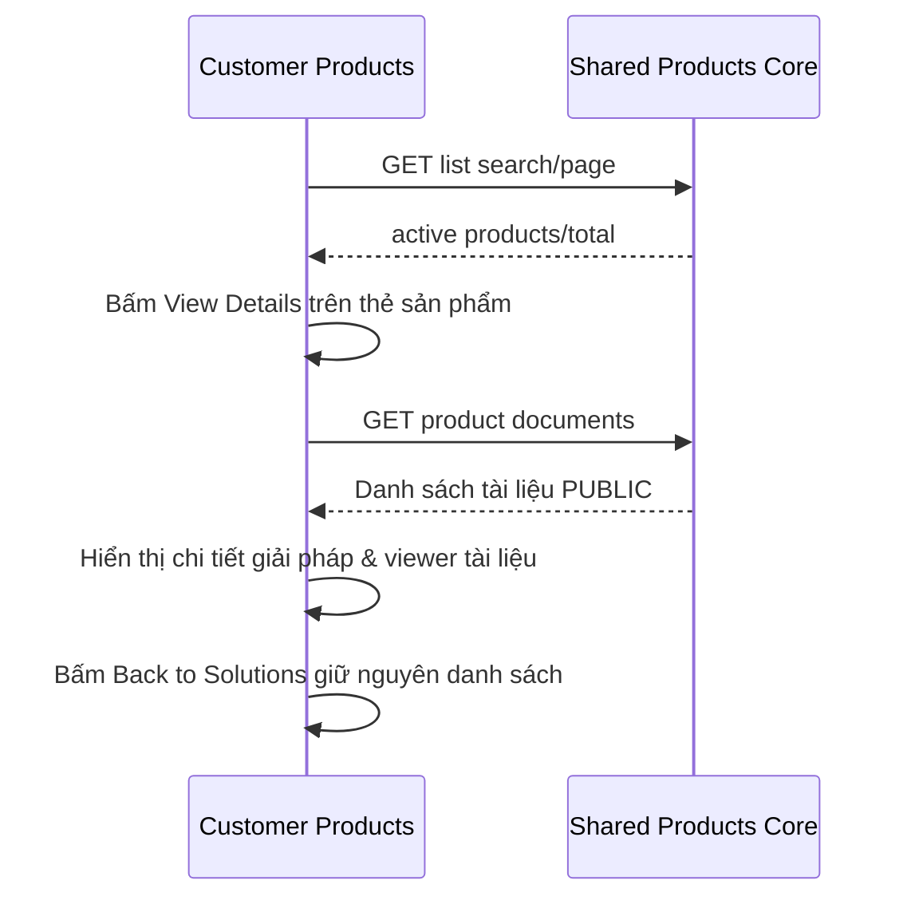

# PR01 — Customer catalog và chi tiết sản phẩm

05/11/2026 · **Đã triển khai** · [C03](../03-products-contract.md) · Cần H01, [Staff P01](../../../staff/plans/products/01-catalog-read-api.md).

## Data model và phạm vi ảnh hưởng

Bảng bên dưới mô tả tác động của phase, gồm cả ghi gián tiếp qua Core. Tên bảng thuộc schema `business` trừ nơi ghi rõ; cột còn đề xuất được đánh dấu **P**. Web không truy cập DB trực tiếp.

| Bảng/model | Cột hoặc dữ liệu liên quan | Thao tác của phase | Quan hệ/ràng buộc cần giữ | Mức ảnh hưởng và nơi bị tác động |
| --- | --- | --- | --- | --- |
| users + auth_sessions | users.id/role/status, auth_sessions.user_id/token_hash/expires_at/revoked_at | Đọc | AuthSession.user_id → User.id; session phải còn hạn, không bị thu hồi | Cao — mọi API dùng session; không trả token/hash trong DTO |
| insurance_products | id/product_code/name/summary/is_active | Đọc | Unique product_code; chỉ catalog active, không sửa hợp đồng đã tham gia khi sản phẩm inactive | Trung bình — catalog và tài liệu dùng chung hai role |
| rate_limit_buckets | client_token/endpoint_group/window_start/request_count/blocked_until | Ghi phụ trợ khi endpoint áp quota | PK (client_token,endpoint_group); tăng atomic, giới hạn theo actor/nhóm endpoint | Trung bình — quota có thể ghi dù nghiệp vụ bị từ chối; không log định danh nhạy cảm |

**Schema/migration:** Không migration trong UI; Web chỉ gọi API Core, không có DB credentials hoặc quyền ghi trực tiếp bảng.

**Nhất quán và hồi quy:** Products chỉ PUBLIC/current, không tạo policy/quote/Ticket khi chọn tài liệu. Core P01/P02 dùng chung Staff; kiểm active/inactive, search, cursor/current version, missing PDF và không lẫn policy private.

## 1. File và UI

Triển khai tại `apps/web/src/components/customer-products.tsx`, tích hợp trong `CustomerWorkspace` (`app/customer/page.tsx`). Sử dụng client API `lib/product-api.ts` dùng chung.

Bố cục giao diện:
- **Danh sách giải pháp**:
  - Tiêu đề: *Explore Insurance Solutions*.
  - Ô tìm kiếm: Nhập tên giải pháp hoặc mã code (`DEV-CARE-01`, `DEV-LIFE-01`,...).
  - Thẻ sản phẩm: Monospace badge mã sản phẩm, nhãn trạng thái *Available Protection*, tên giải pháp và tóm tắt quyền lợi.
  - Thao tác: Toàn bộ thẻ có hiệu ứng hover bấm mở chi tiết, kèm nút hành động **`View Details →`**.
  - Đã loại bỏ nút *Request Quote from Advisor →* tự động mở chat; khách hàng chủ động vào tab Conversations khi có nhu cầu.
- **Màn hình chi tiết sản phẩm**:
  - Nút **`← Back to Solutions`** ở đầu trang giúp quay lại danh sách nhanh chóng mà không reload F5.
  - Header chi tiết: Mã code, nhãn chứng nhận *Certified AegisLife Product*, tiêu đề lớn và phần mô tả đầy đủ.
  - Bảng thông số: Plan Category (*Life & Health Protection*), Product Code, Contract Format (*Paperless Electronic Policy*), Currency (*VND*).

| Vị trí từ root repo | Hiện trạng | Trách nhiệm trong phase | Mức ảnh hưởng | Phạm vi cần kiểm lại |
| --- | --- | --- | --- | --- |
| [apps/web/src/components/customer-products.tsx](<../../../../../apps/web/src/components/customer-products.tsx>) | Hiện có | Catalog/detail và document selection Customer | Trung bình | Customer shell và tự mở PDF |
| [apps/web/src/lib/product-api.ts](<../../../../../apps/web/src/lib/product-api.ts>) | Hiện có | Dùng chung P01/P02 API client | Cao | Staff Products và publication DTO |
| [apps/web/src/components/signed-pdf-preview.tsx](<../../../../../apps/web/src/components/signed-pdf-preview.tsx>) | Hiện có | Shared preview/download, dùng khi mở tài liệu | Cao | Hai role/policy viewer |
| [apps/core/src/products/services/product-document.service.ts](<../../../../../apps/core/src/products/services/product-document.service.ts>) | Hiện có | Publication/access backend dùng lại, không clone service Customer | Cao | Current PUBLIC policy của Staff giữ nguyên |

## 2. API và luồng dữ liệu

Dùng endpoint dùng chung: `GET /products?search=&page=1&pageSize=10` và `GET /products/:productId/documents`.
- Debounce tìm kiếm 200ms với AbortController chống race conditions.
- Loading indicator, thông báo lỗi rõ ràng và empty state khi không tìm thấy kết quả.

## 3. Checklist hoàn tất

- [x] Shared API catalog hoạt động trên session Customer.
- [x] Không ép luồng chat khi xem sản phẩm; cho phép khách hàng xem chi tiết đầy đủ tại chỗ.
- [x] Hỗ trợ tìm kiếm, chuyển đổi list/detail mượt mà không reload trang.
- [x] Giao diện responsive từ mobile 375px đến desktop.

## Test cases

Các ca dưới đây là **đặc tả kiểm thử**, không phải báo cáo kết quả. Kiểm từng lớp API/service/DB/browser đúng nhãn; mock UI không thay kiểm quyền Core hoặc E2E thật.

**Quy ước dữ liệu:** S-A/S-B là hai Staff synthetic; C-A/C-B là hai Customer synthetic khác nhau. Thay alias bằng UUID/token của fixture cô lập; các path HTTP dùng prefix /api/v1 nếu chưa ghi đầy đủ. Chỉ thay assignment, khóa account, inject lỗi hoặc migration trong harness/môi trường test, không trên tài khoản/dữ liệu đang sử dụng.

### PR01-T01 — Search và View Details

**Lớp kiểm thử:** Browser.
**Điều kiện và dữ liệu:** Catalog có nhiều sản phẩm active, mã sản phẩm ở trang sau.

**Các bước:**

1. Mở Products, nhập tên/mã vào search và đợi debounce hiện hành.
2. Bấm View Details.
3. Back to Solutions.

**Kết quả mong đợi:** Kết quả đúng toàn catalog theo API, details đúng sản phẩm; không ép chat, giữ danh sách/query khi Back.

### PR01-T02 — Response về muộn không đổi sản phẩm

**Lớp kiểm thử:** Browser + API barrier.
**Điều kiện và dữ liệu:** Giữ response sản phẩm P1; P2 có metadata khác.

**Các bước:**

1. Mở P1 rồi nhanh chóng chọn P2.
2. Trả P2 trước và P1 sau.
3. Quan sát title/documents.

**Kết quả mong đợi:** P1 không ghi đè P2; request cũ bị abort/bỏ và không reset selection.

### PR01-T03 — Empty, inactive và retry

**Lớp kiểm thử:** Browser + API mock.
**Điều kiện và dữ liệu:** Biến thể search không kết quả, detail 404 và catalog 503.

**Các bước:**

1. Search token không tồn tại.
2. Mở deep link sản phẩm inactive.
3. Cho catalog lỗi rồi Try again.

**Kết quả mong đợi:** Empty/404/network có trạng thái khác nhau; không thẻ sản phẩm giả; retry tại chỗ, không F5.

### PR01-T04 — Customer scope và responsive

**Lớp kiểm thử:** Browser + Network.
**Điều kiện và dữ liệu:** Customer session hợp lệ, viewport 375px.

**Các bước:**

1. Kiểm chỉ gọi shared Products APIs, không Staff customer APIs.
2. Dùng Tab qua card/details/back ở zoom 200%.
3. Logout khi detail pending.

**Kết quả mong đợi:** Controls không tràn, focus hợp lệ; response cũ không khôi phục state sau logout.

**Dọn sau kiểm thử:** xóa đúng fixture/session/object/schema theo runId; phục hồi fault injection và đóng context/socket test. Không reset DB/credential, sửa bootstrap hoặc xóa volumes. Với PDF kiểm metadata/bytes/hash; với UI kiểm DOM/focus/network, không cần screenshot.
