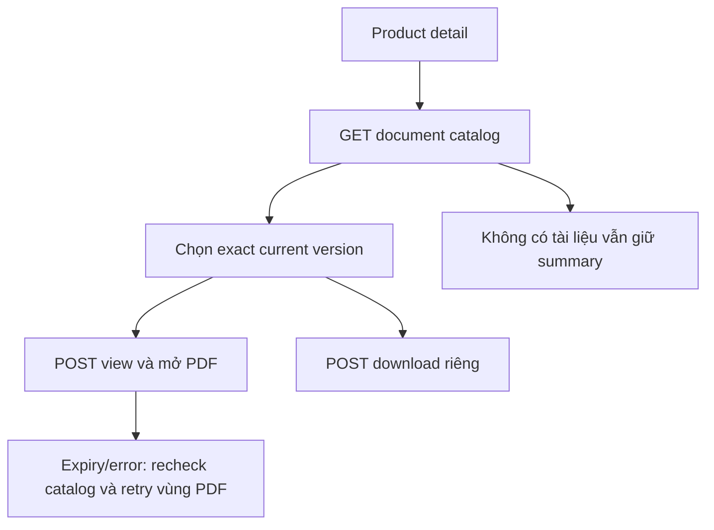

# PR02 — Tài liệu sản phẩm PUBLIC trên Customer

05/11/2026 · **Đã triển khai** · [C03](../03-products-contract.md) · Cần PR01, [Staff P02](../../../staff/plans/products/02-document-access.md).

## 1. API và data

- Tải danh sách tài liệu: `GET /products/:productId/documents?limit=20&cursor=...`
- Cấp quyền đọc/tải PDF: `POST /products/:productId/documents/:documentId/versions/:versionId/view|download` kèm CSRF token và Origin header.
- Endpoint dùng chung giữa Staff và Customer; chỉ áp dụng cho tài liệu PUBLIC thuộc sản phẩm đang hoạt động.

## 2. File và UI

Tích hợp trực tiếp vào màn hình chi tiết sản phẩm trong `apps/web/src/components/customer-products.tsx`:
- Sử dụng component `SignedPdfPreview` (`signed-pdf-preview.tsx`).
- Bộ chọn phiên bản/tài liệu: Cho phép khách hàng chọn giữa các tài liệu công bố (Quy tắc và điều khoản, Tài liệu giới thiệu sản phẩm).
- Bản xem trước PDF trực tiếp trong portal kèm nút Tải PDF riêng biệt.
- Xử lý trạng thái tài liệu chưa phát hành hoặc không khả dụng an toàn, không làm hỏng thông tin chi tiết của sản phẩm.

## 3. Checklist hoàn tất

- [x] Tích hợp `readProductDocuments` và `SignedPdfPreview` vào màn hình chi tiết sản phẩm phía Customer.
- [x] Xem trực tiếp và tải về bản PDF chính thức đã được chứng thực.
- [x] Hiển thị thông báo thân thiện khi sản phẩm chưa có tài liệu đính kèm.
- [x] Kiểm tra bảo mật và quyền truy cập: không thể truy cập tài liệu Private hoặc tài liệu của sản phẩm khác.
